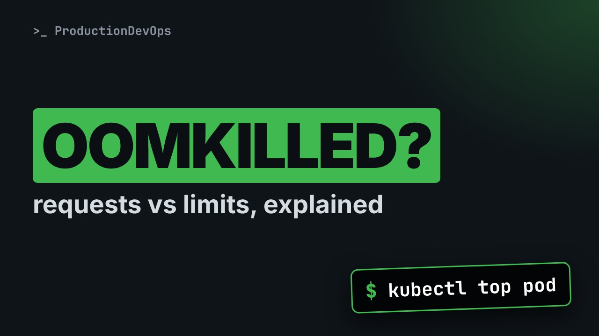
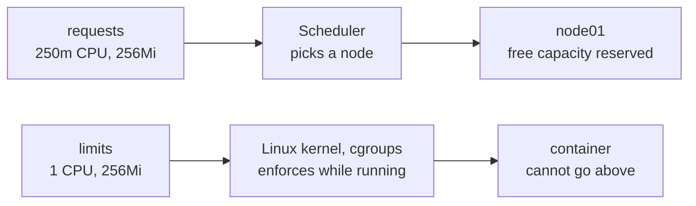

# Kubernetes Requests vs Limits: Why Pods Get OOMKilled (and Throttled)



**Video:** https://youtu.be/nXlzXlAA7dw

A pod restarts with OOMKilled and exit code 137, another service is slow while the node is idle. Both come from two blocks in your YAML: requests and limits. We see what each one really controls, why memory kills and CPU only slows down, how QoS classes decide who is evicted first, and how to pick starting values from measured usage instead of a guess.

## Files in this folder

- [`worker.yaml`](worker.yaml)

## What you need

A Kubernetes cluster you can break: a local [kind](https://kind.sigs.k8s.io/) cluster with one control plane and two workers is what the video uses, plus `kubectl`. Never run these commands against a cluster that matters.

The outputs below were captured for real on the lab cluster. On yours, names, ages, IPs and ports will differ; everything else should match.

## The lesson, step by step

The same explanations as the video, with every command and its real output. Read it, then run it yourself.

A pod keeps restarting with OOMKilled. Another service is slow, while the node is almost idle. Both problems come from two small blocks in your YAML: requests and limits.

### The plan

Here is the plan. First, we look at a pod that gets OOMKilled. Then, requests and limits: who uses each one, and when. Why going over the memory limit kills, while going over the CPU limit only slows down. And finally, QoS classes, and how to pick starting values that are not a guess.

### The symptom

A worker that builds reports has restarted three times.

```console
$ kubectl get pods -l app=report-worker
NAME                             READY   STATUS      RESTARTS      AGE
report-worker-6d8f7c9b54-x7k2m   0/1     OOMKilled   3 (52s ago)   6m12s
```

As in the previous video, describe tells us how the last run ended.

```console
$ kubectl describe pod report-worker-6d8f7c9b54-x7k2m | grep -A3 'Last State'
Last State:     Terminated
  Reason:       OOMKilled
  Exit Code:    137
  Started:      Tue, 24 Nov 2026 09:41:07 +0100
```

Reason OOMKilled, exit code one three seven. The container used more memory than it was allowed, and the kernel killed it.

### Requests and limits

This is the container in the Deployment. The part that matters is called resources.

```
containers:
  - name: worker
    image: registry.example.com/acme/report-worker:1.8
    resources:
      requests:
        cpu: 250m
        memory: 256Mi
      limits:
        cpu: "1"
        memory: 256Mi
```

Requests: what the container asks for. Two hundred fifty m is a quarter of a CPU core. Two hundred fifty six Mi is two hundred fifty six mebibytes of memory. Limits: the maximum it is allowed to use. One full core, and again two hundred fifty six mebibytes. Two numbers, read by two different parts of Kubernetes.

**Requests schedule, limits enforce**



Requests are read by the scheduler, once, to choose a node with enough free capacity. It is a reservation, not a cap. Limits are enforced by the Linux kernel, all the time, while the container runs.

### Memory kills, CPU slows

What happens when a container reaches its limit depends on the resource. Memory cannot be taken back from a running process. So at the memory limit, the kernel kills it. That is the OOMKilled, exit code one three seven, and a restart. CPU time can be shared out. So at the CPU limit, the process is only paused for a moment. This is called throttling. Throttling never appears in the logs. You only see it as slow responses.

### Measure first

Before changing numbers, we measure. kubectl top shows current usage, from the metrics server.

```console
$ kubectl top pod -l app=report-worker
NAME                             CPU(cores)   MEMORY(bytes)
report-worker-6d8f7c9b54-x7k2m   212m         249Mi
```

Two hundred forty nine mebibytes, right under the limit. But this is a sample, taken every few seconds. It can miss the peak that triggers the kill. In this lab, the worker peaks at about four hundred mebibytes on a large report. Your monitoring over a few days of real traffic gives you that number.

### QoS classes

When a node runs short of memory, Kubernetes evicts pods. The order follows three quality of service classes. Guaranteed: every container has requests equal to limits, for both CPU and memory. Evicted last. Burstable: some requests or limits are set, but not equal. Evicted after best effort, starting with pods that use more than they requested. Best effort: no requests and no limits at all. Evicted first. Our worker is burstable, because its CPU request and limit differ. Kubernetes writes the class in the pod status, in the field q o s class.

### Starting values

So how do you choose the numbers? A simple method that works for most services. Measure first, under real load, over a few days. Not a one minute test. Memory: request close to normal use. Limit at the peak, plus some headroom, for example twenty five percent. CPU: request close to normal use. We come back to CPU limits in a moment. Then review after a week, and adjust. These are starting values, not final ones.

### The fix

```
containers:
  - name: worker
    image: registry.example.com/acme/report-worker:1.8
    resources:
      requests:
        cpu: 250m
        memory: 384Mi
      limits:
        cpu: "1"
        memory: 512Mi
```

The memory request goes to three hundred eighty four mebibytes, close to normal use on busy days. The memory limit goes to five hundred twelve. That is the four hundred peak, plus about twenty five percent.

We apply the file, and Kubernetes rolls out a new pod.

```console
$ kubectl apply -f worker.yaml
deployment.apps/report-worker configured
```

An hour later, after the large reports ran: zero restarts.

```console
$ kubectl get pods -l app=report-worker
NAME                             READY   STATUS    RESTARTS   AGE
report-worker-7b5c9d8f66-p4n8w   1/1     Running   0          63m
```

And usage during a large report stays well under the new limit.

```console
$ kubectl top pod -l app=report-worker
NAME                             CPU(cores)   MEMORY(bytes)
report-worker-7b5c9d8f66-p4n8w   305m         402Mi
```

### Gotchas

One. Limits copied from another service are a guess. They fit a different app, with a different load. Two. No requests at all makes the pod best effort. The scheduler packs it blindly, and it is evicted first. Three. CPU limits on services where response time matters. Let's see why.

An API with a CPU limit of half a core is slow, while the node is almost idle. The kernel keeps CPU counters inside the container.

```console
$ kubectl exec deploy/api -- cat /sys/fs/cgroup/cpu.stat
usage_usec 8423190211
user_usec 7310288104
system_usec 1112902107
nr_periods 1204833
nr_throttled 318442
throttled_usec 21894021337
nr_bursts 0
burst_usec 0
```

Time is split into short periods, usually one tenth of a second. nr periods counts them. nr throttled counts the periods where the container hit its limit and had to wait. Here, about one period in four was throttled. Each one adds delay to a request, even with free CPU on the node.

So what should you do with CPU limits? Always set a CPU request. When CPU is scarce, it is shared in proportion to requests. For latency sensitive services, many teams set no CPU limit, or a generous one. Keep strict CPU limits where you must cap usage, like noisy batch jobs.

### Recap

Let's recap. Requests are for scheduling. Limits are enforced at run time. Over the memory limit: OOMKilled, exit code one three seven. At the CPU limit: throttling. Check the cpu dot stat counters. And size from measured usage, then review.

Requests schedule, limits enforce. Next in the series: liveness, readiness and startup probes. Subscribe so you don't miss it.

## All the commands, to copy

Run them from inside this folder, in this order.

```bash
kubectl get pods -l app=report-worker
kubectl describe pod report-worker-6d8f7c9b54-x7k2m | grep -A3 'Last State'
kubectl top pod -l app=report-worker
kubectl apply -f worker.yaml
kubectl exec deploy/api -- cat /sys/fs/cgroup/cpu.stat
```

---

From the [ProductionDevOps](https://www.youtube.com/@production-devops) channel: real-world DevOps and SRE, explained with real commands.
