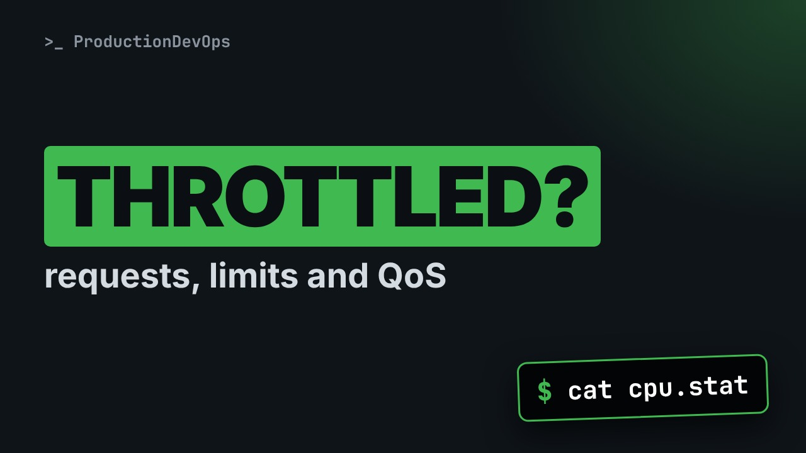

# Kubernetes Requests, Limits and QoS: Throttling, OOM and Eviction



**Video:** coming soon on the [channel](https://www.youtube.com/@production-devops).

A Pod with a CPU limit never crashes: it just gets slow, and nothing in the logs says why. We read requests and limits from both sides on a real cluster: the scheduler's budget on each node, a Pod that asks for too much and stays Pending, CPU throttling measured from inside the container's cgroup, the memory ceiling the kernel enforces, and the three QoS classes that decide who is killed or evicted first. Lesson 6 of Kubernetes Deep Dive.

## Files in this folder

- [`huge.yaml`](huge.yaml)
- [`qos.yaml`](qos.yaml)
- [`spin.yaml`](spin.yaml)
- [`challenge-solution.sh`](challenge-solution.sh) (solution of the challenge: try it yourself first)

## What you need

A Kubernetes cluster you can break: a local [kind](https://kind.sigs.k8s.io/) cluster with one control plane and two workers is what the video uses, plus `kubectl`. Never run these commands against a cluster that matters.

The outputs below were captured for real on the lab cluster. On yours, names, ages, IPs and ports will differ; everything else should match.

## The lesson, step by step

The same explanations as the video, with every command and its real output. Read it, then run it yourself.

A Pod with a CPU limit never crashes. It just gets slow, and the logs say nothing. Today we measure that, and at the end we see who the kernel kills first.

### The plan

Lesson six of Kubernetes Deep Dive. Two numbers, two readers. A node's budget, and a Pod that never fits. Throttling, measured. And QoS classes.

### Two readers

Each container can set requests and limits, for CPU and memory. The scheduler reads requests, and places a Pod where they fit. Limits become a cgroup, enforced by the kernel at runtime. Over the CPU limit: slowed down. Over the memory limit: killed.

Two units cause confusion. CPU is in millicores: a thousand m is one core. For memory, M i is a power of two, M a power of ten: about five percent apart.

### The node's budget

```console
$ kubectl get node lab-worker -o custom-columns=CPU:.status.capacity.cpu,ALLOC_CPU:.status.allocatable.cpu,MEM:.status.capacity.memory,ALLOC_MEM:.status.allocatable.memory
```

How much can one node give? We print four numbers.

- `-o custom-columns=`: you choose the columns
You choose the columns.

- `CPU:.status.capacity.cpu`: header, colon, path
Header, colon, path: the CPU capacity.

- `ALLOC_CPU:.status.allocatable.cpu`: CPU left for Pods
The CPU left for Pods.

- `MEM:.status.capacity.memory,ALLOC_MEM:.status.allocatable.memory`: the same for memory
The same for memory.

We run it on one worker node.

```console
$ kubectl get node lab-worker -o custom-columns=CPU:.status.capacity.cpu,ALLOC_CPU:.status.allocatable.cpu,MEM:.status.capacity.memory,ALLOC_MEM:.status.allocatable.memory
CPU   ALLOC_CPU   MEM         ALLOC_MEM
4     4           8135244Ki   8135244Ki
```

Allocatable is capacity minus system reservations. Our lab reserves nothing, so they are equal. The scheduler adds up the requests of every Pod on the node. A new Pod fits only under allocatable.

```
apiVersion: v1
kind: Pod
metadata:
  name: huge
  namespace: qos
spec:
  containers:
    - name: app
      image: busybox:1.36
      command: ["sleep", "3600"]
      resources: {requests: {cpu: "64"}}
```

This Pod requests sixty four CPU cores. None of our nodes has that many. The rest is ordinary: a small image that sleeps.

We apply it.

```console
$ kubectl apply -f huge.yaml
pod/huge created
```

A few seconds later, it is still Pending.

```console
$ kubectl get pod huge -n qos
NAME   READY   STATUS    RESTARTS   AGE
huge   0/1     Pending   0          6s
```

```console
$ kubectl get events -n qos --field-selector involvedObject.name=huge -o custom-columns=MSG:.message --no-headers | tr ',' '\n'
```

Why does it wait? The scheduler left an event.

- `--field-selector involvedObject.name=huge`: only events about huge
Only the events about our Pod.

- `-o custom-columns=MSG:.message`: one column: the message
Only the message column.

- `| tr ',' '\n'`: one item per line
One item per line.

We run it.

```console
$ kubectl get events -n qos --field-selector involvedObject.name=huge -o custom-columns=MSG:.message --no-headers | tr ',' '\n'
0/3 nodes are available: 1 node(s) had untolerated taint(s)
 2 Insufficient cpu. preemption: 0/3 nodes are available: 3 Preemption is not helpful for scheduling.
```

Read the second line: insufficient CPU on the two workers. The control plane is excluded by its taint. The Pod waits until the request is lowered. We delete it before moving on.

```console
$ kubectl delete pod huge -n qos
pod "huge" deleted from qos namespace
```

### CPU limit

```
spec:
  nodeSelector: {kubernetes.io/hostname: lab-worker}
  containers:
    - name: spin
      image: busybox:1.36
      command: ["sh", "-c", "timeout 120 sh -c 'while :; do :; done'; sleep 3600"]
      resources:
        requests: {cpu: 100m, memory: 16Mi}
        limits: {cpu: 200m, memory: 32Mi}
```

The command is a busy loop, stopped after two minutes. It wants a whole core. The limit allows only two hundred m: one fifth of a core. We pin it to one worker, so we know where it runs.

We start it.

```console
$ kubectl apply -f spin.yaml
pod/spin created
```

What limit does the kernel enforce? Exec runs cat inside the container, on the file cpu dot max.

```console
$ kubectl exec spin -n qos -- cat /sys/fs/cgroup/cpu.max
20000 100000
```

Twenty thousand microseconds of CPU in every period of a hundred thousand. Exactly our two hundred m.

### Throttling

```console
$ kubectl exec spin -n qos -- grep -E 'nr_periods|nr_throttled|throttled_usec' /sys/fs/cgroup/cpu.stat
```

Was the loop slowed down? The file cpu dot stat keeps count.

- `--`: the rest runs in the container
After dash dash: run inside the container.

- `grep -E`: grep with alternatives
Grep dash capital E allows alternatives.

- `'nr_periods|nr_throttled|throttled_usec'`: this line, or this, or this
The bar means or: three counters.

We read the three counters.

```console
$ kubectl exec spin -n qos -- grep -E 'nr_periods|nr_throttled|throttled_usec' /sys/fs/cgroup/cpu.stat
nr_periods 64
nr_throttled 45
throttled_usec 1406338
```

Ten seconds later, the same command.

```console
$ kubectl exec spin -n qos -- grep -E 'nr_periods|nr_throttled|throttled_usec' /sys/fs/cgroup/cpu.stat
nr_periods 171
nr_throttled 128
throttled_usec 3773778
```

Most periods end throttled. The process is never killed. It just waits, and in a real app that wait becomes latency. The memory limit is a ceiling in the same cgroup: thirty two mebibytes, written in bytes.

```console
$ kubectl exec spin -n qos -- cat /sys/fs/cgroup/memory.max
33554432
```

Let's take stock. Requests are the scheduler's budget. Too big, and the Pod stays Pending. Limits are cgroup files. Over the CPU limit, the process is throttled, not killed. Next, the payoff: who is killed first when memory runs out.

### QoS classes

Requests and limits give every Pod a QoS class. Guaranteed: every container, init ones too, sets requests equal to limits, CPU and memory. Burstable: at least one request or limit, but not Guaranteed. Best effort: no requests and no limits at all. Only limits set? Requests copy them: Guaranteed.

```
# guaranteed: requests = limits, for CPU and memory
resources:
  requests: {cpu: 100m, memory: 64Mi}
  limits: {cpu: 100m, memory: 64Mi}
# burstable: some values, not equal
resources:
  requests: {cpu: 50m, memory: 32Mi}
  limits: {memory: 64Mi}
# besteffort: nothing at all
resources: {}
```

The first Pod sets the same values twice. Guaranteed. The second sets different values. Burstable. The third sets nothing. Best effort.

We create the three Pods, on the same worker.

```console
$ kubectl apply -f qos.yaml
pod/guaranteed created
pod/burstable created
pod/besteffort created
```

Which class did each Pod get? A custom column shows the field q o s class in the status.

```console
$ kubectl get pods -n qos -o custom-columns=NAME:.metadata.name,QOS:.status.qosClass
NAME         QOS
besteffort   BestEffort
burstable    Burstable
guaranteed   Guaranteed
spin         Burstable
```

As expected. And our spin Pod is Burstable: its requests and limits differ.

### Who is killed first

```console
$ for p in guaranteed burstable besteffort; do echo "$p $(kubectl exec $p -n qos -- cat /proc/1/oom_score_adj)"; done
```

The class also sets a score for the out of memory killer. A loop reads it.

- `for p in guaranteed burstable besteffort;`: for each Pod name
For each Pod name, in p,

- `do echo "$p`: print the name
print the name,

- `$(kubectl exec $p -n qos -- cat /proc/1/oom_score_adj)`: then that Pod's score
then the inner command's output: process one's score in that Pod.

- `done`: end of the loop
Done closes the loop.

We run it.

```console
$ for p in guaranteed burstable besteffort; do echo "$p $(kubectl exec $p -n qos -- cat /proc/1/oom_score_adj)"; done
guaranteed -997
burstable 996
besteffort 1000
```

Guaranteed gets almost the lowest score. Best effort gets the highest, one thousand. Burstable sits in between, based on its memory request. Ours requests very little, so it is close to best effort. We delete the namespace and everything in it.

```console
$ kubectl delete namespace qos
namespace "qos" deleted
```

### Eviction

Two mechanisms can remove a Pod when memory gets short. The kubelet evicts Pods when available memory falls under a threshold. Best effort first, then burstable Pods above their requests. Guaranteed last. If memory runs out faster, the kernel's out of memory killer picks by the score we just read.

### Recap

Let's recap. Requests for the scheduler, limits for the cgroup. Over the CPU limit, throttled. Over the memory limit, killed. Best effort goes first, Guaranteed last. Challenge: a two-container Guaranteed Pod, then one change to Burstable. Solution in the demo repository.

Requests place, limits restrict, the class decides who goes first. Next, module three: Services in depth. Subscribe to follow the course.

## All the commands, to copy

Run them from inside this folder, in this order.

```bash
kubectl get node lab-worker -o custom-columns=CPU:.status.capacity.cpu,ALLOC_CPU:.status.allocatable.cpu,MEM:.status.capacity.memory,ALLOC_MEM:.status.allocatable.memory
kubectl apply -f huge.yaml
kubectl get pod huge -n qos
kubectl get events -n qos --field-selector involvedObject.name=huge -o custom-columns=MSG:.message --no-headers | tr ',' '\n'
kubectl delete pod huge -n qos
kubectl apply -f spin.yaml
kubectl exec spin -n qos -- cat /sys/fs/cgroup/cpu.max
kubectl exec spin -n qos -- grep -E 'nr_periods|nr_throttled|throttled_usec' /sys/fs/cgroup/cpu.stat
kubectl exec spin -n qos -- cat /sys/fs/cgroup/memory.max
kubectl apply -f qos.yaml
kubectl get pods -n qos -o custom-columns=NAME:.metadata.name,QOS:.status.qosClass
for p in guaranteed burstable besteffort; do echo "$p $(kubectl exec $p -n qos -- cat /proc/1/oom_score_adj)"; done
kubectl delete namespace qos
```

## Challenge

Challenge: a two-container Guaranteed Pod, then one change to Burstable. Solution in the demo repository.

When you have tried: [`challenge-solution.sh`](challenge-solution.sh).

---

From the [ProductionDevOps](https://www.youtube.com/@production-devops) channel: real-world DevOps and SRE, explained with real commands.
