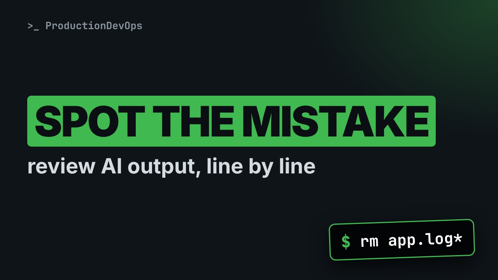
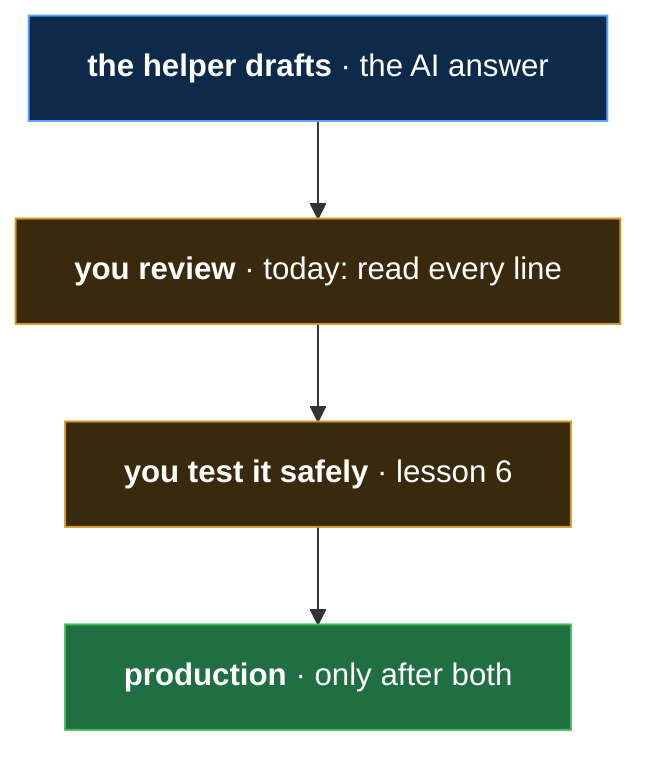
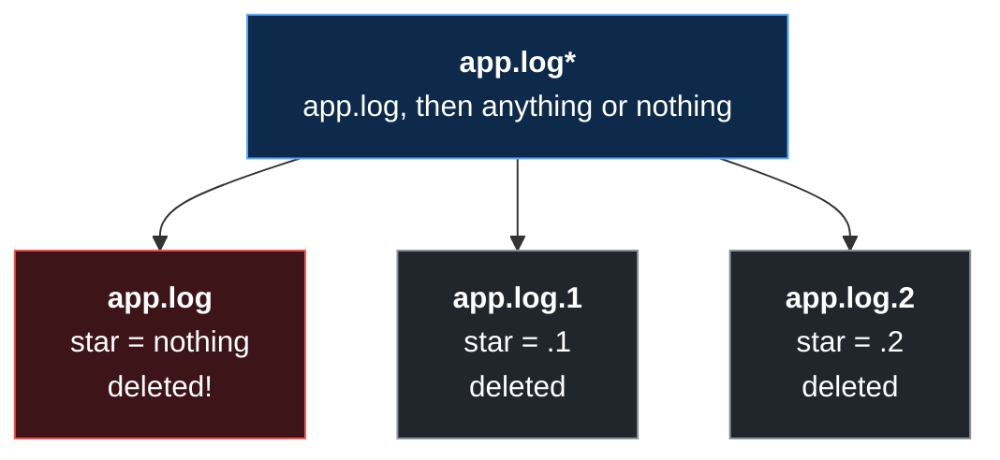
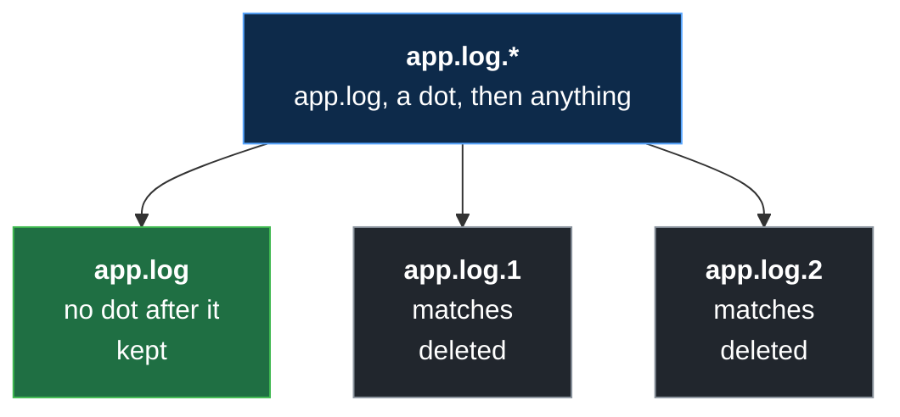

# Reviewing AI Output Like a Code Review (AI for Ops: the Safe Basics)



**Video:** coming soon on the [channel](https://www.youtube.com/@production-devops).

The assistant answered in two seconds, and the script looks fine. One line in it would delete the wrong file. This lesson of AI Assistants for Ops: the Safe Basics reviews a four-line bash script for a fictional app the way a colleague's change is reviewed: line by line, the deleting line first, every star read out loud. We find the planted mistake, fix it with one character, and end with a five-point review checklist. No terminal needed, no product names. Every new word is explained on screen. The challenge and its solution are in the demos repo.

## Files in this folder

- [`challenge-solution.md`](challenge-solution.md) (solution of the challenge: try it yourself first)
- [`challenge-solution.sh`](challenge-solution.sh) (solution of the challenge: try it yourself first)

## What you need

A Linux shell (a VM, WSL or a container is fine). Everything runs inside this folder.

## The lesson, step by step

The same explanations as the video, with every command. Read it, then run it yourself.

In five minutes, we review an AI script line by line, like a colleague's change. One line would delete the wrong file. At the end, you will see which one.

You will need lesson four: our prompt about the old log files. Helpful, but not required: lesson one of Shell Scripting from Zero. No terminal today. We only read.

### The plan

This is lesson five of AI Assistants for Ops. First, what a review is. Then, the answer to our prompt, line by line. The mistake, and its fix. And a review checklist.

### A review

- `code review — Someone reads a change carefully, before it is used (like tasting a dish before it leaves the kitchen)`: 
New word: code review. Someone reads a change carefully, before it is used. Like tasting a dish before it leaves the kitchen.

**Where the review sits**



The helper drafts, and you review it by reading every line. Then you test it safely, in lesson six. Only then does it reach production.

### The request

First, remember what we asked for. A folder, acme app slash logs, with three files. Delete the old copies: app dot log dot one, and dot two. And never touch app dot log, the live log.

### Line by line

Here is the answer. I wrote it for this lesson, with one mistake planted on purpose. Try to spot it.

```
#!/bin/bash
# Delete the old copies of the log. Keep app.log.
rm acme-app/logs/app.log*
echo "Old logs deleted. app.log kept."
```

Line one says which program reads this file: bash. Line two is a comment, a note for people. It repeats our request. A comment is a promise, not a proof. Line three is the only line that acts. It deletes files. Line four prints a message. It says app dot log was kept. It does not check it.

Line three uses r m. R m deletes files. There is no bin, and no undo. So this line gets most of our time. Our question: which files, exactly, does it delete?

### The star

- `wildcard — A star in a file name: it matches any characters, or none (like ordering "any soup": you get every soup, even the plain one)`: 
New word: wildcard. A star in a file name matches any characters, or none at all. Like ordering any soup: you get every soup, even the plain one.

```console
$ rm acme-app/logs/app.log*
```

Line three, piece by piece.

- `rm`: delete these files
R m: delete these files.

- `acme-app/logs/`: in this folder
In the folder acme app slash logs.

- `app.log`: names that start with app.log
Every name that starts with app dot log.

- `*`: then anything, or nothing
Followed by anything, or by nothing at all.

### So far

So far: comments and messages are promises. Line three deletes every name that starts with app dot log, then anything, or nothing. Next: which of our three files match? This is the mistake. If this is helping, subscribe. The next lesson runs this script, and watches the mistake happen safely.

### The mistake

**What app.log* matches**



The two old copies match, as we wanted. But app dot log matches too: the star can be nothing. So line three deletes the live log.

The mistake, in words. The request said: keep app dot log. The comment said: keep app dot log. But the command deletes it, because the star can be nothing.

### The fix

The fix is one character.

```
#!/bin/bash
# Delete the old copies of the log. Keep app.log.
rm acme-app/logs/app.log.*
echo "Old logs deleted. app.log kept."
```

Lines one and two stay the same. Line three now has a dot before the star. Names must start with app dot log, then a dot. Line four is the same. Now it tells the truth, but it still checks nothing.

**What app.log.* matches**



Now app dot log has no dot after it, so it does not match. It stays. The two old copies still match.

### Checklist

Here is the checklist. One: does it do what I asked? Two: which lines change or delete something? Read them twice. Three: is there a star? List what it matches, name by name. Four: a line I cannot explain? Look it up before I go on. Five: comments and messages are promises, not proof.

### Good to know

Good to know. People make this mistake too. Review everyone's code, not only the assistant's. Reading is not enough. Next, we run it, safely.

### Recap

Recap. A review means reading every line before it is used. Read the acting lines first. And remember, a star can match nothing. Your challenge: r m acme app slash logs, slash star dot log. The comment says: delete the old copies. Which of the three files does it delete? The answer is in the demo repo.

### Where next

Where next? Lesson six: we run this script in a practice folder. We watch the mistake happen, where it cannot hurt.

Next lesson: test before you trust, and run it somewhere safe. Subscribe, and that lesson finds you.

## All the commands, to copy

Run them from inside this folder, in this order (some are expected to fail: that is the point of the demo).

```bash
rm acme-app/logs/app.log*
```

## Challenge

Your challenge: r m acme app slash logs, slash star dot log. The comment says: delete the old copies.

When you have tried: [`challenge-solution.md`](challenge-solution.md).

---

From the [ProductionDevOps](https://www.youtube.com/@production-devops) channel: real-world DevOps and SRE, explained with real commands.
