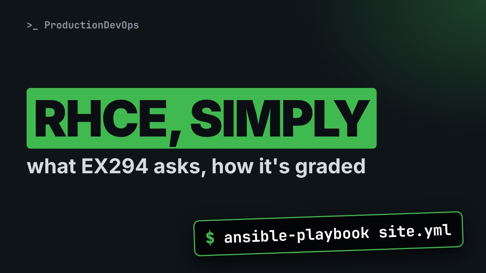
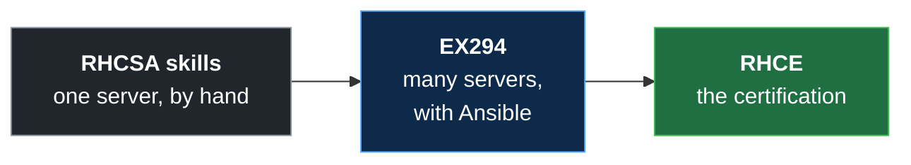
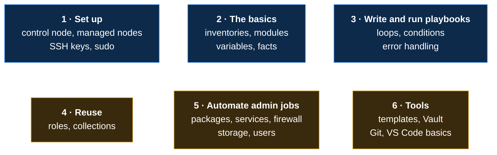
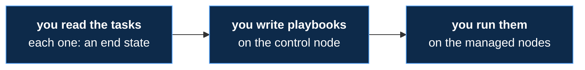
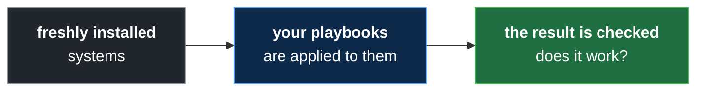
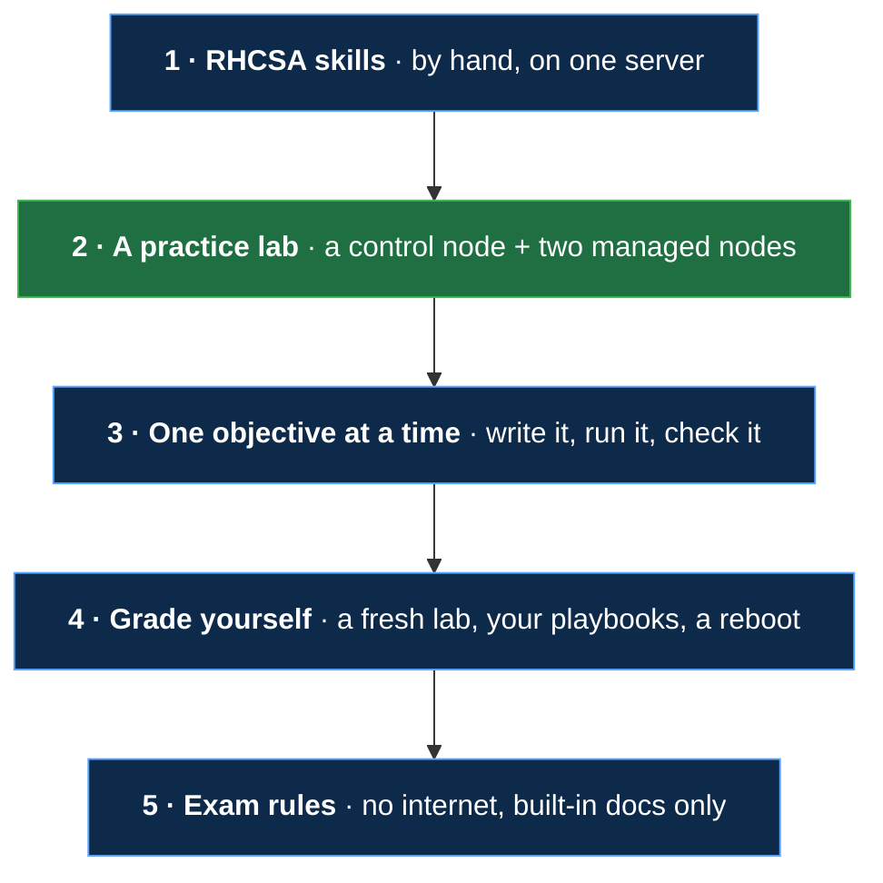
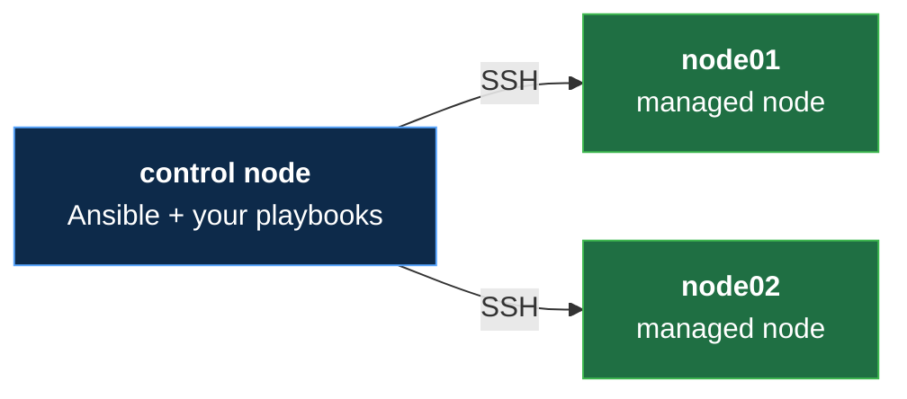

# The RHCE Exam (EX294) Explained Simply: What It Asks and How It's Graded

**Video:** https://youtu.be/csftUO5-KLg

What the RHCE exam, EX294, really asks you to do, and how your work is graded, explained simply with pictures. Who the exam is for, the objectives in one picture and in plain words, how a hands-on exam runs (no internet, your playbooks applied to freshly installed systems, everything must survive a reboot), which RHCSA skills you need first, and a simple study plan. No terminal today: every new word is explained on screen. Next video: Build Your RHCE Practice Lab, Step by Step. Red Hat updates the objectives, so always check the official exam page.
Next: build your practice lab, step by step: https://youtu.be/kgIILpgiMD0

## What you need

A Linux shell (a VM, WSL or a container is fine). Everything runs inside this folder.

## The lesson, step by step

The same explanations as the video, with every command. Read it, then run it yourself.

In five minutes: what the RHCE exam, E X two nine four, asks you to do, and how it is graded. Then a simple study plan. And one grading detail that surprises many people.

You will need nothing to install. Today is pictures only. Some Linux basics help. The course Linux from Zero covers them. New to Ansible? Watch Ansible from Zero first.

### The plan

First, what E X two nine four is, and who it is for. Then what it asks: the objectives, in one picture. Then how it runs, and how it is graded. And what to know first, with a simple study plan.

### The exam

- `Ansible — A tool that sets up many servers from written instructions (like a head chef who sends one recipe card to every kitchen)`: 
First, one word. Ansible: a tool that sets up many servers from written instructions. Like a head chef who sends one recipe card to every kitchen.

**Where EX294 fits**

E X two nine four is Red Hat's hands-on Ansible exam, on the road to the RHCE. RHCSA skills run one server by hand. This exam automates many servers.

Red Hat names a few groups of people. Linux admins who look after many servers. DevOps engineers who want to prove their automation skills. And anyone on the road to the RHCE.

### The objectives

- `control node — The machine where Ansible runs, and where you type (like the head chef's desk)`: 
Three words before the picture. Control node: the machine where Ansible runs, and where you type. The head chef's desk.

- `managed node — A server that Ansible sets up, from the control node (like a kitchen that receives the recipe cards)`: 
Managed node: a server that Ansible sets up, from the control node. A kitchen that receives the recipe cards.

- `playbook — A file of tasks that Ansible runs on your managed nodes (like a recipe card: written once, cooked in every kitchen)`: 
Playbook: a file of tasks that Ansible runs on your managed nodes. A recipe card, written once, cooked in every kitchen.

**What EX294 asks, in one picture**

Here is the whole list, in six groups. Set up the machines, learn the basics, and write and run playbooks. Then reuse your work, automate everyday admin jobs, and use a few tools.

Red Hat updates this list, so check the official exam page. A module is one ready-made job, like install a package. A role is a set of playbooks, packed so you can reuse it. A template is one config file, filled in for each server. And Vault locks passwords inside a file.

### How it runs

- `hands-on exam — Real tasks on real systems. No multiple choice questions (like a cooking exam: you cook, nobody asks quiz questions)`: 
E X two nine four is a hands-on exam. Real tasks on real systems, and no multiple choice. Like a cooking exam: you cook.

- `end state — How a system must look when the job is done (like the finished dish, not the cooking steps)`: 
Each task describes an end state: how a system must look when the job is done. The finished dish, not the cooking steps.

**During the exam**

During the exam, you read the tasks. You write playbooks on the control node. And you run them on the managed nodes.

**How it is graded**

Now the surprise. Red Hat says your playbooks are applied to freshly installed systems. Then they check that the result works.

So a fix you typed by hand never reaches the fresh systems. Only your playbooks do. And every setting must survive a reboot, with no help from you. That is why you practice on a fresh lab, like the graders do.

Now the rules. There is no internet during the exam. You cannot bring notes or books. Looking things up in the built-in documentation is itself an objective. So practice with it.

### So far

So far: E X two nine four is hands-on Ansible, with six groups of objectives. It is graded on fresh systems, and settings must survive a reboot. Next: what to know first, and a simple plan. If this is helping, subscribe. The next video builds your practice lab, step by step.

### Before you start

Ansible automates jobs you can already do by hand. Users, groups and permissions. Storage, packages, services and the firewall. And reading a simple shell script. The rule: if you cannot do it by hand, you cannot write the playbook for it.

### Study plan

**A simple study plan**

Here is a simple plan, in five steps. RHCSA skills first, then a practice lab, then one objective at a time. Then grade yourself like the exam, and practice with its rules.

**Step 2: your practice lab**

Step two is the lab: one control node and two managed nodes. The next video builds exactly this, on one Linux machine.

### Recap

Recap. E X two nine four is hands-on Ansible, in six groups. Your playbooks are applied to fresh systems. Settings must survive a reboot, and there is no internet. RHCSA skills first, then a lab.

### Where next

Where next? The next video builds your practice lab, step by step. Then the Ansible for RHCE playlist, lesson by lesson. Your homework: read the official objectives list, and mark what you can already do by hand.

Next video: build your RHCE practice lab, step by step. Subscribe, and that video finds you.

---

From the [ProductionDevOps](https://www.youtube.com/@production-devops) channel: real-world DevOps and SRE, explained with real commands.
