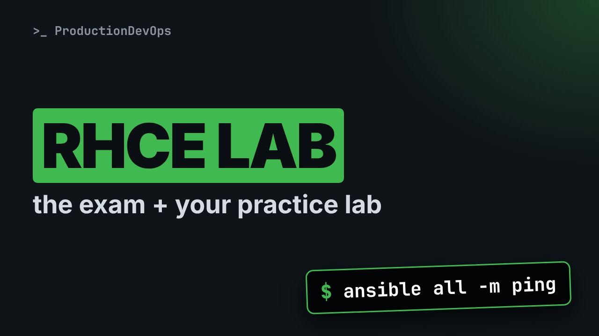
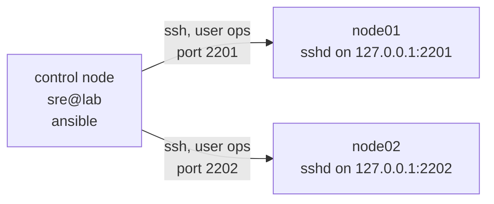

# The RHCE Exam (EX294) Explained, Plus a Lab You Can Build Today



**Video:** coming soon on the [channel](https://www.youtube.com/@production-devops).

Lesson 1 of Ansible for RHCE. What the EX294 exam covers, area by area, how a practical exam works (tasks checked on the systems, after a reboot, with no internet), and which RHCSA skills you need first. Then we build the practice lab live: a control node and two managed nodes, node01 and node02, with an automation user, SSH keys and passwordless sudo, all on one Linux machine. We prove it with ssh and our first Ansible ping. The lab script is in the demos repo.

## Files in this folder

- [`ansible.cfg`](ansible.cfg)
- [`inventory.ini`](inventory.ini)
- [`lab/up.sh`](lab/up.sh)
- [`challenge-solution.sh`](challenge-solution.sh) (solution of the challenge: try it yourself first)

## What you need

A Linux shell (a VM, WSL or a container is fine). Everything runs inside this folder.

## Before you start

The video runs these commands first, off screen:

```bash
if [ -f .lab-reset ]; then bash lab/up.sh; else bash lab/up.sh reset && touch .lab-reset; fi >/dev/null 2>&1
```

## The lesson, step by step

The same explanations as the video, with every command. Read it, then run it yourself.

The RHCE exam gives you a few systems, a list of tasks, and no internet. Nobody reads your answers: they check the systems, so you need a lab where you practice the same way. And at the end, a ping that is not a network ping at all.

### The plan

This is lesson 1 of Ansible for RHCE. Here is the plan. First, what the E X two nine four exam covers. Then how a practical exam works. Then we build the lab: a control node and two managed nodes. And we prove it works, with ssh and a first Ansible ping.

### The objectives

Red Hat updates the objectives, so check the current list. Here they are, by area. Everything an RHCSA can do, plus the core of Ansible: inventories, modules, variables, facts and loops. Configuring the control and managed nodes, and running playbooks. Writing plays, roles and collections, templates, and Vault for secrets. Automating the RHCSA tasks, like packages, services, storage and users. Plus basic Git and VS Code.

### The format

It is a practical exam. There are no multiple choice questions. You get real tasks, on several real systems. Each task describes an end state. The graders check the systems, not your playbooks. Your configuration must survive a reboot, with no manual steps. No internet and no notes, but the product documentation is there. So learn ansible dash doc now.

### The lab

**The lab: one machine, three roles**



On the exam you get a control node and several managed nodes, and our lab copies that shape on one Linux machine. The control node is this shell. Each managed node is an SSH server on its own local port.

```
# 1. The automation user: ops, SSH keys only, passwordless sudo
id ops >/dev/null 2>&1 || useradd -m -s /bin/bash ops
usermod -p '*' ops
printf '%s\n' 'Defaults:ops !authenticate' 'ops ALL=(ALL) ALL' > /etc/sudoers.d/ops
chmod 0440 /etc/sudoers.d/ops

# 2. The control node's key pair
mkdir -p "$LAB" /run/sshd
chmod 0700 "$LAB"
[ -f "$LAB/id_ed25519" ] || ssh-keygen -q -t ed25519 -N '' -C ops@lab -f "$LAB/id_ed25519"
```

First, the automation user, called ops. Ansible will log in as this user on every managed node. A star as the password hash means no password can ever match. Only SSH keys will work. Then sudo: ops may run any command, and sudo never asks for a password. Then one key pair for the control node, with no passphrase. It is created only if it does not exist yet.

```
cat > "$d/sshd_config" <<CFG
Port $port
ListenAddress 127.0.0.1
AllowUsers ops
PasswordAuthentication no
CFG
unshare --uts --mount --propagation private sh -c "
  echo $name > /proc/sys/kernel/hostname
  for dir in etc home tmp opt srv; do mount --bind $d/root/\$dir /\$dir; done
  exec $(command -v sshd) -f $d/sshd_config -E $d/sshd.log"
```

Each managed node is its own SSH server, on a local port. Only the ops user may log in, and only with a key. unshare starts the server in new Linux namespaces. So the node gets its own hostname. And its own slash etc, home, tmp, opt and srv: a file on node zero one is not on node zero two.

### Build it

We run the script. It is idempotent: it only adds what is missing. Run it as root, in a throwaway VM or container.

```console
$ bash lab/up.sh
```

Two managed nodes are ready. Both are reached as user ops, each on its own port.

A quick checkpoint. The exam: real tasks, checked on the systems, with no internet. The lab script: the user ops, a key pair, and one SSH server per node. Next: ssh into the nodes, then Ansible, and a ping that is not a network ping.

The script also wrote an SSH client config.

```console
$ cat /etc/ssh/ssh_config.d/rhce-lab.conf
```

Each node name maps to an address, a port and a user. The last block picks the lab key for every node.

Now we use it. ssh node zero one, and run hostname there.

```console
$ ssh node01 hostname
```

The same on node zero two.

```console
$ ssh node02 hostname
```

Who are we on the node? The ops user.

```console
$ ssh node01 whoami
```

And sudo works with no password. This is what Ansible become will use.

```console
$ ssh node01 sudo id -un
```

### Ansible

On the control node, ansible dash dash version shows the essentials.

```console
$ ansible --version
```

First the ansible core version, then the config file in use, in this folder. And at the bottom, the Python that runs Ansible on the control node.

The inventory lists the managed nodes. Both point to the local address, each with its own port.

```console
$ cat inventory.ini
```

Now the classic first test: the ping module, on all hosts.

```console
$ ansible all -m ping
```

Two pongs, one per node. Ansible logged in as ops, ran a small Python module, and got an answer. This is not a network ping. It proves SSH, the login, and a working Python on the node.

### How to study

A practical exam rewards practice, not reading. Type every command yourself. Watching is not practice. Look things up with ansible dash doc, not a browser, as on the exam. Rebuild the lab often, and verify every end state after a reboot.

### Gotchas

Three things to know about this lab. It is one machine. A package installed on node zero one is also there on node zero two. A container has no systemd, firewalld or SELinux. For those lessons we will use a full virtual machine. The exam runs Red Hat Enterprise Linux. Ansible modules work the same, but package names can differ.

### Recap

Let's recap. E X two nine four is hands-on. Tasks are checked on the systems, after a reboot. Know your RHCSA skills. Ansible only automates them. The lab: a control node, two managed nodes, the user ops, keys and sudo. Your challenge: add node zero three, on port twenty-two zero three, and get three pongs. Hint: the NODES variable. The solution is in the demo repository.

You know the exam, and you have a lab. Next lesson: how Ansible really works, from SSH to Python on the node. Subscribe so you do not miss it.

## All the commands, to copy

Run them from inside this folder, in this order (some are expected to fail: that is the point of the demo).

```bash
bash lab/up.sh
cat /etc/ssh/ssh_config.d/rhce-lab.conf
ssh node01 hostname
ssh node02 hostname
ssh node01 whoami
ssh node01 sudo id -un
ansible --version
cat inventory.ini
ansible all -m ping
```

## Challenge

Your challenge: add node zero three, on port twenty-two zero three, and get three pongs. Hint: the NODES variable. The solution is in the demo repository.

When you have tried: [`challenge-solution.sh`](challenge-solution.sh).

---

From the [ProductionDevOps](https://www.youtube.com/@production-devops) channel: real-world DevOps and SRE, explained with real commands.
