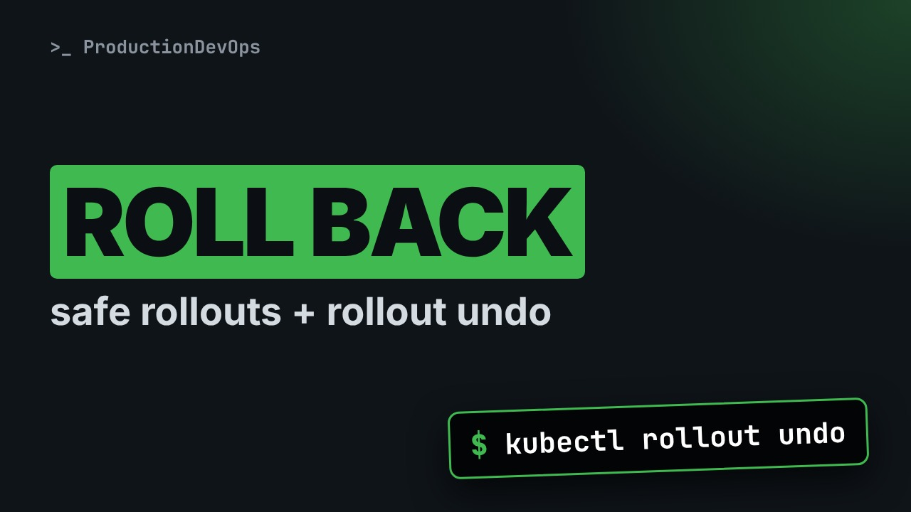
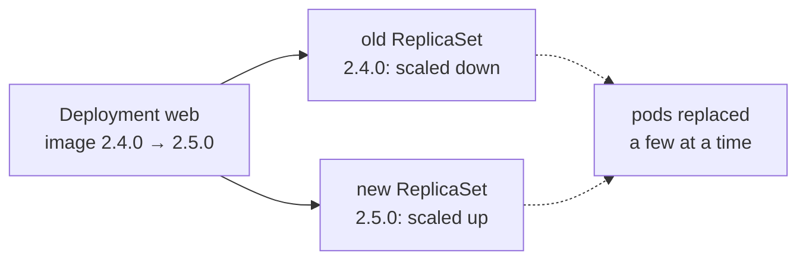

# Safe Kubernetes Rollouts: maxSurge, rollout status and rollout undo



**Video:** https://youtu.be/I7LGVoCgWUo

A bad image should stop at one pod, not reach every replica. We set up a Deployment that protects itself with maxSurge, maxUnavailable and a readiness probe, ship a broken version, watch the rollout stall safely, and roll back to a known revision with kubectl rollout undo. Plus change-cause annotations, rollout status as a deploy gate, and why undo renumbers your revisions.

## Files in this folder

- [`deploy.sh`](deploy.sh)
- [`web.yaml`](web.yaml)

## What you need

A Kubernetes cluster you can break: a local [kind](https://kind.sigs.k8s.io/) cluster with one control plane and two workers is what the video uses, plus `kubectl`. Never run these commands against a cluster that matters.

The outputs below were captured for real on the lab cluster. On yours, names, ages, IPs and ports will differ; everything else should match.

## The lesson, step by step

The same explanations as the video, with every command and its real output. Read it, then run it yourself.

A broken image goes out, and every replica runs it before anyone notices. Kubernetes can stop a bad rollout at the first pod. But only if you set it up for that.

### The plan

Here is the plan. First, how a rolling update replaces pods. Then, max surge and max unavailable, in plain words. We ship a broken version, and watch the rollout stop by itself. And we roll back with rollout undo, to the right revision.

### Rolling updates

**A rolling update, step by step**



When you change the image, the Deployment creates a new ReplicaSet, a group of identical pods with the new version. It scales the new one up and the old one down, a few pods at a time. Each change of the pod template is a numbered revision.

### maxSurge, maxUnavailable

```
spec:
  replicas: 4
  strategy:
    type: RollingUpdate
    rollingUpdate:
      maxSurge: 1
      maxUnavailable: 0
  template:
    spec:
      containers:
        - readinessProbe: {httpGet: {path: /ready, port: 8080}}
```

We want four replicas of the web app. max surge one: during a rollout, at most one extra pod above four. So at most five pods. max unavailable zero: never fewer than four ready pods. An old pod is removed only after a new one is ready. If you write nothing, both default to twenty five percent. Safe for many apps, but less strict. And this line makes it all work. Ready is decided by the readiness probe, from the previous video.

This is the most common reason bad rollouts reach every pod. Without a readiness probe, a pod counts as ready as soon as its container starts. So a broken version looks ready, and the rollout happily continues. With a probe, the broken pod never becomes ready, and the rollout stops at the first pod.

### Ship a bad version

Rollout history lists the revisions of the Deployment. We have two, both working.

```console
$ kubectl rollout history deployment/web
deployment.apps/web
REVISION  CHANGE-CAUSE
1         2.3.1: initial release
2         2.4.0: faster search
```

The change cause column is not automatic. It comes from an annotation that you add at each deploy. We will add one now.

We deploy version two point five, with kubectl set image.

```console
$ kubectl set image deployment/web web=registry.example.com/acme/web:2.5.0
deployment.apps/web image updated
```

Then we record why, in the change cause annotation.

```console
$ kubectl annotate deployment/web kubernetes.io/change-cause='2.5.0: new checkout page'
deployment.apps/web annotated
```

### rollout status as a gate

rollout status waits until the rollout is complete. With a timeout, it fails instead of waiting forever.

```console
$ kubectl rollout status deployment/web --timeout=90s
Waiting for deployment "web" rollout to finish: 1 out of 4 new replicas have been updated...
error: timed out waiting for the condition
```

It failed. And the exit code says so, so a script or a pipeline can react.

```console
$ echo $?
1
```

Let's look at the pods.

```console
$ kubectl get pods -l app=web
NAME                  READY   STATUS    RESTARTS   AGE
web-5d7b9c8f6-2kq8n   1/1     Running   0          2d
web-5d7b9c8f6-8vx4t   1/1     Running   0          2d
web-5d7b9c8f6-hm2zp   1/1     Running   0          2d
web-5d7b9c8f6-wl9rc   1/1     Running   0          2d
web-7f4c8d6b5-j6tnq   0/1     Running   0          95s
```

Four old pods, still ready. One new pod, never ready. The Service sends traffic only to ready pods. So users still get version two point four. Why is the new pod not ready? Its events tell us.

```console
$ kubectl describe pod web-7f4c8d6b5-j6tnq | grep Unhealthy
Warning  Unhealthy  4s (x18 over 89s)  kubelet  Readiness probe failed: HTTP probe failed with statuscode: 503
```

One thing to be clear about. The rollout stops. It does not roll back. The broken pod stays there. After ten minutes by default, the Deployment is marked as failed: progress deadline exceeded. Still no rollback. Rolling back is your action, or your pipeline's.

### rollout undo

Before rolling back, look at the history again.

```console
$ kubectl rollout history deployment/web
deployment.apps/web
REVISION  CHANGE-CAUSE
1         2.3.1: initial release
2         2.4.0: faster search
3         2.5.0: new checkout page
```

We want revision two. dash dash revision shows its details. grep keeps the change cause and the image.

```console
$ kubectl rollout history deployment/web --revision=2 | grep -E 'change-cause|Image'
Annotations:	kubernetes.io/change-cause: 2.4.0: faster search
  Image:	registry.example.com/acme/web:2.4.0
```

Now the rollback. dash dash to revision makes it explicit.

```console
$ kubectl rollout undo deployment/web --to-revision=2
deployment.apps/web rolled back
```

A rollback is a rollout too. So we wait for it, the same way.

```console
$ kubectl rollout status deployment/web --timeout=90s
Waiting for deployment "web" rollout to finish: 1 old replicas are pending termination...
deployment "web" successfully rolled out
```

Look at the history one last time.

```console
$ kubectl rollout history deployment/web
deployment.apps/web
REVISION  CHANGE-CAUSE
1         2.3.1: initial release
3         2.5.0: new checkout page
4         2.4.0: faster search
```

Revision two is gone. The rollback created a new revision, four, with the old template. Revision numbers only go up.

### A deploy gate

```
#!/usr/bin/env bash
set -euo pipefail
image="$1"
kubectl set image deployment/web web="$image"
kubectl annotate deployment/web kubernetes.io/change-cause="$image" --overwrite
if ! kubectl rollout status deployment/web --timeout=180s; then
  echo "rollout of $image failed, rolling back" >&2
  kubectl rollout undo deployment/web
  exit 1
fi
```

A small deploy script, in bash strict mode, from an earlier video. It sets the new image, and records it as the change cause. rollout status is the gate. If it fails or times out... the script says why, rolls back to the previous revision, and exits with an error, so the pipeline turns red.

### Gotchas

Three mistakes to avoid. One. No readiness probe: a broken pod counts as available, and the rollout goes everywhere. Two. A plain undo goes to the previous revision. After two bad deploys in a row, that is also bad. Check the history, and use dash dash to revision. Three. Without change cause annotations, the history is just numbers, exactly when you are under pressure.

### Recap

Let's recap. Max unavailable zero, plus a readiness probe: a bad version stops at one pod. rollout status with a timeout is your gate. rollout history, with change cause annotations, tells you what each revision is. And rollout undo, with dash dash to revision, rolls back without guessing.

A bad version should stop at one pod, and a rollback should be a choice, not a guess. Subscribe for more of the Kubernetes in practice series.

## All the commands, to copy

Run them from inside this folder, in this order.

```bash
kubectl rollout history deployment/web
kubectl set image deployment/web web=registry.example.com/acme/web:2.5.0
kubectl annotate deployment/web kubernetes.io/change-cause='2.5.0: new checkout page'
kubectl rollout status deployment/web --timeout=90s
echo $?
kubectl get pods -l app=web
kubectl describe pod web-7f4c8d6b5-j6tnq | grep Unhealthy
kubectl rollout history deployment/web --revision=2 | grep -E 'change-cause|Image'
kubectl rollout undo deployment/web --to-revision=2
```

---

From the [ProductionDevOps](https://www.youtube.com/@production-devops) channel: real-world DevOps and SRE, explained with real commands.
