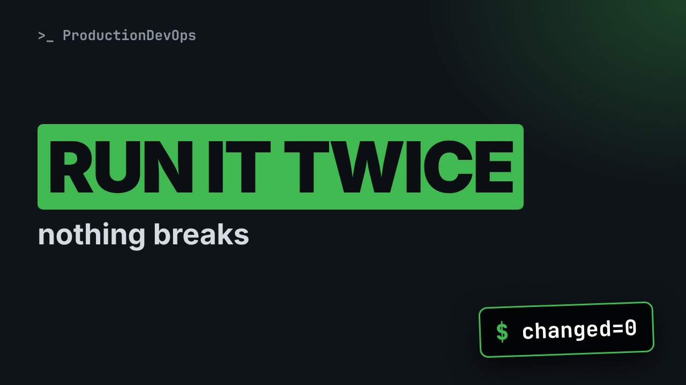
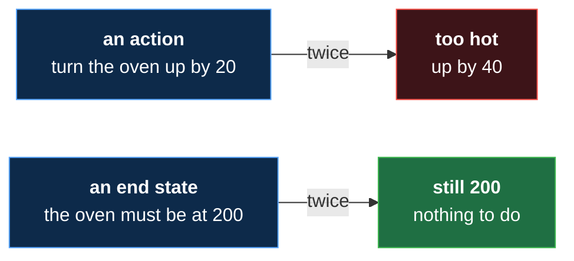
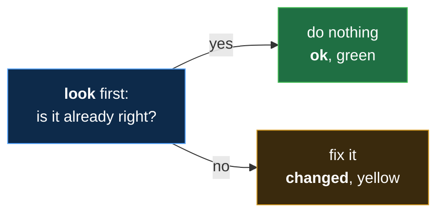

# Run It Twice, Nothing Breaks: Idempotency in Ansible (No Experience Needed)



**Video:** coming soon on the [channel](https://www.youtube.com/@production-devops).

What happens if you run the same Ansible playbook twice? A second folder, an error, a mess? This lesson of Ansible from Zero runs the playbook from lesson 7 a second time on two practice servers, and everything turns green: changed is zero. That is idempotency, explained with an oven: "the oven must be at 200 degrees", not "turn it up by 20". Then we play a colleague who deletes a file on one server, and the same playbook puts back only what is missing. No experience needed: every new word is explained on screen. The files, the challenge and its solution are in the demos repo.

## Files in this folder

- [`acme-app.yml`](acme-app.yml)
- [`ansible.cfg`](ansible.cfg)
- [`hello.txt`](hello.txt)
- [`inventory.ini`](inventory.ini)
- [`lab/up.sh`](lab/up.sh)
- [`oops.yml`](oops.yml)
- [`challenge-solution.sh`](challenge-solution.sh) (solution of the challenge: try it yourself first)

## What you need

A Linux shell (a VM, WSL or a container is fine). Everything runs inside this folder.

## Before you start

The video runs these commands first, off screen:

```bash
if [ -f .lab-reset ]; then bash lab/up.sh; else bash lab/up.sh reset && touch .lab-reset; fi >/dev/null 2>&1
```

## The lesson, step by step

The same explanations as the video, with every command. Read it, then run it yourself.

What happens if you run the same playbook twice? A second folder, or an error? Today, the answer, and a drifted server, fixed by the same playbook.

To watch this lesson, you need nothing. To follow along, start the two practice servers, as in lesson four. The playbook from lesson seven, and one more small file, are in the demo repo.

### The plan

This is lesson eight of Ansible from Zero. First, two ways to write a step. Then we run the playbook once. Then we run it again, and see what changes. And then one server drifts, and we run it a third time.

### Two ways

**Two ways to write a step**



A recipe can say: turn the oven up by twenty degrees, and twice is too hot. Or it says: the oven must be at two hundred, and twice is fine.

- `idempotent`: Run it once or ten times: the same result (like "the oven must be at 200", not "turn it up by 20")
The word for the second kind is idempotent. Run it once or ten times, and you get the same result.

Here is our playbook from lesson seven. Look at what it really says.

```
# Lesson 7: our first playbook
- name: Prepare acme-app
  hosts: web
  gather_facts: false
  tasks:
    - name: Create the app folder
      ansible.builtin.file:
        path: /tmp/acme-app
        state: directory

    - name: Copy the welcome file
      ansible.builtin.copy:
        src: hello.txt
        dest: /tmp/acme-app/hello.txt
```

It does not say: create a folder. It says: this path must be a directory. And this file must be at that place, with the content of hello dot text.

### Once

Our two servers are fresh. We run the playbook, with the command from lesson seven.

```console
$ ansible-playbook acme-app.yml
```

Yellow changed, on both servers. The folder and the file did not exist, so Ansible made them. The recap says changed equals two, on each server.

### So far

So far: idempotent means once or ten times, the same result. Our playbook describes end states, not actions. Next: the very same command, a second time.

### Twice

Now the open question. What happens if we run it again?

```console
$ ansible-playbook acme-app.yml
```

Everything is green. Each task says ok: nothing to do. The recap says changed equals zero, on both servers. No second folder, no error.

**What each module does, every time**



Here is why: each module looks first. If the server is already right, it does nothing, and says ok. If not, it fixes it, and says changed.

### Drift

- `drift`: Servers that slowly become different from each other (like one kitchen that changed the recipe a little)
Remember drift from lesson one? Servers that should be the same slowly become different. Let us make one drift, on purpose.

```
# Lesson 8: we play a colleague who deletes a file
- name: Delete the welcome file
  hosts: node02
  gather_facts: false
  tasks:
    - name: Delete the welcome file
      ansible.builtin.file:
        path: /tmp/acme-app/hello.txt
        state: absent
```

This small playbook plays a colleague, who deletes a file by mistake. Hosts is node zero two only. One task, with the file module. State absent means: this file must not exist.

We run the colleague's playbook.

```console
$ ansible-playbook oops.yml
```

Changed, on node zero two. The welcome file is gone there. Now the two servers are different.

### Third run

Can our playbook fix it? We run it a third time, the very same command.

```console
$ ansible-playbook acme-app.yml
```

The folder task: ok on both. Every folder was still there. The copy task: ok on node zero one, but changed on node zero two. The file is back. And the recap: node zero one changed nothing, node zero two changed one thing.

So you can run a playbook any time. It only fixes what is wrong. If a run stopped halfway, just run it again. And when servers drift, the same playbook brings them back in line. This is the answer to the ten servers of lesson one.

### Good to know

All green on the second run is the sign of a good playbook. Not every task can look first. A task that just runs a command cannot know if it already ran. So, when a ready-made module exists for the job, use it.

### Recap

Recap: idempotent means once or ten times, the same result. Modules look first. Ok if it was right, changed if they fixed it. The same playbook fixes drift, and only drift. Your challenge: change the text in hello dot text, and run the playbook. Which task says changed?

### Where next

Where next? Lesson nine: what you can do now. And where to go next: the Ansible for RHCE course.

Next lesson: where next, the RHCE course. Subscribe so you do not miss it.

## All the commands, to copy

Run them from inside this folder, in this order (some are expected to fail: that is the point of the demo).

```bash
ansible-playbook acme-app.yml
ansible-playbook oops.yml
```

## Challenge

Your challenge: change the text in hello dot text, and run the playbook. Which task says changed?

When you have tried: [`challenge-solution.sh`](challenge-solution.sh).

---

From the [ProductionDevOps](https://www.youtube.com/@production-devops) channel: real-world DevOps and SRE, explained with real commands.
