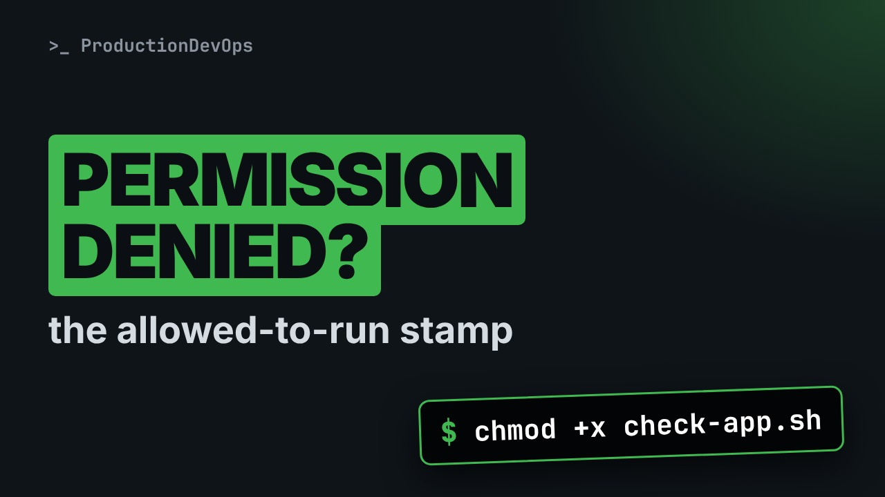
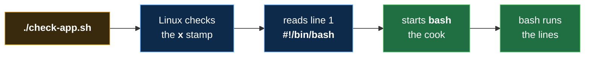

# Running It: chmod +x (Shell Scripting from Zero)



**Video:** coming soon on the [channel](https://www.youtube.com/@production-devops).

You type ./check-app.sh and the terminal answers: Permission denied. In this lesson of Shell Scripting from Zero we read that error, look at a file's permissions with ls -l, and give the script its "allowed to run" stamp with chmod +x. Then the shebang from lesson 2 finally does its job, and the script runs like any other program. We also meet "command not found" and why ./ is needed. Every new word is explained on screen and every command runs for real. The challenge and its solution are in the demos repo.

## Files in this folder

- [`acme-app/config.txt`](acme-app/config.txt)
- [`acme-app/logs/app.log`](acme-app/logs/app.log)
- [`acme-app/logs/old.log`](acme-app/logs/old.log)
- [`check-app.sh`](check-app.sh)
- [`notes/ideas.txt`](notes/ideas.txt)
- [`notes/todo.txt`](notes/todo.txt)
- [`readme.txt`](readme.txt)
- [`challenge-solution.sh`](challenge-solution.sh) (solution of the challenge: try it yourself first)

## What you need

A Linux shell (a VM, WSL or a container is fine). Everything runs inside this folder.

## Before you start

The video runs these commands first, off screen:

```bash
mkdir -p /lab && ln -sfn "$PWD" /lab/sre && cd /lab/sre && export HOME=/lab/sre
alias ls='ls --color=auto'
PROMPT_COMMAND='PS1="\[\e[1;32m\]sre@lab\[\e[0m\]:\[\e[1;34m\]\w\[\e[0m\]$ "'
[ -e .tt-fresh ] || { chmod 644 check-app.sh; touch .tt-fresh; }
id sre >/dev/null 2>&1 || useradd -M -U sre >/dev/null 2>&1; chown -R sre:sre .
```

## The lesson, step by step

The same explanations as the video, with every command. Read it, then run it yourself.

Typing bash before every script gets old. Today you run the file itself. First it refuses, with a real error, and then one small stamp fixes it.

You will need a terminal with bash. And check app dot s h from lesson two, with its shebang. Or just watch. Every step is on screen.

### The plan

This is lesson three of Shell Scripting from Zero. First, we run the file itself. Then we read the error: permission denied. We add the allowed to run stamp, with c h mod plus x. And we run it, twice.

### Run the file

- `./ — Dot slash: the folder you are in. ./check-app.sh means: this file, right here (like pointing at the card on the table: this one)`: 
New word: dot slash. The dot means the folder you are in. So dot slash check app means: this file, right here.

We type dot slash, then the name of the script. No bash in front.

```console
$ ./check-app.sh
```

It refuses. A real error message. Let's read it.

```console
$ bash: ./check-app.sh: Permission denied
```

As in Linux from Zero, an error has three parts, split by colons.

- `bash:`: who: the shell complains
Who complains? Bash, the shell.

- `./check-app.sh:`: what: our script
About what? Our script.

- `Permission denied`: why: not allowed to run it
Why? Permission denied. Bash is not allowed to run this file.

### The stamp

- `permission — A rule on a file: who may read it, change it, or run it (like a stamp on the card: allowed to run)`: 
New word: permission. A rule on a file: who may read it, change it, or run it. Think of a stamp on the card: allowed to run.

To see the permissions, we add dash l to l s. L for long.

```console
$ ls -l check-app.sh
```

Look at the start of the line. Letters r and w, and dashes. No letter x anywhere.

R means read. W means write, or change. X means run. A dash means: not allowed. There are three groups of letters: for you, for your group, and for everyone else. No x at all, so nobody may run it. Not even you.

### So far

So far: dot slash check app gave permission denied. L s dash l showed why: the file has no x. No stamp. Next: we add the stamp, and run it for real.

### chmod +x

```console
$ chmod +x check-app.sh
```

- `chmod`: change mode: change permissions
C h mod. Change mode, which means: change the permissions.

- `+x`: add x: the run stamp
Plus x. Add the letter x, the allowed to run stamp.

- `check-app.sh`: on this file
And the file that gets the stamp.

We add the stamp. No message means it worked.

```console
$ chmod +x check-app.sh
```

We look again. Now there is an x, in each of the three groups.

```console
$ ls -l check-app.sh
```

And now we run the file itself.

```console
$ ./check-app.sh
```

The same output as before. But who chose bash this time?

**The shebang does its job**



Linux checks the stamp first. Then it reads line one, the shebang from lesson two, and starts bash. Bash runs the lines.

### Again

Tomorrow, the same short command. The stamp stays on the file.

```console
$ ./check-app.sh
```

A last look at home. The script is now green: allowed to run.

```console
$ ls
```

### Why ./

What if we forget the dot slash?

```console
$ check-app.sh
```

Command not found. Without a path, bash looks only in a few folders for programs. Not here. Dot slash points at the file. This one, right here.

### Recap

Recap: c h mod plus x gives a file the allowed to run stamp. Once. Dot slash, then the file, runs it. The shebang picks the cook. Your challenge: make where dot s h runnable, and run it with dot slash. Check the x with l s dash l. The solution is in the demo repo.

### Where next

Where next? Lesson four: variables, names for values. Our script stops repeating itself.

Next lesson: variables, names for values. Subscribe so you do not miss it.

## All the commands, to copy

Run them from inside this folder, in this order (some are expected to fail: that is the point of the demo).

```bash
./check-app.sh
ls -l check-app.sh
chmod +x check-app.sh
ls
check-app.sh
```

## Challenge

Your challenge: make where dot s h runnable, and run it with dot slash.

When you have tried: [`challenge-solution.sh`](challenge-solution.sh).

---

From the [ProductionDevOps](https://www.youtube.com/@production-devops) channel: real-world DevOps and SRE, explained with real commands.
