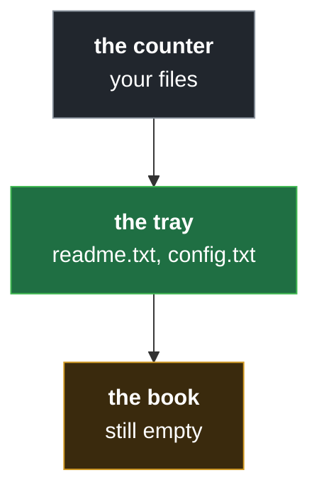
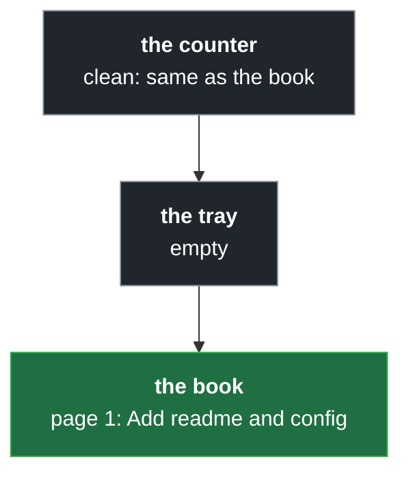
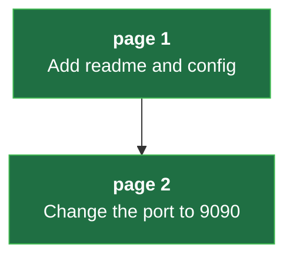

# Saving a Version: git commit (Git from Zero, No Experience Needed)


**Video:** coming soon on the [channel](https://www.youtube.com/@production-devops).

Two files wait on the tray: now you sign them into the book. This lesson of Git and GitHub from Zero takes git commit -m apart piece by piece, saves the first version for real, reads Git's answer (root commit, commit ID, files changed), checks that the working tree is clean, then changes one line and saves a second version. Plus: what makes a good commit message. No experience needed: every new word is explained on screen, and every command runs for real. The challenge and its solution are in the demos repo.

## Files in this folder

- [`acme-app/config.txt`](acme-app/config.txt)
- [`acme-app/readme.txt`](acme-app/readme.txt)
- [`challenge-solution.sh`](challenge-solution.sh) (solution of the challenge: try it yourself first)

## What you need

A Linux shell (a VM, WSL or a container is fine). Everything runs inside this folder.

## Before you start

The video runs these commands first, off screen:

```bash
if [ ! -e .tt-lab ]; then rm -rf /lab/git5 && mkdir -p /lab/git5 && cp -a . /lab/git5/ && rm -f /lab/git5/.tt-runner.sh && touch .tt-lab; fi
export HOME=/lab/git5 && cd /lab/git5/acme-app
git config --global user.name ops && git config --global user.email ops@example.com && git config --global init.defaultBranch main && git config --global core.pager cat
[ -d .git ] || { git init -q && git add readme.txt config.txt; }
if git rev-parse -q --verify HEAD >/dev/null && grep -q port=8080 config.txt; then sed -i s/port=8080/port=9090/ config.txt; fi
PROMPT_COMMAND='HOME=/lab/git5; PS1="\[\e[1;32m\]sre@lab\[\e[0m\]:\[\e[1;34m\]\w\[\e[0m\]$ "'
```

## The lesson, step by step

The same explanations as the video, with every command. Read it, then run it yourself.

Two files wait on the tray. Today you sign them into the book. And at the end, you save a second version, all by yourself.

To follow along, you need a terminal with Git, like in lesson three. Git also needs your name and email, set once. The guide in the demo repo shows how. Or just watch. Every step is on screen.

### The plan

This is lesson five of Git and GitHub from Zero. First, we check the tray. Then the new command, piece by piece: git commit. Then we sign the first page. And we change a line, and save version two.

### The tray

**Where lesson 4 ended**



Here is where lesson four ended. Both files are on the tray. The book is still empty.

Let's check, with git status from lesson four.

```console
$ git status
```

Both files are green, under changes to be committed. Ready to sign.

### The command

- `option — An extra piece after a command, starting with a dash (like a note on an order: no onions)`: 
New word: option. It is an extra piece after a command, starting with a dash. Like a note on an order: no onions.

```console
$ git commit -m "Add readme and config"
```

Here is the one new command. Four pieces.

- `git`: the program
Git, the program.

- `commit`: sign the tray into the book
Commit: sign what is on the tray into the book, as a new page.

- `-m`: option: the message comes next
Dash m is an option. It means: the message comes next.

- `"Add readme and config"`: the message, in quotes
And the message itself, in quotes. What changed, in a few words.

### First page

We type the whole command, and press Enter.

```console
$ git commit -m "Add readme and config"
```

Look at the first line. Main, then root commit: the very first page. Then seven letters and digits: the commit ID. Yours will be different. Last, a summary: two files changed, four lines added. What is left on the tray? We ask git status again.

```console
$ git status
```

Nothing to commit, working tree clean. Everything is in the book.

- `working tree — Your files as they are now, in the folder (like the kitchen counter, where you work)`: 
New word: working tree. It means your files as they are now, in the folder. Clean means: the same as the book.

**After the commit**



Here is the picture now. The tray is empty. The book has its first signed page.

### So far

So far: git commit dash m signs the tray into the book. Each commit gets an ID, an author, a date, and a message. Next: we change a line, and save version two.

### Version two

```
name=acme-app
port=9090
```

Off screen, in a text editor, we changed the port. Eight zero eight zero became nine zero nine zero. The first line did not change.

What does Git see? Git status.

```console
$ git status
```

Modified: config dot t x t, in red. Changed, but not on the tray. Lesson four: on the tray, with git add.

```console
$ git add config.txt
```

And we sign it, with a message that says what changed.

```console
$ git commit -m "Change the port to 9090"
```

No root commit this time. It is page two, after page one. One line in, one line out.

**Two pages in the book**



Two pages in the book now. Page one still holds the old port. Nothing was overwritten.

### Good to know

Good to know. A good message says what changed, and starts with a verb. Forgot dash m? Git opens a text editor, to ask for the message. A commit stays on your computer. Going online is lesson eight.

### Recap

Recap: git commit dash m, with a message, signs the tray into the book. Root commit means the very first page. Working tree clean means everything is saved. Your challenge: change readme dot t x t. Then add it and commit it, with a good message. The solution is in the demo repo.

### Where next

Where next? Lesson six: looking back, with git log. We read the pages of the book.

Next lesson: looking back, with git log. Subscribe so you do not miss it.

## All the commands, to copy

Run them from inside this folder, in this order (some are expected to fail: that is the point of the demo).

```bash
git status
git commit -m "Add readme and config"
git add config.txt
git commit -m "Change the port to 9090"
```

## Challenge

Your challenge: change readme dot t x t. Then add it and commit it, with a good message. The solution is in the demo repo.

When you have tried: [`challenge-solution.sh`](challenge-solution.sh).

---

From the [ProductionDevOps](https://www.youtube.com/@production-devops) channel: real-world DevOps and SRE, explained with real commands.
