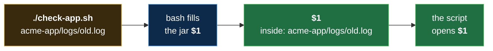
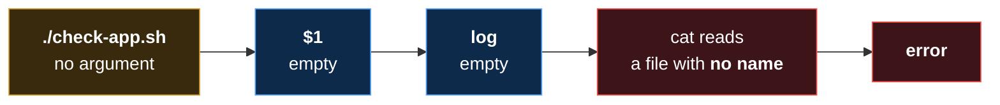

# Arguments: Giving a Script Its Input (Shell Scripting from Zero)


**Video:** coming soon on the [channel](https://www.youtube.com/@production-devops).

Your script always reads the same log, and checking another one means editing the file. In this lesson of Shell Scripting from Zero you hand the script its input when you run it: an argument. We see where it lands ($1), change one line of our acme-app script, run it on two different logs, and then forget the argument on purpose to read the real error that follows. Every new word is explained on screen and every command runs for real. The challenge and its solution are in the demos repo.

## Files in this folder

- [`acme-app/config.txt`](acme-app/config.txt)
- [`acme-app/logs/app.log`](acme-app/logs/app.log)
- [`acme-app/logs/old.log`](acme-app/logs/old.log)
- [`check-app.sh`](check-app.sh)
- [`notes/ideas.txt`](notes/ideas.txt)
- [`notes/todo.txt`](notes/todo.txt)
- [`readme.txt`](readme.txt)
- [`challenge-solution.sh`](challenge-solution.sh) (solution of the challenge: try it yourself first)

## What you need

A Linux shell (a VM, WSL or a container is fine). Everything runs inside this folder.

## Before you start

The video runs these commands first, off screen:

```bash
mkdir -p /lab && ln -sfn "$PWD" /lab/sre && cd /lab/sre && export HOME=/lab/sre
alias ls='ls --color=auto'
PROMPT_COMMAND='PS1="\[\e[1;32m\]sre@lab\[\e[0m\]:\[\e[1;34m\]\w\[\e[0m\]$ "'
```

## The lesson, step by step

The same explanations as the video, with every command. Read it, then run it yourself.

Our script always reads the same log. To read another one, you edit the file. Today you hand the script its input, and you see what happens when you forget.

You will need a terminal with bash. And check app dot s h from lesson four, with its two jars. Or just watch. Every step is on screen.

### The plan

This is lesson five of Shell Scripting from Zero. First, what an argument is. Then dollar one: where it lands. One script, two logs. And we forget it, on purpose, to read a real error.

### Two logs

The logs folder of acme app holds two logs: app dot log, and old dot log.

```console
$ ls acme-app/logs
```

Our script reads only app dot log. The path is written inside the file.

### Arguments

- `argument — A word after a command, telling it what to work on (like what you hand the cook when you ask: this one, please)`: 
New word: argument. A word after a command, that tells it what to work on. Like what you hand the cook when you ask: this one, please.

You have used arguments since Linux from Zero. Here, cat is the command. And the path after it is its argument: what to read. Our script can take one too.

**Where an argument lands: $1**



When the script starts, bash puts the first argument in a jar called dollar one. The script just opens that jar.

Dollar one holds the first argument. Dollar two, the second, and so on. You do not fill them. Bash does, when the script starts.

### The change

Here is the whole script. Only one line changed since lesson four.

```
#!/bin/bash
# check-app.sh: a quick look at acme-app

app="acme-app"
log="$1"

echo "Checking $app"
echo "Log file: $log"
cat "$log"
```

Part one: the shebang and the comment. Part two: the jars. Line five is the change. Part three: the work, exactly as before.

```
app="acme-app"
log="$1"
```

The jar app does not change. The jar log is now filled from dollar one, the first argument. In double quotes, as always. Why copy it into log? The name log says what it is. Dollar one does not.

All together. The script no longer knows which log. You tell it, every time you run it.

```
#!/bin/bash
# check-app.sh: a quick look at acme-app

app="acme-app"
log="$1"

echo "Checking $app"
echo "Log file: $log"
cat "$log"
```

### So far

So far: an argument is what you hand the script. It lands in dollar one. We copy it into the jar log. Next: we run it on both logs.

### Run it

```console
$ ./check-app.sh acme-app/logs/old.log
```

- `./check-app.sh`: the script, right here
First, the script, right here, with dot slash.

- `acme-app/logs/old.log`: the argument: lands in $1
Then a space, and the argument. It lands in dollar one.

First, we hand it app dot log.

```console
$ ./check-app.sh acme-app/logs/app.log
```

Now old dot log. The same script, without any change.

```console
$ ./check-app.sh acme-app/logs/old.log
```

Another log, and another story: an error, yesterday at ten forty two.

### Forget it

What if we hand it nothing? We run it with no argument.

```console
$ ./check-app.sh
```

Look at log file: nothing after the colon. The jar is empty. Then an error. Who: cat; what: two quotes, an empty name; why: no such file.

**Why the error**



No argument, so dollar one is empty, and so is log. Cat is asked to read a file with no name. The script should check first: that is lesson six.

### Good to know

Arguments are split by spaces. A name with spaces? Put it in quotes, when you run the script. Inside the script, always open dollar one in double quotes.

### Recap

Recap: an argument is the input you hand over, when you run the script. Dollar one holds the first one. Log, equals, dollar one gives it a name. Your challenge: make where dot s h greet the name you hand it. Dot slash where s r e should print: hello, s r e. The solution is in the demo repo.

### Where next

Where next? Lesson six: decisions, with if. The script checks that the log exists, before reading it.

Next lesson: decisions, with if. Subscribe so you do not miss it.

## All the commands, to copy

Run them from inside this folder, in this order (some are expected to fail: that is the point of the demo).

```bash
ls acme-app/logs
./check-app.sh acme-app/logs/old.log
./check-app.sh acme-app/logs/app.log
./check-app.sh
```

## Challenge

Your challenge: make where dot s h greet the name you hand it.

When you have tried: [`challenge-solution.sh`](challenge-solution.sh).

---

From the [ProductionDevOps](https://www.youtube.com/@production-devops) channel: real-world DevOps and SRE, explained with real commands.
