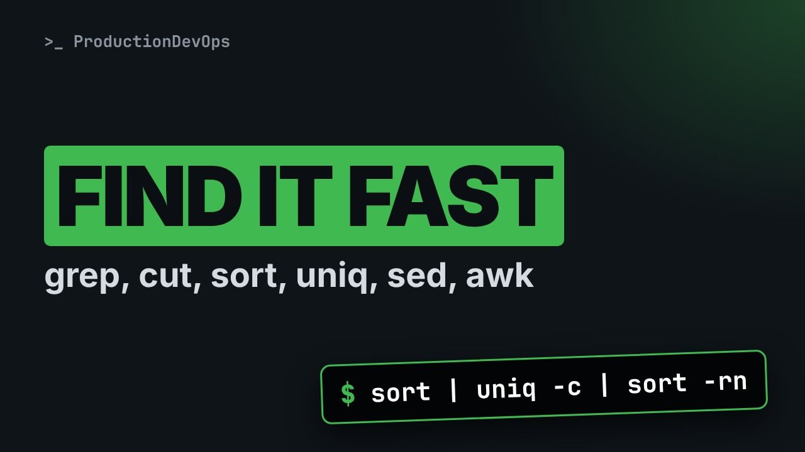
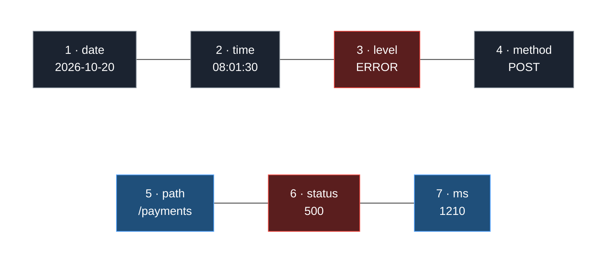
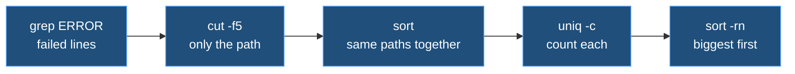

# Searching and Transforming Text: grep, cut, sort, uniq, sed and awk



**Video:** coming soon on the [channel](https://www.youtube.com/@production-devops).

A log with thousands of lines, and one question: which endpoint is failing, and is it slow too? In lesson 11 we answer it with one pipeline, built one piece at a time on an acme-app log: grep with basic and extended regular expressions, wc, cut, sort, uniq -c and sort -rn, the uniq count that lies without sort, then sed to substitute and awk to filter on a number. Up to date for RHEL/AlmaLinux 9 and Ubuntu 24.04. Lesson 11 of Linux from User to Server Admin.

## Files in this folder

- [`acme-app.log`](acme-app.log)
- [`challenge-solution.sh`](challenge-solution.sh) (solution of the challenge: try it yourself first)

## What you need

A Linux shell (a VM, WSL or a container is fine). Everything runs inside this folder.

## The lesson, step by step

The same explanations as the video, with every command. Read it, then run it yourself.

A log with thousands of lines, and one question: which endpoint is failing, and is it slow too? One pipeline answers it. We build it piece by piece, and on the way, meet a count that lies.

### The plan

This is lesson 11 of Linux from User to Server Admin. First, grep and regular expressions, to find lines. Then cut, sort and uniq, to count them. Then sed and awk, to change text and compute.

### The log

How big is the log? wc dash l counts lines: twenty. The same commands work on twenty thousand.

```console
$ wc -l acme-app.log
```

What does a line look like? head dash three shows the first three.

```console
$ head -3 acme-app.log
```

**One line, seven fields**



Every line has seven fields, separated by one space: date, time, level, method, path, status code and milliseconds. Remember the numbers. Field five is the path, field seven the time.

### grep

Which requests failed? grep prints only the lines that contain ERROR.

```console
$ grep ERROR acme-app.log
```

How many? Dash c counts the matches instead of printing them.

```console
$ grep -c ERROR acme-app.log
```

### Regular expressions

grep also understands patterns, called regular expressions. A caret means the start of the line, a dollar the end. A dot is any one character, brackets one character from a set. A star repeats the previous item, zero or more times. Dash capital E, extended, adds plus, question mark, a count in braces, and either-or.

```console
$ grep -E ' 5[0-9]{2} ' acme-app.log
```

Server errors have a status from 500 to 599. One pattern finds them all.

- `-E`: extended regular expression
Dash capital E: extended syntax, so braces work.

- `' `: quotes, then a space
Single quotes keep the shell away from the pattern. The space: a new field starts.

- `5`: a literal 5
A five.

- `[0-9]`: one digit, 0 to 9
Brackets: one digit, zero to nine.

- `{2}`: exactly twice
Braces two: exactly two of them.

- ` '`: a space: the field ends
And a space: the field ends, so the time field never matches.

The pattern finds the five server errors, by status code and not by the word.

```console
$ grep -E ' 5[0-9]{2} ' acme-app.log
```

Brackets with a bar mean either-or: 502 or 503, the errors of a gateway.

```console
$ grep -E ' 50(2|3) ' acme-app.log
```

### Counting

**The pipeline we build**



Here is the answer we build. grep keeps the failed lines, cut keeps only the path. sort puts equal paths together, uniq dash c counts them, and sort dash r n puts the biggest first.

```console
$ cut -d' ' -f5 acme-app.log
```

- `cut`: cut columns out of each line
cut keeps a part of every line.

- `-d' '`: delimiter: one space
Dash d sets the delimiter: here, a space, in quotes.

- `-f5`: keep field 5: the path
Dash f five keeps field five, the path.

Failed lines, then only their path.

```console
$ grep ERROR acme-app.log | cut -d' ' -f5
```

sort puts equal paths next to each other.

```console
$ grep ERROR acme-app.log | cut -d' ' -f5 | sort
```

uniq dash c collapses equal neighbours, with a count in front.

```console
$ grep ERROR acme-app.log | cut -d' ' -f5 | sort | uniq -c
```

sort dash n sorts by number, dash r reverses: the worst first. The answer: slash payments, four failures.

```console
$ grep ERROR acme-app.log | cut -d' ' -f5 | sort | uniq -c | sort -rn
```

Now the trap from the start. The same pipeline, without the first sort.

```console
$ grep ERROR acme-app.log | cut -d' ' -f5 | uniq -c
```

uniq only merges equal lines that are next to each other. The orders line splits the payments lines in two groups.

Let's take stock. grep finds lines, counts them, and understands patterns. cut, sort, uniq dash c and sort dash r n make a ranking. Next: is slash payments slow too? sed and awk answer.

### sed

```console
$ sed 's/ /,/g' acme-app.log
```

sed edits text as it flows past, with the substitute command you met in vim.

- `sed`: stream editor
sed, the stream editor: it reads lines, changes them, prints them. The file stays as it is.

- `s`: substitute
s, substitute, like colon s in vim.

- `/ /,/`: /find a space/put a comma/
Between the slashes: find a space, put a comma.

- `g`: every space, not just the first
g: every match on the line.

First without g, on two lines: only the first space of each line becomes a comma.

```console
$ head -2 acme-app.log | sed 's/ /,/'
```

With g, every space: the log is now a CSV file, ready for a spreadsheet.

```console
$ head -2 acme-app.log | sed 's/ /,/g'
```

### awk

```console
$ awk '$7 > 1000 {print $5, $7}' acme-app.log
```

awk splits every line into fields, and works with them as numbers.

- `awk`: a small language for fields
awk is a small language for fields and numbers.

- `$7 > 1000`: pattern: field 7 above 1000
The pattern: only lines where field seven, the milliseconds, is above a thousand.

- `{print $5, $7}`: action: print path and time
The action in braces: print field five, the path, and field seven. The comma prints a space.

- `acme-app.log`: the input
And the input file.

First, the action alone: path and time of every line. Three are enough.

```console
$ awk '{print $5, $7}' acme-app.log | head -3
```

Now with the pattern: only the requests slower than one second. Slash payments again, three times.

```console
$ awk '$7 > 1000 {print $5, $7}' acme-app.log
```

### Gotchas

Four traps to remember. One. Quote every pattern, or the shell expands the star first. Two. A dot matches any character. A backslash makes it a real dot. Three. sort is alphabetical, so ten comes before nine. Dash n sorts numbers. Four. sed dash i edits the file itself. Dash i dot bak keeps a backup.

### Recap

Let's recap. grep finds lines, with patterns in quotes. cut picks a field, and sort, uniq, sort makes a ranking. sed changes text, awk works with fields and numbers. Your challenge: count the requests per method, GET and POST, biggest first. The solution is in the demo repository.

Now you can ask a log a question and get the answer in one line. Next lesson: processes, what runs on your machine, and how to see it. Subscribe to follow the course.

## All the commands, to copy

Run them from inside this folder, in this order (some are expected to fail: that is the point of the demo).

```bash
wc -l acme-app.log
head -3 acme-app.log
grep ERROR acme-app.log
grep -c ERROR acme-app.log
grep -E ' 5[0-9]{2} ' acme-app.log
grep -E ' 50(2|3) ' acme-app.log
cut -d' ' -f5 acme-app.log
grep ERROR acme-app.log | cut -d' ' -f5
grep ERROR acme-app.log | cut -d' ' -f5 | sort
grep ERROR acme-app.log | cut -d' ' -f5 | sort | uniq -c
grep ERROR acme-app.log | cut -d' ' -f5 | sort | uniq -c | sort -rn
grep ERROR acme-app.log | cut -d' ' -f5 | uniq -c
sed 's/ /,/g' acme-app.log
head -2 acme-app.log | sed 's/ /,/'
head -2 acme-app.log | sed 's/ /,/g'
awk '$7 > 1000 {print $5, $7}' acme-app.log
awk '{print $5, $7}' acme-app.log | head -3
```

## Challenge

Your challenge: count the requests per method, GET and POST, biggest first. The solution is in the demo repository.

When you have tried: [`challenge-solution.sh`](challenge-solution.sh).

---

From the [ProductionDevOps](https://www.youtube.com/@production-devops) channel: real-world DevOps and SRE, explained with real commands.
