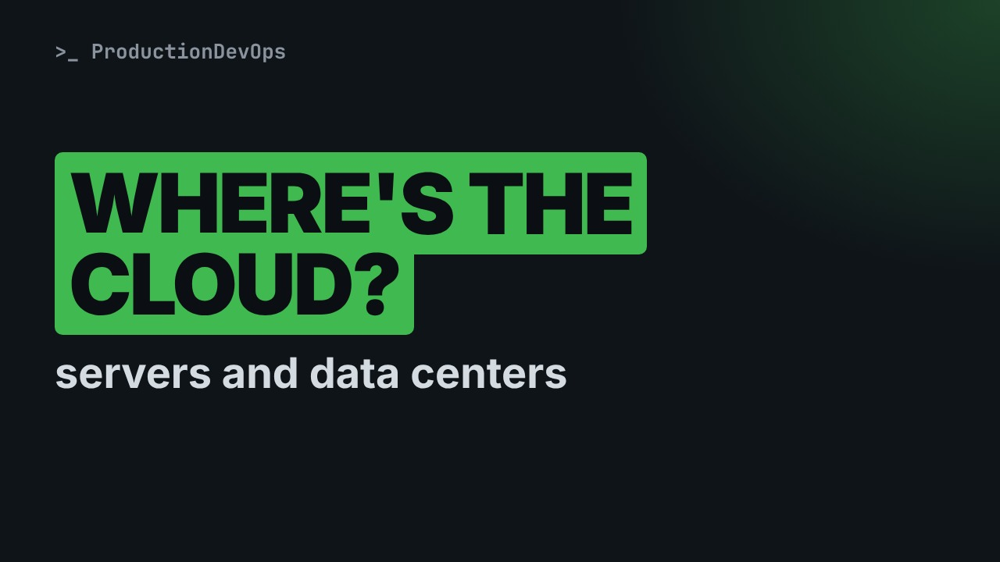
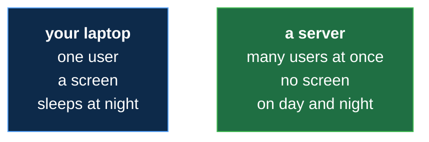
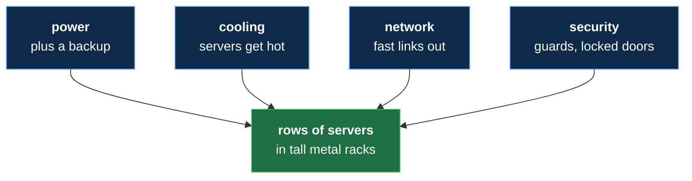
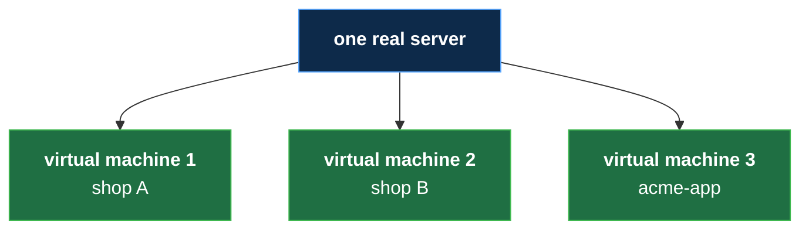
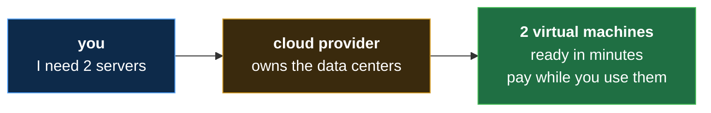

# Servers, Clouds and Data Centers, Explained Simply (DevOps from Zero, No Experience Needed)

**Video:** https://youtu.be/50m5bwn3Tuo

People say "it's in the cloud", but the cloud is not in the sky. This lesson of DevOps from Zero shows, with pictures and a restaurant comparison, what a server really is, what is inside a data center, how one big computer is split into virtual machines, and what renting servers from a cloud provider means, compared with owning them. At the end: where the cloud really is. No terminal, nothing to install, no experience needed. Every new word is explained on screen. The challenge and its solution are in the demos repo.

## Files in this folder

- [`challenge-solution.md`](challenge-solution.md) (solution of the challenge: try it yourself first)

## What you need

A Linux shell (a VM, WSL or a container is fine). Everything runs inside this folder.

## The lesson, step by step

The same explanations as the video, with every command. Read it, then run it yourself.

People say: it is in the cloud. But the cloud is not in the sky. At the end, you will know where it really is.

For this lesson you need nothing. Just watch. No terminal and no code. Only pictures. About five minutes.

### The plan

This is lesson three of DevOps from Zero. First, what a server really is. Then the building where servers live: a data center. Then owning servers, or renting them. And where the cloud really is.

### A server

**A server is just a computer**

Remember: a server is the kitchen of lesson one. Inside, it is a computer like your laptop. But it serves many users, has no screen, and never sleeps.

What makes a server different? It is built to run all the time. It often has two of the parts that break, like power supplies and disks. And people manage it from far away, over the network. Very often, it runs Linux. You can learn it in Linux from Zero.

### Data centers

- `data center — A building full of servers, with power, cooling and guards (like a big building with many kitchens inside, and staff for all of them)`: 
Where do servers live? In a data center. It is a building full of servers, with power, cooling and guards.

**Inside a data center**

Inside, there are rows of servers in tall metal racks. The building gives them power with a backup, cooling, fast network links, and locked doors.

### Own or rent

- `on premises — Servers that a company buys, owns and looks after itself (like owning your restaurant kitchen: yours to equip and to repair)`: 
A company can buy its own servers. This is called on premises. Like owning your kitchen: you equip it, and you repair it.

Owning servers means you buy them, and wait for the delivery. You place them, in your own room or in a rented space. When a part breaks, you replace it. More visitors? You buy more servers, and wait again.

### So far

So far: a server is a computer that runs apps, day and night. A data center is the building with power, cooling and guards. Next: renting instead of owning. And where the cloud really is.

### The cloud

- `virtual machine — A pretend computer, carved out of a real one by software (like one big kitchen split into separate cooking stations)`: 
First, one trick: a virtual machine. It is a pretend computer, carved out of a real one by software. Like one big kitchen, split into stations.

**One real server, three virtual machines**

One real server can hold several virtual machines. Each one acts like its own computer. They can even belong to different customers.

- `cloud — Servers in someone else's data center, that you rent and pay for by use (like renting a kitchen by the hour, instead of building one)`: 
Now the big word: cloud. The cloud is servers in someone else's data center. You rent them, and pay for what you use.

**Renting from a cloud provider**

A company that rents servers is called a cloud provider. You ask for two servers. In minutes, two virtual machines are ready.

Own or rent? If you own, you buy, place and repair. If you rent, you get more servers in minutes, and give them back later. Renting is not always cheaper. It depends on how you use it. And many companies use both.

### Where is it?

- `region — An area of the world where a cloud provider has data centers (like a city where a restaurant chain has its kitchens)`: 
Last word: region. A region is an area of the world where a cloud provider has data centers. You choose it.

So, where is the cloud? In real buildings: data centers. They are in many regions of the world. On real servers, split into virtual machines. In one sentence: the cloud is someone else's computers.

### Good to know

Several big cloud providers exist. The ideas are the same in all of them. Clouds also rent ready-made services, like a database you do not have to install. Rented or owned, a server is a server. The skills are the same.

### Recap

Recap: a server is a computer that serves many people, day and night. A data center is the building. A virtual machine is a pretend computer inside a real one. The cloud is someone else's servers, that you rent. Your challenge: ten times more visitors, for one weekend only. Own or rent, and why? The answer is in the demo repo.

### Where next

Where next? Lesson four: automation. Let the computer repeat the work. Lesson five: saving every version. And in lesson eight, your learning map.

Next lesson: automation, let the computer repeat it. Subscribe so you do not miss it.

## Challenge

Your challenge: ten times more visitors, for one weekend only. Own or rent, and why? The answer is in the demo repo.

When you have tried: [`challenge-solution.md`](challenge-solution.md).

---

From the [ProductionDevOps](https://www.youtube.com/@production-devops) channel: real-world DevOps and SRE, explained with real commands.
