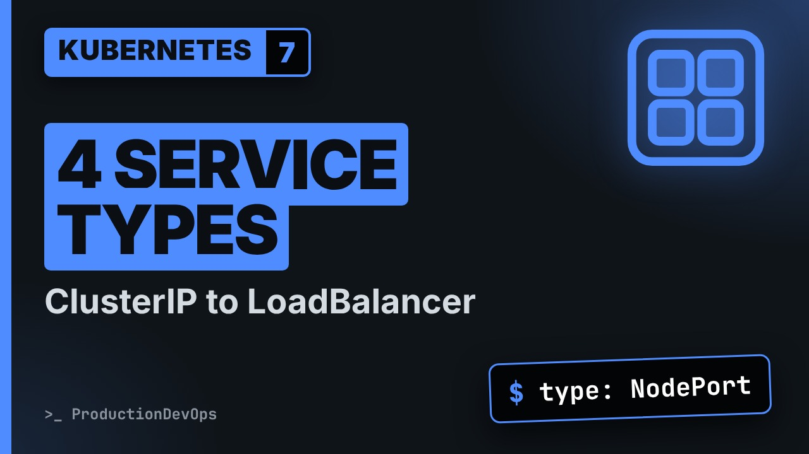
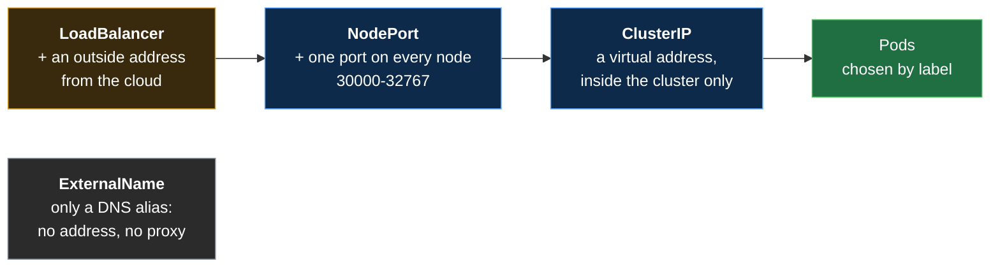
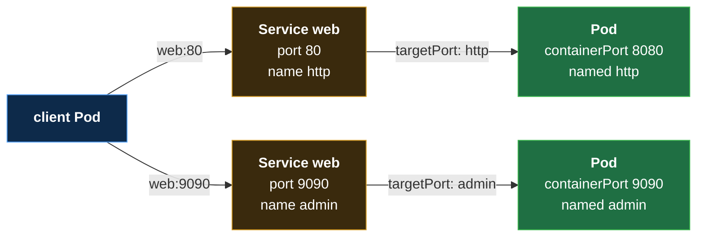
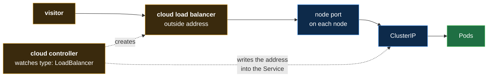

# Kubernetes Services in Depth: ClusterIP, NodePort, LoadBalancer, ExternalName



**Video:** https://youtu.be/Yyi09M6G84o

Four Service types, and on a laptop cluster one of them waits forever. On a real cluster we build a ClusterIP Service with two named ports and targetPort by name, open a NodePort on every node and reach it from a node that runs none of the Pods, see why a LoadBalancer stays pending without a cloud controller, alias an outside name with ExternalName, make a client stick to one Pod with sessionAffinity, and hit the NodePort range and collision errors. Lesson 7 of Kubernetes Deep Dive.

## Files in this folder

- [`web-nodeport.yaml`](web-nodeport.yaml)
- [`web-svc.yaml`](web-svc.yaml)
- [`web.yaml`](web.yaml)
- [`challenge-solution.sh`](challenge-solution.sh) (solution of the challenge: try it yourself first)
- [`cleanup.sh`](cleanup.sh)

## What you need

A Kubernetes cluster you can break: a local [kind](https://kind.sigs.k8s.io/) cluster with one control plane and two workers is what the video uses, plus `kubectl`. Never run these commands against a cluster that matters.

The outputs below were captured for real on the lab cluster. On yours, names, ages, IPs and ports will differ; everything else should match.

## The lesson, step by step

The same explanations as the video, with every command and its real output. Read it, then run it yourself.

A Service has four types, and on a laptop cluster one of them waits forever. Today, all four, and at the end one field that pins a client to one Pod.

### The plan

Lesson seven of Kubernetes Deep Dive: networking begins. ClusterIP, with named ports. NodePort. LoadBalancer and ExternalName. Then sticky clients, and which type to pick.

**Four types, three of them stacked**



Three types stack up: a NodePort is also a ClusterIP, and a LoadBalancer is also a NodePort. ExternalName is only a DNS alias.

### The app

First, the app: three Pods, each answering with its own name.

```
apiVersion: apps/v1
kind: Deployment
metadata:
  name: web
  namespace: shop
spec:
  replicas: 3
  selector:
    matchLabels: {app: web}
  template:
    metadata:
      labels: {app: web}
    spec:
      containers:
        - name: web
          image: busybox:1.36
          command: ["sh", "-c", "hostname > /tmp/index.html; httpd -p 9090 -h /tmp; httpd -f -p 8080 -h /tmp"]
          ports:
            - {name: http, containerPort: 8080}
            - {name: admin, containerPort: 9090}
```

The Deployment. The Pod template, with two named ports.

```
apiVersion: apps/v1
kind: Deployment
metadata:
  name: web
  namespace: shop
spec:
  replicas: 3
  selector:
    matchLabels: {app: web}
```

A Deployment web, in namespace shop. Three replicas, selected by app equals web. Our Services use the same label.

```
template:
  metadata:
    labels: {app: web}
  spec:
    containers:
      - name: web
        image: busybox:1.36
        command: ["sh", "-c", "hostname > /tmp/index.html; httpd -p 9090 -h /tmp; httpd -f -p 8080 -h /tmp"]
        ports:
          - {name: http, containerPort: 8080}
          - {name: admin, containerPort: 9090}
```

Every Pod gets that label. One busybox container. Its command starts two tiny web servers. Dissected next. Port eighty eighty is named http. Ninety ninety is named admin.

```console
$ hostname > /tmp/index.html; httpd -p 9090 -h /tmp; httpd -f -p 8080 -h /tmp
```

Piece by piece.

- `hostname > /tmp/index.html;`: the page = the Pod's name
The page is the Pod's own name.

- `httpd -p 9090 -h /tmp;`: server 1: port 9090, background
A web server on ninety ninety, in the background.

- `httpd -f -p 8080 -h /tmp`: server 2: port 8080, foreground
One on eighty eighty. Dash f keeps it in front, so the container stays up.

All together: three Pods, two named ports.

```
apiVersion: apps/v1
kind: Deployment
metadata:
  name: web
  namespace: shop
spec:
  replicas: 3
  selector:
    matchLabels: {app: web}
  template:
    metadata:
      labels: {app: web}
    spec:
      containers:
        - name: web
          image: busybox:1.36
          command: ["sh", "-c", "hostname > /tmp/index.html; httpd -p 9090 -h /tmp; httpd -f -p 8080 -h /tmp"]
          ports:
            - {name: http, containerPort: 8080}
            - {name: admin, containerPort: 9090}
```

We apply it, in a fresh namespace.

```console
$ kubectl apply -f web.yaml
deployment.apps/web created
```

Three Pods, running.

```console
$ kubectl get pods -n shop
NAME                   READY   STATUS    RESTARTS   AGE
web-799dc9bbd6-s9szk   1/1     Running   0          11s
web-799dc9bbd6-twd7l   1/1     Running   0          11s
web-799dc9bbd6-xqwbz   1/1     Running   0          11s
```

### ClusterIP

**port, targetPort, containerPort**



Port is where the Service listens. Target port is where the Pod listens: a number, or the name of a container port.

The Service, in two blocks.

```
apiVersion: v1
kind: Service
metadata:
  name: web
  namespace: shop
spec:
  type: ClusterIP
  selector: {app: web}
  ports:
    - name: http
      port: 80
      targetPort: http
    - name: admin
      port: 9090
      targetPort: admin
```

Type and selector. Two named ports.

```
apiVersion: v1
kind: Service
metadata:
  name: web
  namespace: shop
spec:
  type: ClusterIP
  selector: {app: web}
```

Service web, in shop. Type ClusterIP, the default: a virtual address, inside the cluster only. It selects ready Pods labelled app web.

```
ports:
  - name: http
    port: 80
    targetPort: http
  - name: admin
    port: 9090
    targetPort: admin
```

With two or more ports, each one needs a name. Port eighty: where the Service listens. Target port http: the container port with that name. The Pod's number can change. The same for admin.

All together: one address, two named doors.

```
apiVersion: v1
kind: Service
metadata:
  name: web
  namespace: shop
spec:
  type: ClusterIP
  selector: {app: web}
  ports:
    - name: http
      port: 80
      targetPort: http
    - name: admin
      port: 9090
      targetPort: admin
```

We apply it.

```console
$ kubectl apply -f web-svc.yaml
service/web created
```

And list it.

```console
$ kubectl get service web -n shop
NAME   TYPE        CLUSTER-IP     EXTERNAL-IP   PORT(S)           AGE
web    ClusterIP   192.0.2.10   <none>        80/TCP,9090/TCP   1s
```

No external address: inside only.

```console
$ kubectl exec client -n shop -- wget -qO- http://web
```

A client Pod, already running in shop, calls it.

- `kubectl exec client`: run a command in Pod client
Exec runs a command in Pod client.

- `--`: the rest runs in the Pod
After dash dash: inside the Pod.

- `wget -qO-`: fetch quietly, print the page
Wget prints the page, quietly.

- `http://web`: the Service, by its short name
Just web: in the same namespace a short name works. Lesson nine explains why.

We call port eighty.

```console
$ kubectl exec client -n shop -- wget -qO- http://web
web-799dc9bbd6-s9szk
```

And the admin door, ninety ninety.

```console
$ kubectl exec client -n shop -- wget -qO- http://web:9090
web-799dc9bbd6-s9szk
```

### So far

So far: a ClusterIP is one virtual address, inside only. A target port by name lets the Pod's port change. Next: from outside. Then, the sticky client.

### NodePort

From outside: a NodePort Service.

```
apiVersion: v1
kind: Service
metadata:
  name: web-nodeport
  namespace: shop
spec:
  type: NodePort
  selector: {app: web}
  ports:
    - name: http
      port: 80
      targetPort: http
      nodePort: 30080
```

Same header, new name. Two new lines in the spec.

```
spec:
  type: NodePort
  selector: {app: web}
  ports:
    - name: http
      port: 80
      targetPort: http
      nodePort: 30080
```

Type NodePort: every node opens a port to the Service. Same Pods, same http port. Node port thirty thousand eighty, our choice. Leave it out, and the cluster picks one.

All together: port thirty thousand eighty, on every node.

```
apiVersion: v1
kind: Service
metadata:
  name: web-nodeport
  namespace: shop
spec:
  type: NodePort
  selector: {app: web}
  ports:
    - name: http
      port: 80
      targetPort: http
      nodePort: 30080
```

```console
$ docker exec lab-control-plane curl -s http://lab-control-plane:30080
```

Our nodes are containers: docker exec runs a command on one.

- `docker exec lab-control-plane`: run on the control-plane node
On the control plane, where none of our Pods runs.

- `curl -s`: fetch the page, silently
Curl dash s: fetch the page, silently.

- `http://lab-control-plane:30080`: the node itself, port 30080
The node itself, port thirty thousand eighty.

We apply the NodePort Service.

```console
$ kubectl apply -f web-nodeport.yaml
service/web-nodeport created
```

Both numbers, in the ports column.

```console
$ kubectl get service web-nodeport -n shop
NAME           TYPE       CLUSTER-IP     EXTERNAL-IP   PORT(S)        AGE
web-nodeport   NodePort   192.0.2.11   <none>        80:30080/TCP   1s
```

The control plane, with none of our Pods.

```console
$ docker exec lab-control-plane curl -s http://lab-control-plane:30080
web-799dc9bbd6-s9szk
```

And a worker.

```console
$ docker exec lab-worker2 curl -s http://lab-worker2:30080
web-799dc9bbd6-xqwbz
```

### LoadBalancer

```console
$ kubectl expose deployment web --name=web-lb --type=LoadBalancer --port=80 --target-port=http -n shop
```

Expose writes a Service with the Deployment's selector.

- `kubectl expose deployment web`: a Service for this Deployment
For Deployment web.

- `--name=web-lb`: the Service's name
Named web l b.

- `--type=LoadBalancer`: ask for an outside address
Type LoadBalancer: ask for an outside address.

- `--port=80 --target-port=http`: port 80 → the port named http
Port eighty, to the port named http.

**Who fills in the address**



In a cloud, a controller sees type LoadBalancer, creates a balancer outside, and writes its address into the Service. Traffic enters through the node ports.

We run it.

```console
$ kubectl expose deployment web --name=web-lb --type=LoadBalancer --port=80 --target-port=http -n shop
service/web-lb exposed
```

And ExternalName: an alias for an outside name.

```console
$ kubectl create service externalname billing-db --external-name=db.example.com -n shop
service/billing-db created
```

All four, in one table.

```console
$ kubectl get services -n shop
NAME           TYPE           CLUSTER-IP      EXTERNAL-IP      PORT(S)           AGE
billing-db     ExternalName   <none>          db.example.com   <none>            1s
web            ClusterIP      192.0.2.10    <none>           80/TCP,9090/TCP   10s
web-lb         LoadBalancer   192.0.2.12   <pending>        80:32002/TCP      1s
web-nodeport   NodePort       192.0.2.11    <none>           80:30080/TCP      4s
```

The load balancer's address: pending. No cloud controller here fills it in. It still got a node port. On kind, the extra tool cloud provider kind fills in the address. ExternalName: no cluster IP, only the outside name.

### Sticky clients

```console
$ kubectl exec client -n shop -- sh -c 'for i in 1 2 3 4 5 6; do wget -qO- http://web; done'
```

The payoff: who answers each call? Six in a row.

- `sh -c '`: a small shell inside the Pod
A shell in the client Pod.

- `for i in 1 2 3 4 5 6;`: six times
Six times,

- `do wget -qO- http://web;`: call the Service
call the Service.

- `done'`: end of the loop
Done ends the loop.

We run it.

```console
$ kubectl exec client -n shop -- sh -c 'for i in 1 2 3 4 5 6; do wget -qO- http://web; done'
web-799dc9bbd6-twd7l
web-799dc9bbd6-twd7l
web-799dc9bbd6-s9szk
web-799dc9bbd6-s9szk
web-799dc9bbd6-s9szk
web-799dc9bbd6-xqwbz
```

Now one field, patched into the live Service: session affinity, client IP.

```console
$ kubectl patch service web -n shop -p '{"spec":{"sessionAffinity":"ClientIP"}}'
service/web patched
```

The same six calls.

```console
$ kubectl exec client -n shop -- sh -c 'for i in 1 2 3 4 5 6; do wget -qO- http://web; done'
web-799dc9bbd6-twd7l
web-799dc9bbd6-twd7l
web-799dc9bbd6-twd7l
web-799dc9bbd6-twd7l
web-799dc9bbd6-twd7l
web-799dc9bbd6-twd7l
```

Sticky until three hours without calls, per client IP.

### Traps

Trap one: node port eighty, outside the range.

```console
$ kubectl create service nodeport bad --tcp=80:8080 --node-port=80 -n shop
error: failed to create NodePort service: Service "bad" is invalid: spec.ports[0].nodePort: Invalid value: 80: provided port is not in the valid range. The range of valid ports is 30000-32767
```

Trap two: thirty thousand eighty, already taken.

```console
$ kubectl create service nodeport dup --tcp=80:8080 --node-port=30080 -n shop
error: failed to create NodePort service: Service "dup" is invalid: spec.ports[0].nodePort: Invalid value: 30080: provided port is already allocated
```

Clean up: the namespace, and everything in it.

```console
$ kubectl delete namespace shop
namespace "shop" deleted
```

### Which type

Which one to pick? ClusterIP for everything inside. NodePort for labs, or behind your own balancer. LoadBalancer: one cloud balancer per Service. Simple, but each costs. Ingress or Gateway API: one entry, routing by host and path to many Services.

### Recap

Let's recap. ClusterIP inside NodePort inside LoadBalancer. ExternalName is an alias. Port, then target port, by number or name. Session affinity client IP pins a client to one Pod. Challenge: the admin port on node port thirty thousand ninety, tested from a node. Solution in the demo repository.

Next: inside kube-proxy, the rules behind a Service address. Subscribe to follow the course.

## All the commands, to copy

Run them from inside this folder, in this order.

```bash
hostname > /tmp/index.html; httpd -p 9090 -h /tmp; httpd -f -p 8080 -h /tmp
kubectl apply -f web.yaml
kubectl get pods -n shop
kubectl apply -f web-svc.yaml
kubectl get service web -n shop
kubectl exec client -n shop -- wget -qO- http://web
kubectl exec client -n shop -- wget -qO- http://web:9090
docker exec lab-control-plane curl -s http://lab-control-plane:30080
kubectl apply -f web-nodeport.yaml
kubectl get service web-nodeport -n shop
docker exec lab-worker2 curl -s http://lab-worker2:30080
kubectl expose deployment web --name=web-lb --type=LoadBalancer --port=80 --target-port=http -n shop
kubectl create service externalname billing-db --external-name=db.example.com -n shop
kubectl get services -n shop
kubectl exec client -n shop -- sh -c 'for i in 1 2 3 4 5 6; do wget -qO- http://web; done'
kubectl patch service web -n shop -p '{"spec":{"sessionAffinity":"ClientIP"}}'
kubectl create service nodeport bad --tcp=80:8080 --node-port=80 -n shop
kubectl create service nodeport dup --tcp=80:8080 --node-port=30080 -n shop
kubectl delete namespace shop
```

## Challenge

Challenge: the admin port on node port thirty thousand ninety, tested from a node. Solution in the demo repository.

When you have tried: [`challenge-solution.sh`](challenge-solution.sh).

---

From the [ProductionDevOps](https://www.youtube.com/@production-devops) channel: real-world DevOps and SRE, explained with real commands.
