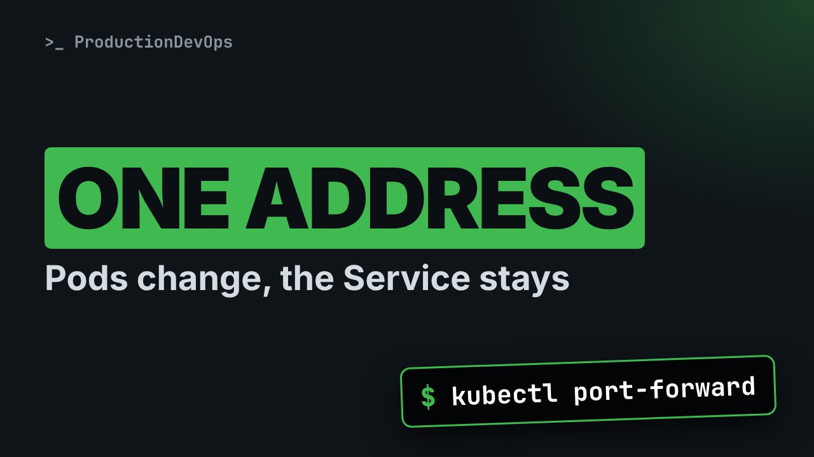
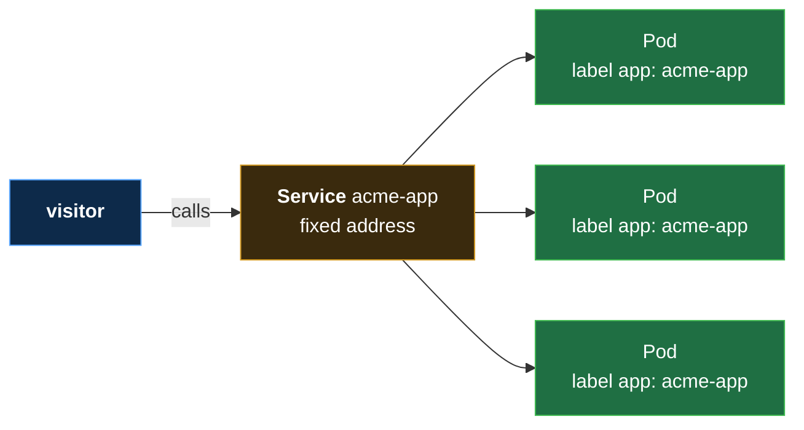

# Kubernetes Services: One Stable Address for Changing Pods (No Experience Needed)



**Video:** https://youtu.be/Ix-JkOakdTw

Every new Pod gets a new address, so how do visitors find your app? This lesson of Kubernetes from Zero shows the problem for real, then the fix: a Service, one name and one address that stay the same while the Pods change. We read the Service's YAML line by line and reach the app from our own computer with kubectl port-forward. No experience needed: every new word is explained on screen. The files, the challenge and its solution are in the demos repo.

## Files in this folder

- [`acme-app.yaml`](acme-app.yaml)
- [`acme-service.yaml`](acme-service.yaml)
- [`challenge-solution.sh`](challenge-solution.sh) (solution of the challenge: try it yourself first)
- [`cleanup.sh`](cleanup.sh)

## What you need

A Linux shell (a VM, WSL or a container is fine). Everything runs inside this folder.

The outputs below were captured for real on the lab cluster. On yours, names, ages, IPs and ports will differ; everything else should match.

## The lesson, step by step

The same explanations as the video, with every command and its real output. Read it, then run it yourself.

A new Pod gets a new address. So how do visitors find your app? Today: one address that stays.

You need nothing. You can just watch. To follow along, use the practice cluster from lesson four, and a browser. You know three commands: get, apply, and delete.

### The plan

This is lesson seven of Kubernetes from Zero. First, the problem: new Pods get new addresses. Then the fix: a Service. Then its file, line by line. And finally, we reach the app from our own computer.

### The problem

- `IP address — A number that finds one machine, or one Pod, on a network (like a phone number: dial it, and the right kitchen answers)`: 
New word: IP address. It is a number that finds one machine, or one Pod, on a network. Like a phone number.

We start the Deployment from lesson six.

```console
$ kubectl apply -f acme-app.yaml
deployment.apps/acme-app created
```

Get pods, dash o wide: a wider table.

```console
$ kubectl get pods -o wide
NAME                        READY   STATUS    RESTARTS   AGE   IP            NODE          NOMINATED NODE   READINESS GATES
acme-app-7747ffb7d6-4x2s5   1/1     Running   0          4s    192.0.2.10   lab-worker2   <none>           <none>
acme-app-7747ffb7d6-6mbqj   1/1     Running   0          4s    192.0.2.11   lab-worker2   <none>           <none>
acme-app-7747ffb7d6-jfxck   1/1     Running   0          4s    192.0.2.12    lab-worker    <none>           <none>
```

Look at the IP column. Each Pod has its own address.

Now we delete the Pods, like in lesson six.

```console
$ kubectl delete pods -l app=acme-app
pod "acme-app-7747ffb7d6-4x2s5" deleted from default namespace
pod "acme-app-7747ffb7d6-6mbqj" deleted from default namespace
pod "acme-app-7747ffb7d6-jfxck" deleted from default namespace
```

The Deployment brings back three new Pods. The same wide table.

```console
$ kubectl get pods -o wide
NAME                        READY   STATUS    RESTARTS   AGE   IP            NODE          NOMINATED NODE   READINESS GATES
acme-app-7747ffb7d6-gqd8q   1/1     Running   0          7s    192.0.2.13   lab-worker2   <none>           <none>
acme-app-7747ffb7d6-hnl8s   1/1     Running   0          7s    192.0.2.14    lab-worker    <none>           <none>
acme-app-7747ffb7d6-nwf8p   1/1     Running   0          7s    192.0.2.15   lab-worker2   <none>           <none>
```

Every address changed. The old numbers now ring nowhere.

### The Service

- `Service — One fixed name and address in front of a group of Pods (like the restaurant's one phone number: whoever is on shift answers)`: 
The fix is a Service. A Service is one fixed name and address in front of a group of Pods. Like a restaurant's one phone number.

**One number, many cooks**



Visitors call the Service. It passes each call to a Pod with its label. When Pods change, it follows them.

- `port — A numbered door on a machine: each program listens at one (like the extension after the phone number)`: 
One more word: port, a numbered door on a machine. Web servers usually listen at door eighty.

### The file

Here is the Service's file. Nine lines, in three parts.

```
apiVersion: v1
kind: Service
metadata:
  name: acme-app
spec:
  selector:
    app: acme-app
  ports:
    - port: 80
```

What it is, and its name. Which Pods it sends calls to. And which door it answers at.

```
apiVersion: v1
kind: Service
metadata:
  name: acme-app
```

Kind Service, form version one, like the Pod. Its name is acme app. Other apps can call it by this name.

```
spec:
  selector:
    app: acme-app
  ports:
    - port: 80
```

The selector: send calls to Pods with the label app, equals acme app. Lesson six's sticker. Ports: the Service answers at port eighty, the same door nginx uses.

All together: a Service called acme app, at port eighty, in front of our Pods.

```
apiVersion: v1
kind: Service
metadata:
  name: acme-app
spec:
  selector:
    app: acme-app
  ports:
    - port: 80
```

We apply the Service's file.

```console
$ kubectl apply -f acme-service.yaml
service/acme-app created
```

And we look at it, with get service.

```console
$ kubectl get service acme-app
NAME       TYPE        CLUSTER-IP     EXTERNAL-IP   PORT(S)   AGE
acme-app   ClusterIP   192.0.2.16   <none>        80/TCP    0s
```

### So far

So far: new Pods get new addresses. A Service gives them one fixed name and address. Next: we reach it from our own computer.

### Reach the app

```console
$ kubectl port-forward service/acme-app 8081:80
```

The cluster is a closed kitchen. This command opens a direct line into it.

- `kubectl port-forward`: open a direct line
Kubectl port forward: open a direct line.

- `service/acme-app`: to the Service acme-app
Service slash acme app: the line goes to our Service.

- `8081`: the door on your computer
Eighty eighty one: the door on your own computer.

- `:80`: the Service's door
Colon eighty: the door of the Service.

We run it.

```console
$ kubectl port-forward service/acme-app 8081:80
Forwarding from 127.0.0.1:8081 -> 80
Forwarding from [::1]:8081 -> 80
Handling connection for 8081
```

Calls to door eighty eighty one, on this computer, now go to the Service. Then we visited that door, as a browser does. Handling connection is that visit. It keeps running while you use it. Control C stops it.

In your browser, open localhost, port eighty eighty one. You see the nginx welcome page, from one of our Pods. To be exact: port forward picks one Pod through the Service. It is for you, not for visitors.

### Pods change

Now we replace every Pod again.

```console
$ kubectl delete pods -l app=acme-app
pod "acme-app-7747ffb7d6-gqd8q" deleted from default namespace
pod "acme-app-7747ffb7d6-hnl8s" deleted from default namespace
pod "acme-app-7747ffb7d6-nwf8p" deleted from default namespace
```

Did the Service change? The same get service.

```console
$ kubectl get service acme-app
NAME       TYPE        CLUSTER-IP     EXTERNAL-IP   PORT(S)   AGE
acme-app   ClusterIP   192.0.2.16   <none>        80/TCP    10s
```

And the same port forward command as before.

```console
$ kubectl port-forward service/acme-app 8081:80
Forwarding from 127.0.0.1:8081 -> 80
Forwarding from [::1]:8081 -> 80
Handling connection for 8081
```

### Recap

Recap: Pods are replaced, and get new addresses. A Service is one name and address. It finds its Pods by label. Port forward opens a line from your computer to the Service. Your challenge: scale to five copies. Does the Service's address change? The solution is in the demo repo.

### Where next

Where next? Lesson eight: everything together, in one file. And then, the Kubernetes Path.

Next lesson: putting it all together. Subscribe so you do not miss it.

## All the commands, to copy

Run them from inside this folder, in this order.

```bash
kubectl apply -f acme-app.yaml
kubectl get pods -o wide
kubectl delete pods -l app=acme-app
kubectl apply -f acme-service.yaml
kubectl get service acme-app
kubectl port-forward service/acme-app 8081:80
```

## Challenge

Your challenge: scale to five copies. Does the Service's address change? The solution is in the demo repo.

When you have tried: [`challenge-solution.sh`](challenge-solution.sh).

---

From the [ProductionDevOps](https://www.youtube.com/@production-devops) channel: real-world DevOps and SRE, explained with real commands.
