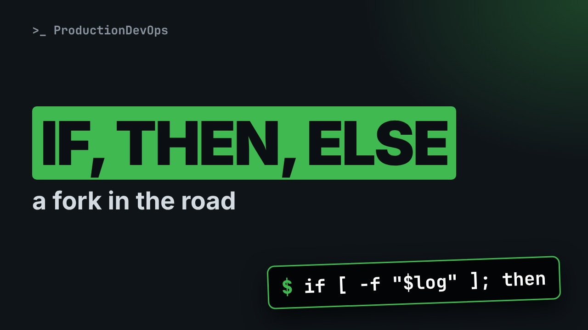
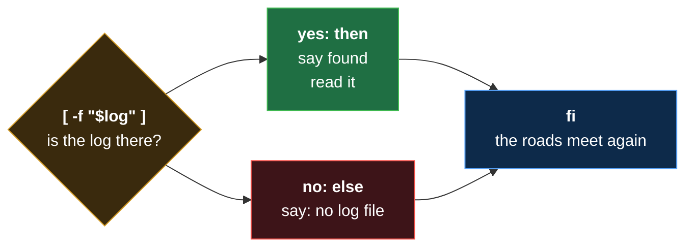

# Decisions: if (Shell Scripting from Zero)



**Video:** coming soon on the [channel](https://www.youtube.com/@production-devops).

Hand a script the wrong file and it crashes into an error. In this lesson of Shell Scripting from Zero the script looks before it reads: we ask a yes or no question with [ -f FILE ], take one road or the other with if, then and else, and close the fork with fi. First by hand, one piece at a time, then in our acme-app script, explained line by line and run three times: a real log, a missing one, and no argument at all. Every new word is explained on screen. The challenge and its solution are in the demos repo.

## Files in this folder

- [`acme-app/config.txt`](acme-app/config.txt)
- [`acme-app/logs/app.log`](acme-app/logs/app.log)
- [`acme-app/logs/old.log`](acme-app/logs/old.log)
- [`check-app.sh`](check-app.sh)
- [`notes/ideas.txt`](notes/ideas.txt)
- [`notes/todo.txt`](notes/todo.txt)
- [`readme.txt`](readme.txt)
- [`challenge-solution.sh`](challenge-solution.sh) (solution of the challenge: try it yourself first)

## What you need

A Linux shell (a VM, WSL or a container is fine). Everything runs inside this folder.

## Before you start

The video runs these commands first, off screen:

```bash
mkdir -p /lab && ln -sfn "$PWD" /lab/sre && cd /lab/sre && export HOME=/lab/sre
alias ls='ls --color=auto'
PROMPT_COMMAND='PS1="\[\e[1;32m\]sre@lab\[\e[0m\]:\[\e[1;34m\]\w\[\e[0m\]$ "'
```

## The lesson, step by step

The same explanations as the video, with every command. Read it, then run it yourself.

Last time, a missing log ended in an error. Today the script looks before it reads. And when the log is not there, it takes another road.

You will need a terminal with bash. And check app dot s h from lesson five, that takes an argument. Or just watch. Every step is on screen.

### The plan

This is lesson six of Shell Scripting from Zero. First, a question: is the file there? Then a fork in the road: if, by hand. Then the other road: else. And our script, run three times.

### The question

- `if — Runs some lines only when the answer to a question is yes (like a fork in the road: one way for yes, one for no)`: 
New word: if. It runs some lines only when the answer to a question is yes. Think of a fork in the road: one way for yes, one for no.

Square brackets ask a yes or no question. It is called a test. Dash f, then a file: is this a file that exists? The spaces inside the brackets are required.

### By hand

```console
$ if [ -f acme-app/logs/app.log ]; then echo "found"; fi
```

- `if`: ask a question
If: we ask a question.

- `[ -f acme-app/logs/app.log ]`: the question: is this file there?
The question: is app dot log a file that exists?

- `; then`: yes? then do this
Semicolon, then. If the answer is yes, do this.

- `echo "found";`: the road for yes
The road for yes: print found.

- `fi`: end of the fork: if, backwards
And f i, if written backwards, ends the fork.

We ask about app dot log. It is there, so we get found.

```console
$ if [ -f acme-app/logs/app.log ]; then echo "found"; fi
```

Now a file that does not exist: nope dot log.

```console
$ if [ -f nope.log ]; then echo "found"; fi
```

The answer is no, so bash skips the yes road. No error, just nothing.

### else

**Two roads: then and else**



Else adds the road for no. Yes: say found, and read the log; no: say there is no log file. At f i, the two roads meet again.

### So far

So far: dash f in square brackets asks: is the file there? If, then, f i: a road for yes. Next: else, the road for no, in our script.

### In the script

Here is the whole script. It has three parts.

```
#!/bin/bash
# check-app.sh: a quick look at acme-app

app="acme-app"
log="$1"

echo "Checking $app"

if [ -f "$log" ]; then
  echo "Log found: $log"
  cat "$log"
else
  echo "No log file at: $log"
fi
```

Part one: the shebang and the comment. Part two: the jars, and the title. As before. Part three is new: the fork.

```
if [ -f "$log" ]; then
  echo "Log found: $log"
  cat "$log"
else
  echo "No log file at: $log"
fi
```

The question, about the file in the jar log. Dollar log, in double quotes. The road for yes: say found, then read it. Two spaces in front, so people see the road. Else: the road for no. Just a message, with the name we were given. F i: the fork ends here.

All together. Fill the jars, print a title, then look before you read.

```
#!/bin/bash
# check-app.sh: a quick look at acme-app

app="acme-app"
log="$1"

echo "Checking $app"

if [ -f "$log" ]; then
  echo "Log found: $log"
  cat "$log"
else
  echo "No log file at: $log"
fi
```

### Run it

First, a real log. The yes road: found, and the log.

```console
$ ./check-app.sh acme-app/logs/app.log
```

Now a log that does not exist. The no road: a clear message.

```console
$ ./check-app.sh nope.log
```

And no argument at all, the mistake from lesson five.

```console
$ ./check-app.sh
```

No cat error this time. The script looked first, and said so.

### Good to know

No space after the bracket? That is an error. The spaces are part of it. Always quote the jar. Without quotes, an empty jar breaks the question. Indent the roads. It is for people. Bash does not care. And dash d asks a different question: is it a folder?

### Recap

Recap: if, a question, then the yes road, else the no road, f i. Look before you act: no crash, but a clear message. Your challenge: a script called is folder dot s h. Use dash d on dollar one. It prints folder, or not a folder. The solution is in the demo repo.

### Where next

Where next? Lesson seven: repeating, with for. We count each kind of line in the log.

Next lesson: repeating, with for. Subscribe so you do not miss it.

## All the commands, to copy

Run them from inside this folder, in this order (some are expected to fail: that is the point of the demo).

```bash
if [ -f acme-app/logs/app.log ]; then echo "found"; fi
if [ -f nope.log ]; then echo "found"; fi
./check-app.sh acme-app/logs/app.log
./check-app.sh nope.log
./check-app.sh
```

## Challenge

Your challenge: a script called is folder dot s h. Use dash d on dollar one.

When you have tried: [`challenge-solution.sh`](challenge-solution.sh).

---

From the [ProductionDevOps](https://www.youtube.com/@production-devops) channel: real-world DevOps and SRE, explained with real commands.
