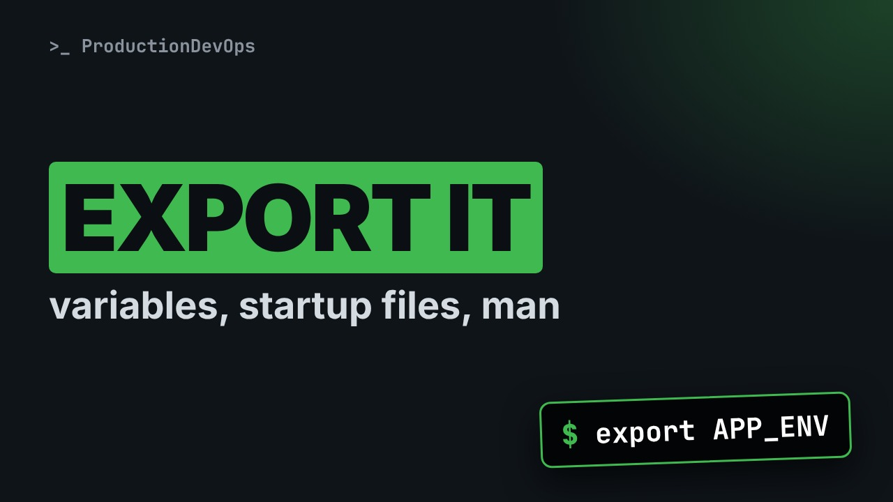
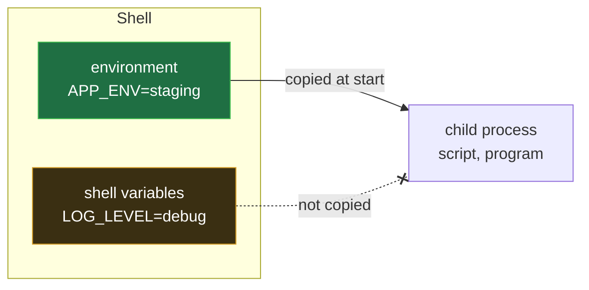
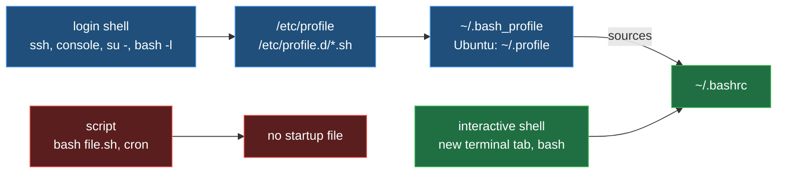

# Shell Variables, the Environment and Getting Help: export, .bashrc and man



**Video:** coming soon on the [channel](https://www.youtube.com/@production-devops).

You set a variable, and your script cannot see it. You add it to .bashrc, and a login over SSH ignores it. In lesson 5 we prove, live, the difference between shell and environment variables, export, printenv and declare -p, the VAR=value command form, source, and which startup files a login, an interactive and a non-interactive shell really read (RHEL 9 and Ubuntu 24.04). Then how to get help on your own: man and its sections, man 5 passwd, apropos and man -k, --help, help for builtins, and info. Lesson 5 of Linux from User to Server Admin.

## Files in this folder

- [`.bash_profile`](.bash_profile)
- [`.bashrc`](.bashrc)
- [`app.env`](app.env)
- [`challenge-solution.sh`](challenge-solution.sh) (solution of the challenge: try it yourself first)

## What you need

A Linux shell (a VM, WSL or a container is fine). Everything runs inside this folder.

## The lesson, step by step

The same explanations as the video, with every command. Read it, then run it yourself.

You set a variable, and your script cannot see it. You put it in a startup file, and SSH ignores it. By the end, you will know which file each shell reads, and why cron reads none.

### The plan

This is lesson 5 of Linux from User to Server Admin. First, shell and environment variables. Then export, printenv and source. Then which startup files each shell reads. Finally, getting help in the terminal.

### Variables

We create a variable called APP_ENV. No spaces around the equals sign.

```console
$ APP_ENV=staging
```

Our shell knows it.

```console
$ echo "$APP_ENV"
```

A child process, a new bash, prints the same variable. The brackets are empty: the child cannot see it.

```console
$ bash -c 'echo "child sees: [$APP_ENV]"'
```

export puts it in the environment, which is copied to every child.

```console
$ export APP_ENV
```

Same command, and now the child sees staging.

```console
$ bash -c 'echo "child sees: [$APP_ENV]"'
```

**Shell variables vs environment variables**



Shell variables stay inside the shell. Environment variables are copied into every program the shell starts. It is a copy, taken when the child starts.

One shell variable, LOG_LEVEL.

```console
$ LOG_LEVEL=debug
```

And one environment variable. export can set and mark it in one step.

```console
$ export APP_ENV=staging
```

declare dash p shows both. Dash x means exported. Two dashes: shell only.

```console
$ declare -p APP_ENV LOG_LEVEL
```

Can a program see LOG_LEVEL? printenv reads only the environment: it prints nothing, and fails.

```console
$ printenv LOG_LEVEL
```

env alone prints the whole environment, dozens of lines. Filter it with grep.

```console
$ env | grep '^APP_'
```

What time is it in Tokyo? A variable before a command is set for that command only. TZ is the time zone.

```console
$ TZ=Asia/Tokyo date +%H:%M
```

Plain date: back to the lab's UTC. Our shell never changed.

```console
$ date +%H:%M
```

This file exports two variables.

```console
$ cat app.env
```

Our shell has APP_ENV set to staging.

```console
$ export APP_ENV=staging
```

bash app dot env runs it in a child, which exits.

```console
$ bash app.env
```

Still staging: a child never changes its parent.

```console
$ echo "$APP_ENV"
```

source runs the file in this shell. A dot does the same.

```console
$ source app.env
```

Now both are set. Startup files are sourced like this.

```console
$ echo "$APP_ENV $APP_HOME"
```

### Startup files

**Which shell reads which file**



A login shell, like SSH, reads slash etc slash profile, profile dot d, then your bash profile. A new terminal tab reads only your bashrc, and a script reads nothing. That is why the bash profile sources the bashrc.

Our lab's home is this demo folder. Its bash profile prints its name, then sources the bashrc, which also prints its name.

```console
$ cat .bash_profile
```

Which files does a login shell read? bash dash l starts one. Look: profile, then bashrc.

```console
$ bash -l -c true
```

And an interactive shell, not a login? bash dash i: only the bashrc.

```console
$ bash -i -c true
```

A plain bash dash c, like a script or cron, reads nothing at all.

```console
$ bash -c true
```

```
~/.bash_profile      login, you         PATH, export VAR=...
  Ubuntu: ~/.profile                    ends with: . ~/.bashrc
~/.bashrc            interactive, you   aliases, functions, prompt
  RHEL 9: also reads ~/.bashrc.d/*
/etc/profile.d/*.sh  login, every user  variables for all users
/etc/bashrc          RHEL: interactive, every user
/etc/bash.bashrc     Ubuntu: interactive, every user
```

The login file, dot profile on Ubuntu, holds PATH and variables, and sources the bashrc. The bashrc holds aliases, functions and the prompt. For all users, add your own file in profile dot d. The system-wide bashrc has a different name per family. After an edit, source it, or open a new shell.

Let's take stock. export gives a variable to children. source runs a file in this shell. Login shells read the profile files, terminal tabs the bashrc, scripts and cron nothing. Next: finding answers on your own, without leaving the terminal.

### Getting help

Which manual pages exist for passwd? man dash f lists them. Look at the numbers: one, the command, and five, the file.

```console
$ man -f passwd
```

man passwd alone opens section one. For the file, give the section: man five passwd. head shows the top.

```console
$ man 5 passwd | head -7
```

The manual has nine numbered sections. Three matter every day. Section one, commands. Section five, file formats, like the passwd file. Section eight, admin commands, like useradd.

How do I create a new user? man dash k searches the descriptions of all pages. Look for section eight.

```console
$ man -k 'new user'
```

apropos is the same search. Dash s five keeps only file formats.

```console
$ apropos -s 5 password
```

Nothing appropriate: cron is not installed here. If a page should exist, rebuild the index with mandb.

```console
$ apropos crontab
```

```
Space / b       next / previous page
/word Enter     search forward for word
n / N           next / previous match
g / G           top / bottom of the page
h               help: every key
q               quit
info ls         the long GNU manual, q quits too
```

man shows pages in a pager. Space goes forward, b back. Slash and a word searches. n jumps to the next match. g and capital G: top and bottom. q quits. info opens the longer GNU manuals.

Which ls option prints human sizes? dash dash help prints a summary, and grep finds the line.

```console
$ ls --help | grep human
```

cd is a builtin, part of bash. For builtins, use the help command.

```console
$ help cd | head -2
```

### Gotchas

Four traps that hit everybody once. One. With spaces, bash runs a command called APP_ENV. Two. On Ubuntu, a new bash profile hides dot profile. Three. cron and services read no startup file: set variables in the job. Four. Minimal images often lack man pages: install them.

### Recap

Let's recap. export copies a variable to children, never back to the parent. A variable before a command: that command only. source: this shell. Login shells read the profiles, tabs the bashrc, scripts nothing. Your challenge: APP_ENV equal lab at every login, and an alias ll in every terminal, each in the right file, proved with bash dash l and dash i. The solution is in the demo repository.

Now you know where variables live, and where to find answers. Next lesson: the filesystem tree, and ls dash l, column by column. Subscribe to follow the course.

## All the commands, to copy

Run them from inside this folder, in this order (some are expected to fail: that is the point of the demo).

```bash
APP_ENV=staging
echo "$APP_ENV"
bash -c 'echo "child sees: [$APP_ENV]"'
export APP_ENV
LOG_LEVEL=debug
export APP_ENV=staging
declare -p APP_ENV LOG_LEVEL
printenv LOG_LEVEL
env | grep '^APP_'
TZ=Asia/Tokyo date +%H:%M
date +%H:%M
cat app.env
bash app.env
source app.env
echo "$APP_ENV $APP_HOME"
cat .bash_profile
bash -l -c true
bash -i -c true
bash -c true
man -f passwd
man 5 passwd | head -7
man -k 'new user'
apropos -s 5 password
apropos crontab
ls --help | grep human
help cd | head -2
```

## Challenge

Your challenge: APP_ENV equal lab at every login, and an alias ll in every terminal, each in the right file, proved with bash dash l and dash i. The solution is in the demo repository.

When you have tried: [`challenge-solution.sh`](challenge-solution.sh).

---

From the [ProductionDevOps](https://www.youtube.com/@production-devops) channel: real-world DevOps and SRE, explained with real commands.
