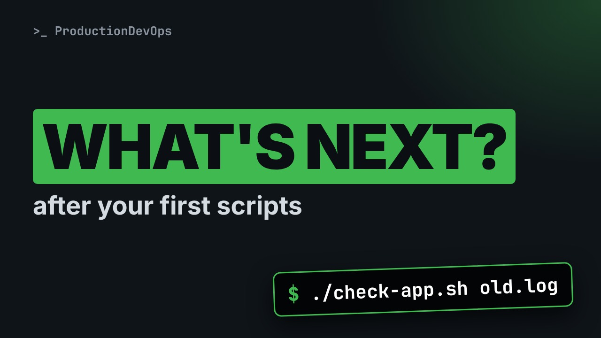
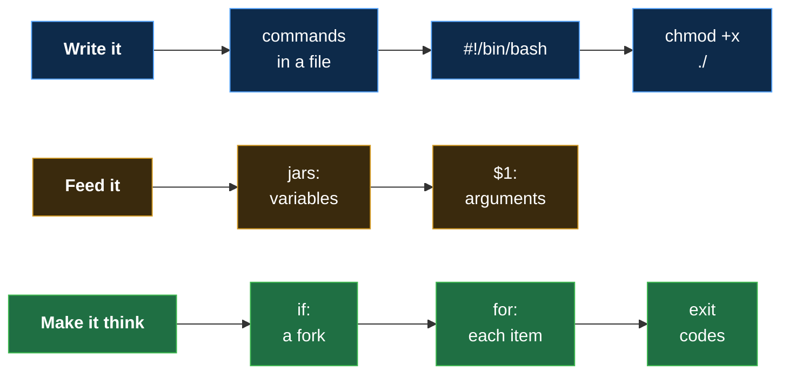
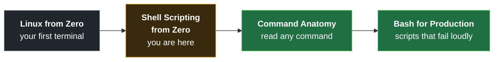

# Where Next: After Your First Scripts (Shell Scripting from Zero)



**Video:** coming soon on the [channel](https://www.youtube.com/@production-devops).

Ten lessons ago a script was a mystery; now you write one that checks a log, counts its lines and tells the truth with its exit code. In this last lesson of Shell Scripting from Zero we look back at the whole recipe card, run our acme-app script one last time, pick three habits to keep from day one, and plan how to practise. Then where to go next: Command Anatomy, to read any command you meet, and Bash for Production, for scripts that fail loudly. The final challenge and its solution are in the demos repo.

## Files in this folder

- [`acme-app/config.txt`](acme-app/config.txt)
- [`acme-app/logs/app.log`](acme-app/logs/app.log)
- [`acme-app/logs/old.log`](acme-app/logs/old.log)
- [`check-app.sh`](check-app.sh)
- [`notes/ideas.txt`](notes/ideas.txt)
- [`notes/todo.txt`](notes/todo.txt)
- [`readme.txt`](readme.txt)
- [`challenge-solution.sh`](challenge-solution.sh) (solution of the challenge: try it yourself first)

## What you need

A Linux shell (a VM, WSL or a container is fine). Everything runs inside this folder.

## Before you start

The video runs these commands first, off screen:

```bash
mkdir -p /lab && ln -sfn "$PWD" /lab/sre && cd /lab/sre && export HOME=/lab/sre
alias ls='ls --color=auto'
PROMPT_COMMAND='PS1="\[\e[1;32m\]sre@lab\[\e[0m\]:\[\e[1;34m\]\w\[\e[0m\]$ "'
```

## The lesson, step by step

The same explanations as the video, with every command. Read it, then run it yourself.

Ten lessons ago, a script was a mystery. Now you write one that checks, counts and reports. Today: what you can do, how to practise, and where to go next.

There is no new command today. Just a terminal, to practise afterwards.

### The plan

This is the last lesson of Shell Scripting from Zero. First, what you can do now. Our script, one last run. Three habits, and how to practise. And the next courses.

### What you can do

**Ten lessons, three steps**



Ten lessons, three steps. You learned to write a script and run it, and to feed it values. And to make it think: forks, loops, and exit codes.

You can put commands in a file, with a shebang and comments. You can run it like a program, with its stamp. You can name values, and take an argument. And you can decide, repeat, and say if it worked.

### One last run

One last run of our script, on yesterday's log.

```console
$ ./check-app.sh acme-app/logs/old.log
```

And did it work? Zero: thumbs up.

```console
$ echo $?
```

And with no argument? The no road, and a clear message.

```console
$ ./check-app.sh
```

One: thumbs down, as promised. Twenty two lines, and you can explain every one.

```console
$ echo $?
```

### So far

So far: you can write a script, feed it, and make it think. Next: three habits, and how to practise.

### Mistakes

Five errors you can read now. Spaces around equals: command not found. Permission denied: the file needs its stamp, c h mod plus x. Command not found for your script: add dot slash. An error at the bracket: put spaces inside it. And an empty dollar one: check it with if, before you use it.

Where do scripts run in real work? By you, every morning. On a schedule, every night, while nobody watches. In a pipeline, after every change to the code. When nobody watches, the exit code speaks for the script. That is why it must tell the truth.

### Habits

One: write the promise first. A comment with the usage, and the exit codes. Two: always quote your jars, with double quotes. Three: end on purpose, with exit zero, or exit one.

### Practise

Practise on your own. Put your own morning commands in a script. Add a word to the loop, like DEBUG. Take a second argument, with dollar two. Keep scripts small, and run them often. Ten minutes a day beats one long evening.

### Next courses

**Your path**



Here is your path. Linux from Zero, then this course. Next, Command Anatomy, and then Bash for Production.

First, Command Anatomy. Linux and DevOps commands, explained piece by piece. One real command per video, flag by flag. So you can read any line you meet in a script.

Then, Bash for Production: scripts that fail loudly. Its first lesson: one line that stops a script at the first error. Then exit codes you can trust, and scripts that clean up after themselves.

### Recap

Recap: a script is a recipe card, that bash follows from top to bottom. Your final challenge: a script called all logs dot s h, that checks both logs. Hint: a for loop, with check app inside. The solution is in the demo repo.

### Where next

Where next? Command Anatomy, then Bash for Production. You find them in the channel's playlists.

Thank you for following Shell Scripting from Zero. Next, Command Anatomy, and Bash for Production. Subscribe so you do not miss a lesson.

## All the commands, to copy

Run them from inside this folder, in this order (some are expected to fail: that is the point of the demo).

```bash
./check-app.sh acme-app/logs/old.log
echo $?
./check-app.sh
```

## Challenge

Your final challenge: a script called all logs dot s h, that checks both logs.

When you have tried: [`challenge-solution.sh`](challenge-solution.sh).

---

From the [ProductionDevOps](https://www.youtube.com/@production-devops) channel: real-world DevOps and SRE, explained with real commands.
