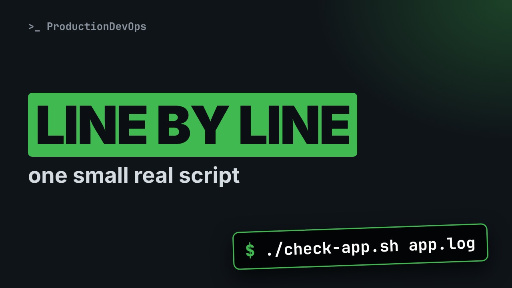
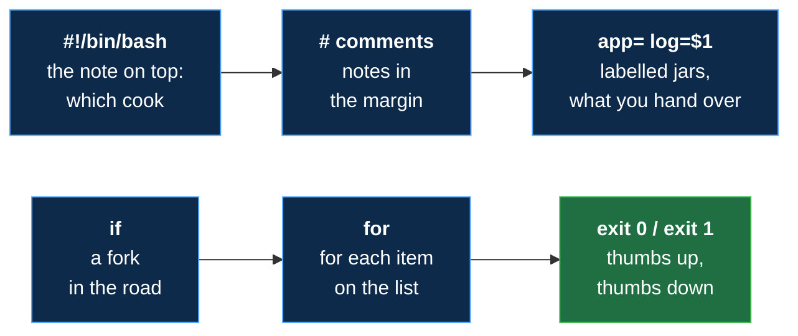

# A Small Real Script, Line by Line (Shell Scripting from Zero)



**Video:** coming soon on the [channel](https://www.youtube.com/@production-devops).

Eight lessons, eight ideas: now they work together in one small real script. In this lesson of Shell Scripting from Zero we read our finished acme-app log checker line by line: the shebang, comments that state its promise, variables, an argument, a decision with if, a for loop that counts INFO, WARN and ERROR lines, and exit codes that tell the truth. Then we run it three ways and learn a simple method to read any script you did not write. Every command runs for real. The challenge and its solution are in the demos repo.

## Files in this folder

- [`acme-app/config.txt`](acme-app/config.txt)
- [`acme-app/logs/app.log`](acme-app/logs/app.log)
- [`acme-app/logs/old.log`](acme-app/logs/old.log)
- [`check-app.sh`](check-app.sh)
- [`notes/ideas.txt`](notes/ideas.txt)
- [`notes/todo.txt`](notes/todo.txt)
- [`readme.txt`](readme.txt)
- [`challenge-solution.sh`](challenge-solution.sh) (solution of the challenge: try it yourself first)

## What you need

A Linux shell (a VM, WSL or a container is fine). Everything runs inside this folder.

## Before you start

The video runs these commands first, off screen:

```bash
mkdir -p /lab && ln -sfn "$PWD" /lab/sre && cd /lab/sre && export HOME=/lab/sre
alias ls='ls --color=auto'
PROMPT_COMMAND='PS1="\[\e[1;32m\]sre@lab\[\e[0m\]:\[\e[1;34m\]\w\[\e[0m\]$ "'
```

## The lesson, step by step

The same explanations as the video, with every command. Read it, then run it yourself.

Eight lessons, eight ideas. Today they work together, in one small real script. At the end, you can read scripts you did not write.

You will need a terminal with bash. And lessons one to eight. Today there is no new command. Or just watch. Every step is on screen.

### The plan

This is lesson nine of Shell Scripting from Zero. First, the whole script, as a map. Then block by block, every line. Then we run it, three ways. And how to read any script.

### The map

Here is the whole script, twenty two lines. Do not read it yet. It has five blocks.

```
#!/bin/bash
# check-app.sh: report on an acme-app log
# usage: ./check-app.sh LOGFILE
# exit codes: 0 = done, 1 = no log

app="acme-app"
log="$1"

echo "Checking $app"

if [ -f "$log" ]; then
  echo "Log found: $log"
  for level in INFO WARN ERROR; do
    echo -n "$level lines: "
    grep -c "$level" "$log"
  done
else
  echo "No log file at: $log"
  exit 1
fi
echo "Report done"
exit 0
```

Block one: the header. Block two: the jars, and a title. Block three: the fork. Block four: the loop, on the yes road. Block five: the end.

### Line by line

```
#!/bin/bash
# check-app.sh: report on an acme-app log
# usage: ./check-app.sh LOGFILE
# exit codes: 0 = done, 1 = no log
```

The shebang, from lesson two. The note on top of the card: bash is the cook. A comment: what the script does. For people, bash skips it. Usage: how to run it, and what to hand over. One log file, the argument. And its promise: exit zero when done, one when there is no log. Lesson eight.

```
app="acme-app"
log="$1"

echo "Checking $app"
```

A labelled jar, app, from lesson four. No spaces around the equals sign. The jar log takes dollar one: what you handed over. Lesson five. Echo prints a title, and opens the jar app. Lesson one.

```
if [ -f "$log" ]; then
  echo "Log found: $log"
  for level in INFO WARN ERROR; do
    echo -n "$level lines: "
    grep -c "$level" "$log"
  done
else
  echo "No log file at: $log"
  exit 1
fi
```

The question from lesson six: is the log there? Dissected in a moment. The yes road starts with a message. Then the loop. It is block four, next. Else, the no road: a clear message. Then exit one: stop here, thumbs down. Lesson eight. F i closes the fork.

```console
$ if [ -f "$log" ]; then
```

- `if`: ask a question
If: ask a question.

- `[ -f "$log" ]`: is the file in the jar log there?
The question, in square brackets with spaces: is the file in the jar log there?

- `; then`: yes? take this road
Semicolon, then: if the answer is yes, take this road.

### So far

So far: the header says the cook, what it does, and its promise. Then jars, a title, and the fork. Next: the loop, the end, and then we run it.

```
    for level in INFO WARN ERROR; do
      echo -n "$level lines: "
      grep -c "$level" "$log"
    done
```

For each word on the list, put it in the jar level. Lesson seven. Print the word as a label. Dash n: stay on this line. Count the lines with that word in the log. The number follows the label. Done: the next word, until the list is empty.

```
echo "Report done"
exit 0
```

We only get here on the yes road. A last message, for people. Exit zero: thumbs up, on purpose, for the computer. The promise of line four.

### Run it

All together again. Now every line has a job you know.

```
#!/bin/bash
# check-app.sh: report on an acme-app log
# usage: ./check-app.sh LOGFILE
# exit codes: 0 = done, 1 = no log

app="acme-app"
log="$1"

echo "Checking $app"

if [ -f "$log" ]; then
  echo "Log found: $log"
  for level in INFO WARN ERROR; do
    echo -n "$level lines: "
    grep -c "$level" "$log"
  done
else
  echo "No log file at: $log"
  exit 1
fi
echo "Report done"
exit 0
```

First, today's log.

```console
$ ./check-app.sh acme-app/logs/app.log
```

Report done. And the exit code? Zero, as promised.

```console
$ echo $?
```

Now yesterday's log. One error line.

```console
$ ./check-app.sh acme-app/logs/old.log
```

And the classic mistake: no argument at all.

```console
$ ./check-app.sh
```

The no road: a clear message, no crash. The exit code?

```console
$ echo $?
```

One, thumbs down, as the header promised.

### Any script

How to read any script. Line one: which cook reads it? The comments: what does it promise? The jars, and dollar one: what comes in? If and for: which roads can it take? And exit: how does it end?

**The whole card**



Here is the whole recipe card. The note on top, notes in the margin, labelled jars, a fork, a checklist, and a thumbs up or down at the end.

### Recap

Recap: one small script holds every idea of this course. To read any script: the cook, the promise, the jars, the roads, the end. Your challenge: add the word DEBUG to the list. Run it on app dot log. What is new, and what is the exit code? The solution is in the demo repo.

### Where next

Where next? Lesson ten, the last one. What you can do now, and the courses that come next.

Next lesson: where next, after your first scripts. Subscribe so you do not miss it.

## All the commands, to copy

Run them from inside this folder, in this order (some are expected to fail: that is the point of the demo).

```bash
if [ -f "$log" ]; then
./check-app.sh acme-app/logs/app.log
echo $?
./check-app.sh acme-app/logs/old.log
./check-app.sh
```

## Challenge

Your challenge: add the word DEBUG to the list.

When you have tried: [`challenge-solution.sh`](challenge-solution.sh).

---

From the [ProductionDevOps](https://www.youtube.com/@production-devops) channel: real-world DevOps and SRE, explained with real commands.
