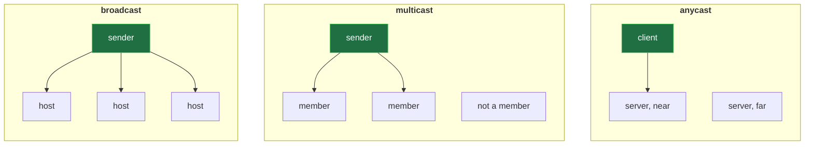
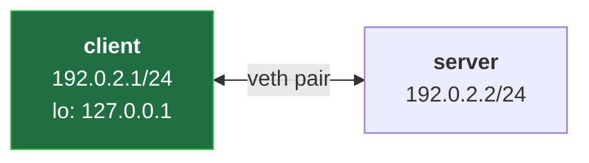
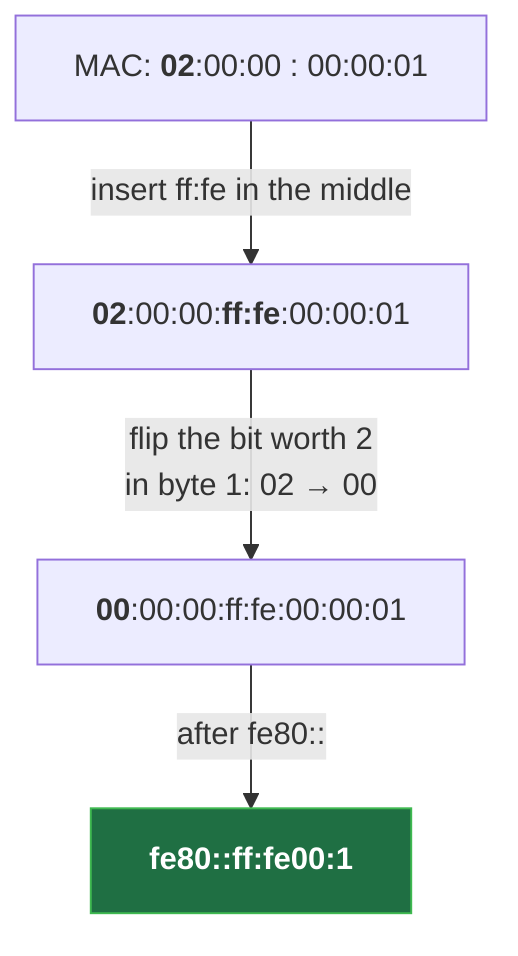

# Special IP Addresses and IPv6 Notation (Private, Loopback, Link-Local, Multicast, Anycast)


**Video:** https://youtu.be/7XofcM7P3dY

Some addresses never leave the machine, some never cross a router, and some reach many hosts at once. We map the special IPv4 ranges (private, loopback, link-local, shared, documentation, broadcast, multicast) and anycast, find them in a real Linux routing table, then learn to read and shorten 128-bit IPv6 addresses without mistakes, and see how a link-local IPv6 address is built from a MAC address. Who hands out addresses, and multihoming, in brief. Script and challenge solution in the demos repo.

## Files in this folder

- [`lab/net.sh`](lab/net.sh)
- [`v6.py`](v6.py)
- [`challenge-solution.sh`](challenge-solution.sh) (solution of the challenge: try it yourself first)

## What you need

A Linux shell (a VM, WSL or a container is fine). Everything runs inside this folder.

## Before you start

The video runs these commands first, off screen:

```bash
bash lab/net.sh up pair >/dev/null 2>&1
```

## The lesson, step by step

The same explanations as the video, with every command. Read it, then run it yourself.

Some addresses never leave the machine; some reach many hosts at once. And our client's MAC starts with 02, but in its IPv6 address that 02 becomes 00: we find out why at the end.

### The plan

This is lesson 3 of Networking Fundamentals. The IPv4 ranges that stay home. One to many: broadcast, multicast, anycast. IPv6: 128 bits, written short. And an address built from a MAC.

### Stay home

Private ranges, from RFC 1918: anyone may use them inside, but Internet routers drop them. NAT bridges the gap, in lesson 14. Loopback, 127.0.0.0 slash 8: the host talking to itself. Link-local, 169 dot 254 slash 16: valid on one link only, when nothing else gave an address. Shared space, for carrier NAT. And documentation ranges, like our lab's 192.0.2.0 slash 24.

### One to many

Broadcast: all host bits set to one, for every host on the subnet. Multicast: only the hosts that joined a group. 224.0.0.1 means all hosts on this link. Anycast is not a range: many servers announce one address, and routing picks the nearest. And 240 slash 4 is reserved.

**Broadcast, multicast, anycast**



In pictures: broadcast reaches every host; multicast, only the members; anycast, one server of many, the nearest.

### In the kernel

**Where to look: the client's local table**



Does Linux treat these addresses specially? We look inside our client, at its local routing table.

ip route show table local lists the addresses the kernel keeps for itself.

```console
$ ip -n client route show table local
```

local 127.0.0.0 slash 8: the whole loopback range belongs to this host. And broadcast 192.0.2.255: the subnet's broadcast, computed from the slash 24.

### So far

So far: private, loopback and link-local stay home. Broadcast and multicast go one to many. Next: IPv6, and why that 02 becomes 00.

### IPv6

IPv6 has 128 bits: eight groups of four hex digits, separated by colons.

- `group 1`: 2001
This one starts with 2001, then 0 d b 8: the IPv6 documentation prefix, slash 32.

- `group 3`: 0000
Then five groups of zeros. Writing them all is slow, and easy to get wrong.

- `group 8`: 0001
And the last group: 1.

Rule one: drop the leading zeros of each group. Rule two: replace one run of zero groups with a double colon. Only once: with two, nobody could tell how many zeros each one hides. So our address becomes 2001, colon, d b 8, double colon, 1.

### The script

We let Python apply the rules. Nine lines, three blocks.

```
#!/usr/bin/env python3
# v6.py ADDRESS...: each IPv6 address in its full form and its short form
import ipaddress
import sys

for arg in sys.argv[1:]:
    ip = ipaddress.IPv6Address(arg)
    print("full: ", ip.exploded)
    print("short:", ip.compressed)
```

The tools. Each address. Both forms.

```
#!/usr/bin/env python3
# v6.py ADDRESS...: each IPv6 address in its full form and its short form
import ipaddress
import sys
```

Run with Python 3; it takes one or more addresses. ipaddress does the arithmetic; sys gives the arguments, as in lesson 2.

```
for arg in sys.argv[1:]:
    ip = ipaddress.IPv6Address(arg)
```

A loop: for each argument, run the indented lines. Parse it as an IPv6 address: a mistake stops the script with an error.

```console
$ for arg in sys.argv[1:]:
```

- `for arg in`: each one, in turn, is arg
For arg in: each value in turn is called arg.

- `sys.argv`: the command line, as a list
sys dot argv: the command line, as a list.

- `[1:]`: from item 1 on: skip the script name
Bracket, one, colon: from item one on. Item zero is the script's own name.

```
    print("full: ", ip.exploded)
    print("short:", ip.compressed)
```

exploded: every group, four digits each. compressed: both rules applied.

The whole script. A quick note: this lab's kernel has no IPv6, so today Python does the work, not a capture.

```
#!/usr/bin/env python3
# v6.py ADDRESS...: each IPv6 address in its full form and its short form
import ipaddress
import sys

for arg in sys.argv[1:]:
    ip = ipaddress.IPv6Address(arg)
    print("full: ", ip.exploded)
    print("short:", ip.compressed)
```

Our address, typed with all its zero groups.

```console
$ python3 v6.py 2001:db8:0:0:0:0:0:1
```

Two runs of zeros: which one gets the double colon?

```console
$ python3 v6.py 2001:db8:0:0:1:0:0:1
```

Equal runs: the first one wins. The other stays as zero, colon, zero.

### Link-local

Every IPv6 card has a link-local address, like 169.254 in IPv4, but always there.

- `prefix, 1/2`: fe80:0000
The first 64 bits: fe80, then zeros. The link-local prefix, fe80 slash 10, padded to 64.

- `interface ID, 1/2`: 0000:00ff
The last 64 bits name the card: the interface identifier. Here it comes from the MAC.

### The answer

**From MAC to interface ID**



The client's MAC has 48 bits: insert ff, fe in the middle to make 64. Then flip one bit, the one that means locally assigned in a MAC: IPv6 inverts its meaning, so 02 becomes 00.

Is fe80, double colon, ff, colon, fe00, colon, 1 really those 128 bits?

```console
$ python3 v6.py fe80::ff:fe00:1
```

### Who assigns

IANA gives blocks to five regional registries; they give them to providers, and providers to you. Private ranges need nobody: you choose. Multihoming: a host or a site connected to two networks at once, for example two providers.

### Gotchas

Many systems now pick random interface IDs, so the MAC does not follow you around. A link-local address exists on every link: you must name the card, with percent eth0. And 192.0.2.0 slash 24 is documentation, not private. Always check the exact range.

### Recap

Recap: private, loopback and link-local stay home. Broadcast and multicast are one to many; anycast picks the nearest. IPv6: drop leading zeros, one double colon, and a prefix plus an interface ID. Challenge: what is the server's link-local address, for MAC 02, then zeros, then 02? Solution in the demo repo.

Next lesson: Ethernet frames and MAC addresses. Subscribe so you do not miss it.

## All the commands, to copy

Run them from inside this folder, in this order (some are expected to fail: that is the point of the demo).

```bash
ip -n client route show table local
for arg in sys.argv[1:]:
python3 v6.py 2001:db8:0:0:0:0:0:1
python3 v6.py 2001:db8:0:0:1:0:0:1
python3 v6.py fe80::ff:fe00:1
```

## Challenge

Challenge: what is the server's link-local address, for MAC 02, then zeros, then 02? Solution in the demo repo.

When you have tried: [`challenge-solution.sh`](challenge-solution.sh).

---

From the [ProductionDevOps](https://www.youtube.com/@production-devops) channel: real-world DevOps and SRE, explained with real commands.
