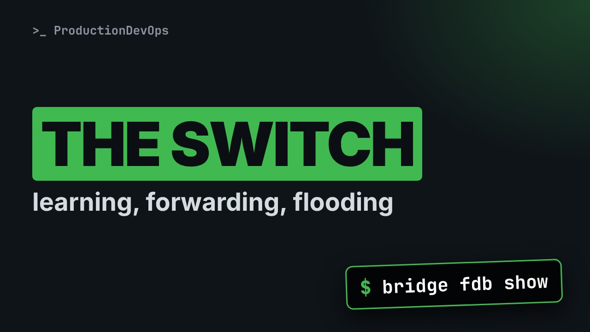
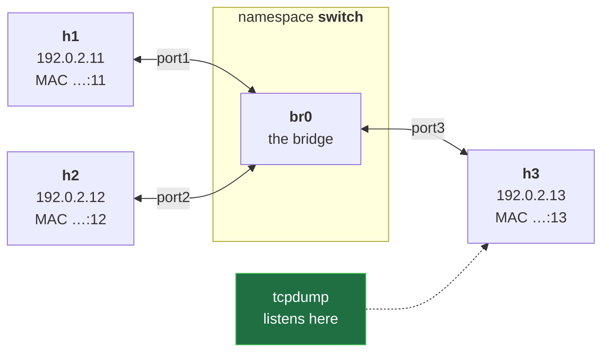
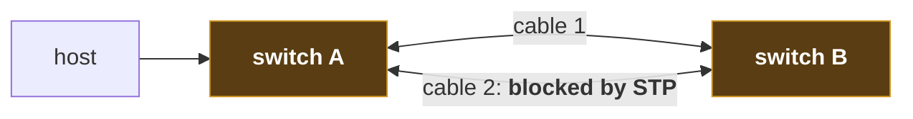

# How a Switch Learns: Linux Bridge, MAC Table and Flooding, Proven in a Capture



**Video:** coming soon on the [channel](https://www.youtube.com/@production-devops).

Nobody configures a switch's table, yet it sends each frame to the right port, and sometimes it sends your frame to everyone. We build a Linux bridge with three hosts in network namespaces, watch the learning table fill up with bridge fdb, and prove with tcpdump on a third host when frames are flooded: broadcasts, and unicast to an unknown destination. Loops, broadcast storms and the Spanning Tree Protocol in brief. Lab script, capture script and challenge solution in the demos repo.

## Files in this folder

- [`flood.sh`](flood.sh)
- [`lab/net.sh`](lab/net.sh)
- [`challenge-solution.sh`](challenge-solution.sh) (solution of the challenge: try it yourself first)

## What you need

A Linux shell (a VM, WSL or a container is fine). Everything runs inside this folder.

## Before you start

The video runs these commands first, off screen:

```bash
bash lab/net.sh up lan >/dev/null 2>&1
```

## The lesson, step by step

The same explanations as the video, with every command. Read it, then run it yourself.

Nobody fills in a switch's table, yet it sends each frame to the right port. And sometimes it sends your frame to everyone. Today we catch it doing both.

### The plan

This is lesson 5 of Networking Fundamentals. What a switch does. A Linux bridge with three hosts, and its script. The learning table, live. Flooding, proven in a capture. Then loops.

### The idea

Rule one, learn: the source MAC of each frame lives behind the port it came in on. Forward: a known destination goes out of that one port. Flood: a broadcast, or an unknown destination, goes out of every other port. Bridge is the older name for the same device. Linux has one built in.

### The lab

**Our lab: three hosts on one switch**



A fourth namespace, switch, holds the bridge, br0. Three hosts plug into its ports. We will listen on h3, the bystander.

From lesson 1, net dot sh has three helpers. host makes a host. cable plugs in a virtual cable. nic sets the card. And a check, a double bar, then create: only if missing.

### The script

The new part of net dot sh, up lan. Two blocks.

```
up_lan() {  # three hosts, each on a port of one switch: the bridge br0
  host switch
  ip -n switch link show br0 >/dev/null 2>&1 ||
    ip -n switch link add br0 type bridge mcast_snooping 0
  ip -n switch link set br0 up
  for n in 1 2 3; do
    host "h$n"
    cable "h$n" switch "port$n"
    ip -n switch link set "port$n" master br0 up
    nic "h$n" "192.0.2.1$n/24" "02:00:00:00:00:1$n"
  done
}
```

The switch. Three hosts, plugged in.

```
up_lan() {  # three hosts, each on a port of one switch: the bridge br0
  host switch
  ip -n switch link show br0 >/dev/null 2>&1 ||
    ip -n switch link add br0 type bridge mcast_snooping 0
  ip -n switch link set br0 up
```

up lan starts with a host called switch, to hold the bridge. No br0 yet? Create it. Then turn it on.

```console
$ ip -n switch link add br0 type bridge mcast_snooping 0
```

- `ip -n switch`: inside the switch host
Inside the switch host,

- `link add br0`: a new interface: br0
a new interface, br0,

- `type bridge`: a software switch
of type bridge: a switch in software.

- `mcast_snooping 0`: no multicast tricks (lesson 19)
mcast snooping zero turns off a multicast feature, for quiet captures. Lesson 19.

```
  for n in 1 2 3; do
    host "h$n"
    cable "h$n" switch "port$n"
    ip -n switch link set "port$n" master br0 up
    nic "h$n" "192.0.2.1$n/24" "02:00:00:00:00:1$n"
  done
}
```

A loop: n takes 1, then 2, then 3. The lines up to done run once for each. Host h-n, and a cable to the switch; the far end is port-n. Plug that port into the bridge. And the card: 192.0.2.1 followed by n, so 11, 12, 13. The MACs end the same way.

```console
$ ip -n switch link set "port$n" master br0 up
```

- `ip -n switch link set "port$n"`: the switch's end of the cable
In the switch, take the cable's end, port-n,

- `master br0`: plug it into br0
make br0 its master: the port now belongs to the bridge,

- `up`: and turn it on
and turn it on.

up lan, all together.

```
up_lan() {  # three hosts, each on a port of one switch: the bridge br0
  host switch
  ip -n switch link show br0 >/dev/null 2>&1 ||
    ip -n switch link add br0 type bridge mcast_snooping 0
  ip -n switch link set br0 up
  for n in 1 2 3; do
    host "h$n"
    cable "h$n" switch "port$n"
    ip -n switch link set "port$n" master br0 up
    nic "h$n" "192.0.2.1$n/24" "02:00:00:00:00:1$n"
  done
}
```

### Learning

The table starts empty. h1 pings h2: first it asks for h2's MAC.

- `h1 → h2`: ARP request, to ff:ff:ff:ff:ff:ff
A broadcast. The switch learns: h1 is on port 1.

- `h1 → h3`: the same frame, flooded
Broadcasts are flooded: h3 gets a copy too.

- `h2 → h1`: ARP reply, to …:11
h2 answers. The switch learns h2, and already knows h1: port 1 only.

- `h1 → h2`: ping, to …:12
The ping itself: known destination, port 2 only. h3 sees nothing.

### The table

A fresh LAN.

```console
$ bash lab/net.sh reset lan
```

What has the switch learned? bridge fdb show prints its table; dynamic keeps only learned entries.

```console
$ bridge -n switch fdb show br br0 dynamic
```

Now h1 pings h2, once.

```console
$ ip netns exec h1 ping -c 1 192.0.2.12
```

And the table again.

```console
$ bridge -n switch fdb show br br0 dynamic
```

### So far

So far: the switch learns source MACs by itself. A known destination gets one port. Next: we catch the flooding, from h3.

### Flooding

The experiment: listen on h3 while h1 pings h2.

```
#!/usr/bin/env bash
# Who sees a frame? Capture on h3 while h1 pings h2, before and after the switch learns
bash lab/net.sh reset lan
ip netns exec h3 tcpdump -n -i eth0 -w h3.pcap -Z root 2>/dev/null &
sleep 1
ip netns exec h1 ping -c 1 192.0.2.12 >/dev/null
bridge -n switch fdb flush dev br0 dynamic
ip netns exec h1 ping -c 1 192.0.2.12 >/dev/null
ip netns exec h1 ping -c 1 192.0.2.12 >/dev/null
sleep 1
kill %1
wait
echo "capture saved: h3.pcap"
```

A fresh LAN, and the capture. A ping, then the switch forgets. Two more pings, and cleanup.

```
#!/usr/bin/env bash
# Who sees a frame? Capture on h3 while h1 pings h2, before and after the switch learns
bash lab/net.sh reset lan
ip netns exec h3 tcpdump -n -i eth0 -w h3.pcap -Z root 2>/dev/null &
sleep 1
```

Run with bash, and start from an empty table. tcpdump records h3's card into a file, in the background, as in lesson 1. A second to start.

```console
$ ip netns exec h3 tcpdump -n -i eth0 -w h3.pcap -Z root 2>/dev/null &
```

- `ip netns exec h3`: on h3, the bystander
On h3,

- `-n -i eth0`: numbers; its card, eth0
numbers only, on its card,

- `-w h3.pcap -Z root`: into a file, as root
into a file, as root,

- `2>/dev/null &`: quiet, in the background
quietly, in the background.

```
ip netns exec h1 ping -c 1 192.0.2.12 >/dev/null
bridge -n switch fdb flush dev br0 dynamic
```

One ping from h1 to h2: the switch learns both, and h1 learns h2's MAC. Then we wipe the switch's table. h1 still knows h2's MAC; the switch does not.

```console
$ bridge -n switch fdb flush dev br0 dynamic
```

- `bridge -n switch`: bridge tool, in the switch host
The bridge tool, in the switch host.

- `fdb flush`: empty the forwarding table
fdb flush: empty the forwarding database,

- `dev br0 dynamic`: br0's learned entries only
only br0's learned entries. Ageing does the same after five silent minutes.

```
ip netns exec h1 ping -c 1 192.0.2.12 >/dev/null
ip netns exec h1 ping -c 1 192.0.2.12 >/dev/null
sleep 1
kill %1
wait
echo "capture saved: h3.pcap"
```

Ping two: h1 sends straight to h2's MAC, but the switch does not know it. Ping three: by now the switch has learned again. A second for the last frames, then stop the capture.

The whole script. Three pings to h2: how many frames will h3 see?

```
#!/usr/bin/env bash
# Who sees a frame? Capture on h3 while h1 pings h2, before and after the switch learns
bash lab/net.sh reset lan
ip netns exec h3 tcpdump -n -i eth0 -w h3.pcap -Z root 2>/dev/null &
sleep 1
ip netns exec h1 ping -c 1 192.0.2.12 >/dev/null
bridge -n switch fdb flush dev br0 dynamic
ip netns exec h1 ping -c 1 192.0.2.12 >/dev/null
ip netns exec h1 ping -c 1 192.0.2.12 >/dev/null
sleep 1
kill %1
wait
echo "capture saved: h3.pcap"
```

### Run it

```console
$ tcpdump -n -t -e -r h3.pcap
```

- `-t`: no timestamps
To read it: dash t, no timestamps,

- `-e`: show the MACs (lesson 4)
dash e, the MACs,

- `-r h3.pcap`: read the saved file
dash r, read the file.

We run it.

```console
$ bash flood.sh
```

And read what h3 received.

```console
$ tcpdump -n -t -e -r h3.pcap
```

- `h1 → h3`: ARP broadcast: flooded
Line one: the ARP broadcast. Every port gets it.

- `h1 → h2`: ping 1: known, port2 only
Ping one: known destination, nothing for h3.

- `h1 → h3`: ping 2, to …:12: flooded
Line two: ping two, addressed to h2's MAC, reached h3. After the flush h2 was unknown, so it was flooded.

- `h1 → h2`: ping 3: learned again
Ping three: learned again, nothing for h3.

### Loops

**Two cables, one loop**



Now connect two switches with two cables, for redundancy. A broadcast floods over cable one, comes back on cable two, and floods again, forever: Ethernet has no hop limit.

That is a broadcast storm: the links fill up in seconds. The spanning tree protocol fixes it: switches elect a root, and block the extra ports. If a link fails, a blocked port takes over. The rapid version does it in about a second. Our bridge has no loop, so STP is off and every port forwards.

### Gotchas

Entries age out after five minutes: a silent host gets flooded again. bridge fdb show also lists the bridge's own permanent entries: add dynamic. And never connect two switch ports without STP.

### Recap

Recap: a switch learns sources, and forwards known destinations. It floods broadcasts and unknown destinations. Loops make storms; STP blocks the extra paths. Challenge: no flush, but entries that age in five seconds. Does h3 see the next ping? Solution in the demo repo.

Next lesson: VLANs, bonding and tunnels. Subscribe so you do not miss it.

## All the commands, to copy

Run them from inside this folder, in this order (some are expected to fail: that is the point of the demo).

```bash
ip -n switch link add br0 type bridge mcast_snooping 0
ip -n switch link set "port$n" master br0 up
bash lab/net.sh reset lan
bridge -n switch fdb show br br0 dynamic
ip netns exec h1 ping -c 1 192.0.2.12
ip netns exec h3 tcpdump -n -i eth0 -w h3.pcap -Z root 2>/dev/null &
bridge -n switch fdb flush dev br0 dynamic
tcpdump -n -t -e -r h3.pcap
bash flood.sh
```

## Challenge

Challenge: no flush, but entries that age in five seconds. Does h3 see the next ping? Solution in the demo repo.

When you have tried: [`challenge-solution.sh`](challenge-solution.sh).

---

From the [ProductionDevOps](https://www.youtube.com/@production-devops) channel: real-world DevOps and SRE, explained with real commands.
