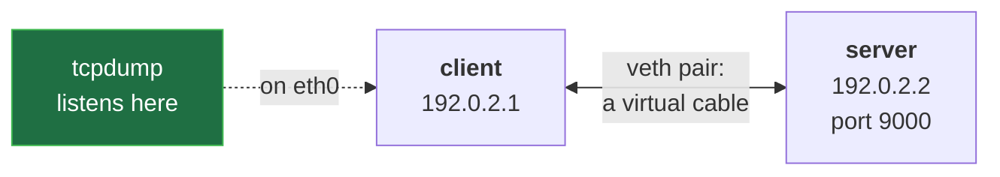

# TCP Three-Way Handshake and Close, Packet by Packet (SYN, ISN, FIN, Half-Close)


**Video:** coming soon on the [channel](https://www.youtube.com/@production-devops).

Why does a TCP connection need three packets to open and four to close? We capture one real conversation with tcpdump between two Linux network namespaces and read it line by line: SYN, SYN-ACK and ACK, the random initial sequence number, relative sequence numbers in tcpdump, FIN, and the half-close, where one side keeps sending after the other is done. Lab script, capture script and challenge solution in the demos repo.

## Files in this folder

- [`handshake.sh`](handshake.sh)
- [`lab/net.sh`](lab/net.sh)
- [`challenge-solution.sh`](challenge-solution.sh) (solution of the challenge: try it yourself first)

## What you need

A Linux shell (a VM, WSL or a container is fine). Everything runs inside this folder.

## Before you start

The video runs these commands first, off screen:

```bash
bash lab/net.sh up pair >/dev/null 2>&1
```

## The lesson, step by step

The same explanations as the video, with every command. Read it, then run it yourself.

Every TCP connection opens with three packets, and closes with four. Why three, and why four? Today we see both, on real packets.

### The plan

Lesson 26 of Networking Fundamentals. A lab, and its script. The handshake, drawn, then captured. The header fields, and the random ISN. The close, and the half-close.

### The lab

**Our lab: two namespaces, one cable**



Two network namespaces act as two hosts, joined by a virtual cable, a veth pair. tcpdump listens on the client's end.

### The handshake

Time flows down. Each side picks a starting number: its ISN.

- `client → server`: SYN  seq=x
The client sends a SYN: my bytes start at x.

- `server → client`: SYN-ACK  seq=y  ack=x+1
The server sends its own SYN, at y, and acknowledges x plus one.

- `client → server`: ACK  ack=y+1
The client acknowledges y plus one. Two SYNs, two ACKs, but the middle two travel together. So, three.

### The script

One script runs the whole experiment. Do not read it yet: we take it in four blocks.

```
#!/usr/bin/env bash
# One TCP conversation between client and server, captured on the client's eth0
bash lab/net.sh reset pair
bash lab/net.sh tcp-options off
reply="cat > /dev/null; sleep 1; echo bye"
ip netns exec server socat -t 3 TCP-LISTEN:9000,bind=192.0.2.2 SYSTEM:"$reply" &
ip netns exec client tcpdump -n -i eth0 -w hs.pcap -Z root port 9000 2>/dev/null &
sleep 1
( echo hello; sleep 1 ) | ip netns exec client nc -N -p 40000 192.0.2.2 9000 >/dev/null
sleep 1
kill %2
wait
echo "capture saved: hs.pcap"
```

A clean lab. The server. The capture. The client, then cleanup.

```
#!/usr/bin/env bash
# One TCP conversation between client and server, captured on the client's eth0
bash lab/net.sh reset pair
bash lab/net.sh tcp-options off
```

The shebang: run this file with bash. Then a comment: bash ignores text after a hash. reset rebuilds the two hosts, with no old connections. tcp options off keeps each packet on one line.

```
reply="cat > /dev/null; sleep 1; echo bye"
ip netns exec server socat -t 3 TCP-LISTEN:9000,bind=192.0.2.2 SYSTEM:"$reply" &
```

A variable holds the server's job: read until the client is done, wait a second, answer bye. The quotes make it one value. The server: socat listens, and runs that reply for the client, in the background.

```console
$ ip netns exec server socat -t 3 TCP-LISTEN:9000,bind=192.0.2.2 SYSTEM:"$reply" &
```

- `ip netns exec server`: run inside the server host
Run the rest inside the server host.

- `socat`: joins a connection and a command
socat joins a network connection to a command.

- `-t 3`: one side ends: wait up to 3 s
Dash t three: once the client stops, wait three seconds for the answer.

- `TCP-LISTEN:9000,bind=192.0.2.2`: wait for a client on port 9000
TCP listen: wait for a client on port nine thousand.

- `SYSTEM:"$reply"`: run the reply command
SYSTEM runs our reply, wired to that connection.

- `&`: background: job %1
The ampersand: run it in the background, as job one.

### The capture

```
ip netns exec client tcpdump -n -i eth0 -w hs.pcap -Z root port 9000 2>/dev/null &
sleep 1
```

The capture: tcpdump saves the client's packets to a file, also in the background. sleep one: give the server and tcpdump a second to start.

```console
$ ip netns exec client tcpdump -n -i eth0 -w hs.pcap -Z root port 9000 2>/dev/null &
```

- `ip netns exec client`: run inside the client host
In the client host, tcpdump.

- `-n`: numbers, no name lookups
Dash n: no name lookups.

- `-i eth0`: listen on eth0
Dash i: listen on eth0.

- `-w hs.pcap`: write the packets to a file
Dash w: write the packets to a file.

- `-Z root`: stay root: may write the file
Dash capital Z root: stay root, to write the file here.

- `port 9000`: filter: only our conversation
port nine thousand: only our conversation.

- `2>/dev/null`: hide its status messages
Two, greater than, dev null: hide its messages.

- `&`: background: job %2
And the ampersand: job two.

Two jobs now run beside the script. Job one, the server, waits. Job two, the capture, records. At the end, the script stops them by number.

### The client

```
( echo hello; sleep 1 ) | ip netns exec client nc -N -p 40000 192.0.2.2 9000 >/dev/null
```

The client, the heart of the lesson: it sends hello, then says it is done.

```console
$ ( echo hello; sleep 1 ) | ip netns exec client nc -N -p 40000 192.0.2.2 9000 >/dev/null
```

- `( echo hello; sleep 1 )`: a group: hello, then 1 s more
The parentheses group two commands: echo prints hello, sleep keeps the input open a second.

- `|`: pipe: the group's output is nc's input
The pipe feeds that into nc: hello is the data.

- `ip netns exec client nc`: netcat, from the client host
nc, netcat, connects from the client host.

- `-N`: input ends: send FIN
Dash capital N: when the input ends, send FIN. The sleep puts FIN in its own packet.

- `-p 40000`: fixed source port: repeatable
Dash p: a fixed source port, for a repeatable capture.

- `192.0.2.2 9000`: server address and port
The server's address and port.

- `>/dev/null`: hide the reply on screen
And the reply is hidden.

```
sleep 1
kill %2
wait
echo "capture saved: hs.pcap"
```

sleep lets tcpdump write the last packets, then kill percent two stops the capture. wait lets the server job finish. And echo says where the packets are.

The whole script again. Now every line has a job you know.

```
#!/usr/bin/env bash
# One TCP conversation between client and server, captured on the client's eth0
bash lab/net.sh reset pair
bash lab/net.sh tcp-options off
reply="cat > /dev/null; sleep 1; echo bye"
ip netns exec server socat -t 3 TCP-LISTEN:9000,bind=192.0.2.2 SYSTEM:"$reply" &
ip netns exec client tcpdump -n -i eth0 -w hs.pcap -Z root port 9000 2>/dev/null &
sleep 1
( echo hello; sleep 1 ) | ip netns exec client nc -N -p 40000 192.0.2.2 9000 >/dev/null
sleep 1
kill %2
wait
echo "capture saved: hs.pcap"
```

```console
$ tcpdump -n -t -r hs.pcap -c 3
```

To read the file:

- `-t`: no timestamps
Dash t: no timestamps.

- `-r hs.pcap`: read the saved file
Dash r: read the file.

- `-c 3`: stop after 3 packets
Dash c three: only three packets.

### Run it

Now we run the script, for real. It takes four seconds.

```console
$ bash handshake.sh
```

And we read the first three packets.

```console
$ tcpdump -n -t -r hs.pcap -c 3
```

The flags: S is SYN, S dot is SYN plus ACK, a dot alone is ACK. Is the ISN random? Run the script again, then read only the SYN: a new number.

```console
$ bash handshake.sh && tcpdump -n -t -r hs.pcap -c 1
```

### The TCP header

The header of that SYN, 32 bits per row.

- `source port`: 40000
From port forty thousand.

- `destination port`: 9000
To port nine thousand.

- `sequence number`: x = the ISN
The sequence number: in a SYN, the ISN. A secret hash plus a clock makes it hard to guess.

- `acknowledgment number`: unused in a SYN
The acknowledgment: the next byte expected. Unused in the first SYN.

- `flags`: SYN
The flags: in this packet, only SYN is set.

- `window`: 64240
The window: how much this side can receive now.

### Sequence numbers

Now with real lines, from an earlier run.

- `client → server`: SYN  seq=2017111640
Line one, the SYN: x, for real.

- `server → client`: SYN-ACK  ack=2017111641
Line two: ack is the client's ISN plus one. A SYN uses one number.

- `client → server`: ACK  ack=1
Line three, ack one: from here, tcpdump shows numbers relative to each ISN.

- `client → server`: hello  seq=1:7
Hello plus a newline: six bytes, one colon seven.

- `server → client`: ACK  ack=7
The server: ack seven, send byte seven next.

### So far

So far: three packets open, two ISNs acknowledged. Sequence numbers count bytes; a SYN uses one. Next: why four to close?

### The close

The end of the file: tail dash six keeps the last six lines.

```console
$ tcpdump -n -t -r hs.pcap | tail -6
```

Two FINs, one per side, and between them, data from the server.

### Half-close

- `client → server`: FIN  seq=7
The client's FIN, for finish: nothing more to send.

- `server → client`: ACK  ack=8
The server acknowledges eight: a FIN uses one number.

- `server → client`: bye  seq=1:5
The half-close: the client's side is closed, the server's is open. It sends bye.

- `client → server`: ACK  ack=5
The client still receives, and acknowledges.

- `server → client`: FIN  seq=5
Now the server is done, and sends its FIN.

- `client → server`: ACK  ack=6
The last ACK. Two one-way streams, each closed by a FIN and an ACK: four.

### Gotchas

Seq one is relative. Dash capital S shows the real numbers. Often only three close: the ACK and the FIN share one packet.

### Recap

Recap: two ISNs, each acknowledged. SYN and FIN each use one sequence number. A FIN closes one direction: hence the half-close. Challenge: make the server close first. Solution in the demo repo.

Next lesson: TCP options. Subscribe so you do not miss it.

## All the commands, to copy

Run them from inside this folder, in this order (some are expected to fail: that is the point of the demo).

```bash
ip netns exec server socat -t 3 TCP-LISTEN:9000,bind=192.0.2.2 SYSTEM:"$reply" &
ip netns exec client tcpdump -n -i eth0 -w hs.pcap -Z root port 9000 2>/dev/null &
( echo hello; sleep 1 ) | ip netns exec client nc -N -p 40000 192.0.2.2 9000 >/dev/null
tcpdump -n -t -r hs.pcap -c 3
bash handshake.sh
bash handshake.sh && tcpdump -n -t -r hs.pcap -c 1
tcpdump -n -t -r hs.pcap | tail -6
```

## Challenge

Challenge: make the server close first. Solution in the demo repo.

When you have tried: [`challenge-solution.sh`](challenge-solution.sh).

---

From the [ProductionDevOps](https://www.youtube.com/@production-devops) channel: real-world DevOps and SRE, explained with real commands.
