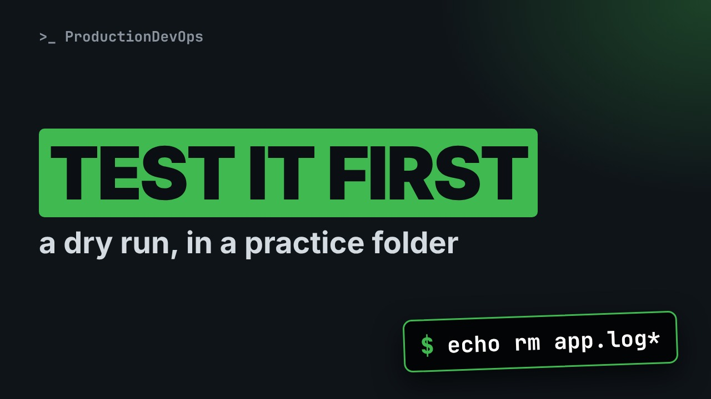
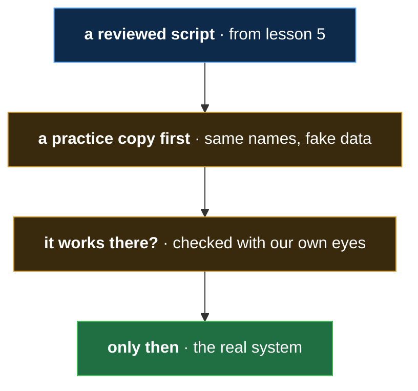
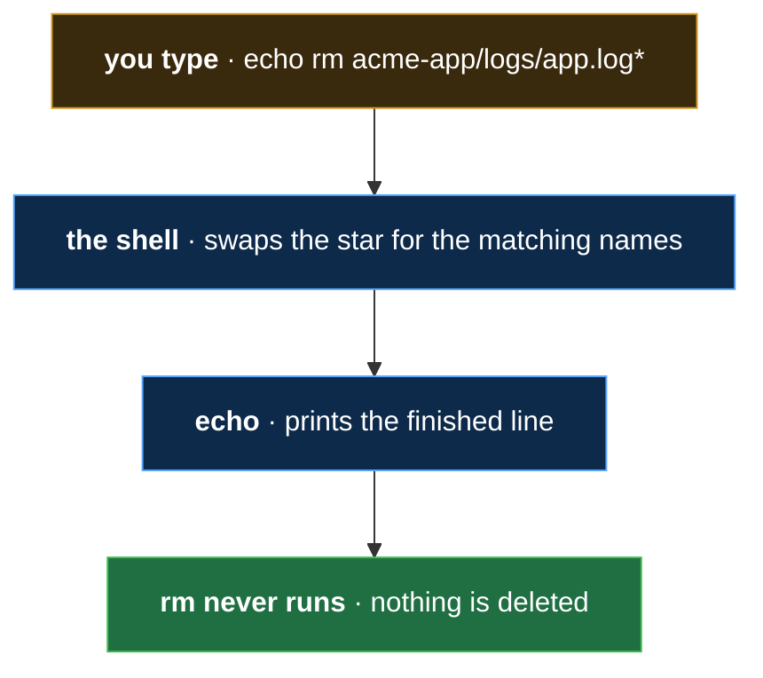
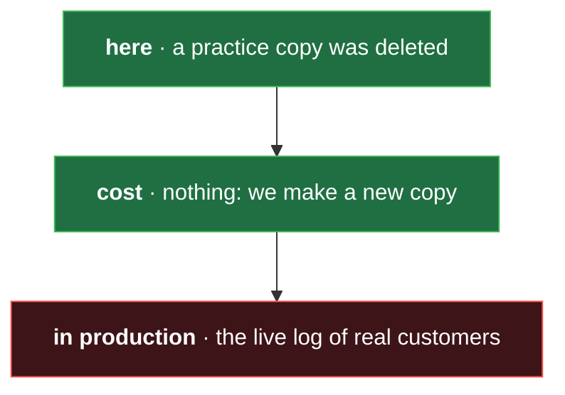

# Test Before You Trust: Run It Somewhere Safe (AI for Ops: the Safe Basics)



**Video:** coming soon on the [channel](https://www.youtube.com/@production-devops).

Reading a script is not enough: you have to see what it really does, somewhere it cannot hurt. This lesson of AI Assistants for Ops: the Safe Basics takes the four-line cleanup script from lesson 5, runs it in a throwaway practice folder, first as a dry run with echo, then for real, and watches the planted mistake delete the live log where nothing matters. Then the one-character fix, a fresh copy, and the proof. Three commands, each explained before it runs, all run for real. Every new word is explained on screen. The challenge and its solution are in the demos repo.

## Files in this folder

- [`fixed/cleanup.sh`](fixed/cleanup.sh)
- [`practice/acme-app/logs/app.log`](practice/acme-app/logs/app.log)
- [`practice/acme-app/logs/app.log.1`](practice/acme-app/logs/app.log.1)
- [`practice/acme-app/logs/app.log.2`](practice/acme-app/logs/app.log.2)
- [`practice/cleanup.sh`](practice/cleanup.sh)
- [`challenge-solution.sh`](challenge-solution.sh) (solution of the challenge: try it yourself first)

## What you need

A Linux shell (a VM, WSL or a container is fine). Everything runs inside this folder.

## Before you start

The video runs these commands first, off screen:

```bash
n=$(( $(cat .tt-n 2>/dev/null || echo 0) + 1 )); echo $n > .tt-n; if [ ! -e .tt-lab ]; then rm -rf /lab/ai6 && mkdir -p /lab/ai6 && cp -a practice /lab/ai6/ && touch .tt-lab; fi
if [ "$n" -ge 4 ]; then cp fixed/cleanup.sh /lab/ai6/practice/cleanup.sh; fi; if [ "$n" = 4 ]; then cp -a practice/acme-app/logs/. /lab/ai6/practice/acme-app/logs/; fi
export HOME=/lab/ai6 && cd /lab/ai6/practice
alias ls='ls --color=auto'
PROMPT_COMMAND='HOME=/lab/ai6; PS1="\[\e[1;32m\]sre@lab\[\e[0m\]:\[\e[1;34m\]\w\[\e[0m\]$ "'
```

## The lesson, step by step

The same explanations as the video, with every command. Read it, then run it yourself.

Test before you trust. Today we run the script from lesson five in a practice folder, and watch its mistake happen safely. Then we fix it, and prove the fix.

You will need lesson five: the cleanup script, and its star. A terminal with bash. Lesson two of Linux from Zero shows how to get one. Or just watch. Every step is on screen.

### The plan

This is lesson six of AI Assistants for Ops. First, a practice folder, where nothing matters. Then, a dry run: print, do not delete. We run the script for real, there. And we fix it, and prove the fix.

### Somewhere safe

- `sandbox — A throwaway copy where a mistake hurts nothing (like the practice kitchen, not the dining room during service)`: 
New word: sandbox. A throwaway copy, where a mistake hurts nothing. Think of the practice kitchen, not the dining room during service.

**Where a new script runs first**



Even a reviewed script runs in a practice copy first, with the same names and fake data. Only when it works there, does it go near the real system.

Today we use three commands. L s lists what is in a folder. Echo prints the text you give it. And bash, then a file name, runs the commands in that file.

### The practice folder

Look at the prompt: we are in a folder called practice. What is in it?

```console
$ ls
```

And in the logs folder? The same three files as in lesson five, as copies.

```console
$ ls acme-app/logs
```

### Dry run

- `dry run — Show what a command would do, without doing it (like reading the recipe out loud, with the stove off)`: 
New word: dry run. It shows what a command would do, without doing it. Like reading the recipe out loud, with the stove off.

**Who turns the star into names?**



The shell reads what you type, and swaps the star for the matching names first. Then echo prints the finished line. R m never runs.

```console
$ echo rm acme-app/logs/app.log*
```

Here is our dry run. It is line three of the script, with echo in front.

- `echo`: print the rest, do not run it
Echo: print the rest of the line. Do not run it.

- `rm`: now just a word
R m is now just a word to print.

- `acme-app/logs/app.log*`: the star, swapped for names
And the path with the star. We will see the names it becomes.

We want to know: which files would line three delete? We type the dry run.

```console
$ echo rm acme-app/logs/app.log*
```

Three names, and the first is the live log. The mistake from lesson five. And nothing was deleted. Echo only printed.

### So far

So far: a practice folder, with copies and nothing real. The dry run shows app dot log on the delete list. Next: we run the script for real, here, and see what the message says. If this is helping, subscribe. The next lesson checks an AI explanation with one command.

### For real, safely

Here it is safe to run it for real. We type bash, then the script's name.

```console
$ bash cleanup.sh
```

The message says the old logs are deleted, and app dot log kept. Is that true? We look.

```console
$ ls acme-app/logs
```

The list is empty. The live log is gone too.

**What just happened**



What just happened? The script deleted a practice copy, and it costs nothing. In production, it would have been the live log of real customers.

### The fix

I fixed the script in a text editor, off screen.

```
#!/bin/bash
# Delete the old copies of the log. Keep app.log.
rm acme-app/logs/app.log.*
echo "Old logs deleted. app.log kept."
```

Lines one and two are the same. Line three has the dot before the star, as in lesson five. Line four still prints the same message. We will not trust it. We will look.

I also put the three logs back in the practice folder, off screen.

### Prove it

First, are the three files back? We list the folder.

```console
$ ls acme-app/logs
```

Now the dry run of the new line three, with the dot.

```console
$ echo rm acme-app/logs/app.log.*
```

Two names, only the old copies. App dot log is not on the list.

The dry run looks right. Now we run the script for real, still in the practice folder.

```console
$ bash cleanup.sh
```

We do not trust the message. We look at the folder.

```console
$ ls acme-app/logs
```

Only app dot log is left. This time, we have seen it.

### Recap

Recap. New scripts run in a sandbox first. A dry run puts echo in front. Nothing is deleted. After the run, look. The folder is the proof, not the message. Your challenge: in a practice folder, dry run both patterns. The solution is in the demo repo.

### Where next

Where next? Lesson seven: an error message, explained by the assistant.

Next lesson: logs and errors. Let it explain, you decide. Subscribe, and that lesson finds you.

## All the commands, to copy

Run them from inside this folder, in this order (some are expected to fail: that is the point of the demo).

```bash
ls
ls acme-app/logs
echo rm acme-app/logs/app.log*
bash cleanup.sh
echo rm acme-app/logs/app.log.*
```

## Challenge

Your challenge: in a practice folder, dry run both patterns. The solution is in the demo repo.

When you have tried: [`challenge-solution.sh`](challenge-solution.sh).

---

From the [ProductionDevOps](https://www.youtube.com/@production-devops) channel: real-world DevOps and SRE, explained with real commands.
