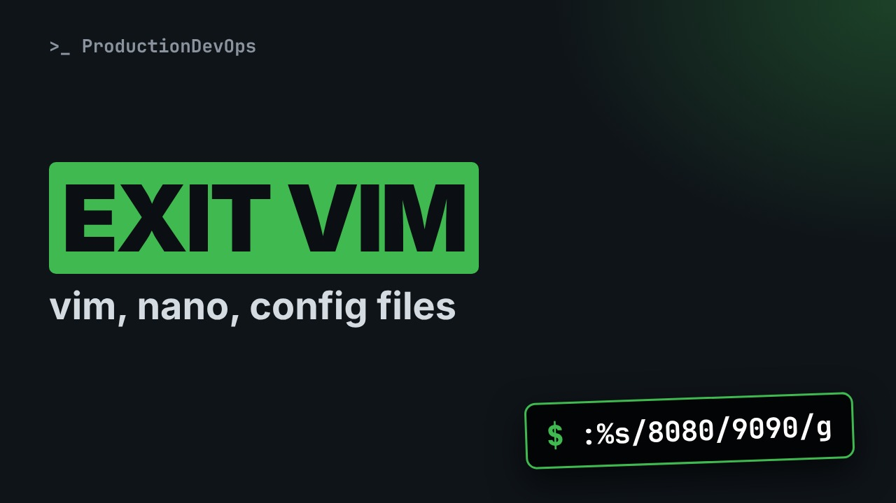
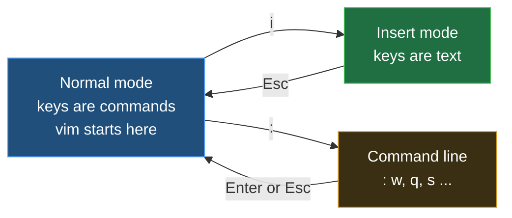

# Editing Files in Linux: vim Essentials, nano and Config Files



**Video:** coming soon on the [channel](https://www.youtube.com/@production-devops).

You open a config file in vim, you cannot type, and you cannot get out. In lesson 10 we make editing calm: why config files are plain text, nano in one screen, vim's modes, the keys that save and quit, search and substitute with :%s, the same edit done from a script with vim -es, a backup and diff before every change, and the Windows line endings that break a config. Up to date for RHEL/AlmaLinux 9 and Ubuntu 24.04. Lesson 10 of Linux from User to Server Admin.

## Files in this folder

- [`app.conf`](app.conf)
- [`win.conf`](win.conf)
- [`challenge-solution.sh`](challenge-solution.sh) (solution of the challenge: try it yourself first)

## What you need

A Linux shell (a VM, WSL or a container is fine). Everything runs inside this folder.

## The lesson, step by step

The same explanations as the video, with every command. Read it, then run it yourself.

You open a config file in vim: you cannot type, and you cannot get out. Let's make editing calm, and at the end, fix an invisible character that breaks a config.

### The plan

This is lesson 10 of Linux from User to Server Admin. First, why config files are plain text. Then nano, in one screen. Then vim: modes, saving, searching, replacing. And the same edit from a script.

### Plain text

Our app reads its settings from app dot conf. cat shows all of it: a comment, then key equals value lines.

```console
$ cat app.conf
```

What kind of file is it? The file command looks inside: plain ASCII text.

```console
$ file app.conf
```

No special format, so any text editor can change it. On a server, that editor runs in the terminal.

### nano

```
GNU nano 7.2                    app.conf
# acme-app settings
port=8080
log_level=debug
data_dir=/var/lib/acme-app

                          [ Read 4 lines ]
^G Help       ^O Write Out  ^W Where Is   ^K Cut        ^T Execute
^X Exit       ^R Read File  ^\ Replace    ^U Paste      ^J Justify
```

This is the real nano screen. Type, and the text goes in: nano has no modes. The status line says what just happened: four lines read. The bottom rows list the keys. The caret means Control: Control O saves, Control X exits. Control W searches, and Control backslash replaces.

### vim modes

**vim has modes: keys mean different things**



vim starts in Normal mode, where every key is a command, not text. i switches to Insert mode, where you type, and Escape goes back. A colon opens the command line, to save and quit: when lost, press Escape.

```
# acme-app settings
port=8080
log_level=debug
data_dir=/var/lib/acme-app
~
~
"app.conf" 4L, 73B                                    1,1           All
```

vim opens the file in Normal mode. Typing a letter here runs a command, so no text appears. The tildes mark lines after the end of the file. The bottom line: the file name, four lines, seventy-three bytes, and the cursor at line one, column one.

```
i            Insert mode: now you type text
Esc          back to Normal mode
:w  Enter    write: save the file
:q  Enter    quit
:wq Enter    write and quit
:q! Enter    quit and throw the changes away
```

i to type, Escape to stop. The bottom line says dash dash INSERT while you type. Colon w writes, colon q quits, colon w q does both. Colon q alone refuses if there are changes. Colon q, exclamation mark: quit, and lose them.

```
h j k l      left, down, up, right (arrows work too)
gg   G       first line, last line
/port Enter  search forward for "port"
n    N       next match, previous match
dd           delete the whole line
u            undo
```

In Normal mode, h j k l move the cursor; the arrow keys work too. g g jumps to the top, capital G to the end. Slash, a word, Enter searches. n jumps to the next match, capital N goes back. d d deletes a line, and u undoes the last change. Undo is your safety net.

Let's take stock. nano: type directly, Control O saves, Control X exits. vim: i to type, Escape to stop, colon w q to save and quit. Next: replace everywhere at once, then the same edit with no editor open.

### Substitute

```console
$ :%s/8080/9090/g
```

This one vim command changes the port everywhere in the file.

- `:`: open the command line
The colon opens the command line.

- `%`: on every line of the file
Percent: on every line. Without it, only the current line.

- `s`: substitute
s, substitute.

- `/8080/9090/`: /find/replace with/
Between the slashes: what to find, then what to put instead.

- `g`: every match on a line, not just the first
g, global: every match on a line, not only the first one.

### No editor open

```console
$ vim -es -c '%s/8080/9090/g' -c wq app.conf
```

vim can also run without a screen, so a script can make the edit.

- `vim -es`: no screen, silent: commands only
Dash e s: no screen and no messages, vim only runs commands.

- `-c '%s/8080/9090/g'`: run this command first
Dash c runs a command: the same substitute, without the colon.

- `-c wq`: then write and quit
A second dash c: write and quit.

- `app.conf`: the file to edit
And the file to edit.

Rule one for config files: a backup before any change. cp dash a keeps the owner and the date.

```console
$ cp -a app.conf app.conf.bak
```

Now the edit, with no editor on screen.

```console
$ vim -es -c '%s/8080/9090/g' -c wq app.conf
```

What changed? diff compares the backup with the new file: line 2, eight zero eight zero became nine zero nine zero.

```console
$ diff app.conf.bak app.conf
```

diff exits with one because the files differ. Zero would mean identical.

```console
$ echo $?
```

### Line endings

Now the surprise. This config was saved on a Windows laptop. file says: CRLF line terminators.

```console
$ file win.conf
```

cat dash capital A shows invisible characters. Every line ends with caret M, a carriage return, before the dollar.

```console
$ cat -A win.conf
```

To the app, the port is now nine zero nine zero plus an invisible character. vim fixes it: dash capital N for full vim mode, then set fileformat equals unix.

```console
$ vim -N -es -c 'set ff=unix' -c wq win.conf
```

Check again: no more caret M.

```console
$ cat -A win.conf
```

### Gotchas

Four traps to remember. One. E37 means unsaved changes: colon w q to keep them, colon q exclamation mark to drop them. Two. E325 means a swap file exists: another vim has the file open, or one crashed. Three. The EDITOR variable picks the editor that crontab, git and others open. Four. Control S freezes the terminal. Control Q unfreezes it.

### Recap

Let's recap. Config files are plain text: back up first, diff after. vim has three modes, and Escape brings you home. Colon percent s replaces everywhere, and vim dash e s does it from a script. Your challenge: change log level from debug to info, with a backup, and prove it with diff. The solution is in the demo repository.

Now you can open, change and save any config file, with or without an editor on screen. Next lesson: searching and transforming text with grep, sort, sed and awk. Subscribe to follow the course.

## All the commands, to copy

Run them from inside this folder, in this order (some are expected to fail: that is the point of the demo).

```bash
cat app.conf
file app.conf
:%s/8080/9090/g
vim -es -c '%s/8080/9090/g' -c wq app.conf
cp -a app.conf app.conf.bak
diff app.conf.bak app.conf
echo $?
file win.conf
cat -A win.conf
vim -N -es -c 'set ff=unix' -c wq win.conf
```

## Challenge

Your challenge: change log level from debug to info, with a backup, and prove it with diff. The solution is in the demo repository.

When you have tried: [`challenge-solution.sh`](challenge-solution.sh).

---

From the [ProductionDevOps](https://www.youtube.com/@production-devops) channel: real-world DevOps and SRE, explained with real commands.
