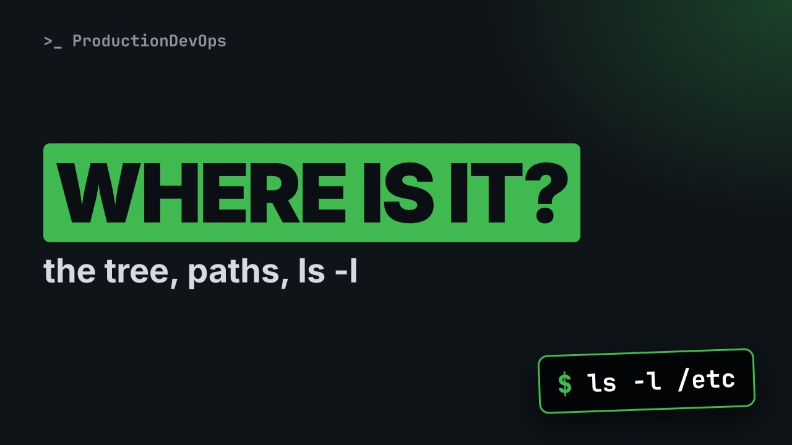

# The Linux Filesystem Tree: /etc, /var, /proc, Paths and ls -l Explained



**Video:** coming soon on the [channel](https://www.youtube.com/@production-devops).

A service fails and you need its configuration and its logs, fast. On Linux you do not search: you know where they live. In lesson 6 we walk the filesystem tree (the FHS: /etc, /var, /usr, /home, /opt, /tmp, /boot and the virtual /proc, /sys and /dev), absolute and relative paths with cd tricks (cd -, ~, ..), then we read ls -l column by column (type, permissions, links, owner, group, size, date, name) and finish with file and stat. Up to date for RHEL/AlmaLinux 9 and Ubuntu 24.04. Lesson 6 of Linux from User to Server Admin.

## Files in this folder

- [`acme-app/bin/acmectl.sh`](acme-app/bin/acmectl.sh)
- [`acme-app/conf/app.conf`](acme-app/conf/app.conf)
- [`acme-app/logs/app.log`](acme-app/logs/app.log)
- [`acme-app/logs/app.log.1`](acme-app/logs/app.log.1)
- [`challenge-solution.sh`](challenge-solution.sh) (solution of the challenge: try it yourself first)

## What you need

A Linux shell (a VM, WSL or a container is fine). Everything runs inside this folder.

## Before you start

The video runs these commands first, off screen:

```bash
__tt_d=$PWD; __tt_w() { case $PWD in "$__tt_d"*) printf '%s' "~/demo${PWD#"$__tt_d"}";; *) printf '%s' "$PWD";; esac; }
PROMPT_COMMAND='PS1="\[\e[1;32m\]sre@lab\[\e[0m\]:\[\e[1;34m\]$(__tt_w)\[\e[0m\]$ "'
id ops >/dev/null 2>&1 || useradd -M -s /usr/sbin/nologin ops
chown -R ops:ops acme-app; chmod 640 acme-app/conf/app.conf; touch -d '2026-10-20 08:00' acme-app/*/* acme-app/* acme-app; touch -d '2026-10-23 06:30' acme-app/logs/app.log
[ -f backup.txt ] || gzip -nc acme-app/conf/app.conf > backup.txt
```

## The lesson, step by step

The same explanations as the video, with every command. Read it, then run it yourself.

A service fails, and you need its configuration and its logs, now. On Linux, every kind of file has its place. And at the end, a file whose name lies about what it is.

### The plan

This is lesson 6 of Linux from User to Server Admin. First, what lives in each top folder. Then three folders that are not on disk. Then paths, and cd tricks. Finally, ls dash l column by column, file and stat.

### The tree

Linux has one tree, starting at slash. No drive letters. The layout is a standard, the FHS.

```
/etc    configuration files, plain text     /etc/ssh/sshd_config
/var    data that changes: logs, caches      /var/log, /var/lib
/usr    installed programs and libraries     /usr/bin, /usr/share
/home   users' home folders                  /home/ops, root: /root
/opt    add-on software, one folder each     /opt/app
/tmp    temporary files, cleaned up          longer-lived: /var/tmp
/boot   the kernel and the boot loader       vmlinuz-*, grub2
/proc   processes and kernel, virtual        /proc/meminfo
/sys    devices and drivers, virtual         /sys/class/net
/dev    device files                         /dev/sda, /dev/null
```

Slash etc holds the configuration, as plain text files. Look here first. Slash var holds data that changes: logs in var log, state in var lib. Slash usr holds the programs that packages install. Slash home has one folder per user. Slash opt holds add-on software, like acme-app. Slash tmp gets cleaned. Slash boot holds the kernel. The last three are made by the kernel, on the fly.

Are they all here? ls dash d lists the folders themselves, not their content. Same tree on RHEL and Ubuntu.

```console
$ ls -d /etc /var /usr /home /opt /tmp /boot /proc /sys /dev
```

Slash bin, sbin and lib are now just links into slash usr, on both families.

```console
$ ls -ld /bin /sbin /lib
```

Slash boot is empty: this lab is a container, and the kernel belongs to the host.

```console
$ ls /boot
```

How big is meminfo, in slash proc? ls dash l says: zero bytes.

```console
$ ls -l /proc/meminfo
```

Yet wc dash l counts dozens of lines. The kernel writes them when you read the file.

```console
$ wc -l /proc/meminfo
```

Dollar dollar is the process ID of our shell.

```console
$ echo $$
```

Every process has a folder in slash proc, named after its ID. comm holds its name: bash.

```console
$ cat /proc/$$/comm
```

### Paths

There are two ways to write a path. An absolute path starts with slash. It works from anywhere. A relative path starts from your current folder. Dot is this folder. Dot dot is the parent. Tilde is your home. Tilde ops is the home of ops.

cd to slash var slash log. The prompt shows where we are.

```console
$ cd /var/log
```

pwd prints the full path of the current folder.

```console
$ pwd
```

Dot dot slash lib: up one level, then into lib.

```console
$ cd ../lib
```

cd dash goes back to the previous folder.

```console
$ cd -
```

cd alone goes home: here, our demo folder.

```console
$ cd
```

A relative path into the acme-app logs.

```console
$ cd acme-app/logs
```

Dot dot slash dot dot: two levels up.

```console
$ cd ../..
```

### ls -l

What can ls tell us about acme-app? Dash l, long: one line per entry, seven columns.

```console
$ ls -l acme-app
```

Now one file. Let's read this line, column by column.

```console
$ ls -l acme-app/conf/app.conf
```

```
-rw-r----- 1 ops ops 52 Oct 20 08:00 acme-app/conf/app.conf

-             type: - file, d folder, l link, c or b device
 rw-r-----    permissions: owner, group, others
1             links: how many names point to this file
ops ops       owner, then group
52            size in bytes
Oct 20 08:00  last modification time
app.conf      the name
```

The first character is the type: dash for a file, d a folder, l a link, c and b devices. Nine permission characters: owner, group, everybody else. That is lesson 7. The number of links: names for this same file. Lesson 8. The owner, then the group: both ops. The size, in bytes. The time of the last content change, then the name.

Let's take stock. Config in slash etc, logs in var log, live kernel data in proc. cd with absolute and relative paths. Next: surprises in ls dash l, and the file that lies.

Four types in one listing. Look at the first column: a link with its target, a device, a folder, a file.

```console
$ ls -ld /bin /dev/null /etc acme-app/conf/app.conf
```

A device shows two numbers instead of a size: major and minor, the driver's IDs. Older than six months? ls shows the year instead of the time. Look at slash bin. On RHEL, a dot after the permissions means an SELinux label.

Dash a shows hidden names, starting with a dot, including dot and dot dot.

```console
$ ls -a acme-app
```

Dash h prints sizes for humans, in K, M and G.

```console
$ ls -lh /usr/bin/bash
```

Which log is newest? Dash t sorts by time, newest first. Total is the space used, in kilobytes.

```console
$ ls -lt acme-app/logs
```

### file and stat

file looks at the content, not the name. Plain text.

```console
$ file acme-app/conf/app.conf
```

Our script: a bash script, and executable.

```console
$ file acme-app/bin/acmectl.sh
```

And the file that lies: backup dot txt is really compressed data. An extension is just part of the name.

```console
$ file backup.txt
```

file also recognises links, and shows the target.

```console
$ file /bin
```

stat prints everything stored about a file: size, inode, links, permissions, owner.

```console
$ stat acme-app/conf/app.conf
```

And four times: Modify is the content, Change the metadata, Access the last read, Birth the creation. Only a few fields, for a script? Dash c takes a format: percent A permissions, U owner, G group, s size.

```console
$ stat -c '%A %U:%G %s bytes' acme-app/conf/app.conf
```

### Gotchas

Four traps around files and paths. One. Slash tmp gets cleaned. Two. If cd fails in a script, the rest runs in the wrong folder. Add: or exit. Three. A folder's size is not its content: use du dash s h. Four. A name can lie. Check with file.

### Recap

Let's recap. Config in etc, logs in var log, programs in usr and opt. Proc, sys and dev are made by the kernel. ls dash l: type, permissions, links, owner, group, size, date. Your challenge: what is slash etc slash localtime, where does it point, and when did it change? Use only ls, file and stat. The solution is in the demo repository.

Now you know where things live, and how to read every column of ls dash l. Next lesson: permissions and ownership: what r, w and x really mean. Subscribe to follow the course.

## All the commands, to copy

Run them from inside this folder, in this order (some are expected to fail: that is the point of the demo).

```bash
ls -d /etc /var /usr /home /opt /tmp /boot /proc /sys /dev
ls -ld /bin /sbin /lib
ls /boot
ls -l /proc/meminfo
wc -l /proc/meminfo
echo $$
cat /proc/$$/comm
cd /var/log
pwd
cd ../lib
cd -
cd
cd acme-app/logs
cd ../..
ls -l acme-app
ls -l acme-app/conf/app.conf
ls -ld /bin /dev/null /etc acme-app/conf/app.conf
ls -a acme-app
ls -lh /usr/bin/bash
ls -lt acme-app/logs
file acme-app/conf/app.conf
file acme-app/bin/acmectl.sh
file backup.txt
file /bin
stat acme-app/conf/app.conf
stat -c '%A %U:%G %s bytes' acme-app/conf/app.conf
```

## Challenge

Your challenge: what is slash etc slash localtime, where does it point, and when did it change? Use only ls, file and stat. The solution is in the demo repository.

When you have tried: [`challenge-solution.sh`](challenge-solution.sh).

---

From the [ProductionDevOps](https://www.youtube.com/@production-devops) channel: real-world DevOps and SRE, explained with real commands.
