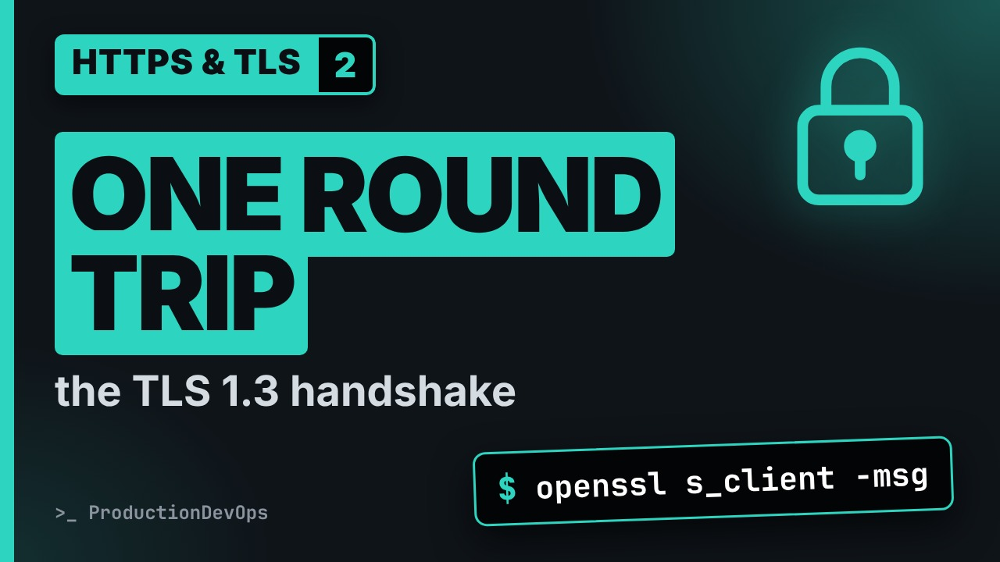

# The TLS 1.3 Handshake, Step by Step



**Video:** coming soon on the [channel](https://www.youtube.com/@production-devops).

What really happens in the first milliseconds of an HTTPS connection? We draw the TLS 1.3 handshake message by message, then see the real messages with openssl s_client -msg, look inside the ClientHello with -trace (the site name and the key share), and compare with TLS 1.2 to see why the old handshake needed two round trips. Lesson 2 of TLS & PKI in Practice; the lab, the challenge and its solution are in the demos repo.

## Files in this folder

- [`make-lab.sh`](make-lab.sh)
- [`serve.sh`](serve.sh)
- [`challenge-solution.md`](challenge-solution.md) (solution of the challenge: try it yourself first)

## What you need

A Linux shell (a VM, WSL or a container is fine). Everything runs inside this folder.

## Before you start

The video runs these commands first, off screen:

```bash
if [ ! -e .tt-lab ]; then pkill -f 's_server -accept 127.0.0.1:844' || true; rm -rf /lab/tls && bash make-lab.sh /lab/tls >/dev/null 2>&1 && touch .tt-lab; fi
bash serve.sh /lab/tls >/dev/null 2>&1
export HOME=/lab/tls && cd /lab/tls
PROMPT_COMMAND='HOME=/lab/tls; PS1="\[\e[1;32m\]sre@lab\[\e[0m\]:\[\e[1;34m\]\w\[\e[0m\]$ "'
```

## The lesson, step by step

The same explanations as the video, with every command. Read it, then run it yourself.

In six minutes: every message of the TLS one point three handshake, in order. And why it needs only one round trip.

You will need lesson one of this course: what T L S really protects. And pipes and grep, from Linux from Zero and Shell Scripting from Zero.

### The plan

First, we draw the handshake, message by message. Then we see the real messages, with one new flag. Then we look inside the very first message. And at the end, the old way, T L S one point two, and why it was slower.

### The drawing

- `Handshake — The opening talk that agrees on keys, before any data (like agreeing on a secret language before the real talk)`: 
New word: handshake. The opening talk that agrees on keys, before any data. Think of agreeing on a secret language before the real talk.

- `Key share — One public half; two halves make one shared secret (like each side mixes its secret color into a common paint)`: 
New word: key share, one public half. Two halves give both sides the same secret. Think of paint: easy to mix, hard to unmix.

Time flows down. The client speaks first.

- `client → server`: ClientHello: versions, name, key share
Client hello: the versions I speak, the site name I want, and my key share.

- `server → client`: ServerHello: its key share
Server hello: the version it picked, and its own key share. Now both sides can compute the same secret.

- `server → client`: EncryptedExtensions, Certificate
From here on, everything is encrypted. Even the certificate travels encrypted.

- `server → client`: CertificateVerify, Finished
Certificate verify proves the server holds the certificate's private key. Finished seals the server's side.

- `client → server`: Finished
The client checks it all and sends its own finished. One round trip, and data can flow.

### The real messages

Our commands get long. So we save the three pieces from lesson one in a shell variable, called LAB. Dollar LAB means: where to go, which name to ask for, which office we trust.

```console
$ openssl s_client $LAB -msg </dev/null 2>/dev/null | grep Handshake
```

We want to see each handshake message. Two new pieces do it.

- `openssl s_client $LAB`: lesson 1's command, saved
Open S S L, s client, dollar LAB: the command from lesson one.

- `-msg`: print every TLS message
Dash msg, new: print every T L S message that goes in or out.

- `2>/dev/null`: hide the chatter
Two greater than slash dev slash null hides the progress chatter.

- `| grep Handshake`: keep the handshake lines
Pipe grep handshake, new: keep only the handshake lines. Without it, we get pages of hex.

First, we save the shortcut. Nothing is printed.

```console
$ LAB="-connect localhost:8443 -servername shop.example -CAfile ca.crt"
```

Now we ask for the handshake messages.

```console
$ openssl s_client $LAB -msg </dev/null 2>/dev/null | grep Handshake
```

Greater than signs mark what we sent. Less than signs mark what came back. Seven lines. Client hello out, six messages in, and our finished. The same order as our drawing.

Now each arrow with its real line.

- `client → server`: ClientHello
Line one is the client hello we drew.

- `server → client`: ServerHello
Line two, the server hello. After it, both sides hold the secret.

- `server → client`: Certificate
Line four, the certificate: already encrypted. Its length is the biggest, because it carries two certificates.

- `client → server`: Finished
Line seven, our finished. That is the whole handshake.

### So far

So far: the two hellos swap key shares. Everything after the server hello is encrypted, even the certificate. Next: inside the first message. Then the old way, and why it was slower. If this is helping, subscribe. Lesson three untangles certificate chains.

### Inside ClientHello

```console
$ openssl s_client $LAB -trace </dev/null 2>/dev/null | grep -A2 server_name
```

We want to see the fields of the client hello. One flag and one grep option.

- `-trace`: decode every field
Dash trace: decode every field of every message, in words.

- `grep -A2`: the match + 2 lines After
Grep dash A two: the matching line, plus two lines after it.

- `server_name`: the SNI field
Server name: the field that carries the site name, S N I from lesson one.

Where does the site name travel? We look for the server name field.

```console
$ openssl s_client $LAB -trace </dev/null 2>/dev/null | grep -A2 server_name
```

On the right, readable letters: shop dot example. It is in the client hello, before any key exists. So anyone on the path can read it. This is why S N I stays visible.

### The key shares

Now the key shares. Same command, we search for key share instead.

```console
$ openssl s_client $LAB -trace </dev/null 2>/dev/null | grep -A2 key_share
```

Two blocks: the client's half, then the server's. X 25519 is the math they use. Run it again and the values change. Fresh halves for every connection: even a stolen server key cannot open old traffic.

### TLS 1.2

Why was T L S one point two slower? We force it with one more flag, dash t l s one underscore two.

```console
$ openssl s_client $LAB -msg -tls1_2 </dev/null 2>/dev/null | grep Handshake
```

Look at server hello done. The server stops and waits. Only then does the client send its key. Then finished, and the server's finished comes back. Two round trips. And the certificate traveled in clear.

### Recap

Recap: T L S one point three needs one round trip. The key shares ride in the two hellos. After the server hello everything is encrypted. The S N I name, sent before, is not. Dash msg shows the messages. Dash trace shows their fields. Your challenge: which cipher suite did the server pick? Use dash trace and grep. The answer is in the demos repo.

### Where next

Where next? Lesson three: certificate chains. Leaf, intermediate and root.

Subscribe, and the next lesson, certificate chains, finds you.

## All the commands, to copy

Run them from inside this folder, in this order (some are expected to fail: that is the point of the demo).

```bash
openssl s_client $LAB -msg </dev/null 2>/dev/null | grep Handshake
LAB="-connect localhost:8443 -servername shop.example -CAfile ca.crt"
openssl s_client $LAB -trace </dev/null 2>/dev/null | grep -A2 server_name
openssl s_client $LAB -trace </dev/null 2>/dev/null | grep -A2 key_share
openssl s_client $LAB -msg -tls1_2 </dev/null 2>/dev/null | grep Handshake
```

## Challenge

Your challenge: which cipher suite did the server pick? Use dash trace and grep. The answer is in the demos repo.

When you have tried: [`challenge-solution.md`](challenge-solution.md).

---

From the [ProductionDevOps](https://www.youtube.com/@production-devops) channel: real-world DevOps and SRE, explained with real commands.
