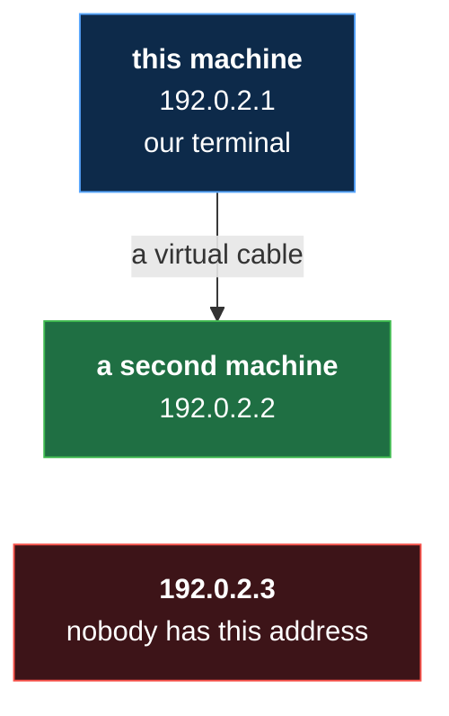
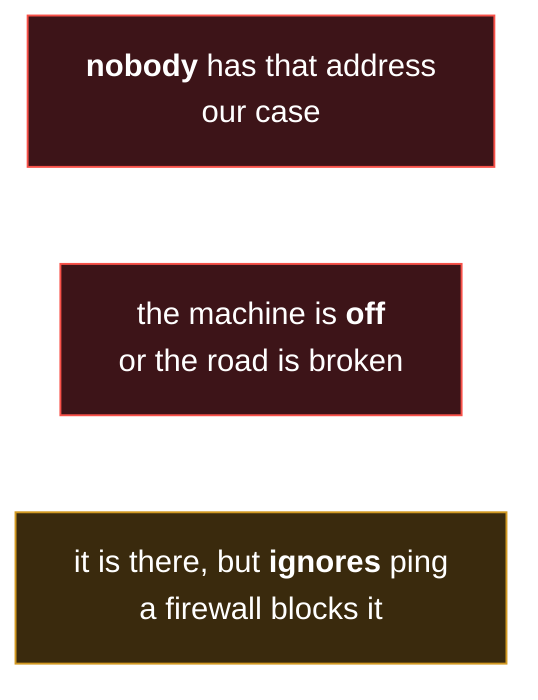

# Try It: ping (How the Internet Works, No Experience Needed)


**Video:** coming soon on the [channel](https://www.youtube.com/@production-devops).

Is that computer there, and does it answer? One small command tells you: ping. In this last lesson of How the Internet Works, Simply you run your first network command for real: first on your own computer, then on a second machine in a small lab, then on an address that nobody answers. We read every line of the output: the replies, the envelope numbers, the round-trip time in milliseconds and the packet loss, and we see why no answer does not always mean a machine is down. You need a terminal (Linux, macOS or WSL on Windows); every new word is explained on screen. The challenge and its solution are in the demos repo.

## Files in this folder

- [`lab/net.sh`](lab/net.sh)
- [`challenge-solution.md`](challenge-solution.md) (solution of the challenge: try it yourself first)

## What you need

A Linux shell (a VM, WSL or a container is fine). Everything runs inside this folder.

## Before you start

The video runs these commands first, off screen:

```bash
bash lab/net.sh reset pair >/dev/null 2>&1
ping() { ip netns exec client ping "$@"; }
```

## The lesson, step by step

The same explanations as the video, with every command. Read it, then run it yourself.

Is that computer there, and does it answer? One small command tells you. At the end: what ping says when nobody answers.

This time you need a terminal. Linux, macOS, or WSL on Windows. No terminal yet? Linux from Zero, lesson two, shows you how. Nothing to install. Ping is already there on almost every computer.

### The plan

This is lesson eight, the last of How the Internet Works, Simply. First, what ping does. Then, we ping this computer. Then, a second machine. And what happens when nobody answers.

### What ping does

- `ping — A command that sends a test packet, and waits for the reply (like a postcard that says: are you there? Please write back)`: 
New word: ping. It is a command that sends a test packet, and waits for the reply. Like a postcard that says: please write back.

Time flows down. Each arrow is one packet.

- `this computer → the other computer`: echo request: are you there?
Ping sends a small packet called an echo request. It asks: are you there?

- `the other computer → this computer`: echo reply: yes, here I am
The other side answers with an echo reply. Ping measures how long the trip took.

### This computer

- `localhost — A name that always means this same computer: 127.0.0.1 (like a letter you post to your own address)`: 
Remember localhost, from lesson three. It always means this same computer. Its address is 127.0.0.1.

```console
$ ping -c 3 127.0.0.1
```

Our first command has three pieces.

- `ping`: the program
Ping is the program.

- `-c 3`: count: send 3, then stop
Dash c three is the count. Send three packets, then stop.

- `127.0.0.1`: where to send: this computer
And the address: this same computer.

Let's try. Ping, dash c three, and the address of this computer.

```console
$ ping -c 3 127.0.0.1
```

Three lines start with sixty four bytes from. Each line is one reply. At the bottom: three sent, three received. Zero percent packet loss.

Now one reply line. I c m p seq is the envelope number. I c m p is the name of ping's rules. Time is the round trip: there, and back. M s means milliseconds, thousandths of a second. Here, almost nothing. T T L is a trip counter. Networking Fundamentals explains it.

### So far

So far: ping asks, are you there? And it times the reply. This computer answered three times out of three, in a blink. Next: a second machine. And an address that never answers.

### A second machine

**Our lab: two machines, one cable**



Our lab has two machines, joined by a virtual cable. Our terminal is on the first one. Nobody has the address ending in three.

Now the second machine. Same command, new address.

```console
$ ping -c 3 192.0.2.2
```

Three replies again, this time from the second machine. Zero percent loss. The times are tiny: the cable is short. Across the internet, expect more.

### Nobody answers

- `timeout — How long to wait for a reply, before giving up (like waiting one day for a letter, then giving up)`: 
New word: timeout. It is how long to wait for a reply, before giving up. Like waiting one day for a letter.

Now the address nobody has. Dash capital W one sets the timeout: one second.

```console
$ ping -c 2 -W 1 192.0.2.3
```

No reply lines at all. Two sent, zero received: one hundred percent packet loss.

**No answer: what can it mean?**



No answer can mean three things. Nobody has the address, or the machine is off. Or a firewall blocks ping.

Remember this for later. No reply does not prove a machine is down. Many servers ignore ping on purpose.

### Good to know

Good to know: without dash c, ping never stops. Press control C to stop it. On Windows, ping stops after four by itself. There, the count is dash n. Ping takes names too. Then DNS finds the address first, like in lesson three.

### Recap

Recap: ping sends an echo request, and waits for an echo reply. Dash c sets the count. Dash capital W sets the timeout. Read the end: how many were received, and the packet loss. Your challenge: ping localhost four times. Which address answers, and how many replies? The answer is in the demo repo.

### Where next

Where next? You finished this course. The next one is Networking Fundamentals. There, we capture real packets, and read them field by field. Its first lesson: how the internet is layered.

Next course: Networking Fundamentals. Subscribe so you do not miss it.

## All the commands, to copy

Run them from inside this folder, in this order (some are expected to fail: that is the point of the demo).

```bash
ping -c 3 127.0.0.1
ping -c 3 192.0.2.2
ping -c 2 -W 1 192.0.2.3
```

## Challenge

Your challenge: ping localhost four times. Which address answers, and how many replies? The answer is in the demo repo.

When you have tried: [`challenge-solution.md`](challenge-solution.md).

---

From the [ProductionDevOps](https://www.youtube.com/@production-devops) channel: real-world DevOps and SRE, explained with real commands.
