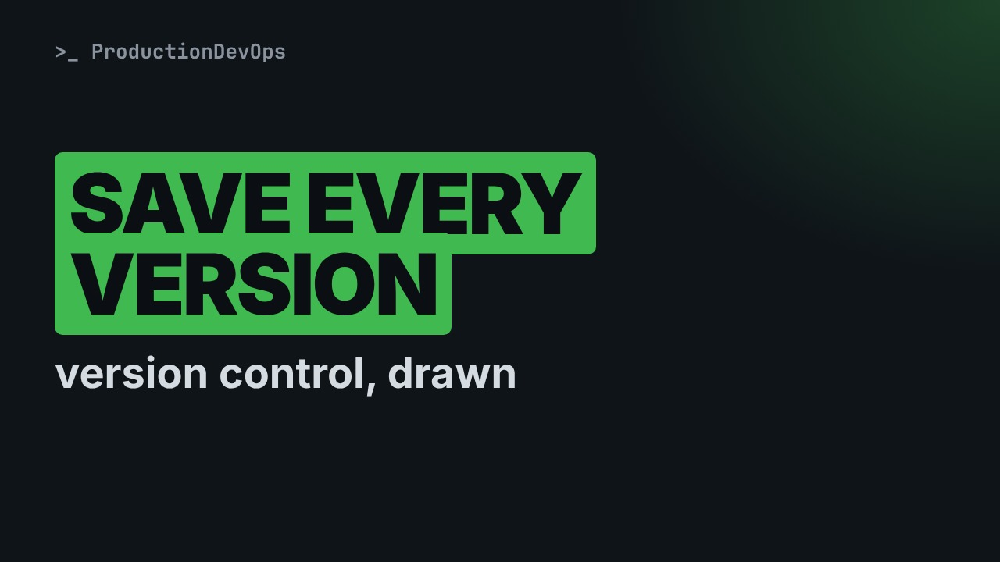
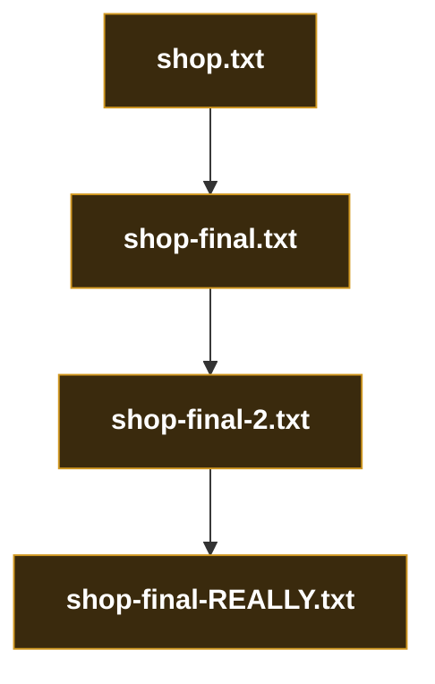
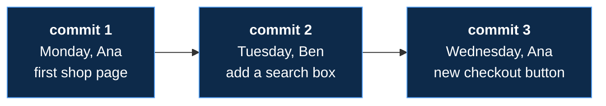
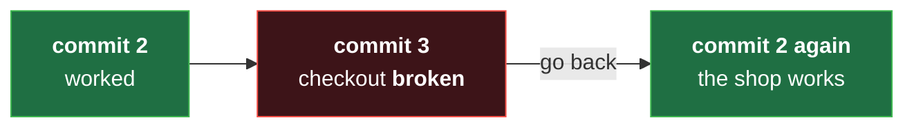
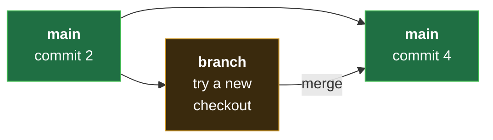

# Saving Every Version: Version Control in One Picture (DevOps from Zero, No Experience Needed)

**Video:** https://youtu.be/ofcOzjv-UW0

report-final, report-final-2, report-final-really. Everyone has done it. This lesson of DevOps from Zero shows, with pictures and a restaurant comparison, the problem version control solves, and its four key words: repository, commit, history and branch. Then how a team goes back to yesterday's working version in one step, and why DevOps teams keep everything in version control: code, server files and pipelines. No terminal, nothing to install, no experience needed. Every new word is explained on screen. The challenge and its solution are in the demos repo.

## Files in this folder

- [`challenge-solution.md`](challenge-solution.md) (solution of the challenge: try it yourself first)

## What you need

A Linux shell (a VM, WSL or a container is fine). Everything runs inside this folder.

## The lesson, step by step

The same explanations as the video, with every command. Read it, then run it yourself.

Report final, report final two, report final really. Everyone has done it. At the end: how teams go back to yesterday in one step.

For this lesson you need nothing. Just watch. No terminal and no code. Only pictures. About five minutes.

### The plan

This is lesson five of DevOps from Zero. First, the file name problem. Then four words: repository, commit, history and branch. Then, going back to yesterday. And why DevOps teams put everything there.

### The problem

**The file-name problem**

Here is the problem. Every change makes a new copy, with a new name. Soon, nobody knows which file is the right one.

Copies are not enough. Which copy is the latest? Who changed this line, and why? And what if two people change the same file at the same time?

### Four words

- `version control — A tool that saves every version of your files, with who and why (like a recipe book that keeps every old version, dated and signed)`: 
The answer is version control. It is a tool that saves every version of your files, with who and why. Like a recipe book that keeps every version.

- `repository — A folder whose whole history is kept by version control (like the recipe book itself: every page, every edit)`: 
First word: repository. It is a folder whose whole history is kept. Think of the recipe book itself.

- `commit — One saved version, with a short note that says what changed (like a dated, signed page: less salt, it was too salty)`: 
Second word: commit. A commit is one saved version, with a short note. Like a dated, signed page: less salt, it was too salty.

**The history: one commit after another**

Third word: history. It is the list of commits, one after another. Each one says when, who, and what changed.

What does every commit record? What changed: the exact lines. Who made the change, and when. And why. That is the message, written by a person.

### So far

So far: a repository is the folder, with its whole history. A commit is one saved version, with who, when and why. Next: going back to yesterday, in one step.

### Going back

**Commit 3 broke the shop**

Here is the payoff. Commit three broke the checkout. Version control puts back commit two in one step, and the shop works again.

Nothing is lost. Commit three is still in the history. Its message says what to look at. The team fixes it calmly, then saves commit four.

### Branches

- `branch — A separate line of commits, for trying something safely (like a test copy of a recipe, tried in a corner of the kitchen)`: 
Fourth word: branch. A branch is a separate line of commits, for trying something safely. Like a test recipe, in a corner of the kitchen.

**A branch, then a merge**

The main line stays safe. The new checkout is tried on a branch. When it works, it is merged back into the main line.

### In DevOps

Why do DevOps teams put everything in version control? The code of the app, first. Then the files that describe the servers, from lesson four. And the pipeline itself. A new commit is what starts it. So every change can be seen, reviewed by a colleague, and undone.

### Good to know

The best known version control tool is Git. It is free and open source. Some websites keep repositories online, so a team can share them. A full course is planned on this channel: Git and GitHub from Zero.

### Recap

Recap: version control saves every version, with who and why. Commits make a history, and going back is one step. A branch tries things safely, and a merge brings them back. Your challenge: which commit message is better, and why? The two are on screen. The answer is in the demo repo.

### Where next

Where next? Lesson six: is production healthy? Logs, metrics and alerts. And in lesson seven, what the engineers do all day.

Next lesson: is production healthy? Logs, metrics and alerts. Subscribe so you do not miss it.

## Challenge

Your challenge: which commit message is better, and why? The two are on screen. The answer is in the demo repo.

When you have tried: [`challenge-solution.md`](challenge-solution.md).

---

From the [ProductionDevOps](https://www.youtube.com/@production-devops) channel: real-world DevOps and SRE, explained with real commands.
