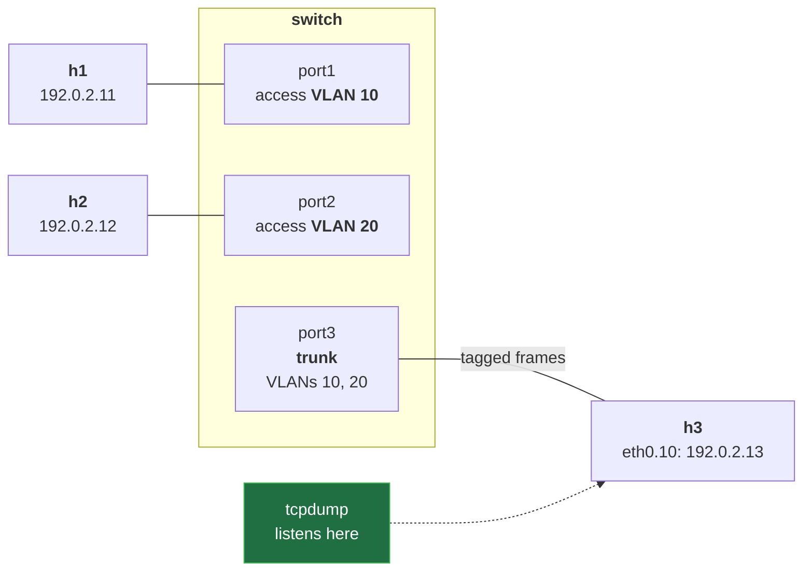
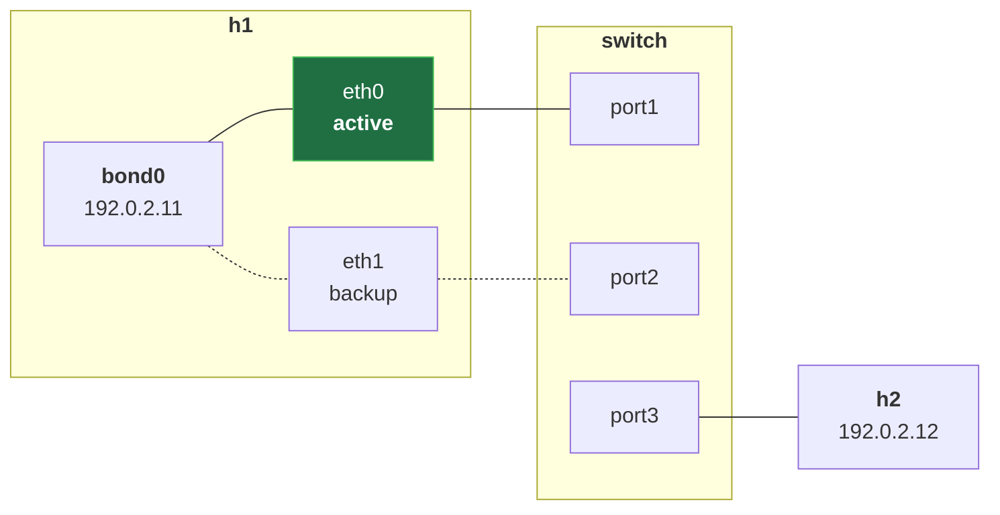
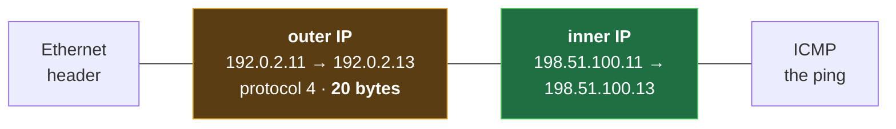

# VLANs, Bonding and Tunnels on Linux: the 802.1Q Tag, Failover and the MTU Tax


**Video:** https://youtu.be/GwgKeZRzkCw

Why can two hosts on the same switch and the same subnet not ping each other, and why is your tunnel's MTU 1480 instead of 1500? We build VLANs on a Linux bridge with vlan_filtering, access and trunk ports, and capture the 4-byte 802.1Q tag on the trunk with tcpdump; we bond two cables in active-backup and pull one during a ping; and we capture an IP-in-IP tunnel with two IP headers in every packet. Loopback and LACP in brief. Lab script and challenge solution in the demos repo.

## Files in this folder

- [`lab/net.sh`](lab/net.sh)
- [`challenge-solution.sh`](challenge-solution.sh) (solution of the challenge: try it yourself first)

## What you need

A Linux shell (a VM, WSL or a container is fine). Everything runs inside this folder.

The outputs below were captured for real on the lab cluster. On yours, names, ages, IPs and ports will differ; everything else should match.

## The lesson, step by step

The same explanations as the video, with every command and its real output. Read it, then run it yourself.

One switch, two networks that cannot see each other. Two cables that act as one. And a tunnel that loses twenty bytes: where do they go?

### The plan

This is lesson 6 of Networking Fundamentals. VLANs, trunks, and the tag. Bonding: two cables, one link. Loopback, then tunnels.

### VLANs

A VLAN is a separate LAN inside a switch, with a number. An access port is in one VLAN, with plain frames. A trunk carries many, each frame tagged.

**Our lab: two VLANs, one switch**



h1 in VLAN 10, h2 in VLAN 20, same subnet. h3 sits on the trunk; we listen there.

### The script

```
host4() {   # host4 NAME: a new host with IPv6 off: no IPv6 chatter in our captures
  host "$1"
  ip netns exec "$1" sysctl -qw net/ipv6/conf/all/disable_ipv6=1
}
plug() {    # plug HOST NIC PORT: a cable from HOST's NIC to PORT, on the switch's br0
  ip link add "$2" netns "$1" type veth peer name "$3" netns switch
  ip -n switch link set "$3" master br0 up
}
```

host4 makes a host, as in lesson 1, plus one line: sysctl turns IPv6 off in it, so our captures stay clean. plug: a cable from a host to a port of br0.

The lab: up vlan. Three blocks.

```
up_vlan() { # one switch, two VLANs: h1 in VLAN 10, h2 in VLAN 20, h3 on a trunk
  host4 switch; host4 h1; host4 h2; host4 h3
  ip -n switch link add br0 type bridge mcast_snooping 0 vlan_filtering 1 vlan_default_pvid 0
  ip -n switch link set br0 up
  plug h1 eth0 port1; plug h2 eth0 port2; plug h3 eth0 port3
  bridge -n switch vlan add dev port1 vid 10 pvid untagged
  bridge -n switch vlan add dev port2 vid 20 pvid untagged
  bridge -n switch vlan add dev port3 vid 10
  bridge -n switch vlan add dev port3 vid 20
  nic h1 192.0.2.11/24 02:00:00:00:00:11
  nic h2 192.0.2.12/24 02:00:00:00:00:12
  ip -n h3 link set eth0 address 02:00:00:00:00:13 up
  ip -n h3 link add link eth0 name eth0.10 up type vlan id 10
  ip -n h3 addr add 192.0.2.13/24 dev eth0.10
}
```

The switch. The VLANs. The addresses.

```
up_vlan() { # one switch, two VLANs: h1 in VLAN 10, h2 in VLAN 20, h3 on a trunk
  host4 switch; host4 h1; host4 h2; host4 h3
  ip -n switch link add br0 type bridge mcast_snooping 0 vlan_filtering 1 vlan_default_pvid 0
  ip -n switch link set br0 up
  plug h1 eth0 port1; plug h2 eth0 port2; plug h3 eth0 port3
```

Four hosts. br0, now VLAN-aware: vlan filtering one. Default pvid zero: no port starts in a VLAN. Three cables, to ports 1, 2 and 3.

```
  bridge -n switch vlan add dev port1 vid 10 pvid untagged
  bridge -n switch vlan add dev port2 vid 20 pvid untagged
  bridge -n switch vlan add dev port3 vid 10
  bridge -n switch vlan add dev port3 vid 20
```

Ports 1 and 2 join VLAN 10 and VLAN 20, as access ports: no tags. Port 3 joins both, tagged: a trunk.

```console
$ bridge -n switch vlan add dev port1 vid 10 pvid untagged
```

- `bridge -n switch`: the bridge tool, in the switch
The bridge tool, in the switch:

- `vlan add dev port1 vid 10`: port1 joins VLAN 10
port 1 joins VLAN 10.

- `pvid`: untagged in → VLAN 10
pvid: plain frames coming in belong to VLAN 10.

- `untagged`: out: the tag is removed
untagged: frames going out lose their tag.

```
  nic h1 192.0.2.11/24 02:00:00:00:00:11
  nic h2 192.0.2.12/24 02:00:00:00:00:12
  ip -n h3 link set eth0 address 02:00:00:00:00:13 up
  ip -n h3 link add link eth0 name eth0.10 up type vlan id 10
  ip -n h3 addr add 192.0.2.13/24 dev eth0.10
}
```

h1 and h2, as in lesson 5. h3's card: on, with no address. The address goes on eth0 dot 10, a VLAN interface: its frames get tag 10.

```console
$ ip -n h3 link add link eth0 name eth0.10 up type vlan id 10
```

- `link add`: a new interface
A new interface,

- `link eth0`: on top of eth0
on top of eth0,

- `name eth0.10 up`: named card.VLAN, turned on
named eth0 dot 10, and on,

- `type vlan id 10`: 802.1Q, VLAN 10
of type VLAN, ID ten.

All together. Who reaches whom?

```
up_vlan() { # one switch, two VLANs: h1 in VLAN 10, h2 in VLAN 20, h3 on a trunk
  host4 switch; host4 h1; host4 h2; host4 h3
  ip -n switch link add br0 type bridge mcast_snooping 0 vlan_filtering 1 vlan_default_pvid 0
  ip -n switch link set br0 up
  plug h1 eth0 port1; plug h2 eth0 port2; plug h3 eth0 port3
  bridge -n switch vlan add dev port1 vid 10 pvid untagged
  bridge -n switch vlan add dev port2 vid 20 pvid untagged
  bridge -n switch vlan add dev port3 vid 10
  bridge -n switch vlan add dev port3 vid 20
  nic h1 192.0.2.11/24 02:00:00:00:00:11
  nic h2 192.0.2.12/24 02:00:00:00:00:12
  ip -n h3 link set eth0 address 02:00:00:00:00:13 up
  ip -n h3 link add link eth0 name eth0.10 up type vlan id 10
  ip -n h3 addr add 192.0.2.13/24 dev eth0.10
}
```

### Run it

```console
$ ip netns exec h3 tcpdump -n -i eth0 -c 5 -w trunk.pcap -Z root 2>/dev/null &
```

- `ip netns exec h3`: on h3, the trunk's end
On h3, the trunk's end,

- `-c 5`: stop after 5 frames
dash c five: stop after five frames.

- `-w trunk.pcap -Z root`: into a file, as root
Into a file, as root,

- `2>/dev/null &`: quiet, in the background
in the background, as in lesson 5.

A fresh VLAN lab.

```console
$ bash lab/net.sh reset vlan
```

The capture starts.

```console
$ ip netns exec h3 tcpdump -n -i eth0 -c 5 -w trunk.pcap -Z root 2>/dev/null &
```

h1, in VLAN 10, pings h3 across the trunk: a reply.

```console
$ ip netns exec h1 ping -c 1 192.0.2.13
PING 192.0.2.13 (192.0.2.13) 56(84) bytes of data.
64 bytes from 192.0.2.13: icmp_seq=1 ttl=64 time=0.498 ms

--- 192.0.2.13 ping statistics ---
1 packets transmitted, 1 received, 0% packet loss, time 0ms
rtt min/avg/max/mdev = 0.498/0.498/0.498/0.000 ms
```

h2, in VLAN 20, pings h3. Dash capital W: wait one second.

```console
$ ip netns exec h2 ping -c 1 -W 1 192.0.2.13
PING 192.0.2.13 (192.0.2.13) 56(84) bytes of data.

--- 192.0.2.13 ping statistics ---
1 packets transmitted, 0 received, 100% packet loss, time 0ms
```

And h1 pings h2: same switch, same subnet. Nothing.

```console
$ ip netns exec h1 ping -c 1 -W 1 192.0.2.12
PING 192.0.2.12 (192.0.2.12) 56(84) bytes of data.

--- 192.0.2.12 ping statistics ---
1 packets transmitted, 0 received, 100% packet loss, time 0ms
```

```console
$ tcpdump -n -t -e -q -r trunk.pcap
```

- `-n -t`: numbers, no timestamps
To read it: numbers, no timestamps,

- `-e`: the Ethernet header (lesson 4)
dash e, the Ethernet header,

- `-q`: quiet: shorter lines
dash q, shorter lines,

- `-r trunk.pcap`: read the saved file
from the file.

Four frames of h1 and h3, in VLAN 10. The fifth, h2's ARP question, in VLAN 20.

```console
$ tcpdump -n -t -e -q -r trunk.pcap
reading from file trunk.pcap, link-type EN10MB (Ethernet), snapshot length 262144
02:00:00:00:00:11 > ff:ff:ff:ff:ff:ff, 802.1Q, length 46: vlan 10, p 0, ARP, Request who-has 192.0.2.13 tell 192.0.2.11, length 28
02:00:00:00:00:13 > 02:00:00:00:00:11, 802.1Q, length 46: vlan 10, p 0, ARP, Reply 192.0.2.13 is-at 02:00:00:00:00:13, length 28
02:00:00:00:00:11 > 02:00:00:00:00:13, 802.1Q, length 102: vlan 10, p 0, IPv4, 192.0.2.11 > 192.0.2.13: ICMP echo request, id 16250, seq 1, length 64
02:00:00:00:00:13 > 02:00:00:00:00:11, 802.1Q, length 102: vlan 10, p 0, IPv4, 192.0.2.13 > 192.0.2.11: ICMP echo reply, id 16250, seq 1, length 64
02:00:00:00:00:12 > ff:ff:ff:ff:ff:ff, 802.1Q, length 46: vlan 20, p 0, ARP, Request who-has 192.0.2.13 tell 192.0.2.12, length 28
```

And the first frame in hex: dash x x.

```console
$ tcpdump -n -t -xx -r trunk.pcap -c 1
reading from file trunk.pcap, link-type EN10MB (Ethernet), snapshot length 262144
ARP, Request who-has 192.0.2.13 tell 192.0.2.11, length 28
	0x0000:  ffff ffff ffff 0200 0000 0011 8100 000a
	0x0010:  0806 0001 0800 0604 0001 0200 0000 0011
	0x0020:  c000 020b 0000 0000 0000 c000 020d
```

### The tag

The tag sits right after the source MAC.

- `TPID`: 0x8100
The TPID, 8100, where the EtherType was: a tag follows.

- `PCP · DEI`: 0 · 0
Three bits of priority, one bit for drop me first: zero.

- `VID: the VLAN ID`: 10
Twelve bits of VLAN ID: ten. Usable: 1 to 4094.

- `EtherType`: 0x0806 = ARP
Then the real EtherType, ARP. Four bytes more: 46, not 42.

### So far

So far: access ports, plain frames; trunks, tagged frames. Different VLANs never meet. Next: bonding, then the missing twenty bytes.

### Bonding

**Bonding: two cables, one interface**



h1's two cables become one interface, bond0, with one address. Active-backup: one cable works, the other waits.

up bond, in two blocks.

```
up_bond() { # h1 with two cables to the switch, joined into bond0; h2 on port3
  host4 switch; host4 h1; host4 h2
  ip -n switch link add br0 type bridge mcast_snooping 0
  ip -n switch link set br0 up
  plug h1 eth0 port1; plug h1 eth1 port2; plug h2 eth0 port3
  ip -n h1 link add bond0 type bond mode active-backup miimon 100
  ip -n h1 link set eth0 master bond0
  ip -n h1 link set eth1 master bond0
  ip -n h1 link set bond0 address 02:00:00:00:00:11 up
  ip -n h1 addr add 192.0.2.11/24 dev bond0
  nic h2 192.0.2.12/24 02:00:00:00:00:12
}
```

Switch and cables. The bond.

```
up_bond() { # h1 with two cables to the switch, joined into bond0; h2 on port3
  host4 switch; host4 h1; host4 h2
  ip -n switch link add br0 type bridge mcast_snooping 0
  ip -n switch link set br0 up
  plug h1 eth0 port1; plug h1 eth1 port2; plug h2 eth0 port3
```

A plain br0, and three cables: two from h1.

```
  ip -n h1 link add bond0 type bond mode active-backup miimon 100
  ip -n h1 link set eth0 master bond0
  ip -n h1 link set eth1 master bond0
  ip -n h1 link set bond0 address 02:00:00:00:00:11 up
  ip -n h1 addr add 192.0.2.11/24 dev bond0
  nic h2 192.0.2.12/24 02:00:00:00:00:12
}
```

bond0, active-backup. miimon checks each cable every 100 milliseconds. Both cables join it: master bond0. MAC and address go on bond0, not on the cables.

All together. Now we cut a cable.

```
up_bond() { # h1 with two cables to the switch, joined into bond0; h2 on port3
  host4 switch; host4 h1; host4 h2
  ip -n switch link add br0 type bridge mcast_snooping 0
  ip -n switch link set br0 up
  plug h1 eth0 port1; plug h1 eth1 port2; plug h2 eth0 port3
  ip -n h1 link add bond0 type bond mode active-backup miimon 100
  ip -n h1 link set eth0 master bond0
  ip -n h1 link set eth1 master bond0
  ip -n h1 link set bond0 address 02:00:00:00:00:11 up
  ip -n h1 addr add 192.0.2.11/24 dev bond0
  nic h2 192.0.2.12/24 02:00:00:00:00:12
}
```

A fresh bond lab.

```console
$ bash lab/net.sh reset bond
```

The driver reports in slash proc; grep keeps the active line: eth0.

```console
$ ip netns exec h1 grep Active /proc/net/bonding/bond0
Currently Active Slave: eth0
```

We pull that cable, at the switch.

```console
$ ip -n switch link set port1 down
```

h1 pings h2: every answer comes back.

```console
$ ip netns exec h1 ping -c 2 192.0.2.12
PING 192.0.2.12 (192.0.2.12) 56(84) bytes of data.
64 bytes from 192.0.2.12: icmp_seq=1 ttl=64 time=0.474 ms
64 bytes from 192.0.2.12: icmp_seq=2 ttl=64 time=0.091 ms

--- 192.0.2.12 ping statistics ---
2 packets transmitted, 2 received, 0% packet loss, time 1044ms
rtt min/avg/max/mdev = 0.091/0.282/0.474/0.191 ms
```

Active is now eth1: the backup took over.

```console
$ ip netns exec h1 grep Active /proc/net/bonding/bond0
Currently Active Slave: eth1
```

### Loopback

Every host has lo, the loopback: the whole 127 block is the host itself. ip route get shows it: dev lo.

```console
$ ip -n h1 route get 127.1.2.3
local 127.1.2.3 dev lo src 127.0.0.1 uid 0 
    cache <local>
```

### Tunnels

**A tunnel: a packet inside a packet**



A tunnel wraps a whole IP packet in another one. Outside, h1 to h3; inside, the tunnel's own addresses.

```
up_tunnel() { # the VLAN lab, plus an IP-in-IP tunnel, tun0, from h1 to h3
  up_vlan
  ip -n h1 link add tun0 up type ipip local 192.0.2.11 remote 192.0.2.13
  ip -n h3 link add tun0 up type ipip local 192.0.2.13 remote 192.0.2.11
  ip -n h1 addr add 198.51.100.11/24 dev tun0
  ip -n h3 addr add 198.51.100.13/24 dev tun0
}
```

It starts from the VLAN lab. Each end gets tun0, type ipip, from its address to the other's. Inside, a second subnet: 198.51.100.

```console
$ ip -n h1 link add tun0 up type ipip local 192.0.2.11 remote 192.0.2.13
```

- `link add tun0 up`: a new interface, on
A new interface, on,

- `type ipip`: IP inside IP, protocol 4
IP-in-IP: protocol four,

- `local 192.0.2.11`: outer source: h1
from h1,

- `remote 192.0.2.13`: outer destination: h3
to h3.

All together.

```
up_tunnel() { # the VLAN lab, plus an IP-in-IP tunnel, tun0, from h1 to h3
  up_vlan
  ip -n h1 link add tun0 up type ipip local 192.0.2.11 remote 192.0.2.13
  ip -n h3 link add tun0 up type ipip local 192.0.2.13 remote 192.0.2.11
  ip -n h1 addr add 198.51.100.11/24 dev tun0
  ip -n h3 addr add 198.51.100.13/24 dev tun0
}
```

A fresh tunnel lab.

```console
$ bash lab/net.sh reset tunnel
```

A capture on h1's cable. The filter ip skips ARP.

```console
$ ip netns exec h1 tcpdump -n -i eth0 -c 2 -w tun.pcap -Z root ip 2>/dev/null &
```

h1 pings h3's tunnel address.

```console
$ ip netns exec h1 ping -c 1 198.51.100.13
PING 198.51.100.13 (198.51.100.13) 56(84) bytes of data.
64 bytes from 198.51.100.13: icmp_seq=1 ttl=64 time=0.961 ms

--- 198.51.100.13 ping statistics ---
1 packets transmitted, 1 received, 0% packet loss, time 0ms
rtt min/avg/max/mdev = 0.961/0.961/0.961/0.000 ms
```

Two IP headers per packet: outer, h1 to h3; inner, the tunnel.

```console
$ tcpdump -n -t -r tun.pcap
reading from file tun.pcap, link-type EN10MB (Ethernet), snapshot length 262144
IP 192.0.2.11 > 192.0.2.13: IP 198.51.100.11 > 198.51.100.13: ICMP echo request, id 16346, seq 1, length 64
IP 192.0.2.13 > 192.0.2.11: IP 198.51.100.13 > 198.51.100.11: ICMP echo reply, id 16346, seq 1, length 64
```

And tun0's MTU: 1480, not 1500.

```console
$ ip -n h1 link show tun0
7: tun0@NONE: <POINTOPOINT,NOARP,UP,LOWER_UP> mtu 1480 qdisc noqueue state UNKNOWN mode DEFAULT group default qlen 1000
    link/ipip 192.0.2.11 peer 192.0.2.13
```

eth0 carries 1500 bytes; the outer header takes twenty. 1480 are left. GRE adds four more: 1476. Bigger packets: path MTU, lesson 21.

### Gotchas

A VLAN missing on one trunk end fails silently. LACP, 802.3ad, uses both cables, but the switch must agree.

### Recap

Recap: trunks carry a four-byte tag. A bond survives a cut. A tunnel costs twenty bytes of MTU. Challenge: make it GRE. What MTU? Solution in the demo repo.

Next lesson: ARP, how a host finds a MAC. Subscribe so you do not miss it.

## All the commands, to copy

Run them from inside this folder, in this order.

```bash
bridge -n switch vlan add dev port1 vid 10 pvid untagged
ip -n h3 link add link eth0 name eth0.10 up type vlan id 10
ip netns exec h3 tcpdump -n -i eth0 -c 5 -w trunk.pcap -Z root 2>/dev/null &
bash lab/net.sh reset vlan
ip netns exec h1 ping -c 1 192.0.2.13
ip netns exec h2 ping -c 1 -W 1 192.0.2.13
ip netns exec h1 ping -c 1 -W 1 192.0.2.12
tcpdump -n -t -e -q -r trunk.pcap
tcpdump -n -t -xx -r trunk.pcap -c 1
bash lab/net.sh reset bond
ip netns exec h1 grep Active /proc/net/bonding/bond0
ip -n switch link set port1 down
ip netns exec h1 ping -c 2 192.0.2.12
ip -n h1 route get 127.1.2.3
ip -n h1 link add tun0 up type ipip local 192.0.2.11 remote 192.0.2.13
bash lab/net.sh reset tunnel
ip netns exec h1 tcpdump -n -i eth0 -c 2 -w tun.pcap -Z root ip 2>/dev/null &
ip netns exec h1 ping -c 1 198.51.100.13
tcpdump -n -t -r tun.pcap
ip -n h1 link show tun0
```

## Challenge

Challenge: make it GRE. What MTU? Solution in the demo repo.

When you have tried: [`challenge-solution.sh`](challenge-solution.sh).

---

From the [ProductionDevOps](https://www.youtube.com/@production-devops) channel: real-world DevOps and SRE, explained with real commands.
