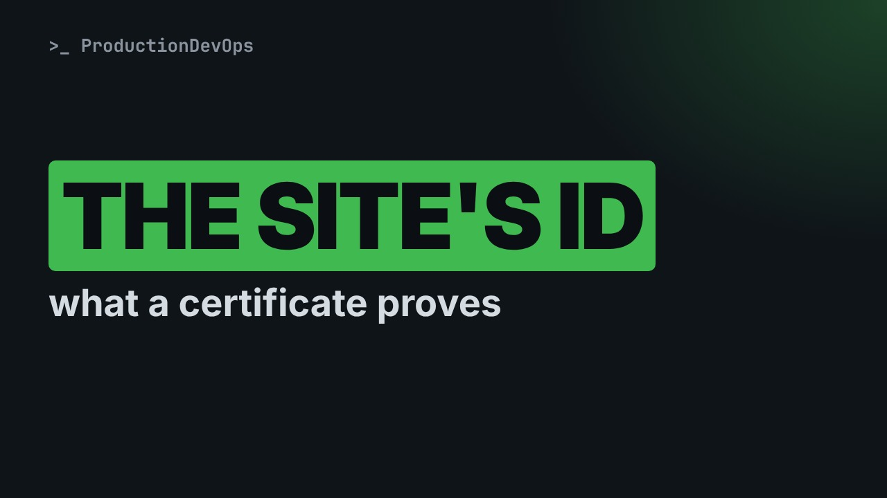
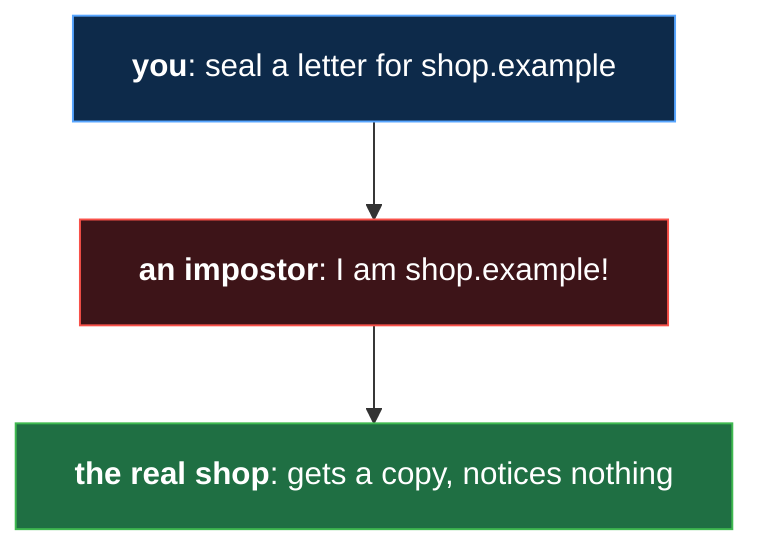
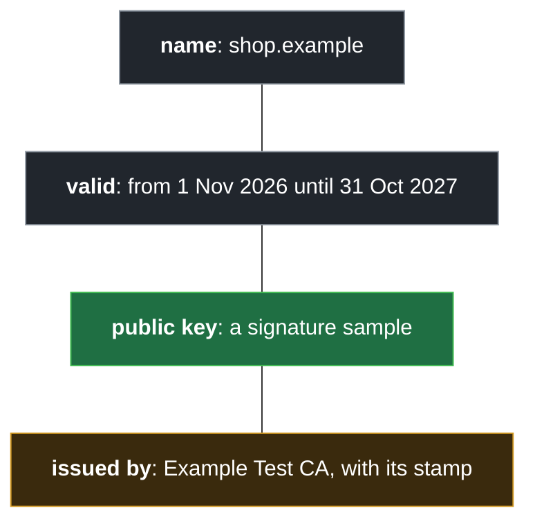

# What a Certificate Proves (HTTPS and Certificates, No Experience Needed)

**Video:** coming soon on the [channel](https://www.youtube.com/@production-devops).

A sealed letter is no use if you seal it for an impostor. So how does your browser know it really reached the shop, and not someone pretending? This lesson of HTTPS and Certificates, Simply explains the website's ID card, the certificate, with pictures and the postal service comparison: what is written on it, the two matching keys behind it, how your browser checks it in a fraction of a second, and what a certificate does not prove. No terminal, nothing to install, no experience needed. Every new word is explained on screen. The challenge and its solution are in the demos repo.

## Files in this folder

- [`challenge-solution.md`](challenge-solution.md) (solution of the challenge: try it yourself first)

## What you need

A Linux shell (a VM, WSL or a container is fine). Everything runs inside this folder.

## The lesson, step by step

The same explanations as the video, with every command. Read it, then run it yourself.

In five minutes: what a website's certificate proves, and how your browser checks it. And what it never proves.

For this lesson you need nothing. Just watch. It helps to have seen lessons one and two of this course. About five minutes.

### The plan

This is lesson three of HTTPS and Certificates, Simply. First, the impostor problem. Then, what is written on the website's ID card. Then, how your browser checks it. And what it proves, and what it does not.

### The impostor

**An impostor on the way**

Imagine someone on the way who says: I am shop dot example. You seal your letter for them. They open it, read it, and pass it on.

A seal protects the letter on the way. But it is useless if you seal it for the wrong person. So, before sealing, your browser asks: who am I talking to?

### The ID card

- `certificate — A small file that says which site this is, signed by a trusted office (like the website's ID card, issued by an office)`: 
Remember the certificate, from lesson one. It says which site this is, and a trusted office signed it. The website's ID card.

**What is on the ID card**

Here is the card, simplified. The site's name, and the dates it is valid. A public key, and who issued it, with their stamp.

- `key pair — Two matching keys: a public one for all, a private one kept hidden (like a signature sample anyone can see, and the hand that signs)`: 
New word: key pair. Two matching keys. The public one is for everyone, the private one stays hidden on the server.

Think of the public key as a signature sample, printed on the card. The private key is the hand that signs. Only the shop has it. Anyone can check a signature against the sample. Only the owner can make it.

### The check

Time flows down. Each arrow is one message.

- `your browser → shop server`: hello: here is a fresh random number
Step one. Your browser says hello, with a fresh random number. It is new for this visit.

- `shop server → your browser`: my ID card
Step two. The server sends its ID card.

- `shop server → your browser`: my signature, over this visit's messages
Step three. The server signs this visit's messages, fresh number included, with its private key.

Now your browser checks four things. Is the name on the card the address I typed? Is today between the two dates? Did a trusted office sign the card? Lesson four explains this one. And does the signature match the sample on the card? Only the real owner can do that.

### So far

So far: the certificate is the site's ID card. The public key is on the card. The private key stays on the server. Next: what all this proves, and what it does not. If this is helping, subscribe: the next lesson shows why your browser trusts the office.

### What it proves

When all four checks pass, you know this. This server holds the private key for shop dot example. An office checked that the owner controls that name. So your sealed letter goes to shop dot example, and no impostor can read it.

### Not proved

Now the other side. A certificate does not prove that the shop is honest. Often it does not even say who runs it. Only the name was checked. And it does not prove that the site is safe to use.

Think of a person's ID card. It proves who someone is. Not that they are kind, or keep their promises. Same for websites. A certificate proves the name, nothing more.

### Good to know

Good to know: if the private key is stolen, the owner asks the office to cancel the card. Some cards also name a company, checked by the office.

### Recap

Recap: a certificate is the site's ID card. A name, dates, a public key, and an issuer. The private key makes a signature, and your browser checks it. It proves the name. Not that the site is honest. Your challenge: someone copies the shop's card onto their own server. Can they pretend to be the shop? The answer is in the demo repo.

### Where next

Where next? Lesson four: who signs certificates. The offices, and the list your browser trusts.

Subscribe, and the next lesson, who signs certificates, finds you.

## Challenge

Your challenge: someone copies the shop's card onto their own server. Can they pretend to be the shop? The answer is in the demo repo.

When you have tried: [`challenge-solution.md`](challenge-solution.md).

---

From the [ProductionDevOps](https://www.youtube.com/@production-devops) channel: real-world DevOps and SRE, explained with real commands.
