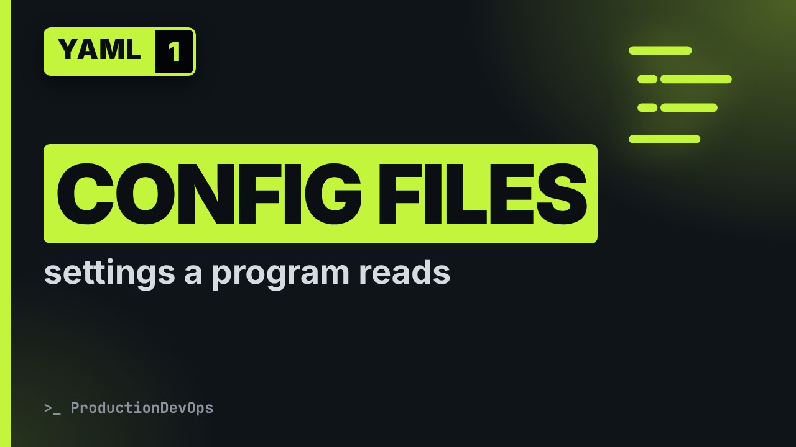
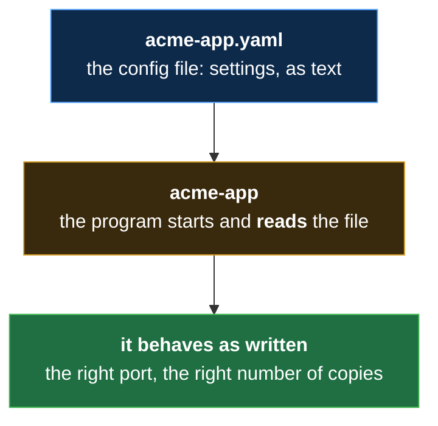
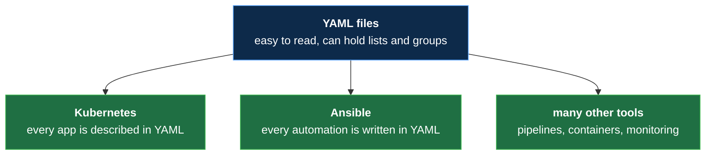

# What a Config File Is, Explained Simply (YAML from Zero, No Experience Needed)



**Video:** https://youtu.be/8R_rYwjGKic

Every program needs settings: which port to answer on, how many copies to run, extra messages on or off. They live in a small text file called a config file. This first lesson of YAML from Zero shows, with pictures and one everyday comparison, what a setting is, why programs read their settings from a file, and the same four settings written in three formats: INI, JSON and YAML. Then you see why DevOps tools like Kubernetes and Ansible chose YAML. No terminal, nothing to install, no experience needed. Every new word is explained on screen. The files, the challenge and its solution are in the demos repo.

## Files in this folder

- [`acme-app.ini`](acme-app.ini)
- [`acme-app.json`](acme-app.json)
- [`acme-app.yaml`](acme-app.yaml)
- [`challenge-solution.md`](challenge-solution.md) (solution of the challenge: try it yourself first)

## What you need

A Linux shell (a VM, WSL or a container is fine). Everything runs inside this folder.

## The lesson, step by step

The same explanations as the video, with every command. Read it, then run it yourself.

Every program needs settings, and they live in a small text file. At the end, you will read one file written three ways.

For this lesson you need nothing. Just watch. No terminal today. Only pictures and small text files. About five minutes.

### The plan

This is lesson one of YAML from Zero. First, what a setting is. Then, the file a program reads when it starts. Then, one file written in three formats. And why DevOps uses YAML everywhere.

### Settings

- `setting — One choice that changes how a program behaves (like one field on a hotel check-in form: nights, breakfast or not)`: 
First word: setting. A setting is one choice that changes how a program behaves. Think of one field on a hotel check-in form.

- `config file — A text file full of settings, read by a program when it starts (like the filled-in check-in form: the hotel reads it, then prepares your room)`: 
Second word: config file, short for configuration file. It is a text file full of settings, read by a program when it starts.

**A program reads its config file**



Our example for the whole course is a small app called acme app. When it starts, it reads its config file. Then it behaves as the file says.

Here are four settings. The first one is the name of the program. Port is the door number where the app answers. Here, eight zero eight zero. Replicas means copies. This app runs three copies at once. Debug means extra messages, for fixing problems. False means: switched off.

Why a file? First, the program starts the same way, every time. You can copy the same file to many servers. Someone can read and check it, before it goes live. And you can keep old versions, to go back if something breaks.

### Three formats

- `format — The rules for how a file is written (like the layout of a form: where each box goes, how you fill it in)`: 
The same settings can be written in different formats. A format is the set of rules for how a file is written. Like the layout of a form.

```
[acme-app]
port = 8080
replicas = 3
debug = false
```

The first format is called ini, an old and simple one. A name in square brackets starts a section. Then one setting per line. The name, an equals sign, and the value.

```
{
  "app": "acme-app",
  "port": 8080,
  "replicas": 3,
  "debug": false
}
```

The second format is JSON. Curly braces wrap the whole file. Every name sits in double quotes. Then a colon, the value, and a comma. No comma on the last line. Forget one comma, and the whole file is broken.

### So far

So far: a setting is one choice for a program. A config file holds settings as text. The program reads it when it starts. We saw two formats for the same settings. Next: the third format, the one DevOps loves.

### YAML

- `YAML — A format for settings, made to be easy for people to read (like a neatly filled-in form: one field per line, nothing extra)`: 
The third format is YAML, which rhymes with camel. It is made to be easy for people to read, like a neatly filled-in form.

```
app: acme-app
port: 8080
replicas: 3
debug: false
```

One setting per line. The name, a colon, a space, and the value. No brackets, no commas, no quotes around the names. Just the settings.

```
INI    port = 8080
JSON   "port": 8080,
YAML   port: 8080
```

Here is the same setting, three ways. The meaning is identical: the port is eight zero eight zero. YAML has the fewest symbols. That is why people find it easy to read and write.

### Why YAML

**Why YAML is everywhere in DevOps**



YAML can also hold lists and groups of settings. So DevOps tools chose it. Kubernetes and Ansible files are YAML, and so are many others.

### Good to know

Config files are plain text. Any text editor opens them. A YAML file name ends in dot yaml, or dot y m l. Both mean the same. JSON is common too, mostly for messages between programs.

### Recap

Recap: a setting is one choice. A config file holds settings as text. A program reads its config file when it starts. YAML is name, colon, space, value. DevOps uses it everywhere. Your challenge: take the JSON line replicas five, and write it in YAML. The answer is in the demo repo.

### Where next

Where next? Lesson two: keys and values, the heart of YAML. And why the space after the colon matters so much.

Next lesson: keys and values. Subscribe so you do not miss it.

## Challenge

Your challenge: take the JSON line replicas five, and write it in YAML. The answer is in the demo repo.

When you have tried: [`challenge-solution.md`](challenge-solution.md).

---

From the [ProductionDevOps](https://www.youtube.com/@production-devops) channel: real-world DevOps and SRE, explained with real commands.
