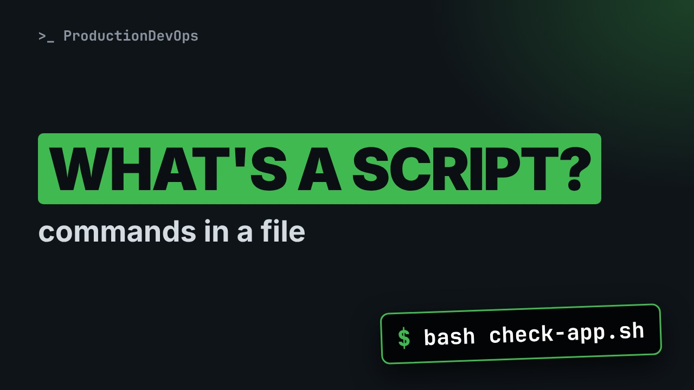
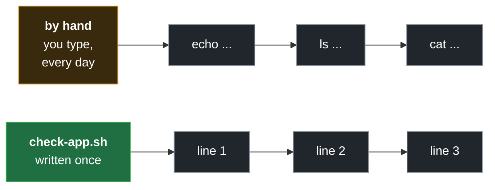
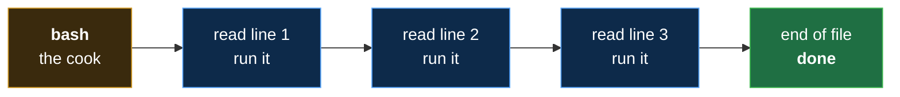

# What a Script Is: Commands in a File (Shell Scripting from Zero)



**Video:** coming soon on the [channel](https://www.youtube.com/@production-devops).

Every morning you type the same commands to check an app, one at a time. A script is a file that holds those commands, so the computer can follow them for you, top to bottom, the same way every time. In this first lesson of Shell Scripting from Zero we put three commands you know in a file, read it with cat, and run it with bash. Every new word is explained on screen and every command runs for real. You only need the terminal basics from Linux from Zero. The challenge and its solution are in the demos repo.

## Files in this folder

- [`acme-app/config.txt`](acme-app/config.txt)
- [`acme-app/logs/app.log`](acme-app/logs/app.log)
- [`acme-app/logs/old.log`](acme-app/logs/old.log)
- [`check-app.sh`](check-app.sh)
- [`notes/ideas.txt`](notes/ideas.txt)
- [`notes/todo.txt`](notes/todo.txt)
- [`readme.txt`](readme.txt)
- [`challenge-solution.sh`](challenge-solution.sh) (solution of the challenge: try it yourself first)

## What you need

A Linux shell (a VM, WSL or a container is fine). Everything runs inside this folder.

## Before you start

The video runs these commands first, off screen:

```bash
mkdir -p /lab && ln -sfn "$PWD" /lab/sre && cd /lab/sre && export HOME=/lab/sre
alias ls='ls --color=auto'
PROMPT_COMMAND='PS1="\[\e[1;32m\]sre@lab\[\e[0m\]:\[\e[1;34m\]\w\[\e[0m\]$ "'
[ -e .tt-fresh ] || { chmod 644 check-app.sh; touch .tt-fresh; }
```

## The lesson, step by step

The same explanations as the video, with every command. Read it, then run it yourself.

Every morning, you type the same commands to check an app. What if a file could do it for you? At the end, you run your first script, twice.

You will need a terminal with bash. Lesson two of Linux from Zero shows how to get one. And the basics from that course: p w d, l s, c d and cat. Or just watch. Every step is on screen.

### The plan

This is lesson one of Shell Scripting from Zero. First, the same commands, every day. Then, what a script is. We look inside one. And we run it, with bash.

### By hand

Our morning check of acme app. First: which logs are there?

```console
$ ls acme-app/logs
```

Then we read the main log, app dot log.

```console
$ cat acme-app/logs/app.log
```

Every morning, the same commands. Typed by hand, one at a time.

Before we go on, one new command: echo. It prints the text you give it. Scripts use it to talk to you.

We type echo, then a sentence in double quotes.

```console
$ echo "Checking acme-app"
```

It prints the sentence back. The quotes keep the words together, as one piece of text.

### A script

- `script — A text file of commands, run from top to bottom (like a recipe card: the computer follows it, step by step)`: 
New word: script. A text file full of commands, that the computer runs from top to bottom. Think of a recipe card, followed step by step.

**By hand, or from a card**



On top, you type every command, every day. Below, you write them once, in a file. The computer reads it, line by line.

### Inside

Here is a script I wrote with a text editor. Its name is check app dot s h.

```
echo "Checking acme-app"
ls acme-app/logs
cat acme-app/logs/app.log
```

Line one: echo prints a title, so we know what is running. Line two: list the logs folder. The same command we typed. Line three: read the main log. Also the same.

### So far

So far: every day, we typed the same commands by hand. A script holds those commands, in a file. Next: who reads the file, and runs it?

### Run it

- `bash — The most common shell: the program that runs your commands (like the cook who follows the recipe card)`: 
New word: bash, the most common shell. You met the shell in Linux from Zero. Think of bash as the cook who follows your card.

**What bash does with the file**



Bash reads line one, and runs it. Then line two, then line three. At the end of the file, it stops.

A new terminal starts at home. Is the script here? We look.

```console
$ ls
```

It is a text file, so cat can read it. Three commands, as we wrote them.

```console
$ cat check-app.sh
```

Now we run it. We type bash, then the name of the file.

```console
$ bash check-app.sh
```

The title, the list of logs, then the log. Three results, in order.

### Again

Tomorrow morning, we just run it again. One short command.

```console
$ bash check-app.sh
```

Same steps, same order, every time. That is the point of a script.

### Good to know

A script is plain text. Any text editor can write it, like nano, or the one on your desktop. Dot s h at the end of the name is a hint, for people. Bash runs every line, then stops at the end of the file.

### Recap

Recap: a script is commands in a file, run from top to bottom. Echo prints a text. Bash, then a file name, runs a script. Your challenge: write a script called where dot s h, with two lines: p w d, and l s. Run it with bash. What does it print? The solution is in the demo repo.

### Where next

Where next? Lesson two: the first line of every script. Then lesson three: running it without typing bash.

Next lesson: your first script, and the shebang. Subscribe so you do not miss it.

## All the commands, to copy

Run them from inside this folder, in this order (some are expected to fail: that is the point of the demo).

```bash
ls acme-app/logs
cat acme-app/logs/app.log
echo "Checking acme-app"
ls
cat check-app.sh
bash check-app.sh
```

## Challenge

Your challenge: write a script called where dot s h, with two lines: p w d, and l s.

When you have tried: [`challenge-solution.sh`](challenge-solution.sh).

---

From the [ProductionDevOps](https://www.youtube.com/@production-devops) channel: real-world DevOps and SRE, explained with real commands.
