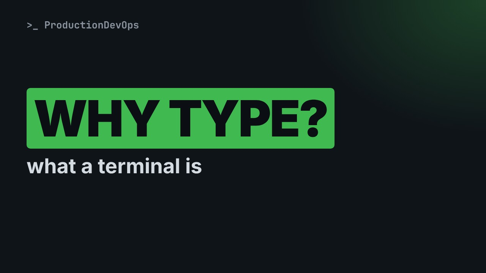
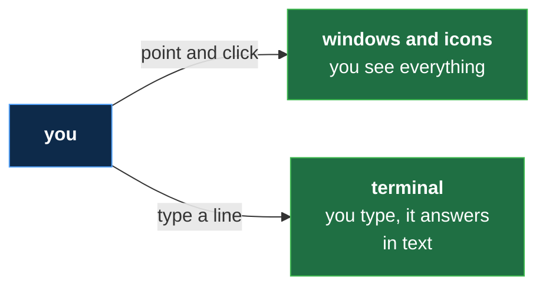
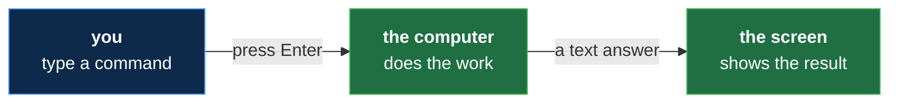
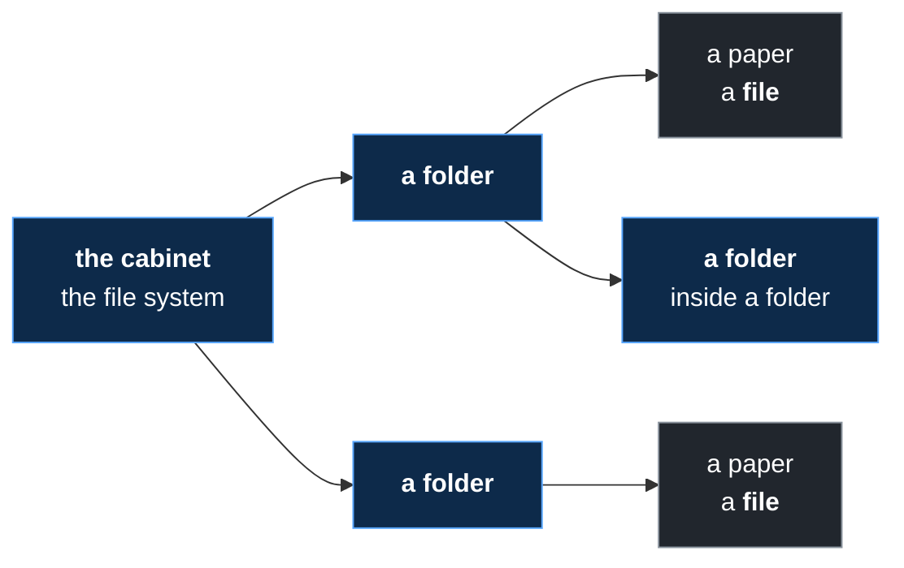
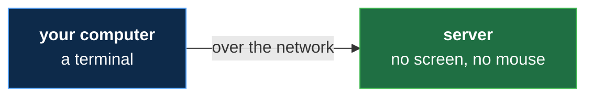

# What a Terminal Is, and Why Engineers Use It (No Experience Needed)



**Video:** https://youtu.be/XuecCojmTTw

Engineers fix servers by typing short lines of text, with no mouse and no icons. This first lesson of Linux from Zero explains, with pictures and everyday comparisons, what a terminal is, what a command is, and why engineers type instead of clicking. Then you read your first terminal screen, line by line. Nothing to install, no experience needed: every new word is explained on screen. The challenge and its solution are in the demos repo.

## Files in this folder

- [`challenge-solution.md`](challenge-solution.md) (solution of the challenge: try it yourself first)

## What you need

A Linux shell (a VM, WSL or a container is fine). Everything runs inside this folder.

## The lesson, step by step

The same explanations as the video, with every command. Read it, then run it yourself.

Engineers fix servers by typing short lines of text. No mouse, no icons. Today you will see why, and you will read your first terminal screen.

For this lesson you need nothing. Just watch. No terminal yet. Lesson two shows how to get one. About five minutes.

### The plan

This is lesson one of Linux from Zero. First, two ways to use a computer. Then, what a terminal is. Then, why engineers type. And you read your first terminal screen.

### Two ways

**Two ways to use a computer**



There are two ways to use a computer. You can point and click on icons. Or you can type a line of text.

- `terminal — A window where you type requests and read the answers as text (like a counter where you hand a note to a clerk)`: 
New word: terminal. It is a window where you type requests, and read the answers as text. Like a counter where you hand a note to a clerk.

- `command — One typed request: a word, sometimes followed by more words (like a short note to the clerk: "show me this folder")`: 
New word: command. A command is one typed request. Like a short note to the clerk: show me this folder.

**One request, one answer**



It always goes the same way. You type a command, and press Enter. The computer does the work, and shows a text answer.

### The cabinet

- `file system — How a computer keeps its files: folders inside folders (like a filing cabinet: folders, with papers inside them)`: 
One more word: file system. It is how a computer keeps its files, in folders inside folders. Think of a filing cabinet.

**The cabinet of this course**



Every lesson of this course uses this picture. Folders hold papers, called files, and other folders. With commands, you ask the clerk to find, read and add.

### So far

So far: in a terminal, you type, and the computer answers in text. A command is one typed request. Next: why type, when you can click?

### Why type?

- `server — A computer that runs programs for other people, all day (like a records office: it answers requests, nobody sits at it)`: 
A word you will hear a lot: server. It runs programs for other people, all day. Like a records office: it answers requests, but nobody sits at it.

**A server has no screen**



Most servers sit in a data center, with no screen and no mouse. Engineers reach them from a terminal, on their own computer.

Servers have no screen, so you type. A command is exact. You can copy it, and share it. Typed steps can be saved, and run again later. And it is fast, once you know a few words.

A click is hard to describe. The third icon, top left? A command is one line. You can send it in a message. Engineers use both, each for its job.

### Read a screen

- `prompt — The text before your cursor: the terminal is ready for you (like the clerk at the counter: next, please)`: 
Last word: prompt. It is the text before your cursor. Like a clerk saying: next, please.

```
sre@lab:~$ pwd
/lab/sre
sre@lab:~$
```

Here is a real terminal screen. Everything up to the dollar sign is the prompt. After the prompt comes the command. Here, p w d. You will meet it in lesson three. The next line is the answer, in plain text. Then the prompt comes back. The terminal is ready for the next request.

### Good to know

The program that reads your commands is called the shell. Most servers on the internet run Linux. So this course uses Linux. Our first commands only look. They change nothing.

### Recap

Recap: in a terminal, you type a command and read a text answer. The prompt means: the terminal is ready for you. Engineers type for servers, for exact steps, and for speed. Your challenge: in this line, which part is the prompt, and which is the command? The answer is in the demo repo.

### Where next

Where next? Lesson two: a terminal on your own computer. On Windows, on a Mac, or just in a browser. Then, one new command per lesson.

Next lesson: getting a Linux terminal on your computer. Subscribe so you do not miss it.

## Challenge

Your challenge: in this line, which part is the prompt, and which is the command? The answer is in the demo repo.

When you have tried: [`challenge-solution.md`](challenge-solution.md).

---

From the [ProductionDevOps](https://www.youtube.com/@production-devops) channel: real-world DevOps and SRE, explained with real commands.
