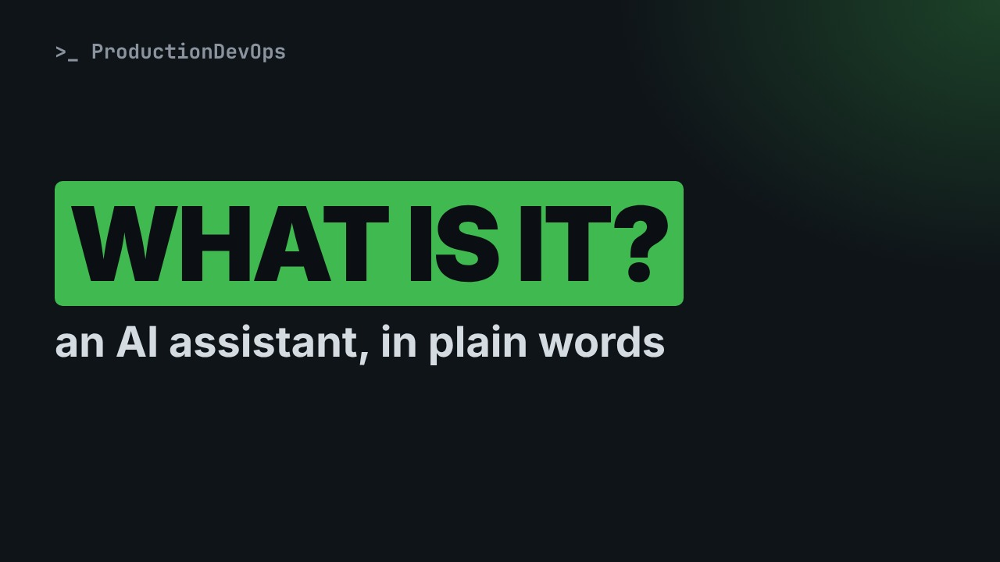
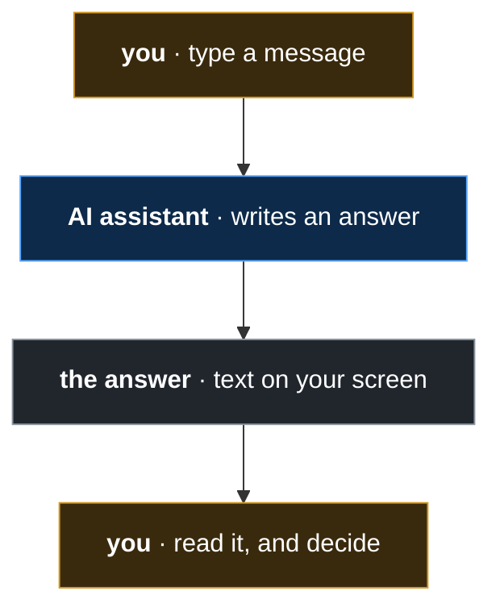
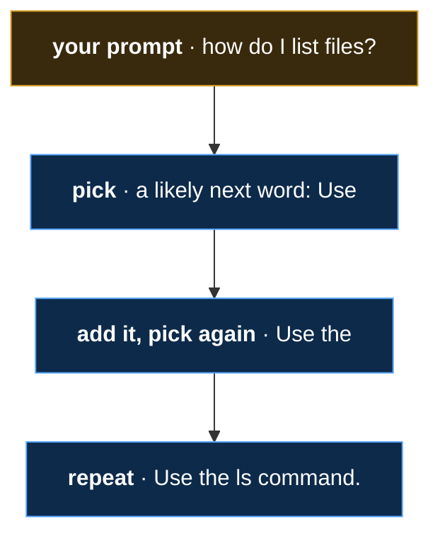
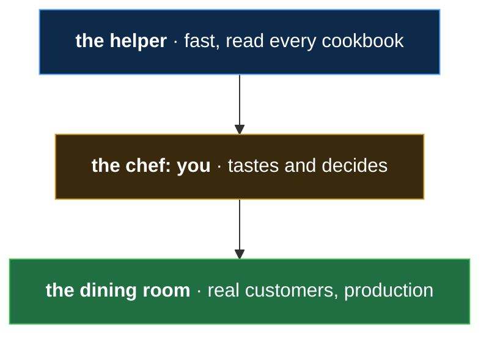

# What an AI Assistant Is, and What It Is Not (AI for Ops: the Safe Basics)

**Video:** coming soon on the [channel](https://www.youtube.com/@production-devops).

You type a question, and a full answer appears in seconds. But what wrote it? This first lesson of AI Assistants for Ops: the Safe Basics explains, with pictures and one kitchen comparison, what an AI assistant is, how it builds an answer one likely word at a time, what it is good at, and what it is not. At the end you get one sentence to remember. Valid for any assistant: no product names, nothing to install. Every new word is explained on screen. The challenge and its solution are in the demos repo.

## Files in this folder

- [`challenge-solution.md`](challenge-solution.md) (solution of the challenge: try it yourself first)

## What you need

A Linux shell (a VM, WSL or a container is fine). Everything runs inside this folder.

## The lesson, step by step

The same explanations as the video, with every command. Read it, then run it yourself.

In five minutes: what an AI assistant is, how it writes an answer, and what it is not. At the end, one sentence to remember.

You will need the words from DevOps from Zero, like server and production. Nothing to install. This lesson is only pictures. About five minutes.

### The plan

This is lesson one of AI Assistants for Ops: the Safe Basics. First, what an AI assistant does. Then, how it builds an answer. What it is good at. And what it is not.

### The helper

- `AI assistant — A program that answers your messages with text it writes (like a very fast new kitchen helper)`: 
First word: AI assistant. It is a program that answers your messages with text it writes. Think of a very fast new kitchen helper.

**You write, it answers**

It works like a chat. You type a message, the assistant writes an answer, and you read it. Then you decide what to do.

- `prompt — The message you type to the assistant (like the order ticket you hand to the helper)`: 
The message you type has a name: prompt. Think of the order ticket you hand to the helper.

### How it answers

- `language model — The engine inside: it predicts the next likely words (like a helper who read every cookbook, but never tasted your dishes)`: 
Inside the assistant there is a language model. It predicts the next likely words. Think of a helper who read every cookbook, but never tasted your dishes.

**One likely word at a time**

How does it build an answer? It reads your prompt, and picks a likely next word. Then it adds that word, and picks again, until the answer is done.

Where does likely come from? The model learned from a huge amount of text. Books, manuals, web pages, and code. So its answers sound like good answers. But sounding right is not the same as being checked. Remember this one.

### Good at

So what is it good at? It can explain an error message in plain words. It can write a first draft of a small script. It can summarise a long text, or a long log. And it can suggest what to check next.

### So far

So far: you type a prompt, and the assistant writes an answer. Inside, a language model picks likely words, one at a time. Next: what it is not. And who decides. If this is helping, subscribe. The next lesson shows why a very sure answer can still be wrong.

### Not this

It is not a fact checker. Its words are likely, not proven. It is not your colleague. It has never seen your servers. It is not in charge. It does not answer for the result. And it is not always right, even when it sounds sure.

**In the kitchen**

In the kitchen, the helper is fast and has read every cookbook. But you are the chef. Nothing reaches the customers until you have tasted it.

The helper drafts. It is fast, and often useful. The chef checks. You taste before serving. And the chef decides. You answer for what reaches production.

### One sentence

Here is the one sentence. An AI assistant is a fast helper that writes likely text. You stay the chef. You check, and you decide.

### Good to know

Good to know. Names and products change all the time. These ideas stay. Some assistants can also search the web, or run tools for you. The core is the same. Likely text, and you check it.

### Recap

Recap. A prompt is the message you type. A language model picks likely words, one at a time. Likely is not checked. You decide. Your challenge: look at three jobs in the demo repo. Which can the helper draft, and which must you do yourself?

### Where next

Where next? Lesson two: why answers can be wrong, and still sound right. Then secrets, good prompts, reviews and tests.

Next lesson: why AI answers can be wrong, and sound right. Subscribe, and that lesson finds you.

## Challenge

Your challenge: look at three jobs in the demo repo. Which can the helper draft, and which must you do yourself?

When you have tried: [`challenge-solution.md`](challenge-solution.md).

---

From the [ProductionDevOps](https://www.youtube.com/@production-devops) channel: real-world DevOps and SRE, explained with real commands.
