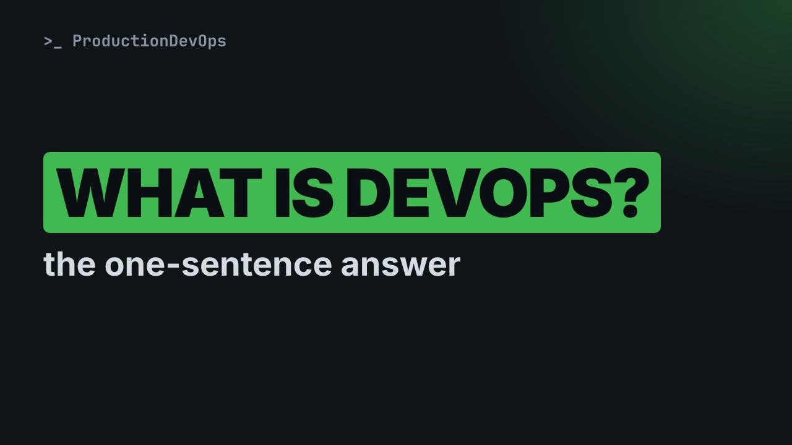
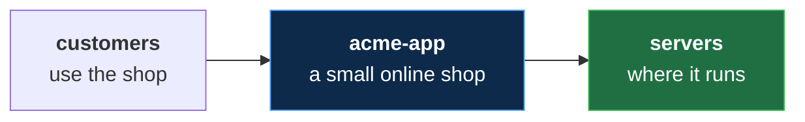
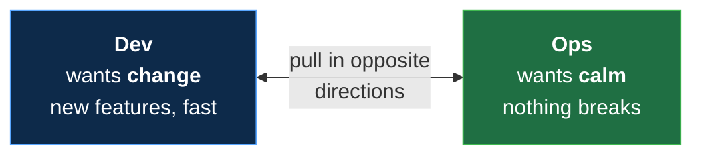
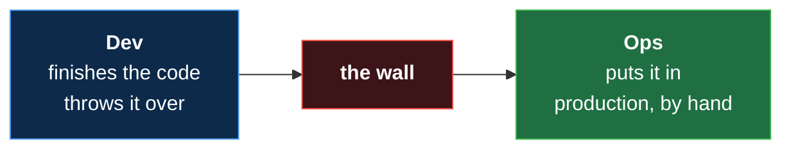
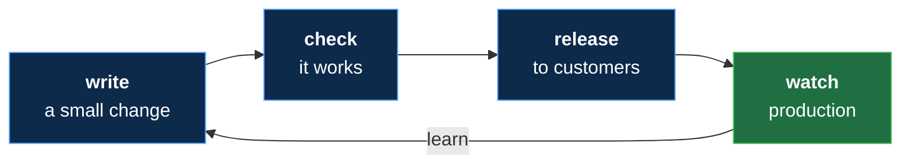
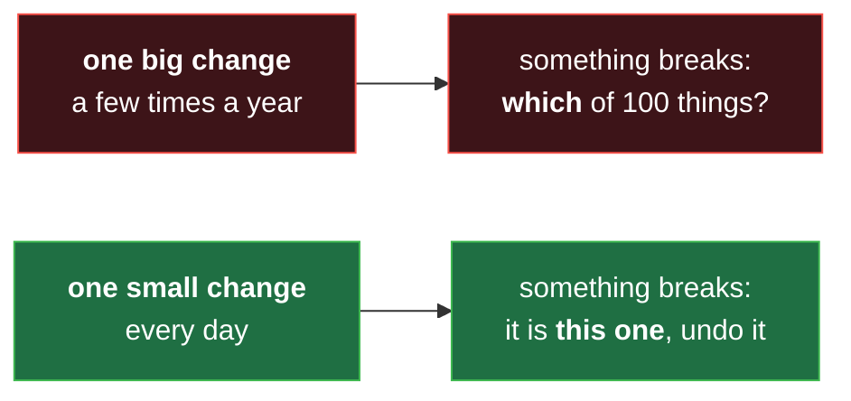

# What DevOps Actually Means, Explained Simply (DevOps from Zero, No Experience Needed)

**Video:** https://youtu.be/IjJT5EMIXSY

Everyone says DevOps: job ads, talks, even the name of this channel. But DevOps is not a tool you can install. This first lesson of DevOps from Zero shows, with pictures and one restaurant comparison, the two teams behind every app, the wall that used to stand between them, and what changes when they work as one team. At the end you get a one-sentence answer you can say to a friend. No terminal, nothing to install, no experience needed. Every new word is explained on screen. The challenge and its solution are in the demos repo.

## Files in this folder

- [`challenge-solution.md`](challenge-solution.md) (solution of the challenge: try it yourself first)

## What you need

A Linux shell (a VM, WSL or a container is fine). Everything runs inside this folder.

## The lesson, step by step

The same explanations as the video, with every command. Read it, then run it yourself.

Everyone says DevOps. But DevOps is not a tool you can install. At the end, you will have a one-sentence answer.

For this lesson you need nothing. Just watch. No terminal and no code. Only pictures. About five minutes.

### The plan

This is lesson one of DevOps from Zero, the start of the whole channel. First, the two teams behind every app. Then, the wall that used to stand between them. Then, what DevOps changes. And what DevOps is not.

### Two teams

- `app — A program people use: a website, a phone app, an online shop (like the food a restaurant serves: customers only see the dish)`: 
First word: app. An app is a program people use, like a website or an online shop. Think of the food a restaurant serves.

- `server — A computer that runs an app for others, all day long (like a restaurant kitchen: it cooks, the customers only see the food)`: 
Second word: server. A server is a computer that runs an app for others, all day long. Think of the kitchen.

**Our example: acme-app**

Our example for the whole course: an online shop called acme app. Customers use it, and it runs on servers.

- `Dev — Development: the people who write and change the app (like the cooks who invent and change the recipes)`: 
Behind every app there are two kinds of work. Dev is short for development. These people write and change the app.

- `Ops — Operations: the people who keep the app running for customers (like the staff who run the restaurant every night)`: 
Ops is short for operations. These people keep the app running for customers. Like the staff who run the restaurant every night.

**Two teams, two wishes**

The two teams want different things. Dev wants change: new features, fast. Ops wants calm, because every change can break something.

### The wall

- `production — The real system that real customers are using right now (like the dining room, with real customers at the tables)`: 
One more word: production. It is the real system, with real customers using it right now. Think of the dining room, full of people.

**The old way: a wall**

For years, many companies worked like this. Dev finished the code and threw it over a wall. Ops had to put it in production, by hand.

Changes came in big piles, only a few times a year. The new version broke, and Dev said: it worked on my computer. Every step was done by hand, often late at night. And when it broke, each team blamed the other.

### So far

So far: Dev changes the app, and Ops keeps it running. A wall between them made changes slow, risky, and full of blame. Next: we take the wall down. And then, the one-sentence answer.

### One team

- `DevOps — A way of working: the same team builds the app and runs it (like cooks and dining room staff working as one restaurant)`: 
Now the word itself. DevOps is a way of working: the same team builds the app, and runs it.

**The DevOps loop**

The work becomes a loop. Write a small change, check it, release it, and watch production. What you learn feeds the next change.

What changes? First, small changes, released often. Second, a computer repeats the boring steps, the same way every time. Third, everyone watches production, not only Ops. And problems are fixed together, without blame.

**Why small and often?**

Why small and often? A big change breaks: which of many things was it? A small change breaks: you know which one, and you undo it.

### Not this

Now, what DevOps is not. It is not a tool you can buy or install. It is not one person who does everything. It is not only for big companies. And it is not less careful. There are more checks, not fewer.

Here is the one-sentence answer. DevOps means one team builds the app, and runs it. It works with small changes, automated steps, and eyes on production. Try to say it to a friend. It fits in one breath.

### Good to know

DevOps engineer is also a job title. We look at that job in lesson seven. Every company does DevOps a little differently. The idea stays the same.

### Recap

Recap: Dev changes the app, and Ops keeps it running. The old wall meant big, rare, risky changes, and blame. DevOps means one team, small changes, automated steps, and eyes on production. Your challenge: a team releases once a year, by hand, and blames others. Name two DevOps fixes. The answer is in the demo repo.

### Where next

Where next? Lesson two: the journey of an app, from code to customers. Lesson three: servers, clouds and data centers. Then automation, saving versions, monitoring, and the job itself. And in lesson eight, your learning map.

Next lesson: from code to users, the journey of an app. Subscribe so you do not miss it.

## Challenge

Your challenge: a team releases once a year, by hand, and blames others. Name two DevOps fixes. The answer is in the demo repo.

When you have tried: [`challenge-solution.md`](challenge-solution.md).

---

From the [ProductionDevOps](https://www.youtube.com/@production-devops) channel: real-world DevOps and SRE, explained with real commands.
