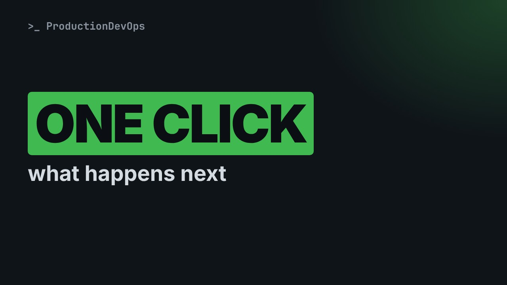
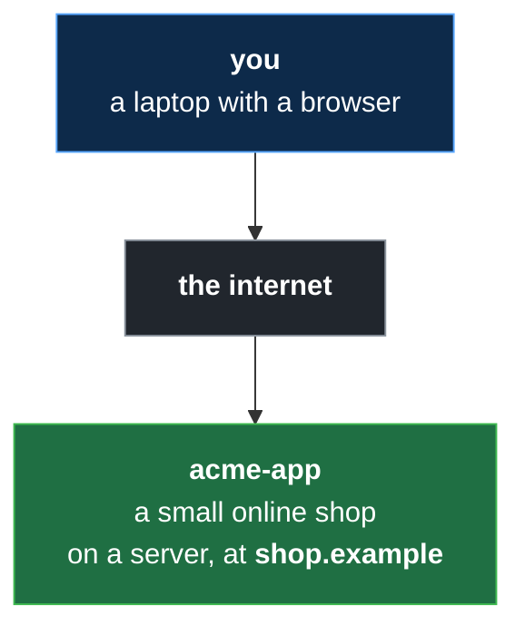
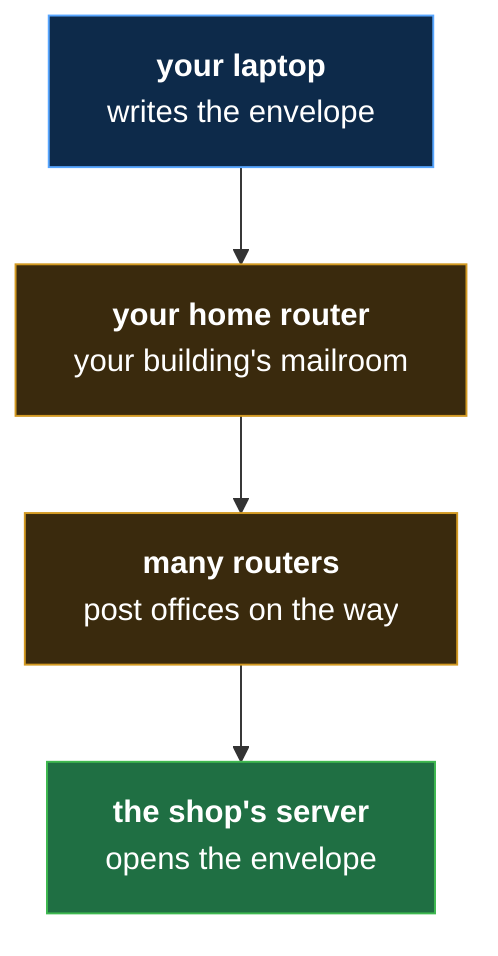

# What Happens When You Open a Website (How the Internet Works, No Experience Needed)

**Video:** coming soon on the [channel](https://www.youtube.com/@production-devops).

You type a name, press Enter, and a page appears in about a second. What happened in that second? This first lesson of How the Internet Works, Simply follows one visit to a small online shop, step by step, with pictures and one everyday comparison: the postal service. A name becomes an address, a request travels there in small envelopes, and an answer comes back. At the end you can tell the whole trip in five steps. No terminal, nothing to install, no experience needed. Every new word is explained on screen. The challenge and its solution are in the demos repo.

## Files in this folder

- [`challenge-solution.md`](challenge-solution.md) (solution of the challenge: try it yourself first)

## What you need

A Linux shell (a VM, WSL or a container is fine). Everything runs inside this folder.

## The lesson, step by step

The same explanations as the video, with every command. Read it, then run it yourself.

You type a name, press Enter, and a page appears. What happened in that second? At the end, you will tell the whole trip in five steps.

For this lesson you need nothing. Just watch. No terminal and no code. Only pictures. About five minutes.

### The plan

This is lesson one of How the Internet Works, Simply. First, the two sides of every visit. Then, the internet as a postal service. Then, one visit, step by step. And the five words this course explains.

### Two sides

- `browser — The program you use to open websites (like you, at your desk, writing letters and reading replies)`: 
First word: browser. It is the program you use to open websites. Think of you at your desk, writing letters and reading the replies.

- `server — A computer that answers requests from others, all day long (like an office that answers every letter it receives)`: 
Second word: server. A server is a computer that answers requests from others, all day long. Think of an office that answers every letter.

**Our example: acme-app**

Our example for the whole course: a small online shop, acme app, at shop dot example. You sit on one side, the shop's server on the other.

### The post

- `internet — Many networks joined, so any computer can reach any other (like the postal service of the whole world)`: 
Between you and the shop: the internet. It is many networks, joined together. Think of the postal service of the whole world.

Here is our comparison for the whole course. Every computer has an address, like a house. Data travels in small envelopes. Post offices pass the envelopes along, one to the next. And an address book turns names into addresses.

### One visit

Now, one visit. You type shop dot example, and press Enter. The browser knows only a name. But envelopes need an address, not a name. So the first stop is the address book.

Time flows down. Each arrow is one message.

- `your browser → address book (DNS)`: where is shop.example?
Step one. The browser asks the internet's address book: where is shop dot example?

- `address book (DNS) → your browser`: at 203.0.113.10
Step two. The answer comes back: an address, made of four numbers.

- `your browser → shop server`: please send the home page
Step three. The browser sends a request to that address: please send the home page.

- `shop server → your browser`: here is the page
Step four. The shop's server answers with the page.

Step five. The browser reads the answer, and draws the page. The page often asks for more: pictures, colours, and so on. Each one makes the same trip again. And all of it often takes less than a second.

### So far

So far: a name becomes an address, thanks to the address book. A request goes to that address, and an answer comes back. Next: how the envelopes travel from you to the shop.

### The trip

- `router — A device that passes data on, toward its address (like a post office: it sorts envelopes and sends them on)`: 
New word: router. A router passes data on, toward its address. Think of a post office that sorts envelopes, and sends them on.

**How the envelopes travel**

Your laptop writes the envelope. Your home router passes it on. Many routers on the way do the same, until it reaches the shop.

This course explains five words. IP address: where to send. Lesson two. DNS: the address book. Lesson three. Port: which program answers. Lesson four. Packet: one envelope. Lesson five. And router, the post office. Lesson six.

### Good to know

Good to know: the internet is not one place. It is many networks, joined. Websites are only one use of it. Mail and video calls use it too. And shop dot example is a name reserved for examples. No real shop has it.

### Recap

Recap: a name becomes an address, in the address book. A request goes out, and an answer comes back, in envelopes. Routers pass the envelopes on, like post offices. Your challenge: put the five steps on screen in the right order. The answer is in the demo repo.

### Where next

Where next? Lesson two: IP addresses, the addresses of computers. Then names, ports, packets, routers, and servers. And in lesson eight, your first real command.

Next lesson: addresses for computers, IP addresses. Subscribe so you do not miss it.

## Challenge

Your challenge: put the five steps on screen in the right order. The answer is in the demo repo.

When you have tried: [`challenge-solution.md`](challenge-solution.md).

---

From the [ProductionDevOps](https://www.youtube.com/@production-devops) channel: real-world DevOps and SRE, explained with real commands.
