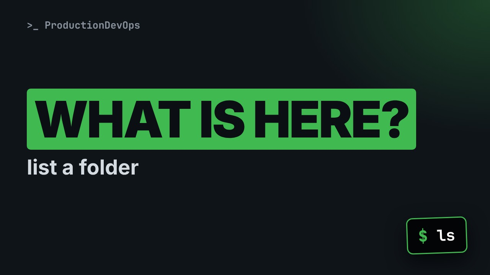
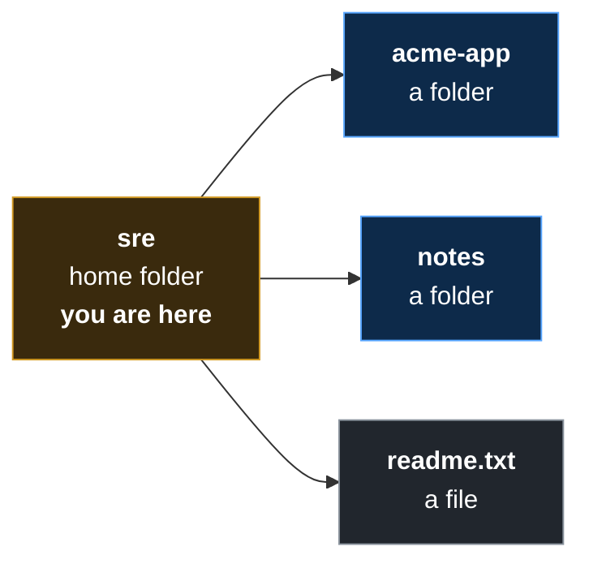
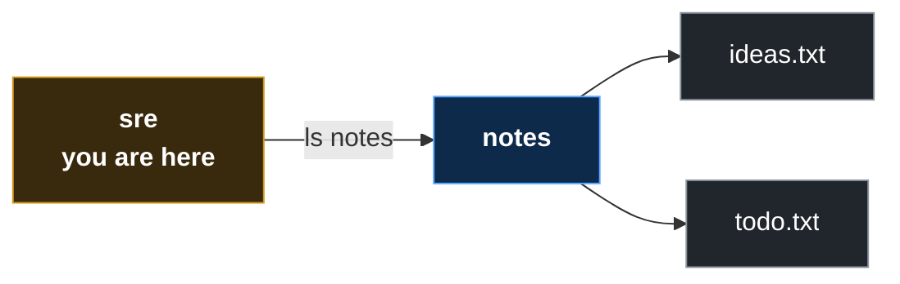
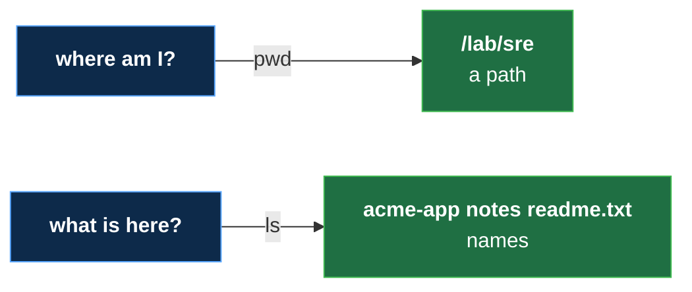

# What Is Here? Listing a Folder with ls (No Experience Needed)



**Video:** https://youtu.be/6gc0EF4u0H4

You know where you are, but what is in this folder? This lesson of Linux from Zero adds one command, ls, that lists what a folder holds. We tell files and folders apart, draw the answer on our cabinet of folders, and then look inside another folder without walking into it. No experience needed: every new word is explained on screen, and every command runs for real. The challenge and its solution are in the demos repo.

## Files in this folder

- [`acme-app/config.txt`](acme-app/config.txt)
- [`acme-app/logs/app.log`](acme-app/logs/app.log)
- [`notes/ideas.txt`](notes/ideas.txt)
- [`notes/todo.txt`](notes/todo.txt)
- [`readme.txt`](readme.txt)
- [`challenge-solution.sh`](challenge-solution.sh) (solution of the challenge: try it yourself first)

## What you need

A Linux shell (a VM, WSL or a container is fine). Everything runs inside this folder.

## Before you start

The video runs these commands first, off screen:

```bash
mkdir -p /lab && ln -sfn "$PWD" /lab/sre && cd /lab/sre && export HOME=/lab/sre
alias ls='ls --color=auto'
PROMPT_COMMAND='PS1="\[\e[1;32m\]sre@lab\[\e[0m\]:\[\e[1;34m\]\w\[\e[0m\]$ "'
```

## The lesson, step by step

The same explanations as the video, with every command. Read it, then run it yourself.

You know where you are, but what is in this folder? One short command lists it. And at the end, a way to look inside a folder without going in.

To follow along, you need a terminal. Lesson two shows how to get one. Or just watch. Every step is on screen.

### The plan

This is lesson four of Linux from Zero. First, a reminder: where am I? Then the new command: l s. Then, how to tell files and folders apart. And how to look inside a folder, without going in.

### Where am I?

Where am I? We ask p w d, from lesson three.

```console
$ pwd
```

Slash lab, slash s r e. Our home folder. But we cannot see what is in it.

### The command

Here is the one new command: l s. It is short for list. It lists what is in a folder. With nothing after it, it lists the folder you are in.

### Try it

What is in our home folder? We type l s, and press Enter.

```console
$ ls
```

Three names. Acme app and notes, in blue, are folders. Readme dot t x t, in white, is a file.

**What ls showed**



Here is that answer on our cabinet. L s shows only what is directly inside this folder. Not what is inside the other folders.

How to read the answer. The names come side by side, not one per line. Only what is in this folder. Not what is inside the folders. And if nothing is printed, the folder is empty.

### Folder or file?

- `extension — The end of a file name, after the dot: .txt, .log (like a label on a paper: "text", "letter", "bill")`: 
New word: extension. It is the end of a file name, after the dot. Like dot t x t, for text.

In many terminals, folders are blue. In ours too. Files often have an extension, like dot t x t. But it is only a hint. On Linux, a name is just a name.

### So far

So far: l s lists what is in the folder you are in. Folders and files, side by side. Next: look inside a folder, without going in.

### Look inside

What is inside notes? We type l s, a space, then the folder's name.

```console
$ ls notes
```

Two files: ideas dot t x t, and to do dot t x t. Did we move? We ask p w d.

```console
$ pwd
```

Still at home. L s looked inside notes from here.

**Looking inside, from where you stand**



You stayed at home, and looked inside notes. Like peeking into a folder, without leaving your spot at the cabinet.

**Two questions, two commands**



You now have two questions, and two commands. P w d answers where am I, with a path. L s answers what is here, with names.

### Good to know

- `hidden file — A file whose name starts with a dot: ls does not show it (like a paper tucked behind the others in a folder)`: 
One more word: hidden file. Its name starts with a dot, and l s does not show it. Like a paper tucked behind the others.

L s lists names in alphabetical order. Hidden files are often settings. Leave them alone for now. And l s only looks. It changes nothing.

### Recap

Recap: l s lists what is in this folder. L s notes lists what is in notes, without moving. Folders are blue. Files often have an extension. Your challenge: list acme app. How many folders, and how many files? The solution is in the demo repo.

### Where next

Where next? Lesson five: walk into a folder. And back out, and home from anywhere.

Next lesson: moving around, from folder to folder. Subscribe so you do not miss it.

## All the commands, to copy

Run them from inside this folder, in this order (some are expected to fail: that is the point of the demo).

```bash
pwd
ls
ls notes
```

## Challenge

Your challenge: list acme app. How many folders, and how many files? The solution is in the demo repo.

When you have tried: [`challenge-solution.sh`](challenge-solution.sh).

---

From the [ProductionDevOps](https://www.youtube.com/@production-devops) channel: real-world DevOps and SRE, explained with real commands.
