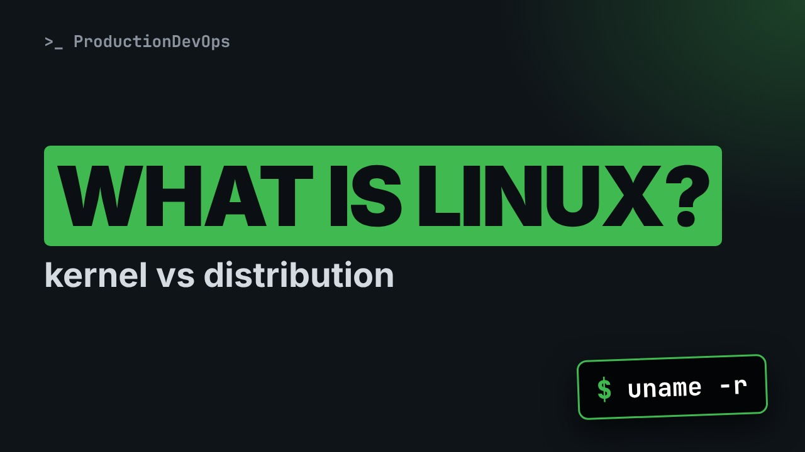
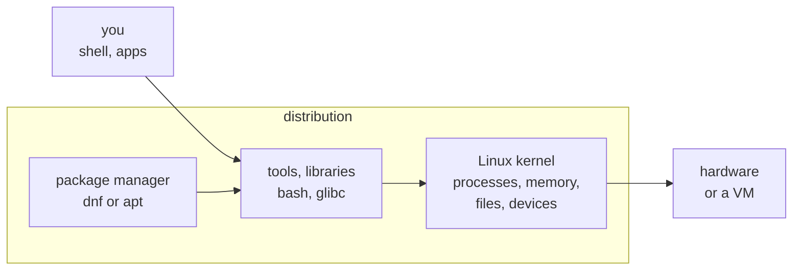

# What Linux Really Is: Kernel, Distributions and Which One to Pick



**Video:** coming soon on the [channel](https://www.youtube.com/@production-devops).

Ubuntu, RHEL, AlmaLinux, Fedora: all of them are Linux, and none of them is just Linux. In lesson 1 we ask a real system what it is: the kernel with uname, the distribution with /etc/os-release, and why a container has a distribution but no kernel of its own. Then the two big families, the licences, and how to pick a distribution for servers and for your lab. Lesson 1 of Linux from User to Server Admin.

## Files in this folder

- [`challenge-solution.sh`](challenge-solution.sh) (solution of the challenge: try it yourself first)

## What you need

A Linux shell (a VM, WSL or a container is fine). Everything runs inside this folder.

## The lesson, step by step

The same explanations as the video, with every command. Read it, then run it yourself.

Ubuntu, RHEL, AlmaLinux: all of them are Linux, and none of them is just Linux. We ask a real system what it is, and find a surprise: a distribution with no kernel of its own.

### The plan

This is lesson 1 of Linux from User to Server Admin. First, the kernel versus a distribution. Then we ask a real system what it runs. Then the two big families, and the licences. Finally, how to pick a distribution.

### Kernel vs distribution

**The kernel is one layer of the system**



The kernel is the core program: it talks to the hardware, and manages processes, memory, files and devices. What you type goes to the tools and libraries above it. A distribution is the whole package: kernel, tools, package manager and installer, tested together.

So when people say Linux, they can mean two different things. The kernel is one program, from the same open source project for everyone. A distribution adds the tools, the packages, the updates, and sometimes paid support. That is why installing software is dnf on RHEL, and apt on Ubuntu. In everyday talk, Linux means the whole thing.

### Ask the system

Which kernel is running? uname tells us. Dash s is its name.

```console
$ uname -s
```

Dash r is the kernel release: the version first, then a tag added by whoever built this kernel.

```console
$ uname -r
```

Dash m is the architecture. x86 underscore 64 means a 64 bit Intel or AMD processor.

```console
$ uname -m
```

Slash proc holds files made by the kernel. Slash proc slash version says how it was built.

```console
$ cat /proc/version
```

```
RHEL / AlmaLinux 9 on a VM
  $ uname -r
  5.14.0-...el9_6.x86_64

Ubuntu 24.04 on a VM
  $ uname -r
  6.8.0-...-generic

WSL 2 on Windows
  $ uname -r
  6.6...-microsoft-standard-WSL2
```

On RHEL or AlmaLinux 9, it is five point fourteen, ending with e l 9. Red Hat keeps that version for all of RHEL 9, and adds fixes. Ubuntu 24.04 starts from six point eight, with the word generic at the end. And in WSL on Windows, the tag says microsoft. Each builder adds its own tag.

A quick checkpoint. The kernel is the core program. The distribution is everything around it. uname dash r shows the kernel release, and who built it. Next: where is the kernel file on this system? Here comes the surprise.

On a normal server, the kernel file lives in slash boot, with a name like vmlinuz. Let's look.

```console
$ ls -la /boot
```

Slash boot is empty, because this lab is a container. A container brings its own distribution, but borrows the kernel of its host. hostnamectl, a systemd tool, shows the system on a full machine. Here it fails.

```console
$ hostnamectl
```

A container usually has no systemd, so this tool cannot work. On a VM, it works.

Which distribution is this? Every modern one has slash etc slash os release. Here are its first seven lines.

```console
$ head -7 /etc/os-release
```

Ubuntu 24.04. ID is ubuntu, and ID underscore LIKE is debian: the Debian family. On AlmaLinux, ID is almalinux, and ID like says rhel, centos and fedora.

lsb release dash d prints a short description. It works here, but RHEL 9 does not install it by default.

```console
$ lsb_release -d
```

In a script, the dot command loads the file as shell variables, and echo prints two of them.

```console
$ . /etc/os-release && echo "$ID, like $ID_LIKE"
```

This works on every modern distribution, with no extra package.

### The families

**Two big families**

```mermaid
flowchart LR
  RH["Red Hat family<br/>.rpm, dnf"]:::fam --> F["Fedora"] --> CS["CentOS<br/>Stream"] --> R["RHEL"]
  R -.->|compatible| A["AlmaLinux"]
  R -.->|compatible| RO["Rocky Linux"]
  DB["Debian family<br/>.deb, apt"]:::fam --> DE["Debian"] --> UB["Ubuntu"]
  classDef fam fill:#12261a,stroke:#3fb950,stroke-width:3px
```



In the Red Hat family, new work lands in Fedora, then in CentOS Stream, then in RHEL, and AlmaLinux and Rocky are free and compatible with RHEL. In the Debian family, Ubuntu is built on top of Debian. Each family has its own package format and its own tools.

Now the licences, in one minute. The kernel is under the GPL, version 2: use it, copy it, change it, share it. A distribution mixes thousands of packages, under many open source licences. RHEL is a paid subscription, for support and updates. A free developer subscription covers personal labs. AlmaLinux, Rocky and Ubuntu are free to use. Support is optional.

### Pick a distro

```
Goal                     Pick                        Why
Learn, jobs, RHCSA       AlmaLinux 9 or Rocky 9      RHEL-compatible, free
Production + support     RHEL 9 or Ubuntu LTS        ~10 years of updates
Cloud and containers     Ubuntu 24.04 LTS            images everywhere
Newest software          Fedora                      new every ~6 months
This course              AlmaLinux 9 + Ubuntu 24.04  both families
```

To learn for jobs or for the RHCSA, use AlmaLinux 9 or Rocky 9. What you learn works on RHEL. In production, a long term release with support: RHEL 9, or an Ubuntu LTS, long term support. For cloud images and containers, Ubuntu LTS is available almost everywhere. Fedora has the newest software, with a new release about every six months. Short lived on a server. In this course: AlmaLinux 9, and the Ubuntu command when it differs.

### Gotchas

Three mistakes beginners make. One. uname dash r is the kernel version, not the distribution version. Two. In a container, uname shows the kernel of the host. Three. A free licence does not mean free support. Decide who fixes production at three in the morning.

### Recap

Let's recap. The kernel is the core; a distribution adds tools, packages and support. uname dash r for the kernel. Slash etc slash os release for the distribution. Two big families: RHEL with dnf, and Debian and Ubuntu with apt. Your challenge: one command line that prints the kernel release, the distribution and its family. The solution is in the demo repository.

Two commands tell you what you are really running. Next lesson: we build your Linux lab, and make your first ssh connection. Subscribe to follow the course.

## All the commands, to copy

Run them from inside this folder, in this order (some are expected to fail: that is the point of the demo).

```bash
uname -s
uname -r
uname -m
cat /proc/version
ls -la /boot
hostnamectl
head -7 /etc/os-release
lsb_release -d
. /etc/os-release && echo "$ID, like $ID_LIKE"
```

## Challenge

Your challenge: one command line that prints the kernel release, the distribution and its family. The solution is in the demo repository.

When you have tried: [`challenge-solution.sh`](challenge-solution.sh).

---

From the [ProductionDevOps](https://www.youtube.com/@production-devops) channel: real-world DevOps and SRE, explained with real commands.
