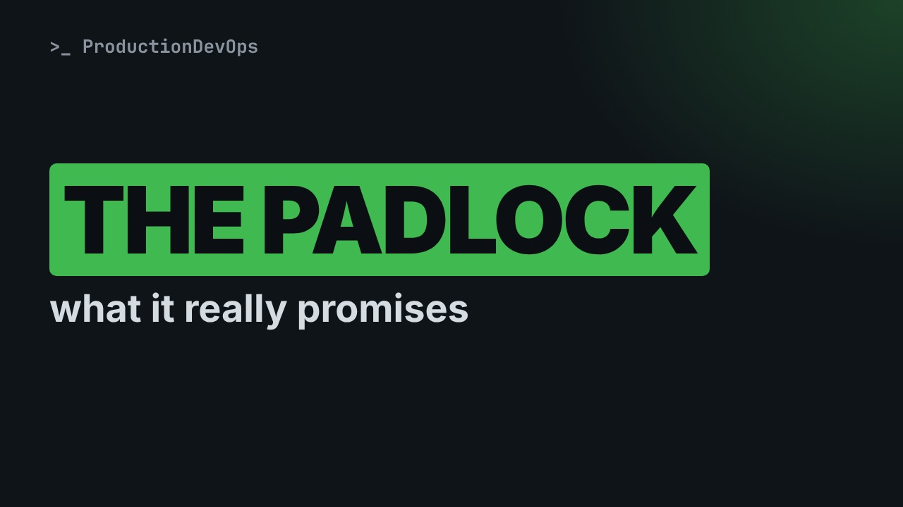
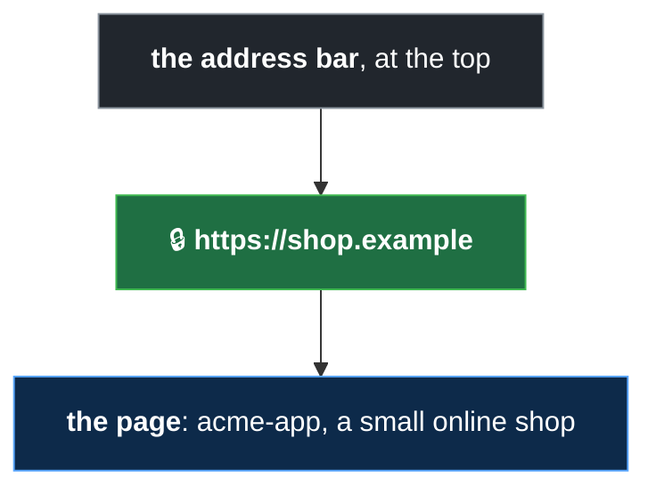
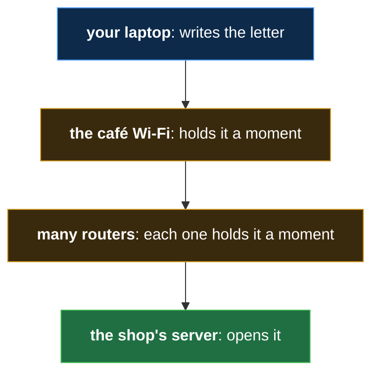
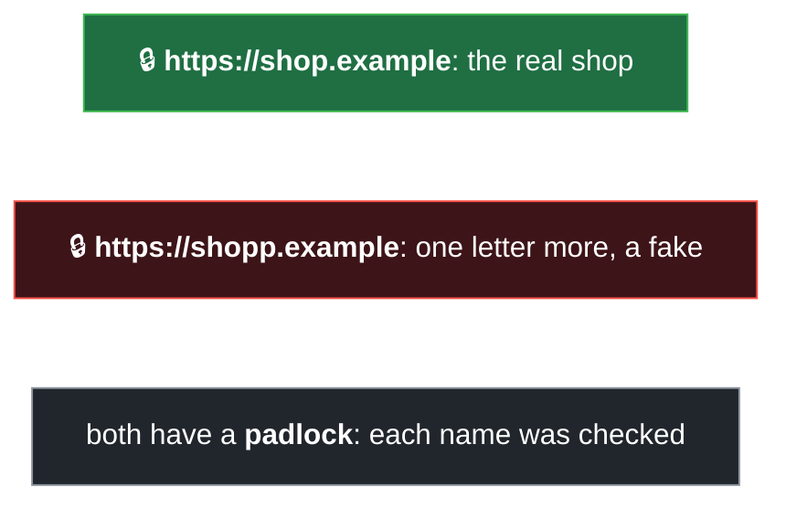

# What the Padlock Means (HTTPS and Certificates, No Experience Needed)

**Video:** coming soon on the [channel](https://www.youtube.com/@production-devops).

You see a small padlock next to a website's address. What does it really promise, and what does it never promise? This first lesson of HTTPS and Certificates, Simply answers with pictures and one everyday comparison, the postal service: a sealed letter, sent to a site whose ID card was checked. You learn the two promises of the padlock, the one thing it never tells you, and what "Not secure" means. No terminal, nothing to install, no experience needed. Every new word is explained on screen. The challenge and its solution are in the demos repo.

## Files in this folder

- [`challenge-solution.md`](challenge-solution.md) (solution of the challenge: try it yourself first)

## What you need

A Linux shell (a VM, WSL or a container is fine). Everything runs inside this folder.

## The lesson, step by step

The same explanations as the video, with every command. Read it, then run it yourself.

In five minutes: what the padlock next to an address promises. And the one thing it never promises.

For this lesson you need nothing. Just watch. It helps to know the course How the Internet Works, Simply. This course builds on it. About five minutes.

### The plan

This is lesson one of HTTPS and Certificates, Simply. First, where the padlock is. Then, who could read your letter on the way. Then, the padlock's two promises. And what it never promises.

### The padlock

**A browser window, drawn**

Here is a browser window, drawn. At the top, the address bar. Left of the address, a small padlock.

- `HTTPS — The safe way to load web pages: sealed, and checked (like a sealed letter, sent to an address that was checked)`: 
First new word: HTTPS, the safe way to load web pages. Think of a sealed letter, sent to an address that was checked.

### The trip

A quick reminder. Your browser is you, at your desk, writing letters. The server is the office that answers them. And routers are the post offices that pass the letters on.

**Who holds your letter on the way?**

Your letter does not fly straight to the shop. The Wi-Fi, then many routers, pass it on. Each one holds it for a moment.

Without a seal, everyone on the way could read your letter. Some could even change it, before they pass it on. Your address, your order, even your card number.

### Two promises

- `encryption — Scrambling data so only the right receiver can read it (like a sealed envelope that only the receiver can open)`: 
New word: encryption. It scrambles data, so only the right receiver can read it. Think of a sealed envelope that only the receiver can open.

Here is the padlock's first promise. Nobody on the way can read your letter. And nobody can change it without being noticed. The seal is encryption.

- `certificate — A small file that proves which website you reached (like the website's ID card)`: 
New word: certificate. It is a small file that proves which website you reached. Think of the website's ID card.

The second promise. The site showed your browser its ID card, a certificate. Your browser checked that card, before sending anything. So your letter goes to shop dot example, and not to an impostor.

### So far

So far: the padlock means HTTPS. Your letter is sealed, and the site was checked. Two promises: private, and the right site. Next: what the padlock never promises. This one matters most. If this is helping, subscribe: the next lesson shows what the café Wi-Fi can read.

### Never promised

The padlock never promises that the shop is honest. Or that it delivers your order, or keeps your data safe. Or that the name is the one you meant.

**Two names, two padlocks**

Look at these two names. The second has one extra letter. A fake shop can get a padlock too.

Think of a sealed letter to a con artist. Nobody on the way can read it. But it arrives, safely, at the con artist. So always read the name, not only the padlock.

### Not secure

Sometimes the address starts with H T T P, with no s at the end. Then browsers show the words not secure, next to it. That is a postcard, and lesson two explains it.

### Good to know

Good to know: some browsers now show a different small icon there, or none at all. The meaning stays the same. The page came over HTTPS. Click that icon to see the site's ID card. Lesson five shows how to read it.

### Recap

Recap: the padlock means HTTPS. A sealed letter, to a site that was checked. It never says the site is honest. So always read the name too. Your challenge: which of these three does the padlock promise? The answer is in the demo repo.

### Where next

Where next? Lesson two: HTTP and HTTPS, a postcard and a sealed letter. Then the ID card, who signs it, and the errors your browser shows.

Subscribe, and the next lesson, HTTP and HTTPS: a postcard and a sealed letter, finds you.

## Challenge

Your challenge: which of these three does the padlock promise? The answer is in the demo repo.

When you have tried: [`challenge-solution.md`](challenge-solution.md).

---

From the [ProductionDevOps](https://www.youtube.com/@production-devops) channel: real-world DevOps and SRE, explained with real commands.
