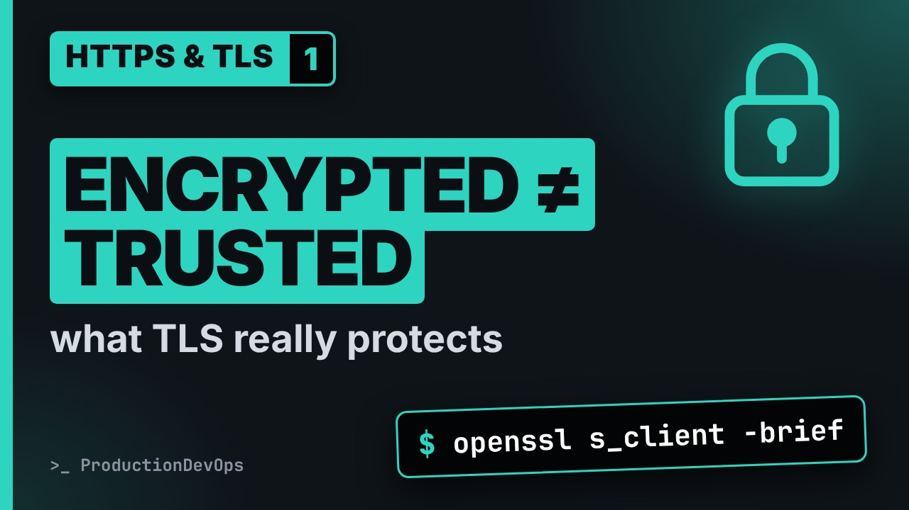
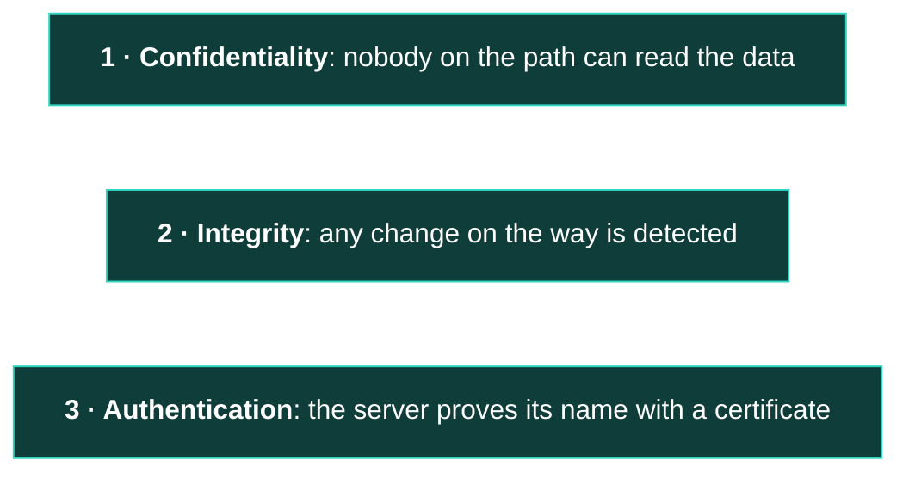
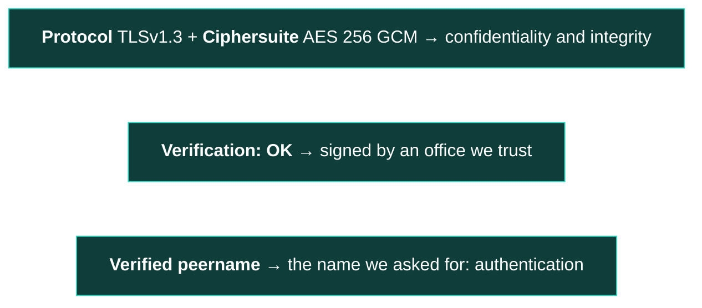
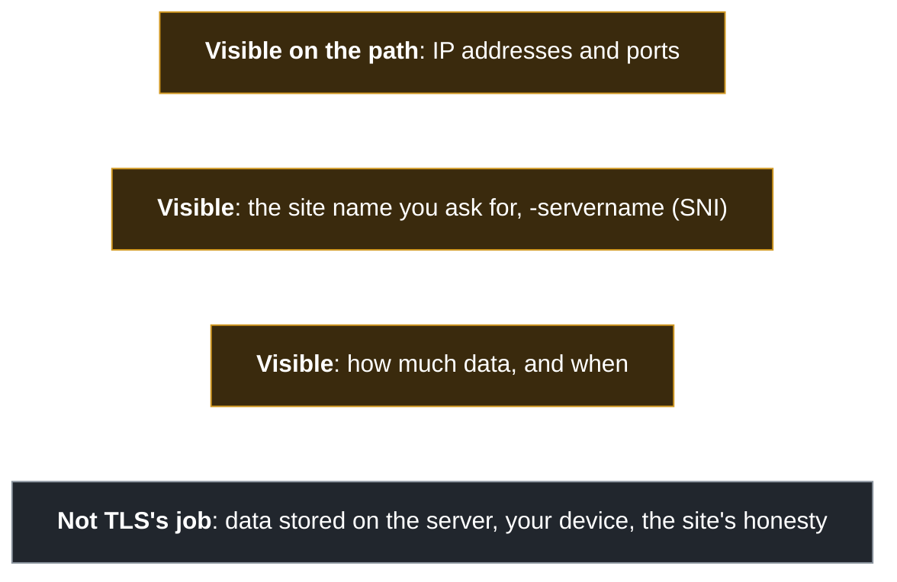

# What TLS Really Protects (and What It Doesn't)



**Video:** coming soon on the [channel](https://www.youtube.com/@production-devops).

The padlock means TLS is on. But what does TLS really protect, and what does it leave in plain sight? We connect to a small lab HTTPS server with one command, openssl s_client, built up one piece at a time: first an encrypted connection we cannot trust yet, then a trusted certificate, then the right name. Then the surprise: a perfect padlock on a look-alike shop. Lesson 1 of TLS & PKI in Practice; every command runs in a lab you can rebuild from the demos repo, with the challenge and its solution.

## Files in this folder

- [`make-lab.sh`](make-lab.sh)
- [`serve.sh`](serve.sh)
- [`challenge-solution.md`](challenge-solution.md) (solution of the challenge: try it yourself first)

## What you need

A Linux shell (a VM, WSL or a container is fine). Everything runs inside this folder.

## Before you start

The video runs these commands first, off screen:

```bash
if [ ! -e .tt-lab ]; then pkill -f 's_server -accept 127.0.0.1:844' || true; rm -rf /lab/tls && bash make-lab.sh /lab/tls >/dev/null 2>&1 && touch .tt-lab; fi
bash serve.sh /lab/tls >/dev/null 2>&1
export HOME=/lab/tls && cd /lab/tls
PROMPT_COMMAND='HOME=/lab/tls; PS1="\[\e[1;32m\]sre@lab\[\e[0m\]:\[\e[1;34m\]\w\[\e[0m\]$ "'
```

## The lesson, step by step

The same explanations as the video, with every command. Read it, then run it yourself.

In six minutes: what TLS really protects, what it does not, and why a perfect padlock can sit on the wrong shop.

You will need the basics of certificates. HTTPS and Certificates, Simply, on this channel, covers them. You should know what a port is. How the Internet Works, Simply, explains it. And a terminal with open S S L. Linux, macOS, or WSL on Windows.

### The plan

This is lesson one of TLS and P K I in Practice. First, the three promises TLS makes. Then one command, built up one piece at a time. Then we match each line of its output to a promise. And at the end, what TLS cannot tell you: a perfect padlock on a fake shop.

### Three promises

- `TLS — The protocol that puts the S in HTTPS (like a sealed envelope, handed over only after checking an ID)`: 
New word: T L S, transport layer security. It is the protocol that puts the S in H T T P S. Think of a sealed envelope, handed over only after checking an ID.

**Three promises**



Three promises. Nobody on the path can read the data, and changes are detected. And the server proves its name with a certificate.

Our lab runs a test server for shop dot example, on port eighty four forty three of this machine. Its certificate comes from a fictional office, Example Root C A, in the file C A dot c r t. Two scripts in the demos repo build it all.

### The command

```console
$ openssl s_client -connect localhost:8443 -servername shop.example -brief </dev/null
```

We want to open a TLS connection and see what it gives us. Our new command has five pieces.

- `openssl s_client`: a TLS client, like a browser
Open S S L, s client: a TLS client, like a browser without the page.

- `-connect localhost:8443`: where: our lab server
Dash connect: where to go. Local host, port eighty four forty three, our lab server.

- `-servername shop.example`: the site name we ask for
Dash server name: the site we ask for, shop dot example. Remember this piece.

- `-brief`: a short summary only
Dash brief: print a short summary, not pages of detail.

- `</dev/null`: nothing to send: close
Less than, slash dev slash null: we send nothing, so the connection closes by itself.

### Encrypted

We want to see what the connection gives us. We type the command.

```console
$ openssl s_client -connect localhost:8443 -servername shop.example -brief </dev/null
```

Look at Protocol version: TLS 1.3, the current version. The connection is up and encrypted. Now look near the end: Verification error. Unable to get local issuer certificate. Encrypted, yes. But we do not know who signed the card, so we cannot trust it yet.

- `Trust anchor — A CA certificate you decide to trust (like the list of ID offices you accept)`: 
New word: trust anchor, a C A certificate you decide to trust. Think of the ID offices you accept.

### Trusted

We tell open S S L to trust our lab's office. Same command, plus one piece: dash C A file, C A dot c r t.

```console
$ openssl s_client -connect localhost:8443 -servername shop.example -CAfile ca.crt -brief </dev/null
```

Read the same line again. Now it says Verification, OK. The signatures lead back to our trust anchor.

### The right name

One trap. Open S S L checked the signatures, not the name. Dash verify host name asks it to check the name too.

```console
$ openssl s_client -connect localhost:8443 -servername shop.example -CAfile ca.crt -verify_hostname shop.example -brief </dev/null
```

A new line: Verified peer name, shop dot example. The card is valid, and it is for the site we asked for.

### What just happened

**Output lines and promises**



What just happened? A E S encrypts and G C M seals every piece: promises one and two. The two verification lines are promise three.

### So far

So far: an encrypted connection is not a trusted one. The verification line must say OK. And a trusted card can still be for another site. The name must match too. Next: what TLS cannot tell you. This is the padlock on a fake shop. If this is helping, subscribe. Lesson two opens the handshake, message by message.

### A fake shop

We run the exact same check on our second site, port eighty four forty four: shoppe dot example.

```console
$ openssl s_client -connect localhost:8444 -servername shoppe.example -CAfile ca.crt -verify_hostname shoppe.example -brief </dev/null
```

Verification, OK. Verified peer name, shoppe dot example. A perfect padlock. TLS proved one thing: you are talking to shoppe dot example. It cannot tell you that it is the wrong shop.

### Not protected

- `SNI — The site name a client asks for, at the start (like the name on the outside of the envelope)`: 
New word: S N I, the site name the client sends first, our dash server name piece. Think of the name on the envelope.

**What TLS leaves in plain sight**



In plain sight: addresses, ports, the S N I name, and how much data moves. Stored data is not TLS's job at all.

### Recap

Recap: TLS gives confidentiality, integrity and authentication. Dash C A file says which office we trust. Dash verify host name says which name we want. Addresses, the S N I name and the traffic size stay visible. Your challenge: connect to port eighty four forty four, but verify shop dot example. What breaks, and why? The answer is in the demos repo.

### Where next

Where next? Lesson two: the TLS one point three handshake, step by step.

Subscribe, and the next lesson, the TLS one point three handshake, step by step, finds you.

## All the commands, to copy

Run them from inside this folder, in this order (some are expected to fail: that is the point of the demo).

```bash
openssl s_client -connect localhost:8443 -servername shop.example -brief </dev/null
openssl s_client -connect localhost:8443 -servername shop.example -CAfile ca.crt -brief </dev/null
openssl s_client -connect localhost:8443 -servername shop.example -CAfile ca.crt -verify_hostname shop.example -brief </dev/null
openssl s_client -connect localhost:8444 -servername shoppe.example -CAfile ca.crt -verify_hostname shoppe.example -brief </dev/null
```

## Challenge

Your challenge: connect to port eighty four forty four, but verify shop dot example. What breaks, and why? The answer is in the demos repo.

When you have tried: [`challenge-solution.md`](challenge-solution.md).

---

From the [ProductionDevOps](https://www.youtube.com/@production-devops) channel: real-world DevOps and SRE, explained with real commands.
