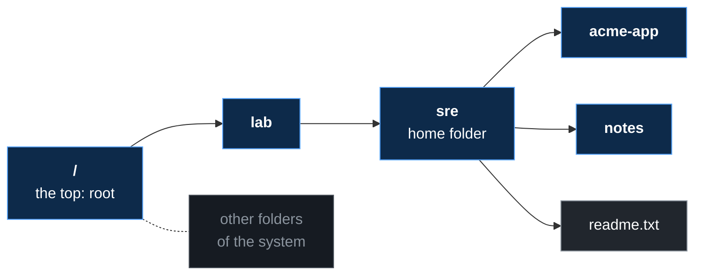
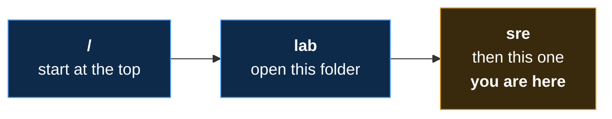

# Where Am I? Your First Linux Command, pwd (No Experience Needed)


**Video:** https://youtu.be/5yPFsSyusTU

In a terminal you cannot see your folders, so the first question is always the same: where am I? This lesson of Linux from Zero answers it with your first command, pwd. We draw the file system as a cabinet of folders, find your home folder, and read the answer, a path, from left to right. Then we see that the prompt was telling you all along. No experience needed: every new word is explained on screen, and every command runs for real. The challenge and its solution are in the demos repo.

## Files in this folder

- [`acme-app/config.txt`](acme-app/config.txt)
- [`acme-app/logs/app.log`](acme-app/logs/app.log)
- [`notes/ideas.txt`](notes/ideas.txt)
- [`notes/todo.txt`](notes/todo.txt)
- [`readme.txt`](readme.txt)
- [`challenge-solution.sh`](challenge-solution.sh) (solution of the challenge: try it yourself first)

## What you need

A Linux shell (a VM, WSL or a container is fine). Everything runs inside this folder.

## Before you start

The video runs these commands first, off screen:

```bash
mkdir -p /lab && ln -sfn "$PWD" /lab/sre && cd /lab/sre && export HOME=/lab/sre
alias ls='ls --color=auto'
PROMPT_COMMAND='PS1="\[\e[1;32m\]sre@lab\[\e[0m\]:\[\e[1;34m\]\w\[\e[0m\]$ "'
```

## The lesson, step by step

The same explanations as the video, with every command. Read it, then run it yourself.

In a terminal, you cannot see your folders. So the first question is always: where am I? And at the end, you will see that the screen was telling you all along.

To follow along, you need a terminal. Lesson two shows how to get one. Or just watch. Every step is on screen.

### The plan

This is lesson three of Linux from Zero. First, our cabinet of folders. Then, your home folder. Then, your first command: p w d. And we read its answer, a path.

### The cabinet

- `folder — A named place that holds files and other folders. Also called a directory. (like a paper folder in a filing cabinet)`: 
New word: folder. It is a named place that holds files, and other folders. Linux often calls it a directory.

- `file — A named piece of data: some text, a picture, a program (like a sheet of paper inside a folder)`: 
New word: file. A file is a named piece of data, like some text or a picture. Think of a sheet of paper inside a folder.

**Our cabinet of folders**



Here is our lab, drawn as a cabinet. It starts at the top, called root, written as one slash. Then folders inside folders, and files inside them.

- `home folder — Your own folder, where your files live (like your own drawer in a shared cabinet)`: 
New word: home folder, your own folder, where your files live. Like your own drawer in a shared cabinet. A new terminal starts there.

### The command

Here is the one new command: p w d. Print working directory. Print means: show it on the screen. The working directory is the folder you are in right now.

### Try it

Where am I? We type p w d, and press Enter.

```console
$ pwd
```

The answer is one line: slash lab, slash s r e. That is our home folder.

### The path

- `path — Directions to a folder or a file, starting from the top (like directions: open lab, then open sre)`: 
New word: path. It gives directions to a folder or a file, from the top. Open lab, then open s r e.

**Reading /lab/sre**



Read a path from the left. The first slash is the top of the cabinet. Then lab, then s r e: you are here.

The first slash is the top of the cabinet, the root. The other slashes go between one folder and the next. On your own computer, home is usually slash home, then your user name.

### So far

So far: p w d shows the folder you are in. Its answer is a path: directions from the top. Next: the screen was already telling you.

### The prompt

- `prompt — The text before your cursor: the terminal is ready for you (like the clerk at the counter: next, please)`: 
New word: prompt, the text before your cursor. It means the terminal is ready for you. Like a clerk saying: next, please.

```
sre@lab:~$ pwd
/lab/sre
```

Look at the prompt, right before the dollar sign. A wavy line, called tilde. Tilde is short for your home folder. The prompt shows where you are. And p w d prints the full path of that same folder.

### Again

Let's ask again: p w d.

```console
$ pwd
```

The same answer. We have not moved, so we are still at home. The answer changes only when you move. You will move in lesson five.

### Good to know

Commands are lowercase. Capital P W D will not work. P w d only looks. It changes nothing. Lost in a terminal? Ask p w d first.

### Recap

Recap: files live in folders, inside one big cabinet. P w d prints your working directory. Where am I? The answer is a path, read from the top. Your challenge: type p w d in your own terminal. How many folders are in the path? The solution is in the demo repo.

### Where next

Where next? Lesson four: what is in this folder? Then lesson five: moving from folder to folder.

Next lesson: what is here? Listing a folder. Subscribe so you do not miss it.

## All the commands, to copy

Run them from inside this folder, in this order (some are expected to fail: that is the point of the demo).

```bash
pwd
```

## Challenge

Your challenge: type p w d in your own terminal. How many folders are in the path? The solution is in the demo repo.

When you have tried: [`challenge-solution.sh`](challenge-solution.sh).

---

From the [ProductionDevOps](https://www.youtube.com/@production-devops) channel: real-world DevOps and SRE, explained with real commands.
