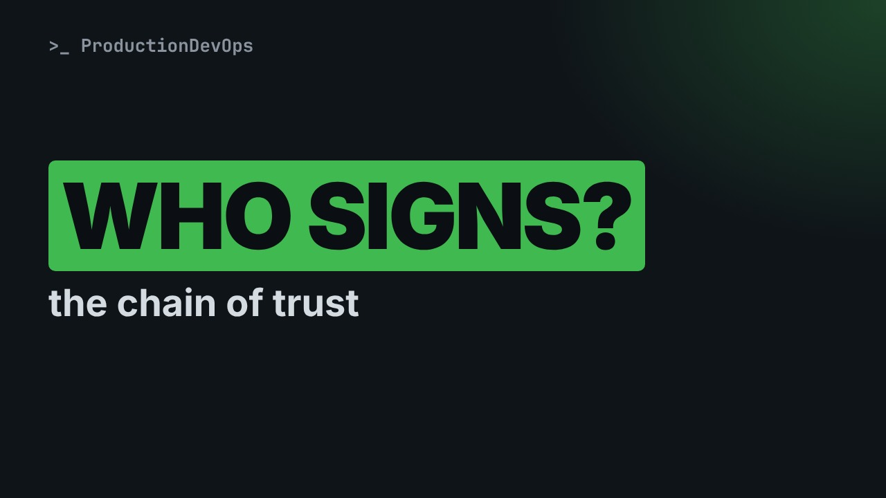
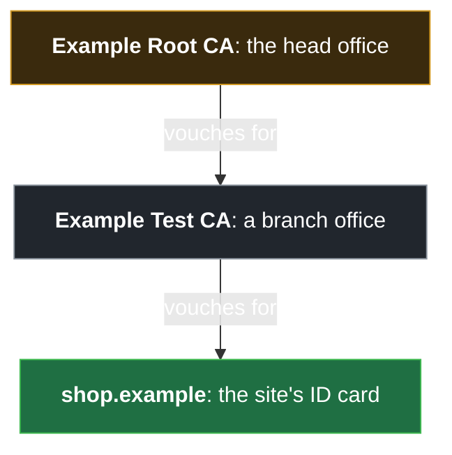
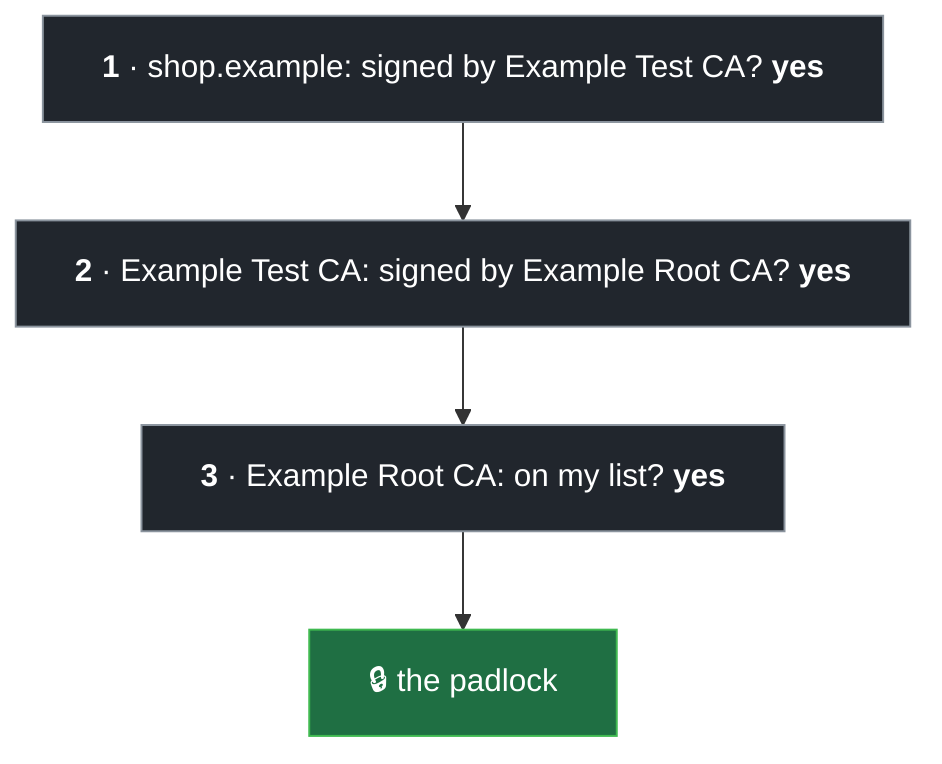

# Who Signs Certificates (HTTPS and Certificates, No Experience Needed)

**Video:** coming soon on the [channel](https://www.youtube.com/@production-devops).

Anyone can print an ID card at home. So why does your browser believe the one a website shows? This lesson of HTTPS and Certificates, Simply explains who signs certificates, with pictures and the postal service comparison: the certificate authority, the office that issues ID cards; how a site proves it owns its name; the chain, where one office vouches for the next; and the trust store, the list of offices your browser already trusts. At the end: what happens when an office breaks the rules. No terminal, nothing to install, no experience needed. The challenge and its solution are in the demos repo.

## Files in this folder

- [`challenge-solution.md`](challenge-solution.md) (solution of the challenge: try it yourself first)

## What you need

A Linux shell (a VM, WSL or a container is fine). Everything runs inside this folder.

## The lesson, step by step

The same explanations as the video, with every command. Read it, then run it yourself.

In five minutes: who signs a website's certificate, and why your browser believes it. At the end: when an office breaks the rules.

For this lesson you need nothing. Just watch. It helps to have seen lesson three, what a certificate proves. About five minutes.

### The plan

This is lesson four of HTTPS and Certificates, Simply. First, the office that issues ID cards. Then, how a site gets its card. Then, the chain: offices that vouch for other offices. And the list of offices inside your browser.

### The office

- `certificate authority — An organisation that checks site owners, then signs their certificates (like the office that issues ID cards)`: 
New word: certificate authority, or C A. It checks site owners, then signs their certificates. Think of the office that issues ID cards.

### Getting a card

Time flows down. Each arrow is one message.

- `shop owner → certificate authority`: a card for shop.example, please
Step one. The shop owner asks for a card for shop dot example. They send their public key.

- `certificate authority → shop owner`: prove you control shop.example
Step two. The office says: prove that you control this name.

- `shop owner → certificate authority`: done: the code is on my site
Step three. The office gave a code. The owner puts it on the site, or in its DNS.

- `certificate authority → shop owner`: here is your signed card
Step four. The office checks the code, and signs the card.

Notice: the private key never leaves the shop. The office only sees the public key. Today, a program often does all four steps, by itself. It repeats them every few months. That is called renewal.

- `signature — A mark made with a private key, that anyone can check (like an office stamp that nobody can copy)`: 
New word: signature. It is a mark made with a private key, and anyone can check it. Think of an office stamp that nobody can copy.

### So far

So far: an office, the C A, signs the site's ID card. First, the site proves it controls the name. Next question: who vouches for the office itself? If this is helping, subscribe: the next lesson reads a real certificate, with one command.

### The chain

- `chain — Certificates that vouch for each other, up to one your browser trusts (like the office that vouches for the office)`: 
New word: chain. Certificates vouch for each other, up to one your browser trusts. Think of the office that vouches for the office.

**A chain of three**

Here is a chain of three, with fictional names. The head office vouches for a branch office. The branch office signs the shop's card.

- `root CA — The top of a chain: it signs its own card (like the head office: nobody stands above it)`: 
New word: root C A. It is the top of a chain, and it signs its own card. Think of the head office, with nobody above it.

- `trust store — The list of root CAs your computer already trusts (like the list of offices your browser already trusts)`: 
So why trust the head office? Because of the trust store, the list of root C As your computer already trusts.

**How your browser walks the chain**

Your browser walks up the chain: the shop's card, then the branch office. Last, is the head office on my list? Yes, so you get the padlock.

Where does the list come from? It comes with your operating system, or your browser. Updates keep it fresh. Offices are added, and sometimes removed. A company can add its own office, for its internal sites.

### When an office fails

Now the payoff. Offices must follow strict rules, and they are checked. What if one signs cards for the wrong people? Then browsers can remove it from their list. This has happened, more than once. And the cards it signed stop working.

### Good to know

Good to know: the site sends its own card, and the branch office's card. The head office's card is already on your computer, in the list. And a site card signed by itself is like an ID printed at home. Lesson six shows the warning.

### Recap

Recap: a C A checks the owner, then signs the card. In a chain, each office vouches for the next one. The trust store is the list of offices your browser already trusts. Your challenge: put the three names on screen in order, top to bottom. Which one is on the list? The answer is in the demo repo.

### Where next

Where next? Lesson five: reading a certificate. In your browser, and with one command in a terminal.

Subscribe, and the next lesson, reading a certificate, finds you.

## Challenge

Your challenge: put the three names on screen in order, top to bottom. Which one is on the list? The answer is in the demo repo.

When you have tried: [`challenge-solution.md`](challenge-solution.md).

---

From the [ProductionDevOps](https://www.youtube.com/@production-devops) channel: real-world DevOps and SRE, explained with real commands.
