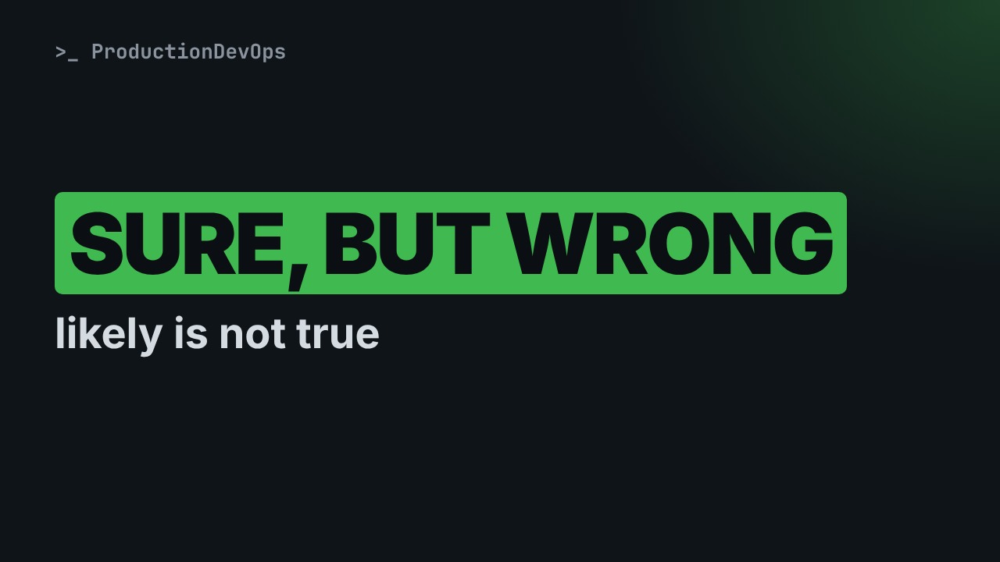
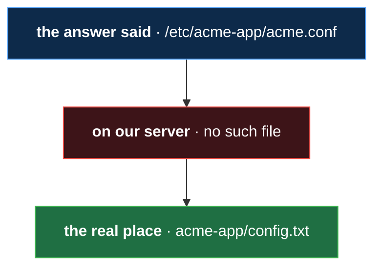
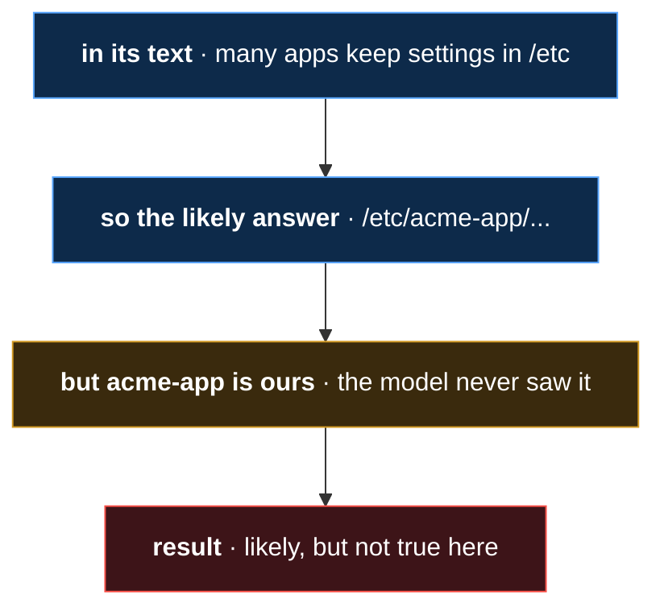
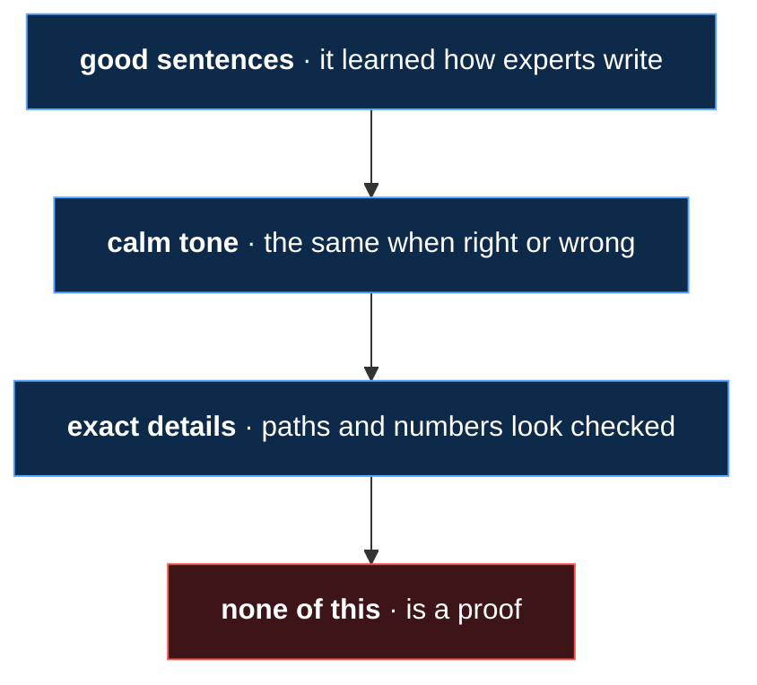
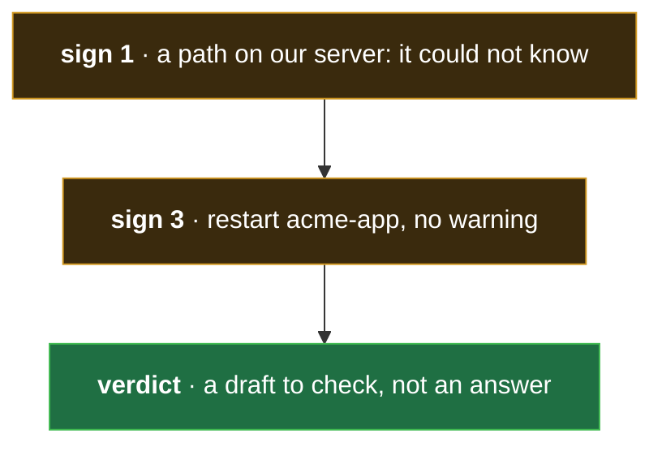

# Why AI Answers Can Be Wrong and Sound Right (AI for Ops: the Safe Basics)



**Video:** coming soon on the [channel](https://www.youtube.com/@production-devops).

The answer is clear, polite and sure of itself, and it is wrong. This lesson of AI Assistants for Ops: the Safe Basics shows why: an assistant writes likely text, not checked facts, and likely is not the same as true for your own systems. We follow one confident wrong answer step by step, then learn three warning signs to spot one before it costs you an evening. Valid for any assistant, no product names, nothing to install. Every new word is explained on screen. The challenge and its solution are in the demos repo.

## Files in this folder

- [`challenge-solution.md`](challenge-solution.md) (solution of the challenge: try it yourself first)

## What you need

A Linux shell (a VM, WSL or a container is fine). Everything runs inside this folder.

## The lesson, step by step

The same explanations as the video, with every command. Read it, then run it yourself.

An answer can be clear, polite, sure of itself, and wrong. In five minutes: why that happens, and three warning signs to spot it.

You will need lesson one: the words prompt and language model. Nothing to install. Only pictures.

### The plan

This is lesson two of AI Assistants for Ops. First, one question, and one very sure answer. Then, why likely is not the same as true. Why it still sounds right. And three warning signs.

### One answer

A quick reminder. The model picks the next likely word. Likely means what often comes next, in the text it learned from. Today: what happens when likely is wrong.

We ask about our example app, acme app. Where does it keep its port setting? I wrote this answer to show a typical case.

```
You:
  Where does acme-app keep its port setting?

AI assistant:
  acme-app keeps its settings in /etc/acme-app/acme.conf.
  Change the line port=8080, then restart acme-app.
```

Our question. The port is the number the app listens on. The answer names a folder and a file. Exact, calm, sure. It even tells us what to change, and what to do next.

**What is really there**



On our server, that file does not exist. Our acme app keeps its settings in config dot t x t, in its own folder.

- `hallucination — A confident wrong answer: it sounds sure, but it is made up (like the helper reaching for salt where most kitchens keep it, not where yours does)`: 
This has a name: hallucination. We will just call it a confident wrong answer. Like a helper reaching for the salt where most kitchens keep it, not where yours does.

### Likely, not true

**Why it guessed that path**



In the text it learned from, many apps keep settings in slash etc. So that path is likely. But acme app is ours, and the model never saw it.

Three reasons it can be wrong. First, it writes likely text. It does not check it. Second, it never saw your systems: your names, paths and versions. Third, it learned from text up to a certain date. Newer things may be missing.

### So far

So far: a very sure answer named a file that does not exist. Likely text is not checked text. Next: why it still sounds right. And the three warning signs. If this is helping, subscribe. The next lesson shows what you must never paste, and a ten-second check.

### Sounds right

**Why it sounds right**



It learned how experts write, and its tone stays calm, right or wrong. Exact details look checked. None of this is a proof.

With people, someone who is unsure often sounds unsure. The assistant may sound just as sure when it is wrong. So judge the content, never the tone.

### Warning signs

Three warning signs. One: details about your system that it could not know. Two: an option or a command that you cannot find in the manual. Three: a risky step, like delete or restart, with no warning.

**Our answer, checked**



Our answer shows two signs: a path it could not know, and a restart with no warning. So it is a draft to check.

### What we do

So what do we do? We treat every answer as a draft. We check its claims on the real system. Lesson seven shows how. And we review and test it before we run it. Lessons five and six.

### Recap

Recap. Likely is not true, and a calm tone is not a proof. A confident wrong answer sounds sure, but it is made up. The signs: details of your system, options you cannot find, and risky steps. Your challenge: an example answer of three lines, in the demo repo. Which line could it not know?

### Where next

Where next? Lesson three: what you must never paste into an assistant.

Next lesson: never paste secrets, and what not to share. Subscribe, and that lesson finds you.

## Challenge

Your challenge: an example answer of three lines, in the demo repo. Which line could it not know?

When you have tried: [`challenge-solution.md`](challenge-solution.md).

---

From the [ProductionDevOps](https://www.youtube.com/@production-devops) channel: real-world DevOps and SRE, explained with real commands.
