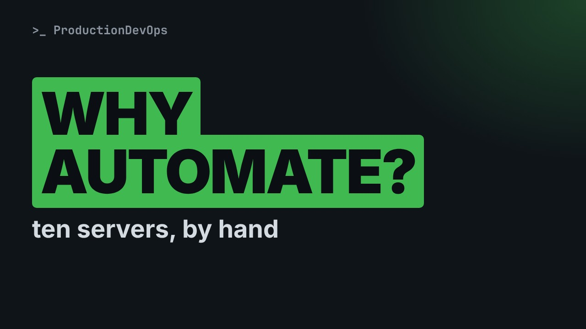
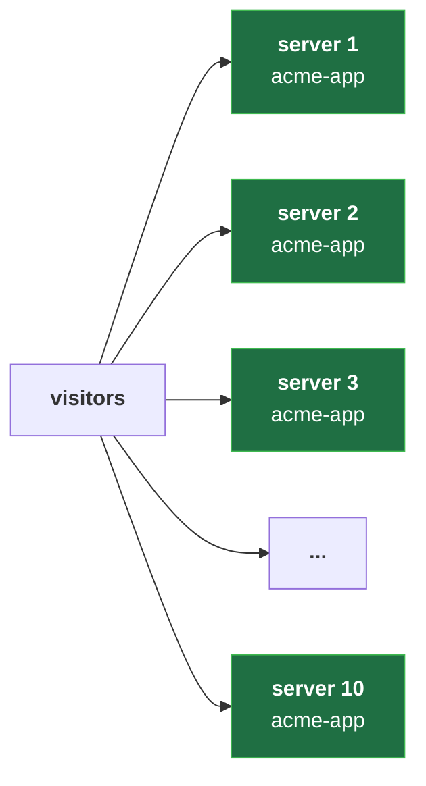
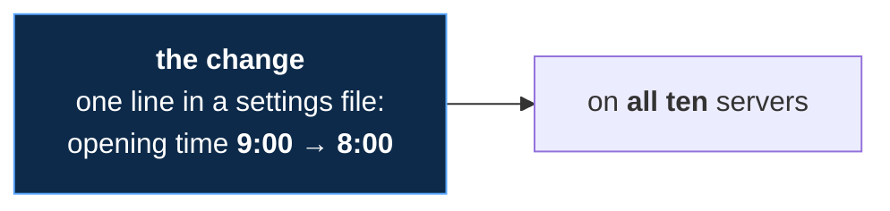
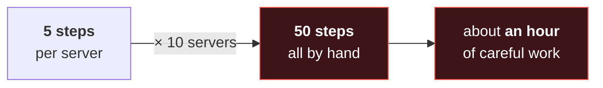
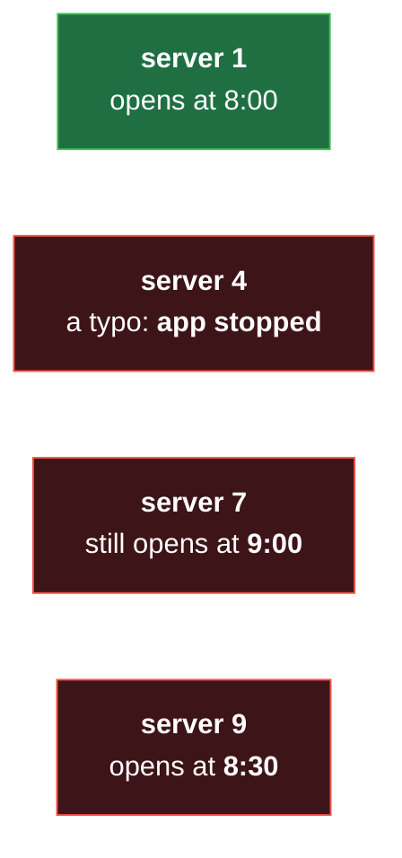
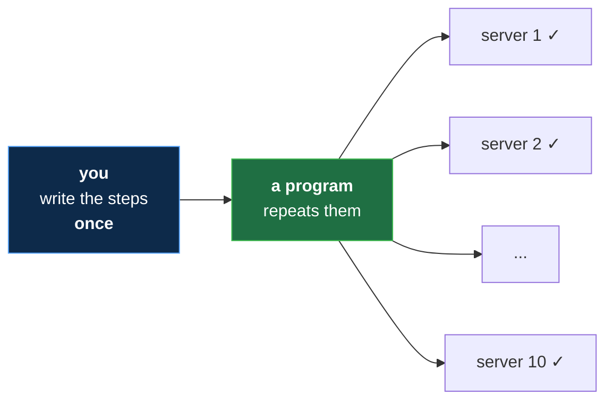
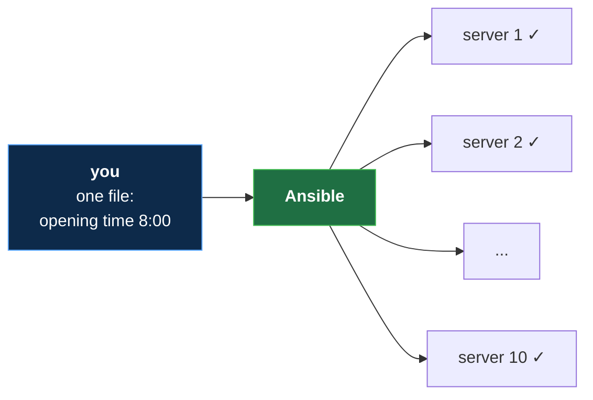

# Why Automate? Ten Servers by Hand (Ansible from Zero, No Experience Needed)

**Video:** https://youtu.be/ghkJtTYfEFs

One small change on ten servers, by hand: ten logins, fifty steps, and fifty chances to slip. This first lesson of Ansible from Zero shows, with pictures and everyday comparisons, what goes wrong when people repeat the same job on many servers, why servers slowly drift apart, and the simple idea behind automation: write the steps once, and let a program repeat them the same way everywhere. No terminal, nothing to install, no experience needed. Every new word is explained on screen. The challenge and its solution are in the demos repo.

## Files in this folder

- [`challenge-solution.md`](challenge-solution.md) (solution of the challenge: try it yourself first)

## What you need

A Linux shell (a VM, WSL or a container is fine). Everything runs inside this folder.

## The lesson, step by step

The same explanations as the video, with every command. Read it, then run it yourself.

One small change, on ten servers. By hand, that is fifty steps. At the end, you will see why the tenth server goes wrong.

For this lesson you need nothing. Just watch. No terminal today, only pictures. About five minutes.

### The plan

This is lesson one of Ansible from Zero. First, one small change on ten servers. Then, what goes wrong when we do it by hand. Then the fix: write the steps once. And the tool of this course: Ansible.

### Ten servers

- `server`: A computer that runs programs for others, all day long (like a restaurant kitchen: it cooks, the customers only see the food)
First word: server. A server is a computer that runs programs for others, all day long. Think of a restaurant kitchen.

**Ten servers, one app**

Here is our example. An app called acme app runs on ten servers. Like a restaurant chain with ten kitchens.

**One small change**

Now a small change arrives. One line in a settings file must change, on all ten servers. Like a new opening time, on the door of every kitchen.

### By hand

By hand, on one server, it goes like this. First, you log in. Then you open the settings file. You change one line. You restart the app, so it reads the new setting. And you check that it still works.

**Ten servers: fifty steps**

Five steps, times ten servers, makes fifty steps. At a few minutes per server, that is about an hour of careful work.

And people are not machines. On server four, you make a typo. Server seven is forgotten, because the phone rang. On server nine, you make a slightly different change. And afterwards, nobody knows exactly what was done.

- `drift`: Servers that slowly become different from each other (like ten kitchens that each change the recipe a little)
This has a name: drift. Servers that should be the same slowly become different. Like ten kitchens that each change the recipe a little.

**A few months later**

A few months later, the ten servers are all a bit different. When something breaks, nobody knows which version is the right one.

### So far

So far: one change on ten servers means fifty steps by hand. People slip. There are typos, forgotten servers, and drift. Next: we write the steps once, and let a program repeat them.

### Automation

- `automation`: Letting a program repeat a job for you, the same way every time (like a recipe card: written once, every kitchen cooks the same dish)
New word: automation. It means letting a program repeat a job for you, the same way every time. Think of a recipe card.

**Write it once, run it everywhere**

You write the steps once, in a file. A program follows them on every server. Every kitchen gets the same recipe card.

First, the same result on every server. Second, it takes minutes, not an hour. Third, a written record. The file itself says what was done. And you can run it again, to bring a drifted server back in line.

### Ansible

- `Ansible`: A free tool that does the same job on many servers for you (like a head chef who sends one recipe card to every kitchen)
The tool of this course is Ansible. It does the same job on many servers, for you. Think of a head chef, sending one recipe card to every kitchen.

**The same change, with Ansible**

Here is the same change with Ansible. You write it once, and Ansible does all fifty steps on the ten servers.

Now the answer from the start. Why does the tenth server go wrong? By hand, attention drops. Server ten gets your most tired minute. A program never gets tired. With automation, server ten gets exactly the same steps as server one.

### Good to know

Ansible is open source. It is free, and its code is public. It runs from one computer, which can be yours. You type its commands in a terminal. We start in lesson four. And be honest: for one server and one change, by hand is fine.

### Recap

Recap: by hand, a change takes many steps, and people slip. Drift means servers slowly become different. Automation means you write the steps once, and a program repeats them. Your challenge: three steps on twenty servers. How many steps by hand, and how many to write? The answer is in the demo repo.

### Where next

Where next? Lesson two: how Ansible works, drawn step by step. Lesson three: just enough YAML, the language of its files. Then real commands, on two practice servers. And after this course: Ansible for RHCE.

Next lesson: how Ansible works, drawn. Subscribe so you do not miss it.

## Challenge

Your challenge: three steps on twenty servers. How many steps by hand, and how many to write? The answer is in the demo repo.

When you have tried: [`challenge-solution.md`](challenge-solution.md).

---

From the [ProductionDevOps](https://www.youtube.com/@production-devops) channel: real-world DevOps and SRE, explained with real commands.
