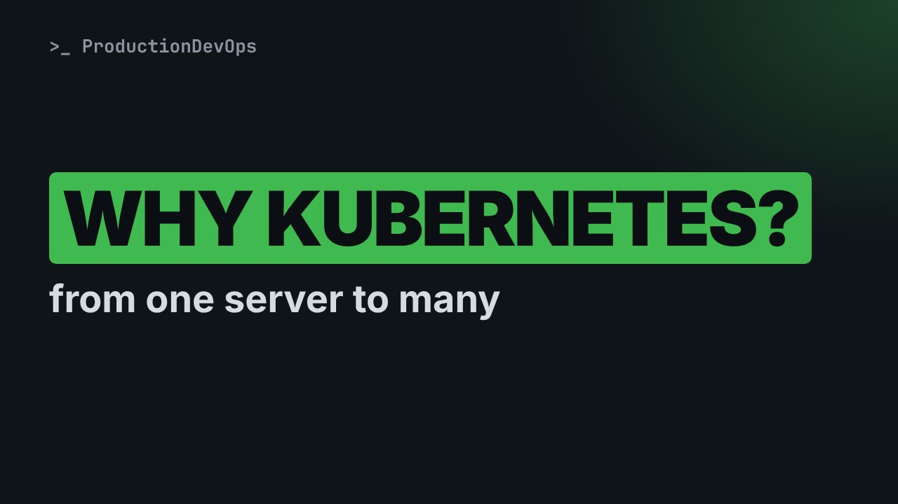
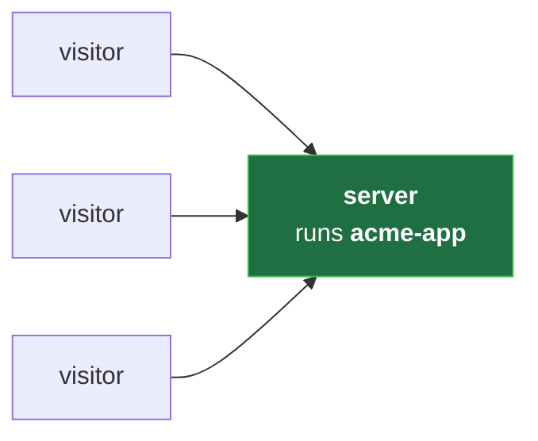
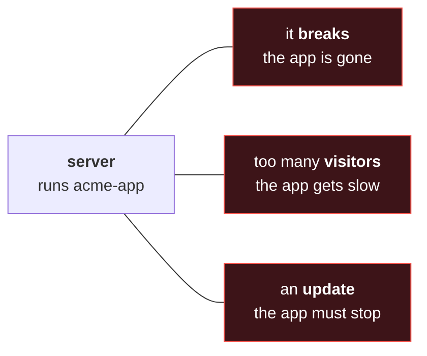
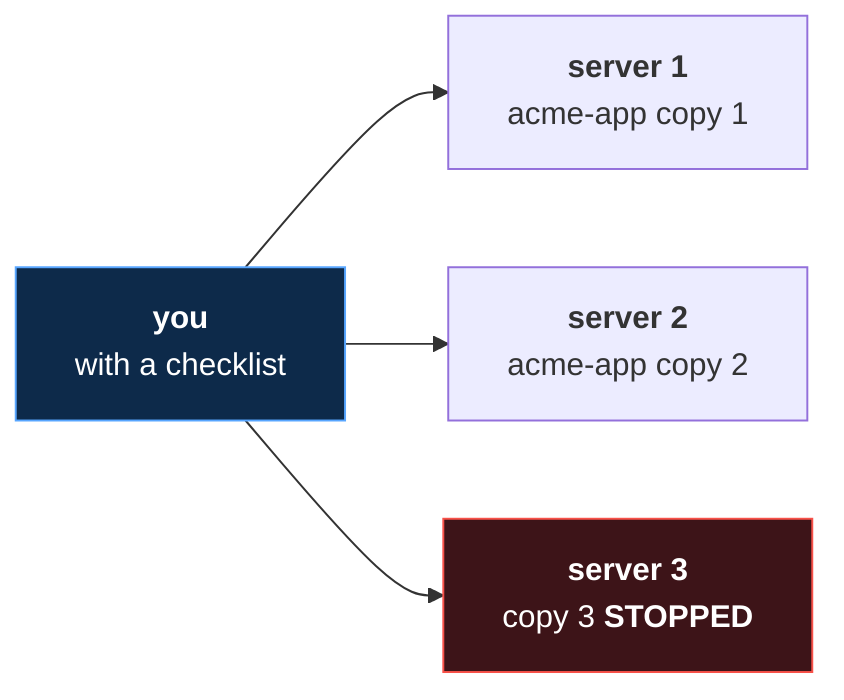
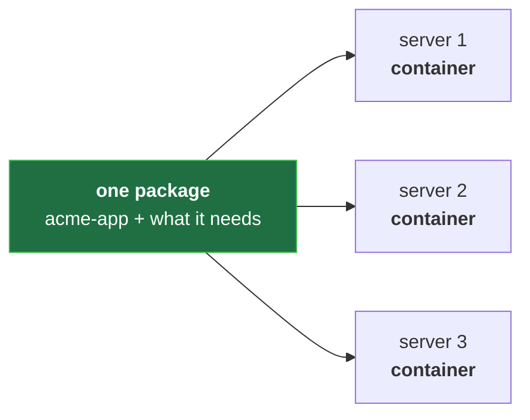
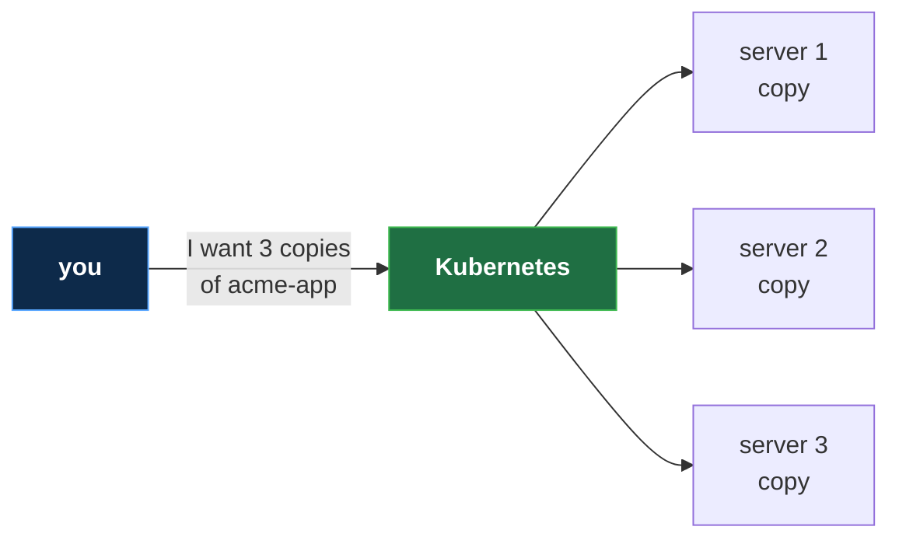
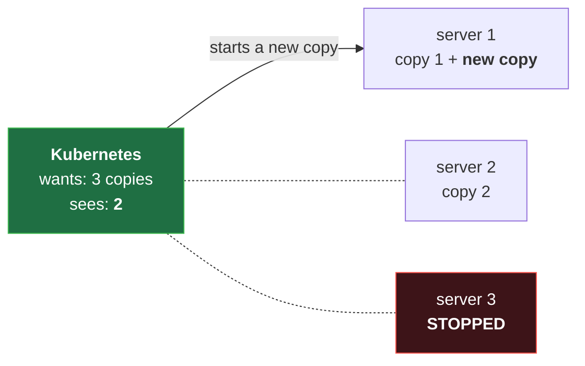

# Why Kubernetes Exists: From One Server to Many (No Experience Needed)

**Video:** coming soon on the [channel](https://www.youtube.com/@production-devops).

Your app runs on one computer, and when that computer stops, your app stops too. This first lesson of Kubernetes from Zero shows, with pictures and everyday comparisons, why Kubernetes exists: what goes wrong with one server, what gets hard by hand with many, and the simple idea behind Kubernetes: you say what you want, and it keeps it true. No terminal, nothing to install, no experience needed. Every new word is explained on screen. The challenge and its solution are in the demos repo.

## Files in this folder

- [`challenge-solution.md`](challenge-solution.md) (solution of the challenge: try it yourself first)

## What you need

A Linux shell (a VM, WSL or a container is fine). Everything runs inside this folder.

## The lesson, step by step

The same explanations as the video, with every command. Read it, then run it yourself.

Your app runs on one computer. If that computer stops, your app stops too. Today you will see the simple idea that fixes this.

For this lesson you need nothing. Just watch. No terminal, no code, and no servers of your own. About five minutes.

### The plan

This is lesson one of Kubernetes from Zero. First, one app on one computer. Then, what goes wrong. Then many computers, managed by hand. And finally, the idea behind Kubernetes.

### One server

- `server`: A computer that runs a program for others, all day long (like a restaurant kitchen: it cooks, the customers only see the food)
First word: server. A server is a computer that runs a program for others, all day. Think of a kitchen: it cooks, and customers only see the food.

**One app, one server**

Here is our example. An app called acme app runs on one server, and visitors use it.

**One server, three problems**

One server means three problems. It can break, or get too busy. And every update stops the app for a while.

### Many servers

The usual fix is more servers, each running a copy of the app. If one server breaks, the other copies keep working. But now someone has to look after all of them.

**Many servers, by hand**

That someone is you. Three servers, three copies, and copy three just stopped.

You decide which server has room for a new copy. A copy stops at three in the morning. Who starts it again? Visitors need one address, not three. And every update means every server, one by one.

### Containers

- `container`: An app packed together with everything it needs to run (like a meal kit: everything in one box, the same dish in any kitchen)
One more word: container. A container is an app packed with everything it needs. Like a meal kit, it cooks the same in any kitchen.

**Containers make copies easy**

With containers, one package runs the same on every server. Copies are easy now. Watching them is still your job.

### So far

So far: one server breaks, gets busy, and stops for updates. Many servers fix that, but by hand it is a lot of work. Next: let a program do the watching for you.

### The idea

- `Kubernetes`: A program that runs your containers on many servers, and keeps them running (like a manager of many kitchens: you order, it assigns the cooks)
That program is Kubernetes. It runs your containers on many servers, and keeps them running. Think of a manager of many kitchens.

**You say what you want**

You do not say how. You only say what you want: three copies of acme app. Kubernetes picks the servers.

**A copy stops: Kubernetes fixes it**

Then it keeps checking. It wants three copies and sees two, so it starts a new one. Nobody has to wake up.

Room for a copy? Kubernetes picks the server. A copy stops? It starts a new one. One address? It sends visitors to a working copy. An update? It replaces the copies one at a time, so the app stays up.

### Good to know

You will often see K eight s. It is short for Kubernetes: K, eight letters, then s. Kubernetes is open source: free to use, and its code is public. And be honest: for one small app on one server, you may not need it. It has many parts, so we learn them one at a time.

### Recap

Recap: one server can break, get busy, or stop for updates. With many servers by hand, you watch everything. With Kubernetes, you say what you want, and it keeps it true. Your challenge: a copy stops at night. What happens by hand, and with Kubernetes? The answer is in the demo repo.

### Where next

Where next? Lesson two: containers, in five minutes. Lesson three: a cluster, drawn step by step. Then a real cluster, on your own computer. And after this course, the Kubernetes Path.

Next lesson: containers in five minutes, the boxes that Kubernetes runs. Subscribe so you do not miss it.

## Challenge

Your challenge: a copy stops at night. What happens by hand, and with Kubernetes? The answer is in the demo repo.

When you have tried: [`challenge-solution.md`](challenge-solution.md).

---

From the [ProductionDevOps](https://www.youtube.com/@production-devops) channel: real-world DevOps and SRE, explained with real commands.
