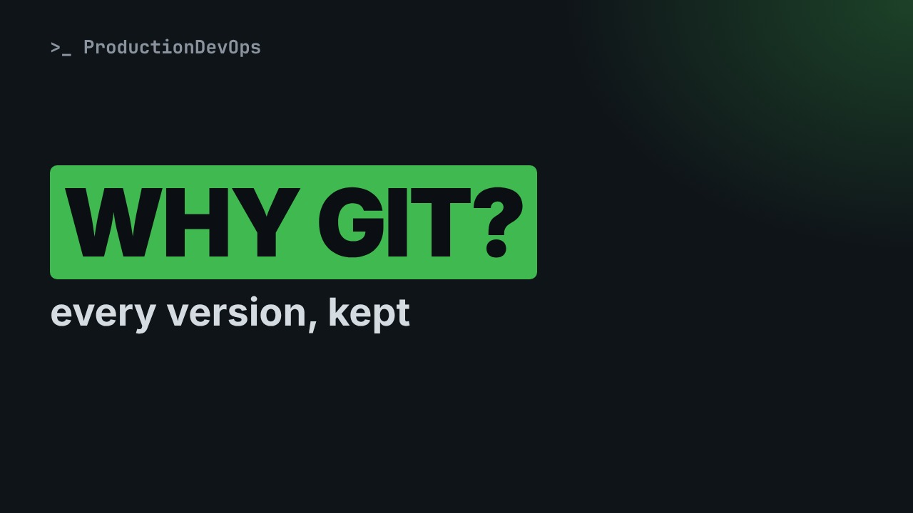
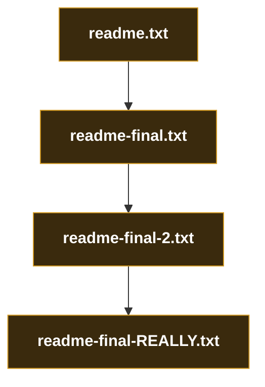
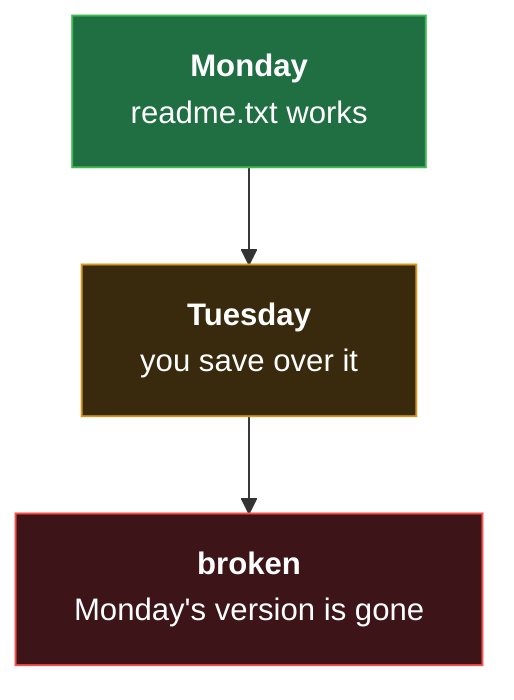
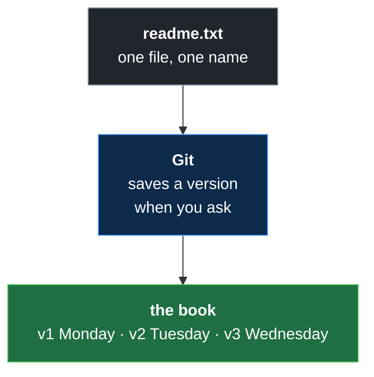
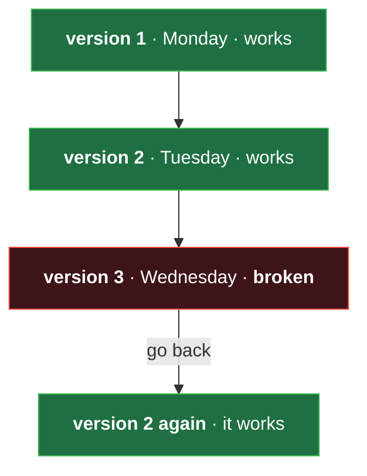

# Why Save Versions? The Problem Git Solves (Git from Zero, No Experience Needed)

**Video:** coming soon on the [channel](https://www.youtube.com/@production-devops).

readme-final.txt, readme-final-2.txt, readme-final-REALLY.txt. Copies with new names get lost and overwritten. This first lesson of Git and GitHub from Zero shows, with pictures and one recipe-book comparison, the problem Git solves: every version kept, with who, when and why, and going back to yesterday in one step. No terminal, nothing to install, no experience needed. Every new word is explained on screen. The challenge and its solution are in the demos repo.

## Files in this folder

- [`challenge-solution.md`](challenge-solution.md) (solution of the challenge: try it yourself first)

## What you need

A Linux shell (a VM, WSL or a container is fine). Everything runs inside this folder.

## The lesson, step by step

The same explanations as the video, with every command. Read it, then run it yourself.

You change a file, it breaks, and yesterday's version is gone. At the end, you will see how to get yesterday back, in one step.

For this lesson you need nothing. Just watch. No terminal today. Only pictures. About five minutes.

### The plan

This is lesson one of Git and GitHub from Zero. First, the copies problem. Then, what we really want. Then the answer: version control, and a tool called Git. And going back to yesterday.

### The problem

**The copies problem**

Here is the usual way. Every change makes a new copy, with a new name. Soon, nobody knows which one is right.

Which copy is the latest? The name does not tell you. What changed between two copies? You have to compare them by eye. Who changed it, and why? Nobody wrote it down. And two people change the same file. Whose copy wins?

**Saving over the file**

The other way is worse. You save over the file. Tuesday's change breaks it, and Monday's version is gone for good.

### What we want

So what do we really want? Every version kept, and never lost. A note on each version: who, when, and why. Going back to an old version, in one step. And one file name, not ten copies.

### The answer

- `version control — A tool that keeps every version of your files, with who and why (like a recipe book that keeps every version, dated and signed)`: 
The answer has a name: version control. It keeps every version of your files, with who and why. Like a recipe book that keeps every version.

- `Git — The most used version control tool. Free, and it runs on your computer. (like the bookkeeper who files every version in the book)`: 
New word: Git. It is the most used version control tool. It is free, and it runs on your computer.

**One file, many versions**

With Git, there is one file, with one name. When you ask, Git saves a version. It keeps them all in a book, one page each.

Each saved version gets a note. Who: the author. When: the date and time. Why: a short message, written by you.

### So far

So far: copies with new names are messy, and risky. Version control keeps every version, with a note. Next: going back to yesterday, in one step.

### Going back

**Version 3 broke it**

Here is the payoff. Version three broke the app. Git puts version two back in one step, and it works again.

And nothing is lost. Version three stays in the book. Its note says what changed, so you know where to look. You fix it calmly, then save version four.

### Where Git is

Where will you meet Git? In the code of almost every app. In server settings, and config files. In notes and scripts. In fact, in any text you care about. And in this channel's demo files, too.

### The course

Here is the course. Lesson two: the words you need, drawn. Lessons three to six: one command each, in a real terminal. Lesson seven: branches. Lessons eight and nine: GitHub, and pull requests.

### Good to know

Good to know. Git is free and open source. Git works offline, on your own computer. GitHub is a website for sharing your work. That is lesson eight.

### Recap

Recap: copies with new names get lost, and overwritten. Version control keeps every version: who, when, and why. Going back is one step, and nothing is lost. Your challenge: report v2, or report final. Which one is newer, and how do you know? The answer is in the demo repo.

### Where next

Where next? Lesson two: repository, commit, and history. Three words, drawn, before your first command.

Next lesson: repository, commit, and history, drawn. Subscribe so you do not miss it.

## Challenge

Your challenge: report v2, or report final. Which one is newer, and how do you know? The answer is in the demo repo.

When you have tried: [`challenge-solution.md`](challenge-solution.md).

---

From the [ProductionDevOps](https://www.youtube.com/@production-devops) channel: real-world DevOps and SRE, explained with real commands.
