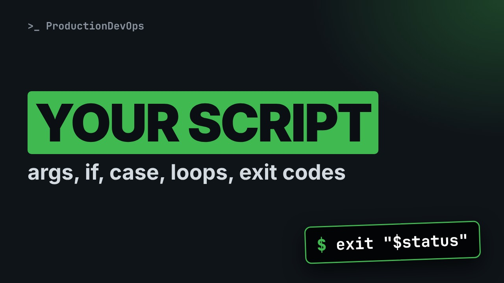

# Writing Shell Scripts: Arguments, if, case, Loops, Functions and Exit Codes



**Video:** coming soon on the [channel](https://www.youtube.com/@production-devops).

You keep typing the same five commands, so you put them in a file, and the first time someone runs it wrong, it says nothing useful. In lesson 14 we write one small bash script that checks acme-app logs and read it as it grows: the shebang, arguments ($1, $#, "$@"), variables, test and if, case, shift, a for loop, a function, and exit codes that monitoring and other scripts can trust. Shown whole, block by block, whole again, then run. Up to date for RHEL/AlmaLinux 9 and Ubuntu 24.04. Lesson 14 of Linux from User to Server Admin.

## Files in this folder

- [`app.log`](app.log)
- [`check-logs.sh`](check-logs.sh)
- [`web.log`](web.log)
- [`challenge-solution.sh`](challenge-solution.sh) (solution of the challenge: try it yourself first)

## What you need

A Linux shell (a VM, WSL or a container is fine). Everything runs inside this folder.

## The lesson, step by step

The same explanations as the video, with every command. Read it, then run it yourself.

You keep typing the same commands, so you put them in a file. Then someone runs it wrong, and it says nothing useful. Today we write a small script that checks its input, and answers with an exit code a machine can trust.

### The plan

This is lesson 14 of Linux from User to Server Admin. First, test, if and exit codes, live. Then one script, whole, then block by block. Arguments, case, a function and a loop. Then we run it, and read its exit code.

### test and if

Does app dot log exist? Square brackets run test, and dash f asks: is this a file? Nothing is printed.

```console
$ [ -f app.log ]
```

The answer is in the exit code, dollar question mark: zero means yes, true.

```console
$ echo $?
```

A file that does not exist.

```console
$ [ -f nope.log ]
```

One: no, false. In the shell, zero is success, anything else a failure.

```console
$ echo $?
```

```console
$ if [ -f app.log ]; then echo "found"; fi
```

- `if`: run the next command, check its exit code
if runs the command that follows, and looks at its exit code.

- `[ -f app.log ]`: the test: 0 or 1
Here, the test: zero or one. The spaces inside the brackets are required.

- `; then`: exit code 0: do this
then: if the exit code was zero, run this part.

- `echo "found";`: the action
The action.

- `fi`: end of the if
And f i, if backwards, closes it.

### The script

Here is the whole script. Do not read it yet: it grew in four blocks, and we take them one at a time.

```
#!/usr/bin/env bash
# check-logs.sh: count the ERROR or WARN lines in acme-app logs
# exit codes: 0 = none found, 1 = found, 2 = wrong usage

usage() {
  echo "usage: $0 error|warn FILE..." >&2
  exit 2
}

case "$1" in
  error) word="ERROR" ;;
  warn)  word="WARN" ;;
  *)     usage ;;
esac
shift
if [ $# -eq 0 ]; then
  usage
fi

status=0
for file in "$@"; do
  count=$(grep -c "$word" "$file")
  echo "$file: $count $word line(s)"
  if [ "$count" -gt 0 ]; then
    status=1
  fi
done
exit "$status"
```

One: who runs it, and what it promises. Two: a function that explains the usage. Three: read the arguments. Four: the work, and the exit code.

```
#!/usr/bin/env bash
# check-logs.sh: count the ERROR or WARN lines in acme-app logs
# exit codes: 0 = none found, 1 = found, 2 = wrong usage
```

The shebang, hash and exclamation mark: the program that runs this file. env finds bash in the PATH. Comments, after a hash: what it does, and what its exit codes mean. Write them first.

```
usage() {
  echo "usage: $0 error|warn FILE..." >&2
  exit 2
}
```

A function: a name, brackets, and the body in braces. It runs only when called by its name. Dollar zero is the script's own name. Greater than, ampersand, two sends the message to stderr, the error stream. exit two ends the whole script, with code two: wrong usage.

```
case "$1" in
  error) word="ERROR" ;;
  warn)  word="WARN" ;;
  *)     usage ;;
esac
shift
if [ $# -eq 0 ]; then
  usage
fi
```

Dollar one is the first argument. case compares it with patterns, and esac, case backwards, ends it. error or warn set the variable word. Anything else, star, calls usage. Piece by piece next. shift drops the first argument. Dollar two becomes dollar one: only the files are left. Dollar hash is the number of arguments left. Zero files? Usage, and exit two.

```console
$ error) word="ERROR" ;;
```

- `error)`: pattern: the word error
The pattern, then a closing bracket: matches when the argument is error.

- `word="ERROR"`: set a variable: no spaces around =
Then the commands: set the variable word. No spaces around the equals sign.

- `;;`: end of this branch
Two semicolons end the branch. Only the first matching pattern runs.

```
status=0
for file in "$@"; do
  count=$(grep -c "$word" "$file")
  echo "$file: $count $word line(s)"
  if [ "$count" -gt 0 ]; then
    status=1
  fi
done
exit "$status"
```

status starts at zero: nothing found yet. for walks a list: quoted dollar at is every argument left, one per round, in the variable file. Count the matching lines, and print the result. The count line, piece by piece next. dash g t: greater than, for numbers. Anything found sets status to one. The last line: exit with the status. That number is the script's answer.

```console
$ count=$(grep -c "$word" "$file")
```

- `count=`: store into the variable count
Store into the variable count...

- `$(`: run this, keep its output
...the output of the command in dollar brackets.

- `grep -c`: count the matching lines
grep dash c counts matching lines, lesson 11.

- `"$word" "$file")`: quoted: safe with spaces
Both variables in double quotes: a name with a space stays one argument.

Let's take stock. Arguments, shift, case and a function read the input. for runs once per item. Its cousin, while, repeats as long as a test returns zero. Next: we run it, and read the exit code.

### Run it

The whole script again. Now every line has a job you know.

```
#!/usr/bin/env bash
# check-logs.sh: count the ERROR or WARN lines in acme-app logs
# exit codes: 0 = none found, 1 = found, 2 = wrong usage

usage() {
  echo "usage: $0 error|warn FILE..." >&2
  exit 2
}

case "$1" in
  error) word="ERROR" ;;
  warn)  word="WARN" ;;
  *)     usage ;;
esac
shift
if [ $# -eq 0 ]; then
  usage
fi

status=0
for file in "$@"; do
  count=$(grep -c "$word" "$file")
  echo "$file: $count $word line(s)"
  if [ "$count" -gt 0 ]; then
    status=1
  fi
done
exit "$status"
```

Run it with no arguments, and print the exit code after it: the usage message, and two.

```console
$ ./check-logs.sh; echo "exit code: $?"
```

Errors in two logs: two in app dot log, none in web dot log. Exit code one: found.

```console
$ ./check-logs.sh error app.log web.log; echo "exit code: $?"
```

Warnings in web dot log: zero lines, exit code zero.

```console
$ ./check-logs.sh warn web.log; echo "exit code: $?"
```

And because the answer is an exit code, if can use it: the same pattern as with test.

```console
$ if ./check-logs.sh error web.log; then echo "web is clean"; fi
```

### Gotchas

Four traps to remember. One. Brackets need spaces inside, or the shell sees a different command. Two. Dash e q and friends compare numbers. Equals compares text. Three. Quote your variables, or a name with a space becomes two. Four. Permission denied? chmod plus x, or run it with bash.

### Recap

Let's recap. A shebang, a comment with the promise, a usage function. case and shift read the arguments, test and if decide. And exit codes that tell the caller what happened. Your challenge: run it on a file that does not exist, see what goes wrong, and add a test with dash f that stops with exit two. The solution is in the demo repository.

Now you can write a script that reads its arguments, checks them, and answers with an exit code. Next lesson: the one line that stops a script at the first error. Subscribe to follow the course.

## All the commands, to copy

Run them from inside this folder, in this order (some are expected to fail: that is the point of the demo).

```bash
[ -f app.log ]
echo $?
[ -f nope.log ]
if [ -f app.log ]; then echo "found"; fi
error) word="ERROR" ;;
count=$(grep -c "$word" "$file")
./check-logs.sh; echo "exit code: $?"
./check-logs.sh error app.log web.log; echo "exit code: $?"
./check-logs.sh warn web.log; echo "exit code: $?"
if ./check-logs.sh error web.log; then echo "web is clean"; fi
```

## Challenge

Your challenge: run it on a file that does not exist, see what goes wrong, and add a test with dash f that stops with exit two. The solution is in the demo repository.

When you have tried: [`challenge-solution.sh`](challenge-solution.sh).

---

From the [ProductionDevOps](https://www.youtube.com/@production-devops) channel: real-world DevOps and SRE, explained with real commands.
