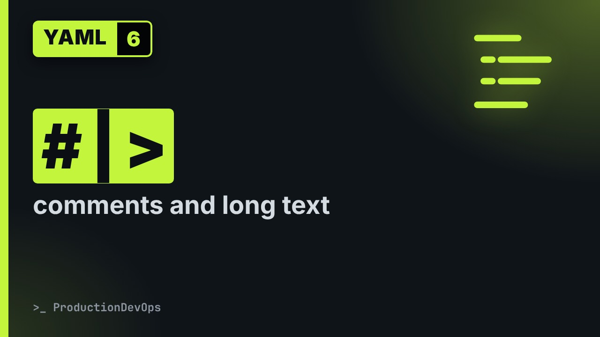

# YAML Comments and Multi-line Text: # | and › (YAML from Zero, No Experience Needed)



**Video:** https://youtu.be/PyhwXlLBxio

Some lines of a YAML file are not for the program at all, and some values are too long for one line. This lesson of YAML from Zero shows comments, the notes for people after a hash sign, and how to switch a setting off without deleting it. Then the hash sign that silently empties a value, and the two ways to write long text: the bar keeps every line, the greater-than sign folds them into one. For each one you see exactly what the program reads. No terminal, nothing to install, no experience needed. Every new word is explained on screen. The files, the challenge and its solution are in the demos repo.

## Files in this folder

- [`challenge.yaml`](challenge.yaml)
- [`chat.yaml`](chat.yaml)
- [`commented.yaml`](commented.yaml)
- [`message.yaml`](message.yaml)
- [`note.yaml`](note.yaml)
- [`switched-off.yaml`](switched-off.yaml)
- [`challenge-solution.md`](challenge-solution.md) (solution of the challenge: try it yourself first)

## What you need

A Linux shell (a VM, WSL or a container is fine). Everything runs inside this folder.

## The lesson, step by step

The same explanations as the video, with every command. Read it, then run it yourself.

Some lines of a YAML file are not for the program at all. Some values need many lines. And one hash sign can silently empty a value.

For this lesson you need nothing. Just watch. No terminal today, only small text files. About five minutes.

### The plan

This is lesson six of YAML from Zero. First, comments: notes for people. Then, the hash sign that empties a value. Then, long text that keeps its lines. And long text folded into one line.

### Comments

- `comment — A note for people, after a # sign: the program skips it (like a pencil note in the margin of a form)`: 
First word: comment. A comment is a note for people, after a hash sign. The program skips it, like a pencil note in the margin.

```
# acme-app settings, for the lab
app: acme-app
port: 8080  # the door number
replicas: 3
```

Line one starts with a hash sign. The whole line is a note. Line three has a note at the end. After the value: spaces, then the hash sign. The program reads three settings: app, port and replicas. The notes are skipped.

```
app: acme-app
port: 8080
# debug: true
```

Comments have a second use. Here, app and port are normal settings. A hash in front of debug turns that line into a note. The setting is off, but not deleted. Engineers call this commenting out. Remove the hash, and the setting is back.

### The hash trap

```
team: ops
channel: #ops
```

Our team is called ops. The chat channel should be hash ops. But a space then a hash starts a comment. So channel has no value at all. Empty. And there is no error.

The fix is quotes, from lesson five. In quotes, the hash is just text. Remember the rule: a hash sign in a value needs quotes.

### So far

So far: a hash sign starts a note for people. The program skips it. A hash inside a value needs quotes. Next: text that is too long for one line.

### Keep the lines

- `multi-line text — A value that runs over several lines (like the big "Comments" box at the bottom of a form)`: 
New word: multi-line text. It is a value that runs over several lines. Like the big box at the bottom of a form.

```
message: |
  Welcome to acme-app.
  Maintenance on Sunday.
```

After the colon, a vertical bar. It says: the text starts on the next line. Keep every line. The text lines are indented, so they belong to message. The text ends where the indent ends.

```
Welcome to acme-app.
Maintenance on Sunday.
```

The program gets two lines, exactly as written. Without the spaces in front.

### Fold the lines

```
note: >
  This text is long,
  so we wrap it here,
  but it is one line.
```

Now a greater-than sign. It says: fold the lines into one. In the file, three short lines, easy to read on screen.

```
This text is long, so we wrap it here, but it is one line.
```

The program gets one line. Each line break became a space.

Bar or greater-than? The bar keeps the lines. Use it for messages and commands. Greater-than folds them. Use it for one long sentence, wrapped for people. Both need the text indented under its key.

### Good to know

Inside a bar or greater-than block, a hash sign is just text, not a comment. Three dashes on their own line mean: a new document starts. So one file can hold many documents. Kubernetes files often do.

```
# lab settings
app: acme-app  # our app
message: >
  Hello
  from the lab.
```

Your challenge. What does the program read here? And what is the exact value of message?

### Recap

Recap: a hash sign starts a note, or switches a setting off. A hash in a value needs quotes. The bar keeps the lines. The greater-than sign folds them into one. Your challenge: the exact value of message. The answer is in the demo repo.

### Where next

Where next? Lesson seven: common mistakes, and how to spot them. With a tool that checks your file for you.

Next lesson: common YAML mistakes, and how to spot them. Subscribe so you do not miss it.

## Challenge

Your challenge: the exact value of message. The answer is in the demo repo.

When you have tried: [`challenge-solution.md`](challenge-solution.md).

---

From the [ProductionDevOps](https://www.youtube.com/@production-devops) channel: real-world DevOps and SRE, explained with real commands.
