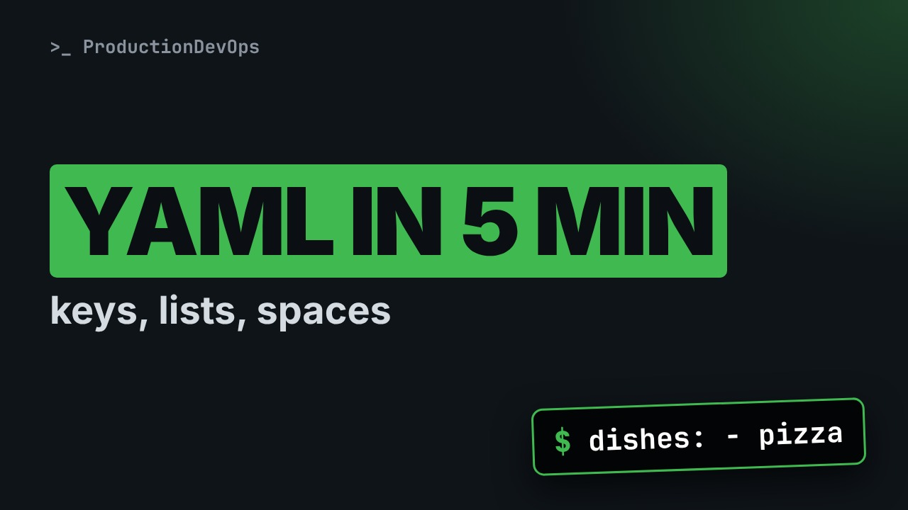
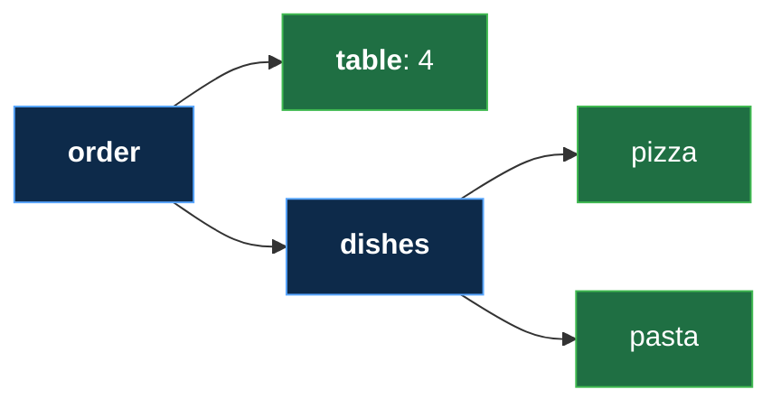

# YAML for Ansible in Five Minutes: Keys, Lists and Spaces (No Experience Needed)



**Video:** https://youtu.be/SvjDtckCUU8

Every Ansible file is written in YAML, and one wrong space can break it. This lesson of Ansible from Zero teaches just enough YAML to read a playbook: a key and a value, lists with a dash, and the spaces at the start of a line that say what belongs to what. Then we find the one space that breaks a file, and read the start of a real Ansible playbook with these three rules. No terminal, nothing to install, no experience needed. Every new word is explained on screen. The files, the challenge and its solution are in the demos repo.

## Files in this folder

- [`order.yml`](order.yml)
- [`challenge-solution.md`](challenge-solution.md) (solution of the challenge: try it yourself first)

## What you need

A Linux shell (a VM, WSL or a container is fine). Everything runs inside this folder.

## The lesson, step by step

The same explanations as the video, with every command. Read it, then run it yourself.

Every Ansible file is written in YAML. It looks like plain text, but one wrong space can break it. Today: three rules, and that one space.

For this lesson you need nothing. Just watch. No terminal today, only small text files. About five minutes.

### The plan

This is lesson three of Ansible from Zero. First, a key and a value. Then lists, with a dash. Then the spaces at the start of a line. And finally, a real Ansible file, read with these three rules.

### YAML

- `YAML`: A text format for settings: keys, values and lists (like an order form: each line is one field, filled in)
First word: YAML. It is a text format for settings, easy for people and programs to read. Think of an order form.

### Key and value

- `key`: The label before the colon; the value comes after it (like a field on the form: "Table:" and then "4")
Each line has a key and a value. The key is the label before the colon. Like a field on a form: table, and then four.

```
table: 4
dish: pizza
paid: true
```

Here is a tiny file. The key is table, then a colon, then a space, then the value: four. A value can be a word. The dish is pizza. And true or false is a yes or no value. This order is paid.

With the space, table is the key and four is the value. Without the space, YAML sees no key at all. Just the text: table colon four. So always put a space after the colon.

### Lists

- `list`: Several values, one per line, each after a dash (like a shopping list: one item per line)
Second rule, the list. A list is several values, one per line, each after a dash. Like a shopping list.

```
dishes:
  - pizza
  - pasta
  - salad
```

The key dishes has nothing after its colon. So its value comes on the next lines. Each dash starts one item of the list. Three dishes: pizza, pasta and salad.

### Spaces

- `indentation`: Spaces at the start of a line: they show what belongs to what (like a sub-item on a to-do list, pushed to the right)
Third rule: indentation. It means spaces at the start of a line. They show what belongs to what, like a sub-item on a to-do list.

```
order:
  table: 4
  dishes:
    - pizza
    - pasta
```

Here is a whole order. The key order has nothing after the colon: a group starts. Two spaces in: table and dishes both belong to the order. Four spaces in: pizza and pasta belong to dishes.

**The same file, as a picture**



This is what YAML reads from those spaces. An order, with a table and a list of dishes.

### So far

So far, three rules. Key, colon, space, value. A dash starts one item of a list. Spaces at the start mean: it belongs to the line above. Next: the one space that breaks a file.

### One space

```
order:
  table: 4
 dishes:
    - pizza
    - pasta
```

Look at line three. Dishes has one space, not two. Does dishes belong to order or not? YAML cannot tell. It stops with an error. Ansible refuses to run a broken file. So line up your spaces, and never use the tab key.

### A real file

- `comment`: A note for people, after a # sign; programs skip it (like a pencil note in the margin of a recipe)
One last word: comment. A comment is a note for people, after a hash sign. Programs skip it, like a pencil note on a recipe.

Here is the start of the Ansible file from lesson seven. Do not read the words yet. Look at the shapes.

```
# Lesson 7: our first playbook
- name: Prepare acme-app
  hosts: web
  gather_facts: false
  tasks:
    - name: Create the app folder
      ansible.builtin.file:
        path: /tmp/acme-app
        state: directory
```

Line one is a comment, a note for us. Line two starts with a dash. So this file is a list, and here is its first item. And tasks is a list of its own, with one item, four spaces deeper.

```
- name: Prepare acme-app
  hosts: web
  gather_facts: false
  tasks:
```

Rule one: key, colon, space, value. The name is prepare acme app. Hosts is web. Gather facts is false, a yes or no value. Lesson seven explains what it means. Rule three: tasks has nothing after its colon. Its value is the indented lines below.

All together. A comment, a list with one item, and inside it, a list of tasks. You can already read its shape.

```
# Lesson 7: our first playbook
- name: Prepare acme-app
  hosts: web
  gather_facts: false
  tasks:
    - name: Create the app folder
      ansible.builtin.file:
        path: /tmp/acme-app
        state: directory
```

### Recap

Recap: key, colon, space, value. A dash starts a list item. Spaces at the start say what belongs where. Never tabs. Your challenge: add salad to the order file. How many spaces go before the dash? The answer is in the demo repo.

### Where next

Where next? Lesson four: the list of servers, called the inventory. You will type your first command, on two practice servers.

Next lesson: your inventory, the list of servers. Subscribe so you do not miss it.

## Challenge

Your challenge: add salad to the order file. How many spaces go before the dash? The answer is in the demo repo.

When you have tried: [`challenge-solution.md`](challenge-solution.md).

---

From the [ProductionDevOps](https://www.youtube.com/@production-devops) channel: real-world DevOps and SRE, explained with real commands.
