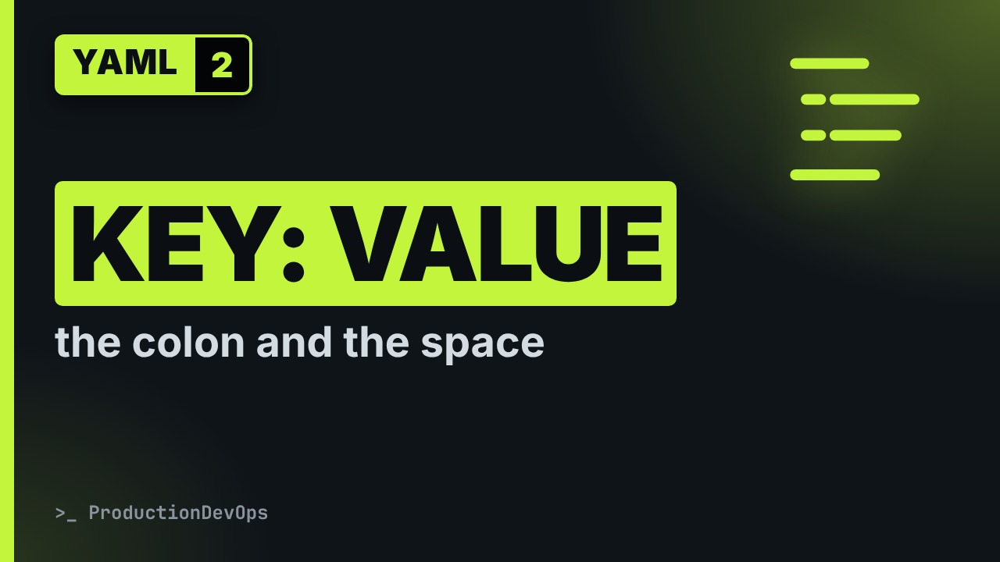
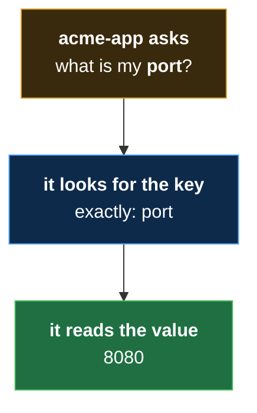

# YAML Keys and Values: the Colon and the Space (YAML from Zero, No Experience Needed)



**Video:** https://youtu.be/gpP7KMUjj04

Almost every line of a YAML file is a key and a value, and one missing space can break the whole file. This lesson of YAML from Zero takes one line apart, piece by piece: the key, the colon, the space and the value. Then we read a small config file line by line, see what a program does with it, find the space that breaks it, and learn why Port and port are two different keys. No terminal, nothing to install, no experience needed. Every new word is explained on screen. The files, the challenge and its solution are in the demos repo.

## Files in this folder

- [`acme-app.yaml`](acme-app.yaml)
- [`challenge.yaml`](challenge.yaml)
- [`challenge-solution.md`](challenge-solution.md) (solution of the challenge: try it yourself first)

## What you need

A Linux shell (a VM, WSL or a container is fine). Everything runs inside this folder.

## The lesson, step by step

The same explanations as the video, with every command. Read it, then run it yourself.

Almost every line of a YAML file is a name and a value. One missing space can break the whole file. Today you will see which space.

For this lesson you need nothing. Just watch. No terminal today, only small text files. About five minutes.

### The plan

This is lesson two of YAML from Zero. First, a key and a value. Then, one line, piece by piece. Then, the space that breaks a file. And how a program finds a setting.

### Key and value

- `key — The name of a setting, written before the colon (like the label of a field on a form: "Nights:")`: 
First word: key. A key is the name of a setting, written before the colon. Like the label of a field on a form.

- `value — What the setting is set to, written after the colon (like what you write in the field: "3")`: 
Second word: value. The value is what the setting is set to. Like what you write in the field on the form.

```console
$ port: 8080
```

Here is one line of YAML. It has three pieces.

- `port`: the key: the setting's name
First, the key. The name of the setting is port.

- `: `: a colon, then one space
Then a colon, and right after it, one space. Both are needed.

- `8080`: the value
Then the value: eight zero eight zero.

```
app: acme-app
port: 8080
replicas: 3
debug: false
```

Here is the config file of acme app. Line one: the key app, the value acme app. Line two: the key port, the value eight zero eight zero. Line three: three replicas, so three copies. Line four: debug is false, so no extra messages.

### The space

- `error — The program cannot read the file, so it stops (like a form the hotel desk cannot read: it comes back to you)`: 
Now the space. Without it, you get an error: the program cannot read the file, so it stops. Like a form the desk cannot read.

```
app: acme-app
port:8080
replicas: 3
```

Look at line two. There is no space after the colon. Without the space, YAML sees no key here. Just the text port colon eight zero eight zero. Text alone, among keys and values, does not fit. The program stops with an error.

With the space, port is the key and eight zero eight zero is the value. Without the space, there is no key. Just one piece of text. So here is the rule. Always put one space after the colon.

### So far

So far: a line is a key, a colon, a space, and a value. With no space after the colon, the file breaks. Next: how a program finds its setting. And why one capital letter matters.

### Finding a setting

**How a program finds a setting**



When acme app needs its port, it looks for the key port. Exactly that word. Then it reads the value.

```
app: acme-app
Port: 8080
```

Here the key is Port, with a capital P. For YAML, Port and port are two different keys. Capital letters count. Acme app looks for port and does not find it. It may use a default, or stop.

Rules for keys. Write each key exactly as the program expects. The program chooses the key names, not you. Its guide lists them. Write each key only once in the same group. Lesson seven shows why.

### Good to know

A value can hold spaces. The owner is ops team. But a colon followed by a space, inside a value, confuses YAML. Put that value in quotes, and it stays one value. Lesson five is about quotes.

### All together

All together: four keys, four values. A colon and a space on every line, and every key spelled exactly.

```
app: acme-app
port: 8080
replicas: 3
debug: false
```

```
app: acme-app
Port: 8080
replicas:3
```

Your challenge. This file has two mistakes. Can you find both?

### Recap

Recap: the key is the name, and the value is what it is set to. Always one space after the colon. Keys must match exactly. Capital letters count. Your challenge: find the two mistakes in the challenge file. The answer is in the demo repo.

### Where next

Where next? Lesson three: lists, with one item per dash. A key with many values.

Next lesson: lists. Subscribe so you do not miss it.

## Challenge

Your challenge: find the two mistakes in the challenge file. The answer is in the demo repo.

When you have tried: [`challenge-solution.md`](challenge-solution.md).

---

From the [ProductionDevOps](https://www.youtube.com/@production-devops) channel: real-world DevOps and SRE, explained with real commands.
