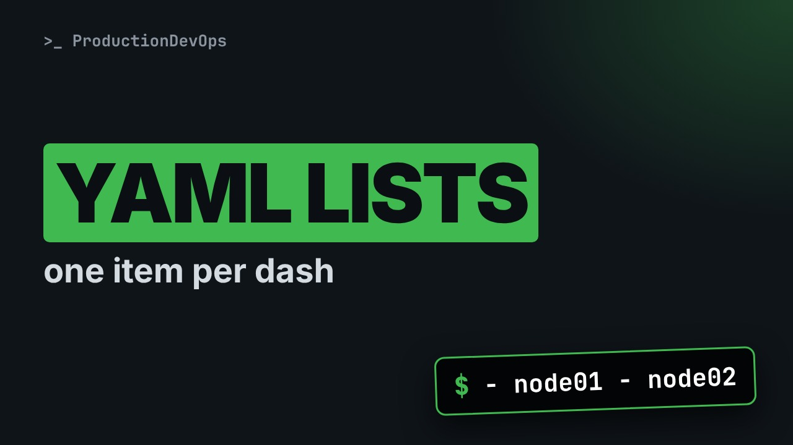
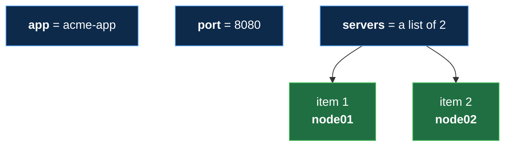

# YAML Lists: One Item per Dash (YAML from Zero, No Experience Needed)



**Video:** coming soon on the [channel](https://www.youtube.com/@production-devops).

One setting, many values: a list of servers, a list of ports. This lesson of YAML from Zero shows how YAML writes a list: a key with nothing after the colon, then one item per line, each after a dash and a space. We read a list piece by piece, see what the program gets, find the missing space that turns your list into one long piece of text without any error, and write the same list on one line, in square brackets. No terminal, nothing to install, no experience needed. Every new word is explained on screen. The files, the challenge and its solution are in the demos repo.

## Files in this folder

- [`acme-app.yaml`](acme-app.yaml)
- [`challenge.yaml`](challenge.yaml)
- [`shopping.yaml`](shopping.yaml)
- [`challenge-solution.md`](challenge-solution.md) (solution of the challenge: try it yourself first)

## What you need

A Linux shell (a VM, WSL or a container is fine). Everything runs inside this folder.

## The lesson, step by step

The same explanations as the video, with every command. Read it, then run it yourself.

One setting, many values: a list of servers, a list of ports. Today, lists. And one missing space that ruins a list, without any error.

For this lesson you need nothing. Just watch. No terminal today, only small text files. About five minutes.

### The plan

This is lesson three of YAML from Zero. First, what a list is. Then, the dash and the space. Then, a list in the config file of acme app. And the same list, written on one line.

### Lists

- `list — Several values for one key, one per line, each after a dash (like a shopping list: one item per line)`: 
New word: list. A list holds several values for one key, one per line, each after a dash. Like a shopping list.

```
shopping:
  - milk
  - bread
  - eggs
```

The key is shopping. Nothing comes after the colon. So the value is on the next lines. A dash starts one item. The first item is milk. Then bread, then eggs. Three items in one list. A list keeps its order. First milk, then bread, then eggs.

```console
$   - node01
```

Now one line of a list, piece by piece.

- `  `: two spaces: it belongs to the key above
First, two spaces. They push the item under its key. Lesson four is all about these spaces.

- `- `: a dash, then one space
Then a dash, and one space. Together they say: here starts one item.

- `node01`: the item
Then the item itself: node zero one, the name of a server.

### A real list

```
app: acme-app
port: 8080
servers:
  - node01
  - node02
```

Here is acme app's config file. The first two lines are keys and values, from lesson two. Then the key servers, with nothing after the colon. A list follows. Two items: the servers node zero one and node zero two. Acme app runs on both.

**What the program gets**



Here is what acme app reads. App and port have one value each. Servers has a list of two values, in order.

### So far

So far: a list is one key with many values. Each item is a dash, a space, and the value. Next: the missing space that ruins a list, without any error.

### One space

```
servers:
  -node01
  -node02
```

Look closely. There is no space after the dashes. Without the space, a dash is just a letter. So these lines are text, not items. YAML joins the two lines into one text: dash node zero one, dash node zero two.

You wanted a list of two servers. The program gets one piece of text instead. And YAML gives no error. You find out later, when the program misbehaves. So the rule: always a space after the dash.

### One line

```
servers: [node01, node02]
```

A list can also fit on one line. Square brackets hold the items. A comma separates the items. It is the same list, in the same order.

Two ways, one list. Dashes, one per line, are easy to read, even for long lists. Square brackets on one line suit short lists. And two brackets with nothing inside mean an empty list.

### Good to know

Some files put the dashes right under the key, with no spaces in front. That is valid too. Pick one style, and keep it in the whole file. An item can also be a group of keys. That is lesson four.

### All together

All together: two keys with one value each, and a list of two servers. Every dash is followed by a space.

```
app: acme-app
port: 8080
servers:
  - node01
  - node02
```

### Recap

Recap: a list is a key, then one item per line. Each item starts with a dash and a space. The short form uses square brackets and commas. Your challenge: write this list of two ports with dashes, one per line. The answer is in the demo repo.

### Where next

Where next? Lesson four: nesting, groups inside groups. And why the spaces at the start of a line matter so much.

Next lesson: nesting, and why spaces matter. Subscribe so you do not miss it.

## All the commands, to copy

Run them from inside this folder, in this order (some are expected to fail: that is the point of the demo).

```bash
  - node01
```

## Challenge

Your challenge: write this list of two ports with dashes, one per line. The answer is in the demo repo.

When you have tried: [`challenge-solution.md`](challenge-solution.md).

---

From the [ProductionDevOps](https://www.youtube.com/@production-devops) channel: real-world DevOps and SRE, explained with real commands.
